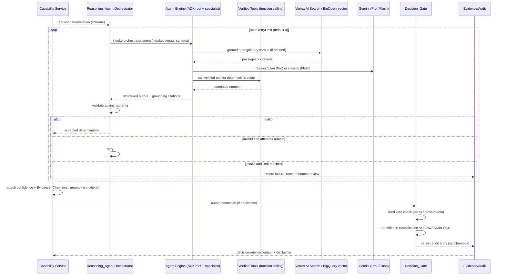

# Design Document

## Overview

TerraVow is an AI-powered environmental compliance, remediation-advisory, and certification platform for manufacturing supply chains. Its tagline is "Enforce. Certify. Track." The platform rests on a single thesis: machine degradation is an invisible, unpriced emissions event that propagates through supply chains, and every deferred-maintenance decision is therefore an undeclared emissions decision.

The system links machine health state to emissions intensity (EID), prices the resulting compounding liability (ERD), monitors air and water pollution with a cross-media displacement guardrail, measures harm caused by emission *timing* (AEI), synthesises substitution counterfactuals, reasons over real Indian regulatory and incentive instruments to produce cited drafts, propagates a machine-health-adjusted footprint across supply-chain tiers (Embedded Pollution Passport), gates every recommendation through a confidence-bounded ALLOW/ASK/BLOCK Decision_Gate with a hard veto against increasing harm, and certifies facilities on verified improvement *trajectory* into a public registry.

Two design principles dominate this document:

1. **Every produced number is a counterfactual or an interpretation that does not exist in any database.** It is reasoned by a Gemini Reasoning_Agent on Vertex AI, validated against a schema, and carries a machine-checkable Evidence_Chain back to a primary source. Where a value is a deterministic computation (EC formula, ERD summation, mass-preservation, net-position), it is produced by a *verified tool* the agent invokes via function calling — the model orchestrates, verified tools emit the numbers.
2. **Safety is structural, not advisory.** The Decision_Gate applies a hard veto against increasing total emission mass or cross-media load *before* confidence classification; a vetoed recommendation is BLOCK regardless of confidence. Every enrichment path degrades gracefully by lowering confidence rather than failing the determination.

**Input authenticity is itself a structural concern (Req 16).** Because every number the platform produces drives liability pricing (ERD), remediation, or certification, the data fed into it is a direct attack surface: an operator has an incentive to under-report emissions readings, forge a maintenance event to reset the ERD degraded-onset clock, or replay stale "healthy" telemetry. TerraVow therefore places an **Integrity_Gate at the ingestion boundary that runs *ahead of* PII masking (Req 13) and ahead of any reasoning or persistence.** The Integrity_Gate authenticates each record's source, checks instrument calibration and health, detects duplicates/replays and timestamp-freshness violations, verifies the acting actor is authorized, corroborates each reading against correlated signals, and emits a per-input **Data_Trust_Score in [0,1]**. That score flows downstream as a confidence *floor*: it bounds the confidence of every value derived from the record, and it bounds the Decision_Gate — a recommendation governed by sub-threshold trust is capped at **ASK** and routed to human review, never **ALLOW**. The Integrity_Gate only *adds a trust floor*; it never raises a classification and never relaxes the hard-veto-first ordering, the Evidence_Chain provenance guarantee, the synchronous audit persistence, or the masking invariant. The ingestion ordering is explicit and invariant: **Integrity_Gate → masking → reasoning / persistence.**

These principles are **invariant across the choice of platform building blocks.** This revision maximises use of managed Google Cloud AI tooling — Vertex AI Agent Builder / Agent Engine with the Agent Development Kit (ADK), Grounding with Vertex AI Search, BigQuery embeddings + vector search, Gemini function calling, Pub/Sub with BigQuery continuous queries, and a two-tier Gemini model strategy — but **no managed service relaxes a safety guarantee.** The Decision_Gate hard-veto-before-confidence ordering, Evidence_Chain provenance on every value, synchronous audit persistence, and PII/confidentiality masking *before any reasoning or persistence* remain structural. In particular, managed grounding (Vertex AI Search), Agent Engine Sessions/Memory Bank, and BigQuery vector retrieval operate **only over already-masked data**: no customer or supplier PII leaves the TerraVow boundary unmasked, and every value a managed service helps produce still carries an Evidence_Chain whose links resolve to primary sources.

Outputs that touch legal, tax, or engineering determinations are cited drafts for qualified professional review and never authoritative sign-off.

**Requirement 17 adds a second, narrower layer of defense-in-depth on top of the Req 16 Integrity_Gate.** Req 16 defends the ingestion boundary against an inauthentic, stale, replayed, unauthorized, or internally-inconsistent *record*. Req 17 defends against fraud patterns that sit outside that boundary and that a record-level gate structurally cannot see: an inflated *reference point* (the Commissioning_Baseline) set once at registration and never re-examined; a *physically-consistent* falsified reading that passes every self-consistency and cross-signal check Req 16 can run because the fraud is internally coherent; an anomaly detector whose own *expected-profile* history has been poisoned by prior low-trust admissions; and an *insider* with write access to the tamper-evident log itself, who does not need to forge a record because they control the chain. This is literature-grounded hardening — carbon-market/MRV fraud is dominated by baseline and documentation manipulation rather than live-sensor spoofing; false-data-injection-attack research shows a provable detectability ceiling for correlation/consistency-only detectors against a sufficiently informed, physically-consistent attacker, which is why an *exogenous* verification source is required rather than more self-consistency checking; continuous-emissions-monitoring practice cross-validates self-reported stack/effluent data against independent reference methods for exactly this reason; and tamper-evident logging practice anchors periodic checkpoints externally because a hash chain alone only proves *internal* consistency, not that the keeper of the chain didn't rewrite history before anyone looked. **None of the four Req 17 mechanisms — Baseline_Plausibility_Check, Independent_Verification_Source reconciliation, Trust_Weighted_Profile construction, or Anchored_Hash_Root verification — can ever raise a Decision_Gate classification or a confidence value beyond what Req 8 and Req 16.15–16.16 already allow (Req 17.16).** Each is purely additive: it can only add a downgrade, a flag, or a human-review routing on top of the existing fail-closed posture. The ingestion/registration ordering is extended but not altered in kind: **Baseline_Plausibility_Check (at registration) / Integrity_Gate + Independent_Verification_Source reconciliation (at ingestion) → masking → reasoning / persistence**, with Trust_Weighted_Profile construction and Anchored_Hash_Root verification operating as read-side and audit-side hardening over data that has already passed that pipeline.

This design is derived from the approved requirements at `.kiro/specs/terravow/requirements.md` and addresses all 17 requirements.

### Research Summary

Key findings that inform the design, grounded in the regulatory instrument structures named in the requirements:

- **Environmental Compensation (EC)** under Indian environmental regulators follows a documented formula *shape*: `base rate × days of violation × deterrence factor`, organised into per-violation-class guideline chapters. The design treats this shape as a fixed computation while the figures (base rate, deterrence factor) are retrieved from a regulatory corpus and cited. ([CPCB methodology for environmental compensation](https://cpcb.nic.in/) — content rephrased for compliance with licensing restrictions.)
- **ESCerts / PAT scheme** issues tradeable certificates under the Bureau of Energy Efficiency's Perform-Achieve-Trade mechanism to designated consumers that beat Specific Energy Consumption reduction targets. ([Bureau of Energy Efficiency — PAT scheme](https://beeindia.gov.in/) — rephrased for compliance.)
- **Income Tax Act Section 32** governs depreciation eligibility, used in the forgone-tax-depreciation ERD component. The design retrieves and cites the applicable rate rather than hard-coding it.
- **Vertex AI Gemini structured output** supports response schemas (controlled generation) so the model can be constrained to emit JSON matching a declared schema; the design pairs this with application-side re-validation and bounded retries for defense in depth. ([Google Cloud Vertex AI controlled generation](https://cloud.google.com/vertex-ai/generative-ai/docs/multimodal/control-generated-output) — rephrased for compliance.)
- **AEI (Avoidable Exposure Index)** requires an airshed assimilative-capacity forecast weighted by a Receptor_Map; this is a timing-optimisation problem over a fixed total emission mass, which drives the mass-preservation invariant in the design.
- **Data integrity is the platform's core threat model (Req 16).** A certification-and-liability platform is only as trustworthy as the data fed into it, and the dominant incentive among monitored parties is adversarial: under-reporting an emissions reading reduces priced ERD, and forging or back-dating a maintenance event resets the degraded-health-state onset that anchors ERD accrual (Req 14.6) — a direct financial-liability evasion. Standard practice for defending ingestion in regulated/metering contexts is layered: (a) **source authentication** of each record via a signed payload or an authenticated device/gateway credential; (b) **calibration validity and instrument health** gating, so readings from an expired-calibration or degraded/failed detector are down-weighted rather than trusted; (c) **replay and freshness** defence via duplicate detection and a monotonic-timestamp / freshness-bound check; (d) **tamper-evidence** on the append-only log via per-entry hashing / hash-chaining so any retroactive edit is detectable; (e) **authorized-actor** verification for maintenance records; and (f) **cross-signal corroboration/plausibility**, reconciling a reading against correlated signals (energy consumed, output quantity, redundant sensors) independently of the statistical anomaly path (Req 3.4). The design folds all six into a single ingestion-time Integrity_Gate that emits a Data_Trust_Score, and treats that score as a monotone confidence floor — mirroring the existing fallback-confidence invariant (Property 4) rather than introducing a new safety mechanism. (Reflects standard metering/data-integrity practice; no external corpus figure is invented — the Data_Trust_Score is a computed value with its own Evidence_Chain.)

Additional findings on **maximal Google Cloud AI tooling** (2026) shape this revision:

- **Vertex AI Agent Builder / Agent Engine + ADK.** Google provides a managed runtime for building and operating multi-agent systems: the Agent Development Kit (ADK) is an open framework for authoring agents and multi-agent orchestration, and Agent Engine is the managed deployment runtime offering Sessions, a Memory Bank for durable cross-session context, built-in evaluation, and sandboxed Code Execution. This lets a root-orchestrator agent coordinate per-capability specialist agents without hand-rolling the runtime, while the application retains the schema-validation + bounded-retry + escalation contract. ([Vertex AI Agent Builder overview](https://cloud.google.com/vertex-ai/docs/generative-ai/agent-builder/overview); [Build and manage multi-system agents with Vertex AI](https://cloud.google.com/blog/products/ai-machine-learning/build-and-manage-multi-system-agents-with-vertex-ai) — rephrased for compliance with licensing restrictions.)
- **Grounding with Vertex AI Search.** Vertex AI Search (a Builder API over a managed search engine / data store) provides semantic + keyword RAG over an ingested corpus with connectors, including a BigQuery connector, and returns grounding metadata with source citations. Grounding a Gemini response on this store yields answers tied to retrieved passages with citation support, which is the natural managed substrate for the regulatory corpus feeding the Economics Engine Evidence_Chain. ([Agent Builder / discovery engine Builder APIs](https://docs.cloud.google.com/generative-ai-app-builder/docs/builder-apis); [Build KYC agentic workflows with Google's ADK](https://cloud.google.com/blog/products/ai-machine-learning/build-kyc-agentic-workflows-with-googles-adk) — rephrased for compliance.)
- **BigQuery embeddings + vector search.** BigQuery can generate text embeddings in-warehouse (via a remote embedding model) and run approximate vector search over them, keeping corpus/evidence retrieval and similarity co-located with the telemetry/analytics tables rather than in bespoke retrieval code. ([Google Cloud Vertex AI controlled generation / BigQuery ML docs](https://cloud.google.com/vertex-ai/generative-ai/docs/multimodal/control-generated-output) — rephrased for compliance.)
- **Gemini function calling (tool use).** Gemini supports function calling: the model is given tool declarations and returns a structured call the application executes, then feeds results back. This lets deterministic computations run as verified application tools while the model does orchestration and interpretation — reinforcing "deterministic-first, delegate only genuinely non-existent values to reasoning."
- **Pub/Sub + BigQuery continuous queries.** Event-driven data agents can be built by streaming events through Pub/Sub into BigQuery and standing up BigQuery continuous queries that evaluate incoming rows in near-real-time, invoking downstream agents/triage. This fits pollution monitoring and the maintenance lifecycle, which are inherently streaming. ([Building event-driven data agents with BigQuery, Pub/Sub and ADK](https://cloud.google.com/blog/topics/developers-practitioners/building-event-driven-data-agents-with-bigquery-pubsub-and-adk) — rephrased for compliance.)
- **Two-tier Gemini model strategy.** Gemini models span a reasoning-optimised Pro tier (deep multi-step reasoning, planning, long 1M-token context, native tool use, multimodal) and a latency/cost-optimised Flash tier for high-volume classification. TerraVow routes deep counterfactual/economics/certification reasoning to the Pro tier and high-volume classification (threshold checks, masking triage, intent routing) to the Flash tier.

Further findings on **detection-hardening literature (2026)** motivate Requirement 17, each targeting a fraud surface the Req 16 Integrity_Gate cannot reach by construction:

- **Baseline manipulation is the dominant real-world MRV fraud pattern.** Carbon-market and emissions-MRV fraud investigations repeatedly center on an inflated or stale *reference/baseline* figure rather than live-sensor tampering, because the baseline is set once, is rarely re-examined, and every downstream liability figure (EID, ERD) is a delta against it — making it the highest-leverage, lowest-detection-risk point to manipulate. This motivates screening the Commissioning_Baseline itself at registration time (Baseline_Plausibility_Check, Req 17.1–17.5), not only the ongoing telemetry.
- **Correlation/consistency-only detection has a provable ceiling.** False-data-injection-attack research on cyber-physical and metering systems shows that a sufficiently informed adversary can craft readings that are internally self-consistent and pass every cross-signal/correlation check (energy, output, redundant sensors) a detector can run using only data the adversary also has visibility into — the Req 16 corroboration path included. The only structural defense against a *physically-consistent* false reading is reconciliation against a source the reporting party cannot influence. This motivates the Independent_Verification_Source as an exogenous check (Req 17.6–17.9), distinct in kind from the endogenous corroboration of Req 16.12–16.13, and the strict trust ceiling on corroboration-only (no-independent-source) data.
- **CEMS cross-validation practice.** Continuous Emissions Monitoring System practice cross-validates self-reported stack/effluent readings against an independent reference method or third-party measurement precisely because self-reported-only data cannot be trusted to full confidence regardless of how internally consistent it looks — the same rationale underlying Req 17.8–17.9's trust-ceiling design.
- **A poisoned expected-profile silently defeats anomaly detection.** The Req 3.4 anomaly detector learns its "expected profile" from reading history; if that history already contains reduced-trust or implausible readings, the profile itself drifts toward the fraud, after which genuinely anomalous future readings no longer deviate from the (already-poisoned) expectation. This motivates building the expected profile as a Trust_Weighted_Profile constructed and weighted only from readings at or above a trust threshold (Req 17.10), with reduced-trust readings still *evaluated* against the profile but never permitted to *shape* it (Req 17.11).
- **A self-contained hash chain does not defend against its own keeper.** Hash-chaining an append-only log (Req 16.9) makes external tampering detectable, but an insider or administrator with write access to the chain's storage can rewrite history and recompute a consistent chain from that point forward — the chain alone cannot prove no one with legitimate write access altered it. Standard tamper-evident-logging practice defends against this by periodically publishing a checkpoint hash root to an external, operator-uninfluenced location (e.g., a public timestamping/notarization service or an independent system outside the operator's administrative control), against which the live chain can later be independently reverified. This motivates the periodic Anchored_Hash_Root (Req 17.12–17.15).

These findings shape five load-bearing decisions: (a) regulatory figures are never invented — they are retrieved via managed grounding (Vertex AI Search / BigQuery vector search) and cited into the Evidence_Chain; (b) all AI output passes through a validate→retry→escalate pipeline, now layered over Agent Engine's managed runtime; (c) rescheduling and remediation are mass-conserving optimisations, never mass-reducing shortcuts; (d) deterministic numbers are produced by verified tools the agents call via function calling, not free-generated; (e) every managed path (Agent Engine, Vertex AI Search, BigQuery retrieval, continuous queries) is still subject to graceful degradation with a safe fallback and strictly lower confidence, and operates only over masked data.

## Architecture

### System Context

```mermaid
graph TB
    subgraph Ingestion
        EXT[External MES/ERP/CMMS records]
        TEL[Machine telemetry]
        READ[Stack / effluent / sensor readings]
        MET[Meteorological forecast + Receptor Map]
    end

    subgraph EventPath["Event-Driven Ingestion & Triage"]
        PS[Pub/Sub topics: readings, telemetry, job events]
        CQ[BigQuery Continuous Queries: threshold / anomaly triage]
    end

    subgraph TerraVow["TerraVow on Google Cloud (Cloud Run)"]
        INTEG[Integrity_Gate: source-auth, calibration/health, replay/freshness, authorized-actor, corroboration -> Data_Trust_Score]
        IVS[Independent_Verification_Source reconciliation]
        BPC[Baseline_Plausibility_Check at registration]
        TWP[Trust_Weighted_Profile builder for Req 3.4 anomaly detection]
        ANCHOR[Hash_Root_Anchor_Service: periodic Anchored_Hash_Root publish + verify]
        IG[Ingestion & Validation Service]
        PII[PII / Confidentiality Masking - Gemini Flash triage]
        CORE[Domain Core: Machine_Asset, Maintenance_Event, Job_Run, Health_State, Operating_Log]
        subgraph Capabilities["Capability Services"]
            EID[EID Attribution]
            ERD[ERD Quantification]
            MON[Pollution Monitor + Cross-Media Guardrail]
            AEI[AEI + Harm-Aware Rescheduler]
            SUB[Substitution Dossier]
            ECON[Economics Engine]
            EPP[Embedded Pollution Passport]
            CERT[Trajectory Certification]
            LIFE[Emissions-Aware Maintenance Lifecycle]
        end
        subgraph AgentRuntime["Vertex AI Agent Engine (ADK)"]
            ROOT[Root Orchestrator Agent]
            SPEC[Per-capability Specialist Agents]
            TOOLS[Verified Tools via Gemini function calling: EC formula, ERD sum, mass-check, net-position]
            MEM[Sessions + Memory Bank - masked context only]
        end
        ORCH[Reasoning_Agent Orchestrator wrapper: schema-validate, bounded retry 1-5, escalate]
        GATE[Decision_Gate]
        EV[Evidence_Chain & Audit Service]
    end

    subgraph Grounding["Managed Retrieval & Grounding"]
        VAIS[Vertex AI Search: regulatory corpus RAG + citations]
        BQV[BigQuery embeddings + vector search]
    end

    subgraph Models["Gemini on Vertex AI"]
        PRO[Gemini 3.1 Pro: deep reasoning / planning]
        FLASH[Gemini Flash: high-volume classification]
    end

    subgraph Storage
        BQ[(BigQuery: telemetry, emissions analytics, embeddings)]
        CS[(Cloud Storage: documents, regulatory corpus)]
        FS[(Firestore: registry, certificates, audit trail)]
        IR[(Instrument_Registry + Authorized_Actor records + integrity/quarantine audit)]
    end

    subgraph ExternalAnchor["External / Operator-Uninfluenced"]
        IVSRC[(Independent_Verification_Source: third-party satellite/remote-sensing, independent utility meters, regulator-held reference data)]
        ANCHORLOC[(External anchoring location: public timestamping/notarization service)]
    end

    EXT --> INTEG
    TEL --> PS
    READ --> PS
    MET --> AEI
    PS --> INTEG
    INTEG --> IR
    INTEG --> IVS
    IVS --> IVSRC
    IVS -. reconciliation outcome .-> INTEG
    INTEG --> CQ
    CQ --> MON
    MON --> TWP
    TWP -. Trust_Weighted_Profile .-> MON
    CQ --> LIFE
    INTEG --> IG
    IG --> PII --> CORE
    CORE -. register Machine_Asset / Commissioning_Baseline .-> BPC
    BPC -. plausibility verdict + confidence .-> CORE
    CORE --> Capabilities
    Capabilities --> ORCH
    ORCH --> ROOT
    ROOT --> SPEC
    SPEC --> TOOLS
    SPEC --> MEM
    ROOT --> PRO
    SPEC --> PRO
    PII --> FLASH
    MON --> FLASH
    ECON --> VAIS
    VAIS --> CS
    VAIS --> BQV
    BQV --> BQ
    ORCH --> Capabilities
    Capabilities --> GATE
    INTEG -. Data_Trust_Score floor .-> GATE
    BPC -. reduced confidence floor .-> GATE
    INTEG --> EV
    GATE --> EV
    Capabilities --> EV
    EV --> FS
    CORE --> BQ
    CERT --> FS
    CORE --> ANCHOR
    ANCHOR --> ANCHORLOC
    ANCHOR -. verify liveChain vs anchoredRoot .-> EV
```



### Layered Responsibilities

- **Integrity_Gate — ingestion trust boundary** (Req 16): the **first** thing every ingested reading, telemetry record, Maintenance_Event, or Job_Run passes through — on **both** the batch path (MES/ERP/CMMS → Ingestion & Validation) and the **Pub/Sub streaming path** (readings/telemetry → continuous-query triage). It runs **ahead of PII masking (Req 13)** and ahead of any reasoning or persistence (Req 16.1). It authenticates the record's source (signed payload / device-gateway credential, Req 16.2–16.3), looks up the source's **Calibration_Window** and health status in the **Instrument_Registry** and down-weights expired/degraded/failed/unregistered sources (Req 16.4–16.5), detects duplicates/replays and monotonic-timestamp/freshness violations (Req 16.7–16.8), verifies the acting technician/system is an **Authorized_Actor** for the referenced Machine_Asset before a Maintenance_Event may touch the ERD degraded-onset clock (Req 16.10–16.11), reconciles readings against correlated signals independently of the Req 3.4 statistical path (Req 16.12–16.13), and computes a per-record **Data_Trust_Score in [0,1]** with its own Evidence_Chain (Req 16.14). Each record is admitted, admitted-at-reduced-trust, quarantined, or rejected, each with a recorded reason. The Data_Trust_Score propagates into downstream value confidence (Req 16.6) and caps the Decision_Gate at **ASK** when below the configured trust threshold (Req 16.15), while strictly preserving the Req 8 hard veto and fail-closed posture — trust can only lower, never raise, a classification (Req 16.16). Accepted readings/telemetry are appended to the Operating_Log **tamper-evidently** so any later edit of a prior entry is detectable (Req 16.9).
- **Baseline_Plausibility_Check — registration-time hardening** (Req 17.1–17.5): wired into **Domain Core** `Machine_Asset`/`Commissioning_Baseline` registration (Req 14.1), not into the per-reading Integrity_Gate. When a Commissioning_Baseline is proposed, it is screened against the Fleet_Cohort_Baseline range and the asset class's declared engineering/manufacturer limits. A baseline outside the configured plausibility tolerance is **flagged** (never silently rejected): it is admitted, assigned strictly lower confidence than an in-tolerance baseline, routed to human review, and the Fleet_Cohort_Baseline range and engineering limits used in the screening are recorded in its Evidence_Chain. Until a flagged baseline clears human review, any EID or ERD computed from it inherits its reduced confidence — the same confidence-propagation shape as Req 16.6, applied to the baseline reference point rather than to a single reading.
- **Independent_Verification_Source reconciliation — exogenous corroboration** (Req 17.6–17.9): runs alongside the Integrity_Gate's cross-source corroboration (Req 16.12) but reconciles a self-reported reading against a source **external to and uninfluenced by** the monitored facility's own reporting chain (third-party satellite/remote-sensing estimates, independent utility meters, regulator-held reference data). A divergence beyond configured tolerance raises a discrepancy condition carrying both values and an Evidence_Chain. Because self-consistency and cross-signal checks alone cannot distinguish a physically-consistent falsified reading from a genuine one, a reading corroborated against an Independent_Verification_Source earns a strictly higher trust weight than one supported only by self-reported corroboration; where no Independent_Verification_Source exists, the absence is recorded and the reading's Data_Trust_Score is capped at a configured corroboration-only ceiling strictly below full trust.
- **Trust_Weighted_Profile — poisoning-resistant anomaly baseline** (Req 17.10–17.11): extends the Req 3.4 "expected profile" so it is constructed and weighted **only** from readings whose Data_Trust_Score is at or above the configured trust-weighting threshold. A reading admitted at `ADMIT_REDUCED_TRUST` is still evaluated against the current Trust_Weighted_Profile for anomaly detection, but it never contributes to establishing or shifting that profile — preventing a low-trust reading from poisoning the very baseline used to detect future anomalies.
- **Anchored_Hash_Root — externally-verifiable tamper evidence** (Req 17.12–17.15): a periodic checkpoint process publishes the current hash root of the Req 16.9 `TamperEvidentLogEntry` chain to an **externally-verifiable, operator-uninfluenced location** at a configured interval. The chain can later be independently reverified against the most recently published root; a live chain that fails to reproduce a previously published root when recomputed to that checkpoint raises a tamper-detected condition — this is a strictly stronger guarantee than the self-contained hash chain alone, because it defends against a party (e.g., an insider or administrator) who has write access to the chain itself. If the anchoring sink is unavailable at a scheduled interval, the unpublished root is retained for the next attempt and the missed attempt is recorded, following the standard Req 12 degradation pattern.
- **Event-Driven Ingestion & Triage** (Req 3, 15): machine telemetry and stack/effluent/sensor readings stream through **Pub/Sub** topics, pass the **Integrity_Gate** first, and land in **BigQuery**, where **continuous queries** evaluate incoming rows in near-real-time against regulatory thresholds and the Trust_Weighted_Profile, raising threshold/anomaly conditions and triggering agent triage for the Pollution Monitor (Req 3) and the Emissions-Aware Maintenance Lifecycle (Req 15). This is the streaming front door; batch external records (MES/ERP/CMMS) likewise pass the Integrity_Gate first and then enter through Ingestion & Validation.
- **Ingestion & Validation** (Req 13, 14): validate external machine/maintenance/job records against required fields; route valid records to domain stores; reject invalid records with recorded reasons and continue. This step runs **after** the Integrity_Gate has established source trust (Req 16.1). Supplier data is masked (Req 13) before reasoning or persistence; a Gemini Flash tier performs high-volume masking/confidentiality triage, but deterministic masking remains authoritative and masking must complete before any data reaches reasoning, Memory Bank, grounding, or storage. The ordering is invariant: **Integrity_Gate → masking → reasoning / persistence.**
- **Domain Core** (Req 14): the provenance spine — `Machine_Asset`, `Maintenance_Event`, `Job_Run`, `Machine_Health_State`, append-only `Operating_Log`, and baselines. Every analytic value traces to Operating_Log records.
- **Capability Services** (Req 1–7, 9, 15): one service per determination family. Each is deterministic-first for computation, delegating only the genuinely non-existent-in-any-database values to a Reasoning_Agent. Deterministic computations are exposed as **verified tools** the agents invoke via **Gemini function calling** (EC formula, ERD summation, mass-preservation check, net-position arithmetic) so the model orchestrates while verified tools emit the numbers.
- **Agent Runtime — Vertex AI Agent Engine + ADK** (Req 11): a **root-orchestrator agent** coordinates **per-capability specialist agents** authored with the Agent Development Kit and deployed on the managed **Agent Engine** runtime, using its **Sessions**, **Memory Bank** (durable cross-session context, masked only), **evaluation**, and sandboxed **Code Execution**. The agents call verified tools via function calling and ground on managed retrieval.
- **Reasoning_Agent Orchestrator** (Req 11): the thin TerraVow-owned contract wrapping every Agent Engine invocation with schema validation, bounded retries (1–5, default 3), and human-review escalation. This contract is preserved on top of the managed runtime — Agent Engine supplies the runtime; the orchestrator supplies the determinism/escalation guarantee.
- **Managed Retrieval & Grounding** (Req 6, 10): **Grounding with Vertex AI Search** provides semantic + keyword RAG over the regulatory corpus (Cloud Storage + BigQuery connector) with native citation grounding; **BigQuery embeddings + vector search** co-locates corpus/evidence similarity with analytics data. Retrieved passages and their citations feed the Evidence_Chain.
- **Decision_Gate** (Req 8): the single chokepoint through which every recommendation passes before it can be surfaced or applied. Hard veto first, confidence classification second. No managed service bypasses it.
- **Evidence_Chain & Audit Service** (Req 10): attaches machine-checkable provenance to every value — including values produced with managed grounding — and persists the audit trail before any decision-oriented output is returned.
- **Models — two-tier Gemini** (Req 11, 12): **Gemini 3.1 Pro** for deep counterfactual/economics/certification reasoning and planning (leveraging 1M-token context, native tool use, and multimodal input where relevant); a **Gemini Flash** tier for high-volume, latency-sensitive classification (threshold checks, PII/confidentiality masking triage, intent routing).
- **Platform & Degradation** (Req 12): Cloud Run services, Vertex AI reasoning via Agent Engine, Pub/Sub + BigQuery continuous queries for streaming, managed grounding via Vertex AI Search + BigQuery vector search, storage split across BigQuery / Cloud Storage / Firestore, with a uniform fallback mechanism that lowers confidence and records the substituted path. **Every managed path (Agent Engine, Vertex AI Search, BigQuery retrieval, continuous queries) is a degradable enrichment path**: on error/timeout it falls back to a predefined safe path with strictly lower confidence, or marks the result undetermined and routes to human review when no fallback exists. The two Req 17 enrichment paths — **Independent_Verification_Source reconciliation** and the **external hash-root anchoring sink** — follow the identical pattern: an unavailable Independent_Verification_Source degrades to the corroboration-only trust ceiling (Req 17.9) rather than failing the reading, and an unavailable anchoring sink retains the unpublished root for the next scheduled attempt rather than failing the checkpoint (Req 17.15).

### Cross-Cutting Control Flow

Every capability produces a **Determination**: a value (or structured result) plus a confidence in [0,1] plus an Evidence_Chain. A determination that is a *recommendation* is additionally routed through the Decision_Gate. A determination that is a *decision-oriented output* additionally triggers synchronous audit persistence (Req 10.3) and carries the advisory disclaimer (Req 13.5).

The orchestrator contract is unchanged in behaviour; it now drives a managed Agent Engine runtime whose specialist agents call verified tools (function calling) and ground on Vertex AI Search / BigQuery vector search. The schema-validate → bounded-retry → escalate loop still owns the Req 11 guarantee.



### Google Cloud Services Utilization

The table makes the maximal-usage story explicit: each managed Google service / AI feature, the requirement(s) and capability it serves, and the safety constraint it operates under. No row weakens a safety invariant — grounding, Memory Bank, and vector retrieval operate only over masked data, and every produced value still carries an Evidence_Chain and passes the Decision_Gate.

| Google Cloud service / AI feature | Serves (Req) | Capability role | Safety constraint |
|---|---|---|---|
| **Cloud Run** | 12.1 | Hosts all TerraVow services | — |
| **Vertex AI Agent Engine + ADK** (Sessions, Memory Bank, evaluation, Code Execution) | 11.1–11.5 | Managed multi-agent runtime: root orchestrator + per-capability specialist agents | Memory Bank stores masked context only; orchestrator wrapper preserves schema-validate + bounded-retry (1–5, default 3) + escalation |
| **Gemini 3.1 Pro** (1M context, native tool use, multimodal) | 1,2,4,5,6,9,15,11 | Deep counterfactual / economics / certification reasoning & planning | Output schema-validated; deterministic numbers delegated to verified tools |
| **Gemini Flash** | 3,13,chat intent | High-volume classification: threshold checks, PII/masking triage, intent routing | Deterministic masking remains authoritative; triage never bypasses masking |
| **Gemini function calling (verified tools)** | 2.2, 4.5, 6.2, 6.5 | EC formula (base×days×deterrence), ERD summation, mass-preservation check, net-position arithmetic | Model orchestrates; verified tools emit the numbers (deterministic-first) |
| **Grounding with Vertex AI Search** (corpus RAG + citations, BigQuery connector) | 6.1, 6.7, 10.1 | Managed retrieval of regulatory/incentive instruments with native citation grounding | Citations feed Evidence_Chain; a figure not retrievable → undetermined (6.9) |
| **BigQuery embeddings + vector search** | 6.1, 10.1, 10.5 | In-warehouse embedding + similarity retrieval of corpus/evidence co-located with analytics | Retrieval over masked/corpus data; links resolve to primary sources |
| **Pub/Sub** | 3.1–3.4, 15.3 | Event-driven streaming of readings/telemetry/job events | Masking applied before persistence; backpressure-safe |
| **BigQuery continuous queries** | 3.1, 3.3, 3.4, 15.3 | Near-real-time threshold/anomaly triage feeding agent triage | Threshold/anomaly logic deterministic; raises conditions, does not auto-apply |
| **BigQuery** (telemetry, analytics, embeddings) | 12.2 | Time-series telemetry, Job_Runs, EID/ERD series, embeddings | — |
| **Cloud Storage** | 12.2 | Regulatory corpus, filings, document primary sources | Evidence_Chain primary-source store |
| **Firestore** | 12.2, 9.5, 10.3, 10.4 | Public registry, certificates, audit trail (≥ 7-year retention) | Synchronous audit persistence before output return |
| **Firestore** (Instrument_Registry, Authorized_Actor records, integrity/quarantine audit) | 16.4, 16.5, 16.7, 16.10 | Stores registered instruments (source identity, Calibration_Window, health status), actor↔asset authorization, and the integrity/quarantine audit trail alongside the decision audit | Lookups run inside the Integrity_Gate ahead of masking; a registry-lookup outage is a degradation path (reduced trust / undetermined), never silent full-trust admission |
| **Signed-payload / device-credential verification** (Cloud KMS / IAM-backed signature + credential validation) | 16.2, 16.3 | Verifies each record's Source_Authentication (signed payload or authenticated device/gateway credential) at the ingestion boundary | Verification runs before masking/persistence; a failed/absent credential → reject or admit-at-reduced-trust only, never full trust; a verification-service outage degrades to a safe lower-trust/undetermined path |
| **Gemini Flash** (corroboration/plausibility triage) | 16.12, 16.13 | High-volume reconciliation of a reading against correlated signals (energy, output, redundant sensors), independent of the Req 3.4 statistical anomaly path | Deterministic plausibility checks remain authoritative; triage may only *lower* the Data_Trust_Score, never raise it; runs on masked/boundary data |
| **BigQuery** (trust-weighted aggregation) | 17.10, 17.11 | Computes/maintains the Trust_Weighted_Profile per reading stream as a Data_Trust_Score-weighted aggregate over admitted readings, co-located with the existing telemetry/analytics tables | Aggregation reads only readings at/above the trust-weighting threshold; an `ADMIT_REDUCED_TRUST` reading is excluded from the aggregate query and evaluated only against the already-materialized profile |
| **External timestamping/notarization sink** (operator-uninfluenced anchoring location, outside the TerraVow Google Cloud project boundary) | 17.12, 17.13, 17.14 | Periodically receives the published Anchored_Hash_Root checkpoint of the TamperEvidentLogEntry chain | Publish-only interface; TerraVow has no write access to rewrite a previously published root; an outage degrades to retain-and-retry (17.15), never to skipping the checkpoint silently |
| **Independent_Verification_Source connectors** (e.g., BigQuery-ingested third-party satellite/remote-sensing feeds, independent utility-meter data, regulator reference data) | 17.6–17.9 | Supplies the exogenous reconciliation value for self-reported readings | Source is external to and uninfluenced by the monitored facility; absence degrades to the corroboration-only trust ceiling, never to full trust |

## Components and Interfaces

Services follow an interface + implementation convention (e.g., `EidAttributionService` / `DefaultEidAttributionService`). Interfaces are expressed below in language-neutral signatures; the implementation targets the Google Cloud stack (Cloud Run services).

### Reasoning_Agent Orchestrator over Vertex AI Agent Engine (Req 11)

The orchestrator is the TerraVow-owned contract that guarantees Req 11; the managed runtime underneath it is **Vertex AI Agent Engine** running agents authored with the **Agent Development Kit (ADK)**. A **root-orchestrator agent** decomposes a determination request and delegates to **per-capability specialist agents** (one per determination family — EID, ERD, pollution, AEI, substitution, economics, passport, certification, lifecycle). Agent Engine supplies the managed runtime, **Sessions**, **Memory Bank** (durable cross-session context — masked data only), **evaluation**, and sandboxed **Code Execution**. Specialist agents produce deterministic values by calling **verified tools via Gemini function calling** and ground interpretive values on managed retrieval (Vertex AI Search / BigQuery vector search). The orchestrator wraps every Agent Engine invocation with the schema-validate → bounded-retry → escalate loop, so Req 11's guarantee is independent of the runtime.

```
interface ReasoningAgentOrchestrator {
    // Produces a schema-validated determination for the given capability.
    // Delegates execution to Vertex AI Agent Engine (root + specialist agents, ADK).
    // Retries on schema-validation failure up to retryLimit (1..5, default 3).
    // On exhaustion: records a failure entry and routes to human review.
    ReasoningResult<T> reason(
        CapabilityId capability,
        PromptSpec prompt,          // carries only masked inputs
        OutputSchema<T> schema,
        List<ToolDeclaration> tools, // verified deterministic tools (function calling)
        GroundingSpec grounding,     // Vertex AI Search / BigQuery vector store ref
        RetryPolicy policy           // bounded 1..5, default 3
    )
}

record ReasoningResult<T>(
    Optional<T> value,          // present iff schema-valid output obtained
    int attemptsPerformed,
    ReasoningStatus status,     // ACCEPTED | ESCALATED_HUMAN_REVIEW
    Optional<String> failureReason,
    List<GroundingCitation> citations, // folded into the Evidence_Chain
    EvidenceChain evidence
)

record ToolDeclaration(ToolId id, Schema input, Schema output) // executed by TerraVow, not the model
record GroundingSpec(DataStoreRef store, GroundingMode mode)   // VERTEX_AI_SEARCH | BIGQUERY_VECTOR
```

Behaviour (Req 11.1–11.5): a determination that does not exist in any database is produced through a Reasoning_Agent — a specialist agent on Agent Engine using Gemini; the output is validated against its schema; a valid output is accepted; an invalid output is retried up to the bounded limit; exhaustion routes to human review and records `{capability, attemptsPerformed, failureReason}`. `retryLimit` outside 1..5 is clamped/defaulted to 3. Model routing follows the two-tier strategy: deep reasoning/planning on Gemini 3.1 Pro, high-volume classification on Gemini Flash. Deterministic values returned by the agent originate from verified tools, not free generation; grounding citations returned by the agent are folded into the Evidence_Chain. **Masking invariant:** only masked inputs are placed in the prompt, in Agent Engine Sessions/Memory Bank, and in any grounding query — no raw PII or confidential supplier identifier reaches the managed runtime.

### Integrity_Gate & Data Trust (Req 16)

The Integrity_Gate is the ingestion trust boundary. **It runs ahead of PII masking (Req 13) and ahead of any reasoning or persistence** — on both the batch and Pub/Sub streaming paths — establishing the authenticity, integrity, and source trust of every ingested reading, telemetry record, Maintenance_Event, and Job_Run before any downstream step touches the data (Req 16.1). It produces a single admission decision per record plus a Data_Trust_Score in [0,1] that becomes a confidence *floor* for every value derived from the record and a cap on the Decision_Gate classification. It never raises a classification and never relaxes the Req 8 hard veto — it only lowers trust (Req 16.16).

```
interface IntegrityGate {
    // Single entry point: runs for every ingested record BEFORE masking/reasoning/persistence (Req 16.1).
    IntegrityResult evaluate(IngestedRecord record)
}

// --- Composed checks (each contributes to the Data_Trust_Score and the admission decision) ---

interface SourceAuthenticator {
    // Verify signed payload or authenticated device/gateway credential (Req 16.2, 16.3).
    AuthOutcome authenticate(IngestedRecord record)   // AUTHENTICATED_FULL | AUTHENTICATED_REDUCED | FAILED
}

interface InstrumentRegistry {
    // Look up calibration window + health status for a registered source (Req 16.4).
    Optional<Instrument> lookup(SourceId source)
    CalibrationStatus calibrationStatus(SourceId source, Instant at) // CURRENT | EXPIRED | UNREGISTERED (Req 16.5)
}

interface IntegrityChecks {
    DuplicateOutcome checkReplay(IngestedRecord record)         // duplicate/replay detection (Req 16.7)
    FreshnessOutcome checkFreshness(IngestedRecord record)      // monotonic timestamp + freshness bound (Req 16.8)
    boolean appendTamperEvident(MachineId m, OperatingLogEntry e) // hash-chained append (Req 16.9)
}

interface ActorAuthorizer {
    // A Maintenance_Event's acting technician/system must be an Authorized_Actor for the asset (Req 16.10, 16.11).
    boolean isAuthorized(ActorId actor, MachineId machine)
}

interface CorroborationChecker {
    // Reconcile a reading against correlated signals (energy, output, redundant sensors),
    // independently of the Req 3.4 statistical anomaly path (Req 16.12, 16.13).
    PlausibilityOutcome corroborate(Reading r, CorrelatedSignals signals)
}

record IntegrityResult(
    AdmissionDecision decision,       // ADMIT | ADMIT_REDUCED_TRUST | QUARANTINE | REJECT
    DataTrustScore trust,             // value in [0,1] (Req 16.14)
    Optional<String> reason,          // present for every non-ADMIT outcome (and reduced-trust reason)
    EvidenceChain evidence            // records auth outcome, calibration/health, integrity + corroboration (Req 16.14)
)

enum AdmissionDecision { ADMIT, ADMIT_REDUCED_TRUST, QUARANTINE, REJECT }

record DataTrustScore(double value)   // invariant: 0.0 <= value <= 1.0 (Req 16.14)
record AuthOutcome(AuthStatus status, Optional<String> reason)
enum AuthStatus { AUTHENTICATED_FULL, AUTHENTICATED_REDUCED, FAILED }
enum CalibrationStatus { CURRENT, EXPIRED, UNREGISTERED }
record DuplicateOutcome(boolean isDuplicate, Optional<RecordRef> priorRef)
record FreshnessOutcome(boolean withinBound, boolean monotonic)
record PlausibilityOutcome(boolean plausible, List<SignalRef> conflictingSignals)
```

Behaviour (Req 16.1–16.17):

1. **Ordering (Req 16.1).** `evaluate` is invoked at the ingestion boundary **before** the Req 13 masking step and before any reasoning or persistence, on both the batch and Pub/Sub paths.
2. **Source authentication (Req 16.2, 16.3).** A record that fails Source_Authentication is **rejected** — never used in reasoning, never persisted — with a recorded reason. A record whose credential is valid but below full-trust authority is admitted at a **strictly reduced** Data_Trust_Score with the reduced-trust reason recorded in the Evidence_Chain. Authentication never yields full trust on a failed credential.
3. **Calibration & health (Req 16.4, 16.5).** For a registered instrument the gate retrieves the Calibration_Window and health status. An expired-calibration, degraded/failed-health, or unregistered source is flagged and assigned a Data_Trust_Score **strictly lower** than a registered instrument with a current window and healthy status, with the flag reason in the Evidence_Chain.
4. **Confidence propagation (Req 16.6).** When an EID, ERD, Embedded Pollution Passport, or Machine_Health_State is computed from a flagged or reduced-trust record, the reduced trust propagates into that value's confidence (the Data_Trust_Score acts as an upper bound on derived confidence).
5. **Replay & freshness (Req 16.7, 16.8).** Duplicate/replayed records are detected against previously ingested records and rejected or quarantined with a reason. A record whose timestamp is not monotonically later than the latest accepted record for the same source, or falls outside the configured freshness bound, raises an integrity condition and is rejected or quarantined.
6. **Tamper-evident log (Req 16.9).** Accepted readings/telemetry are appended to the Machine_Asset Operating_Log via a hash-chained append so any later modification or deletion of a prior entry is detectable (extends the Req 14.11 append-only guarantee).
7. **Authorized actor (Req 16.10, 16.11).** A Maintenance_Event whose acting technician/system is not an Authorized_Actor for the referenced Machine_Asset (or cannot be authenticated) is rejected or quarantined and is **not** applied to the ERD degraded-onset clock — closing the forge-maintenance-to-reset-ERD fraud vector — with the reason recorded.
8. **Corroboration & plausibility (Req 16.12, 16.13).** Each reading is reconciled against correlated signals (energy consumed, output quantity, redundant sensors) independently of the Req 3.4 statistical anomaly detection. A physically implausible or internally inconsistent reading raises an implausibility condition, attaches the conflicting signals and an Evidence_Chain, and reduces the Data_Trust_Score.
9. **Data_Trust_Score (Req 16.14).** On completion the gate computes a Data_Trust_Score in [0,1] from the authentication outcome, calibration/health status, integrity-check outcome, and corroboration outcome, and attaches it plus an Evidence_Chain to the record.
10. **Decision_Gate capping (Req 16.15, 16.16).** When a recommendation is derived from inputs whose governing Data_Trust_Score is below the configured trust threshold, the Decision_Gate classifies it as **at most ASK** and routes it to human review. This composes *with* the Req 8 ordering: the hard veto and the invalid-confidence fail-closed to BLOCK still run first; the trust cap can only lower (never raise) the resulting classification.
11. **Graceful degradation (Req 16.17).** If the Instrument_Registry lookup, the Source_Authentication verification service, or a corroboration source is unavailable or times out, the gate treats the path as unavailable and continues through a predefined safe fallback at a **strictly lower** trust/confidence, recording the fallback id and replaced primary id in the Evidence_Chain; when no safe fallback exists, the record is marked undetermined and routed to human review with the unavailable path recorded (reuses the Req 12 `DegradationPolicy`).

**Decision_Gate integration.** The gate's `classify` input is extended with the governing Data_Trust_Score so the trust cap composes with the existing ordering without changing step order:

```
record TrustContext(DataTrustScore governingTrust, double trustThreshold) // governingTrust = min over contributing inputs
```

### Detection Hardening: Baseline Plausibility, Independent Verification, Trust-Weighted Profile, Anchored Hash Root (Req 17)

These four mechanisms are a second, narrower defense-in-depth layer over the Req 16 Integrity_Gate, each closing a fraud surface a per-record gate cannot see on its own: a manipulated reference baseline, a physically-consistent falsified reading, a poisoned anomaly-detection history, and an insider with write access to the tamper-evident log. **All four are strictly additive downgrade/review paths — none can raise a Decision_Gate classification or a confidence value beyond what Req 8 and Req 16.15–16.16 already allow (Req 17.16).**

```
interface BaselinePlausibilityChecker {
    // Runs once, at Machine_Asset / Commissioning_Baseline registration (Req 17.1).
    BaselinePlausibilityVerdict screen(
        CommissioningBaseline proposed,
        FleetCohortBaseline cohortRange,          // range for the asset class
        EngineeringLimits declaredLimits          // manufacturer/engineering limits for the asset class
    )
}

enum PlausibilityOutcome { PLAUSIBLE, FLAGGED_REDUCED_CONFIDENCE }  // never a silent hard reject (Req 17.2)

record BaselinePlausibilityVerdict(
    PlausibilityOutcome outcome,
    double confidence,                 // strictly lower when FLAGGED (Req 17.2)
    boolean routedToHumanReview,        // true iff FLAGGED (Req 17.2); false for PLAUSIBLE alone (Req 17.3)
    Optional<String> reason,
    EvidenceChain evidence              // records cohortRange + declaredLimits used in screening (Req 17.4)
)

interface IndependentVerificationReconciler {
    // Reconciles a self-reported reading against an Independent_Verification_Source when one is available (Req 17.6).
    IndependentVerificationResult reconcile(Reading selfReported, Optional<IndependentVerificationSource> source)
}

enum ReconciliationOutcome { CORROBORATED_INDEPENDENT, DISCREPANCY, NO_INDEPENDENT_SOURCE }

// corroborationOnlyTrustCeiling: configured constant, strictly < 1.0 (full trust) (Req 17.9).
record IndependentVerificationResult(
    ReconciliationOutcome outcome,
    Optional<Double> independentValue,
    double trustWeight,                 // CORROBORATED_INDEPENDENT > self-reported-only corroboration (Req 17.8);
                                         // NO_INDEPENDENT_SOURCE is capped at corroborationOnlyTrustCeiling (Req 17.9)
    EvidenceChain evidence              // links self-reported value + independent value when DISCREPANCY (Req 17.7)
)

interface TrustWeightedProfileBuilder {
    // Builds/updates the Req 3.4 expected profile as a Trust_Weighted_Profile (Req 17.10).
    TrustWeightedProfile buildOrUpdate(StreamId stream, List<AdmittedReading> history, double trustWeightingThreshold)

    // Any reading is still evaluated against the current profile for anomaly detection (Req 3.4),
    // regardless of whether it was eligible to shape that profile (Req 17.11).
    AnomalyEvaluation evaluateAgainst(TrustWeightedProfile profile, Reading r)
}

record AdmittedReading(Reading reading, DataTrustScore trust, AdmissionDecision admission)

record TrustWeightedProfile(
    StreamId stream,
    List<AdmittedReading> contributingReadings, // only readings with trust >= trustWeightingThreshold;
                                                  // ADMIT_REDUCED_TRUST readings are never included (Req 17.11)
    double trustWeightingThreshold
)

interface HashRootAnchorService {
    // Periodically publishes the current chain hash root to an external, operator-uninfluenced location (Req 17.12).
    AnchorPublishResult publish(TamperEvidentLogEntry latestEntry, Instant at)

    // Makes the most recently published root available for independent verification (Req 17.13).
    Optional<AnchoredHashRoot> mostRecentAnchor(MachineId machine)

    // Recomputes the live chain to the anchored checkpoint and compares against the published root (Req 17.14).
    AnchorVerificationResult verify(List<TamperEvidentLogEntry> liveChain, AnchoredHashRoot anchoredRoot)
}

record AnchorPublishResult(boolean published, Optional<String> missedReason) // false + reason when sink unavailable (Req 17.15)

record AnchorVerificationResult(
    boolean tamperDetected,              // true iff recomputed root != anchoredRoot.hashRoot
    Optional<MachineId> divergingMachine,
    EvidenceChain evidence               // records the diverging Operating_Log and the affected AnchoredHashRoot (Req 17.14)
)
```

Behaviour (Req 17.1–17.16):

1. **Baseline plausibility (Req 17.1–17.5).** At registration, `screen` compares the proposed Commissioning_Baseline against the Fleet_Cohort_Baseline range and the asset class's declared engineering/manufacturer limits. Within the configured tolerance → `PLAUSIBLE`, admitted without routing to human review on that basis alone (Req 17.3). Outside tolerance → `FLAGGED_REDUCED_CONFIDENCE`: the baseline is still admitted (never a silent hard reject), assigned strictly lower confidence than a `PLAUSIBLE` baseline, routed to human review, and its Evidence_Chain records the cohort range and engineering limits used (Req 17.4). Until a flagged baseline clears human review, any EID or ERD computed from it has its confidence bounded by the baseline's reduced confidence (Req 17.5) — the same propagation shape as Req 16.6/Property 52, applied to the baseline reference point.
2. **Independent verification (Req 17.6–17.9).** When an Independent_Verification_Source is available, the self-reported reading is reconciled against it. A divergence beyond the configured tolerance raises `DISCREPANCY`, carrying both values and an Evidence_Chain linking to each (Req 17.7). A reading reconciled as `CORROBORATED_INDEPENDENT` receives a strictly higher trust weight than the same reading would receive from self-reported-only corroboration under Req 16.12 (Req 17.8). When no Independent_Verification_Source exists, the absence is recorded and the reading's Data_Trust_Score is capped at a configured `corroborationOnlyTrustCeiling` strictly below full trust (Req 17.9) — this ceiling composes with, and can only further lower, the Data_Trust_Score the Req 16 Integrity_Gate would otherwise assign.
3. **Trust-weighted anomaly profile (Req 17.10–17.11).** `buildOrUpdate` constructs the Trust_Weighted_Profile for a reading stream using only readings whose Data_Trust_Score is at or above `trustWeightingThreshold`, weighted by each reading's own score. A reading admitted at `ADMIT_REDUCED_TRUST` is excluded from `contributingReadings` — it never establishes or shifts the profile — but `evaluateAgainst` still runs the Req 3.4 anomaly check for that reading against whichever Trust_Weighted_Profile currently exists, so a reduced-trust reading is still screened, just never trusted to define the baseline it is screened against.
4. **Anchored hash root (Req 17.12–17.15).** `publish` runs at a configured interval, sending the current `TamperEvidentLogEntry` chain's hash root to an external, operator-uninfluenced location. `mostRecentAnchor` exposes the latest published root for independent reverification. `verify` recomputes the live chain to the anchored checkpoint; a mismatch raises `tamperDetected = true`, records the diverging Machine_Asset Operating_Log and the affected `AnchoredHashRoot` in the Evidence_Chain, and routes the finding to human review (Req 17.14) — a strictly stronger guarantee than the self-contained hash chain of Req 16.9/Property 54 alone, because it is resistant to a party with write access to the live chain. If the anchoring sink is unavailable or times out at a scheduled interval, `publish` returns `published = false` with a reason, the unpublished root is retained for the next scheduled attempt, and the missed attempt is recorded (Req 17.15) — reusing the Req 12/16.17 `DegradationPolicy` pattern (Property 4).
5. **Non-interference with the Decision_Gate (Req 17.16).** None of the four mechanisms writes directly to a Decision_Gate classification or raises a confidence value. Each only ever (a) lowers a confidence value, (b) adds a human-review routing, or (c) raises a tamper-detected/discrepancy condition that is itself routed to human review. Composed with the existing Req 8 hard-veto-first, then Req 16.15–16.16 trust-cap ordering, the maximum classification any recommendation can receive is unchanged by whether any Req 17 check ran — Req 17 can only push the result toward ASK/BLOCK/human-review, never toward ALLOW (extends Property 59).

### Decision_Gate (Req 8, Req 16.15–16.16)

```
interface DecisionGate {
    GateVerdict classify(Recommendation rec, GateThresholds thresholds, HarmDelta harm, TrustContext trust)
}

record GateThresholds(double allowThreshold, double askThreshold) // askThreshold <= allowThreshold
record HarmDelta(double totalEmissionMassDelta, double crossMediaLoadDelta)

enum GateDecision { ALLOW, ASK, BLOCK }

record GateVerdict(
    GateDecision decision,
    boolean vetoApplied,
    boolean routedToHumanReview,
    EvidenceChain evidence
)
```

Ordered algorithm (Req 8.1–8.5, with the Req 16 trust cap appended as a final floor):
1. **Hard veto first (Req 8.4):** if `totalEmissionMassDelta > 0` OR `crossMediaLoadDelta > 0` → `BLOCK`, `vetoApplied = true`, attach supporting readings (Req 8.3). This precedes confidence classification.
2. **Confidence validity (Req 8.5):** if confidence is absent or outside [0,1] → `BLOCK`, route to human review.
3. **Confidence classification (Req 8.1):** `confidence >= allowThreshold` → `ALLOW`; `askThreshold <= confidence < allowThreshold` → `ASK`; `confidence < askThreshold` → `BLOCK`.
4. **Trust cap (Req 16.15, 16.16):** if `trust.governingTrust < trust.trustThreshold`, the classification is capped at `ASK` — i.e., an `ALLOW` from step 3 is lowered to `ASK` and routed to human review; `ASK` and `BLOCK` are unchanged. This step can only lower a classification, never raise it, so it composes safely with the hard veto (a vetoed `BLOCK` is never lifted by trust) and with the fail-closed invalid-confidence path.
5. **Human-review routing (Req 8.2):** any decision below the allow threshold (i.e., ASK or BLOCK), including an ALLOW lowered to ASK by the trust cap, withholds automatic application and routes to human review.

The gate never claims authoritative sign-off (Req 8.6). The ordering guarantees that neither the trust cap nor any reduced Data_Trust_Score can *raise* a classification (Req 16.16): the maximum classification is `min(confidence-classification, trust-cap)` after the hard veto.

### Evidence_Chain & Audit Service (Req 10)

```
interface EvidenceService {
    EvidenceChain build(List<EvidenceLink> links)       // each link resolves to a primary source
    boolean isFullyResolved(EvidenceChain chain)
    ProvenanceResult provenanceOf(ValueRef ref)         // NOT_FOUND leaves audit unchanged
}

interface AuditService {
    // Must complete before a decision-oriented output is returned (Req 10.3).
    void persistDecision(AuditEntry entry)
}

record EvidenceLink(SourceType type, SourceRef ref)     // READING | FILING | REGULATORY_TEXT | OPERATING_LOG | FALLBACK_PATH
record AuditEntry(RecommendationId id, GateDecision decision, double confidence, EvidenceChain evidence, Instant at)
```

Behaviour: counterfactuals, penalty exposures, incentive eligibilities, and certification verdicts carry a machine-checkable Evidence_Chain whose every link resolves to a primary source (Req 10.1). Decision classification is recorded with id, decision, confidence, evidence (Req 10.2). Audit persistence is synchronous relative to output return (Req 10.3) and retained ≥ 7 years (Req 10.4). Provenance lookup returns the full chain (Req 10.5) or NOT_FOUND without mutating the audit trail (Req 10.6). A value that cannot be linked to a primary source is marked unsupported and routed to human review (Req 10.7).

### EID Attribution Service (Req 1)

```
interface EidAttributionService {
    EmissionsIntensityResult intensity(MachineId m, TelemetryWindow t, ProductionOutput p)
    EidResult eid(MachineId m)
}

record EidResult(
    EidStatus status,                 // COMPUTED | UNDETERMINED
    Optional<Double> eid,
    Optional<Double> healthAttributed,       // additive component
    Optional<Double> processNecessityAttributed, // additive component; sum == eid
    BaselineKind baselineUsed,        // COMMISSIONING | FLEET_COHORT | NONE
    double confidence,                // [0,1]
    EvidenceChain evidence,
    Optional<String> reason
)
```

Behaviour: emissions intensity = emissions / output (Req 1.1); missing/invalid inputs → intensity unavailable with reason (Req 1.2); EID = current intensity − baseline intensity against Commissioning_Baseline (Req 1.3); the result reports two additive attributed quantities that sum to EID (Req 1.4); Fleet_Cohort_Baseline fallback carries strictly lower confidence than commissioning (Req 1.5); both baselines absent → undetermined with reason (Req 1.6); every result carries confidence in [0,1] and an Evidence_Chain (Req 1.7).

### ERD Quantification Service (Req 2)

```
record ErdComponent(ErdComponentType type, Optional<Money> amount, ComponentStatus status, Optional<String> reason)
enum ErdComponentType { EC_EXPOSURE, EXCESS_ENERGY, FORGONE_ESCERTS, FORGONE_TAX_DEPRECIATION, CROSS_MEDIA_TREATMENT }

record ErdResult(
    Money erd,                        // sum of AVAILABLE components only
    List<ErdComponent> components,
    Currency currency,
    double confidence,                // derived from the EID confidence
    EvidenceChain evidence
)
```

Behaviour: ERD is a single monetary amount in one declared currency (Req 2.1); it equals the sum of its available components (Req 2.2); it accrues per elapsed operating hour from the degraded-state onset while the machine stays degraded (Req 2.3); each component links to its source instrument/input (Req 2.4); confidence derives from the EID confidence (Req 2.5); a component that cannot be computed is excluded from the sum, reported unavailable, with a reason (Req 2.6).

### Pollution Monitor + Cross-Media Guardrail (Req 3)

```
interface PollutionMonitor {
    ThresholdEvaluation evaluate(Reading r)                 // vs regulatory threshold
    AnomalyEvaluation evaluateAnomaly(StreamId s, Reading r) // vs expected profile
}
interface CrossMediaGuardrail {
    CrossMediaResult assess(Remediation rem, List<Reading> before, List<Reading> after)
}
```

Readings arrive on a **Pub/Sub** topic and land in **BigQuery**, where a **BigQuery continuous query** evaluates each incoming reading in near-real-time against its applicable threshold and expected profile, emitting threshold-violation and anomaly conditions and triggering agent triage. The deterministic threshold/anomaly logic is unchanged by this streaming substrate — the continuous query is the near-real-time evaluation surface, not a new source of truth.

Behaviour: readings are evaluated against the applicable regulatory threshold per pollutant+medium (Req 3.1); no threshold → unevaluated-for-threshold with reason (Req 3.2); exceedance raises a threshold-violation carrying pollutant, medium, measured value, exceeded threshold, and Evidence_Chain (Req 3.3); with ≥ configured minimum history, a reading deviating by ≥ anomaly threshold raises an anomaly condition (Req 3.4); below minimum history → deferred/insufficient-history (Req 3.5); the guardrail checks whether a reduction in one medium increased load in another (Req 3.6) and flags cross-media displacement with supporting readings and Evidence_Chain (Req 3.7). High-volume per-reading classification uses the Gemini Flash tier; if the continuous-query path is unavailable, evaluation falls back to a batch micro-poll of the same BigQuery table at lower freshness (a degradation path recorded in the Evidence_Chain), never dropping readings.

### AEI + Harm-Aware Rescheduler (Req 4)

```
interface AeiService {
    AssimilativeForecast forecast(FacilityId f)   // >= 24h horizon, <= 1h steps
    AeiResult aei(EmissionSchedule actual, FacilityConstraints c)
    RescheduleResult reschedule(EmissionSchedule actual, FacilityConstraints c)
}

record AeiResult(
    AeiStatus status,                 // COMPUTED | UNDETERMINED
    Optional<Double> aeiPersonUgM3Hours,  // actual harm − harm-minimising harm
    List<Receptor> affectedReceptors,
    EvidenceChain evidence,
    Optional<String> reason
)
```

Behaviour: forecast horizon ≥ 24h at ≤ 1h steps when met data + Receptor_Map available (Req 4.1); otherwise AEI undetermined with reason (Req 4.2); AEI = harm(actual) − harm(harm-minimising schedule of same total mass over horizon under production constraints), in person-µg/m³-hours (Req 4.3); a recommended schedule has AEI no greater than the actual (Req 4.4); every recommendation preserves total emission mass within 0.1% (Req 4.5); a candidate that would exceed the 0.1% tolerance or increase cross-media load is rejected and the actual schedule retained (Req 4.6); results report affected receptors and link to met + receptor inputs (Req 4.7).

### Substitution Dossier Service (Req 5)

```
record SubstitutionDossier(
    List<Candidate> candidates,       // 0..5
    boolean requiresVendorValidationFlag,  // always true
    Optional<String> reason           // present when 0 candidates
)
record Candidate(
    SignedValue deltaEmissions, SignedValue deltaEnergy, SignedValue deltaCost,
    QualityRisk qualityRisk, List<Incentive> incentives, PaybackPeriod payback,
    RegulatoryAdmissibility admissibility, SupplyChainRipple ripple,
    Map<Field, Confidence> perValueConfidence,
    List<ValueQuality> unquantified,  // fields marked hypothesis
    ReasoningChain reasoning, EvidenceChain evidence
)
```

Behaviour: infer functional role and generate 1–5 candidates on request (Req 5.1); each candidate reports signed Δemissions/Δenergy/Δcost plus quality risk, incentives, payback, admissibility, ripple (Req 5.2); confidence attached per reported value per candidate (Req 5.3); every dossier carries the mandatory vendor-validation flag (Req 5.4); reasoning chain + Evidence_Chain support each value (Req 5.5); insufficient data → still produce the dossier, mark the value an unquantified hypothesis with reason (Req 5.6); no viable alternative → zero candidates with a recorded reason (Req 5.7).

### Economics Engine (Req 6)

```
interface EconomicsEngine {
    EcExposure computeEnvironmentalCompensation(ViolationFacts facts)   // base × days × deterrence (verified tool)
    IncentiveAssessment assessIncentives(AssetContext ctx)
    NetPosition netPosition(EcExposure penalty, IncentiveAssessment incentives) // verified tool
    TimingRecommendation optimalReplacementTiming(TimingHorizon h)
}

// Managed retrieval over the regulatory corpus; returns passages + citations.
interface RegulatoryGrounding {
    GroundedFigures resolve(ViolationFacts facts)   // Vertex AI Search (semantic+keyword) over Cloud Storage corpus + BigQuery connector
    List<Citation> citationsFor(FigureRef ref)      // native grounding citations → Evidence_Chain
}
```

Behaviour: the economics specialist agent resolves the EC guideline chapter, base rate, days, and deterrence from the regulatory corpus using **Grounding with Vertex AI Search** (semantic + keyword RAG, with **BigQuery embeddings + vector search** for similarity co-located with analytics), and the returned citations feed the Evidence_Chain (Req 6.1). The agent does not free-generate the arithmetic: `base × days × deterrence` is computed by a **verified tool invoked via function calling** (Req 6.2), as is the net-position identity (Req 6.5). Conflicting central/state/NGT instruments are reported with every conflicting instrument in the Evidence_Chain (Req 6.3); incentives cover PAT/ESCerts, IT Act §32 depreciation, state industrial policy, and avoided EC (Req 6.4); net position = total incentives + avoided EC − penalty (Req 6.5); recommend the timing maximising net position with recorded basis (Req 6.6); every regulatory figure carries a primary-source citation surfaced by the grounding layer (Req 6.7); every output is labelled a cited draft, not advice (Req 6.8); a figure the grounding layer cannot retrieve from the corpus is undetermined with recorded gap (Req 6.9). If Vertex AI Search is unavailable, the engine falls back to the BigQuery vector-search path at lower confidence, and if neither is available the figure is undetermined and routed to human review (Req 12.3–12.6).

### Embedded Pollution Passport Service (Req 7)

```
interface PassportService {
    Passport create(BatchId batch, MachineStateReadings readings)
    Passport propagate(BatchId downstream, List<ConsumedInput> inputs)  // proportional to quantity
    CoScheduleResult airshedCoSchedule(List<FacilityId> sharedAirshed)
    CascadeRisk propagateCascade(TierId upstream, DegradedCondition cond)
    RippleResult supplyChainRipple(TierId appliedTier, Substitution s)
}

record Passport(
    double embeddedFootprint,         // machine-state-conditioned actuals
    double confidence,
    EvidenceChain evidence
)
record ConsumedInput(BatchId batch, double quantity, Passport passport)
```

Behaviour: produced batch gets a Passport with machine-health-adjusted footprint, confidence, and Evidence_Chain to contributing readings (Req 7.1); downstream consumption adds each input's embedded footprint in proportion to quantity consumed (Req 7.2); footprint uses machine-state-conditioned actuals, not industry averages (Req 7.3); a missing actual uses Fleet_Cohort_Baseline with reduced confidence and records the substitution (Req 7.4); shared-airshed facilities get a mass-preserving co-scheduling recommendation (Req 7.5); upstream degradation propagates cascade-risk to each dependent downstream tier (Req 7.6); a tier substitution computes and reports delivery-requirement changes for each connected tier (Req 7.7).

### Trajectory Certification Service (Req 9)

```
interface CertificationService {
    CertificationVerdict evaluate(FacilityId f, EffortHistory history, Period minObservation)
}
record CertificationVerdict(
    VerdictStatus status,             // ISSUED | WITHHELD_INSUFFICIENT_HISTORY | WITHHELD_GAMING
    Optional<Certificate> certificate,
    double confidence,
    boolean routedToHumanReview,
    EvidenceChain evidence
)
```

Behaviour: compute verdict from rate of improvement + verified effort history across ≥ configured min observation period (Req 9.1); derive from ≥ 2 verified measurement points, not a snapshot (Req 9.2); history shorter than the min period → withhold, report insufficient history, route to human review (Req 9.3); issued verdicts persist certificate, confidence, Evidence_Chain (Req 9.4); publish facility identity, certificate reference, verdict, validity window to the public registry (Req 9.5); contradictory points / unverifiable readings / gaming pattern → withhold, omit from registry, record findings (Req 9.6).

### Emissions-Aware Maintenance Lifecycle (Req 15)

```
interface MaintenanceLifecycle {
    EidTrajectory forecastTrajectory(MachineId m, Horizon h)        // via Reasoning_Agent
    Money forecastDeferralCost(EidTrajectory t)                     // priced through ERD
    List<RankedAction> prioritise(List<QueuedAction> queue)         // Emissions_Aware_Priority
    MaintenanceEffectivenessRecord recordEffectiveness(MaintenanceEventId e)
}
```

The lifecycle is event-driven: machine-health transitions and job events flow through **Pub/Sub** into **BigQuery**, and a **continuous query** flags newly-degraded assets, triggering the lifecycle specialist agent to produce the EID-trajectory forecast. The trajectory forecast runs on the Gemini 3.1 Pro tier via Agent Engine; the deferral-cost pricing calls the verified ERD-component tools via function calling.

Behaviour: degraded assets get an EID-trajectory forecast over a configured horizon via a Reasoning_Agent (Req 15.1); forecast deferral cost prices the trajectory through ERD components, computed by verified tools (Req 15.2); each queued action gets an Emissions_Aware_Priority combining failure risk, downtime cost, and forecast pollution cost (Req 15.3); where Receptor_Map + met forecast exist, the pollution-cost term is AEI-weighted (Req 15.4); ranking places a higher-environmental-harm action above a lower-harm action that has higher failure probability, with Evidence_Chain (Req 15.5); on completion, compare before/after intensity and compute the attributable change (Req 15.6); record a Maintenance_Effectiveness_Record with asset class, action, measured change, confidence, Evidence_Chain (Req 15.7); make applicable records available to substitution/certification outputs (Req 15.8); the resulting recommendation passes the Decision_Gate and routes below-allow to human review (Req 15.9); insufficient data → deferral cost undetermined with reason (Req 15.10).

### Platform & Graceful Degradation (Req 12)

```
interface DegradationPolicy {
    <T> PathResult<T> executeWithFallback(PrimaryPath<T> primary, Optional<FallbackPath<T>> fallback)
}
record PathResult<T>(
    T value,
    boolean usedFallback,
    double confidence,                // strictly lower than primary when fallback used
    EvidenceChain evidence            // records fallbackPathId + replaced primaryPathId
)
```

Behaviour: services run on Cloud Run with Vertex AI reasoning delivered through **Agent Engine** (Req 12.1); BigQuery holds telemetry/analytics/embeddings, Cloud Storage holds documents/regulatory corpus, Firestore holds registry/certificates (Req 12.2); a path that errors or times out is treated as unavailable and a predefined safe fallback is used (Req 12.3); a fallback result carries strictly lower confidence than the primary (Req 12.4) and records the fallback id and replaced primary id in the Evidence_Chain (Req 12.5); if no safe fallback exists, the result is undetermined, routed to human review, with the unavailable path recorded (Req 12.6).

**Every managed Google path is a degradable enrichment path with a defined fallback:**

| Primary managed path | Safe fallback (strictly lower confidence) | No-fallback outcome |
|---|---|---|
| Vertex AI Agent Engine (specialist agent) | Direct Gemini call via the orchestrator with the same schema + verified tools | Undetermined → human review |
| Grounding with Vertex AI Search | BigQuery embeddings + vector search over the same corpus | Figure undetermined, gap recorded (Req 6.9) |
| BigQuery vector search | Keyword/corpus scan of Cloud Storage filings | Undetermined → human review |
| Pub/Sub + BigQuery continuous query | Batch micro-poll of the same BigQuery table (lower freshness) | Readings retained; evaluation deferred |
| Gemini 3.1 Pro (deep reasoning) | Gemini Flash with reduced-scope prompt (lower confidence) | Undetermined → human review |
| Agent Engine Memory Bank (cross-session context) | Stateless single-session reasoning (lower confidence) | Proceed stateless; no determination failure |
| Instrument_Registry lookup (Req 16.4) | Treat source as unverified at a strictly reduced Data_Trust_Score | Record undetermined → human review |
| Source_Authentication verification service (Req 16.2–16.3) | Admit at reduced trust only where a lower-authority fallback credential exists | Reject or undetermined → human review |
| Cross-source corroboration source (Req 16.12) | Proceed without corroboration at a strictly reduced Data_Trust_Score | Record undetermined → human review |
| Independent_Verification_Source (Req 17.6, 17.9) | Proceed with self-reported-only corroboration, capped at the configured corroboration-only trust ceiling | Record the absence of an Independent_Verification_Source; never promoted to full trust |
| External hash-root anchoring sink (Req 17.15) | Retain the unpublished hash root and retry at the next scheduled interval | Record the missed anchoring attempt; the un-anchored interval is flagged until a subsequent publish succeeds |

In all cases the degradation is **confidence-lowering, never guarantee-weakening**: masking still precedes any managed call, the Integrity_Gate still runs ahead of masking, the Evidence_Chain still records the substituted path, and the Decision_Gate still applies hard veto before confidence (and the trust cap only after). The integrity-path fallbacks reuse the same `DegradationPolicy` and satisfy Property 4. The Req 17 fallbacks (Independent_Verification_Source, external anchoring sink) are the same pattern applied one layer further out: an exogenous source and an exogenous anchor are both, by design, outside TerraVow's control, so their unavailability can never be resolved by raising trust internally — it is always a cap-and-record outcome.

## Data Models

### Domain Core (Req 14)

```
record MachineAsset(
    MachineId id,                     // stable identifier (required)
    AssetClass assetClass,            // required
    FacilityLocation location,        // required
    Instant commissioningDate,        // required
    Optional<BaselineRef> commissioningBaseline
)

record MaintenanceEvent(
    MaintenanceEventId id,
    MachineId machine,
    MaintenanceType type,             // PREVENTIVE | CORRECTIVE
    Instant start, Instant end,
    String action,
    List<Component> componentsReplaced,
    Duration downtime,
    ActorId actingTechnicianOrSystem
)

record MaintenanceSchedule(MachineId machine, List<ScheduledAction> actions)
record ScheduledAction(ActionId id, Instant dueTime, boolean completed, Optional<Instant> completedAt)
// Deferral_Period = (completedAt | now) − dueTime, while past due and not completed

record JobRun(
    JobId id, MachineId machine,
    Instant start, Instant end,
    BatchId batch, double outputQuantity,
    OperatingParameters params        // load, throughput, energyConsumed
)

record MachineHealthState(
    MachineId machine, Instant assessedAt,
    double healthScore,
    List<Factor> contributingFactors,
    Instant degradedOnset,            // onset of current degraded period
    double confidence                 // [0,1]
)

// Append-only; prior entries are never modified or deleted (Req 14.11)
record OperatingLogEntry(MachineId machine, Instant at, LogRecordType type, SourceRef record)
```

Behaviour mapping: registration requires id/class/location/commissioning date and optional commissioning baseline (Req 14.1); missing identity field → reject, record missing field, create nothing (Req 14.2); maintenance events store the full field set (Req 14.3) and reject on missing required field (Req 14.4); past-due incomplete scheduled actions are marked deferred with Deferral_Period from due time (Req 14.5); entering degraded state sets the ERD-accrual onset to the Deferral_Period start (Req 14.6); job runs store the full field set and link to the produced batch (Req 14.7) and feed per-run EID/Passport inputs (Req 14.8); health state carries score/factors/onset/confidence in [0,1] (Req 14.9) with Fleet_Cohort_Baseline fallback at strictly lower confidence (Req 14.10); the Operating_Log is append-only (Req 14.11) and supplies the records included in EID/ERD/Passport Evidence_Chains (Req 14.12); external records validate against required fields and route to the right store (Req 14.13), rejecting invalid records while continuing (Req 14.14); synthetic records fill gaps and are labelled synthetic (Req 14.15).

### Baselines

```
record CommissioningBaseline(MachineId machine, double baselineIntensity, double baselineEnergy)
record FleetCohortBaseline(AssetClass assetClass, double cohortIntensity, double cohortEnergy)
enum BaselineKind { COMMISSIONING, FLEET_COHORT, NONE }
```

### Shared Value Types

```
record EvidenceChain(List<EvidenceLink> links)
record Confidence(double value)   // invariant: 0.0 <= value <= 1.0
record Money(long minorUnits, Currency currency)
record SignedValue(double magnitude, Sign sign)  // explicit sign for deltas
enum DeterminationStatus { COMPUTED, UNDETERMINED, UNAVAILABLE }
enum SyntheticLabel { REAL, SYNTHETIC }  // propagates to all derived outputs (Req 13.2)
```

### Integrity, Instrument Registry & Data Trust (Req 16)

```
// A registered detector / data source known to the system (Req 16.4).
record Instrument(
    SourceId id,                      // stable source identity (required)
    CalibrationWindow calibration,    // validity interval (required)
    InstrumentHealth health           // HEALTHY | DEGRADED | FAILED
)

record CalibrationWindow(Instant calibrationStart, Instant calibrationExpiry)
enum InstrumentHealth { HEALTHY, DEGRADED, FAILED }

// Actor -> asset authorization for Maintenance_Events (Req 16.10, 16.11).
record AuthorizedActor(
    ActorId actor,                    // technician or system identity
    MachineId machine,                // asset the actor is permitted to maintain
    Instant grantedAt,
    Optional<Instant> revokedAt
)

// Per-input trust (Req 16.14); governs downstream confidence and the Decision_Gate cap (Req 16.6, 16.15).
record DataTrustScore(double value)   // invariant: 0.0 <= value <= 1.0

// Tamper-evident extension of the append-only Operating_Log (Req 16.9).
// Each entry carries the hash of the prior entry, forming a per-machine hash chain;
// any modification/deletion of a prior entry breaks the chain and is detectable.
record TamperEvidentLogEntry(
    OperatingLogEntry entry,          // the Req 14.11 append-only payload
    byte[] entryHash,                 // hash(entry || prevHash)
    byte[] prevHash                   // hash of the immediately preceding entry (genesis = zero)
)

// Per-record admission decision emitted by the Integrity_Gate.
record RecordAdmission(
    AdmissionDecision decision,       // ADMIT | ADMIT_REDUCED_TRUST | QUARANTINE | REJECT
    DataTrustScore trust,
    Optional<String> reason,          // present for every non-ADMIT and reduced-trust outcome
    EvidenceChain evidence
)
```

The Operating_Log of Req 14 remains append-only (Req 14.11); the tamper-evident chain (Req 16.9) is an *additive* integrity layer over it — the payload and append-only semantics are unchanged, and the hash chain only makes retroactive edits detectable.

### Detection Hardening Data Models (Req 17)

```
// Verdict of the Baseline_Plausibility_Check at Machine_Asset registration (Req 17.1-17.5).
record BaselinePlausibilityVerdict(
    PlausibilityOutcome outcome,        // PLAUSIBLE | FLAGGED_REDUCED_CONFIDENCE
    double confidence,                  // [0,1]; strictly lower when FLAGGED (Req 17.2)
    boolean routedToHumanReview,
    Optional<String> reason,
    EvidenceChain evidence              // records the Fleet_Cohort_Baseline range + engineering limits used (Req 17.4)
)
enum PlausibilityOutcome { PLAUSIBLE, FLAGGED_REDUCED_CONFIDENCE }

// Result of reconciling a self-reported reading against an Independent_Verification_Source (Req 17.6-17.9).
record IndependentVerificationResult(
    ReconciliationOutcome outcome,      // CORROBORATED_INDEPENDENT | DISCREPANCY | NO_INDEPENDENT_SOURCE
    Optional<Double> independentValue,
    double trustWeight,                 // bounded by CORROBORATION_ONLY_TRUST_CEILING when NO_INDEPENDENT_SOURCE
    EvidenceChain evidence
)
enum ReconciliationOutcome { CORROBORATED_INDEPENDENT, DISCREPANCY, NO_INDEPENDENT_SOURCE }

// Configured constant: strictly below full trust (Req 17.9). Example default: 0.7.
// double CORROBORATION_ONLY_TRUST_CEILING; invariant: 0.0 <= CORROBORATION_ONLY_TRUST_CEILING < 1.0

// Trust-weighted replacement for the Req 3.4 "expected profile" (Req 17.10-17.11).
record TrustWeightedProfile(
    StreamId stream,
    List<AdmittedReading> contributingReadings,  // every member has trust >= trustWeightingThreshold;
                                                   // ADMIT_REDUCED_TRUST readings are never members (Req 17.11)
    double trustWeightingThreshold
)
record AdmittedReading(Reading reading, DataTrustScore trust, AdmissionDecision admission)

// Periodic externally-anchored checkpoint of the TamperEvidentLogEntry chain (Req 17.12-17.15).
record AnchoredHashRoot(
    MachineId machine,
    Instant checkpointAt,
    byte[] hashRoot,                    // root of the TamperEvidentLogEntry chain at checkpointAt
    AnchorLocationRef location          // reference to the external, operator-uninfluenced sink
)
record AnchorLocationRef(String sinkId, String externalReference)  // e.g., notarization-service receipt id
```

Behaviour mapping: a flagged Commissioning_Baseline carries a `BaselinePlausibilityVerdict` whose reduced confidence bounds every EID/ERD computed from it until the verdict clears human review (Req 17.5); an `IndependentVerificationResult` with `NO_INDEPENDENT_SOURCE` never produces a `trustWeight` above `CORROBORATION_ONLY_TRUST_CEILING`, and a `DISCREPANCY` always carries both the self-reported and independent values in its Evidence_Chain (Req 17.7); a `TrustWeightedProfile`'s `contributingReadings` is exactly the subset of stream history at or above `trustWeightingThreshold` (Req 17.10), and an `ADMIT_REDUCED_TRUST` reading is still passed to `evaluateAgainst` without ever appearing in `contributingReadings` (Req 17.11); an `AnchoredHashRoot` is published at a configured interval and `verify` detects any live-chain recomputation to `checkpointAt` that does not reproduce `hashRoot` (Req 17.14).

### Storage Mapping (Req 12.2)

| Store | Contents |
|---|---|
| **BigQuery** | Time-series telemetry, Job_Runs, emissions-intensity analytics, EID/ERD time series, in-warehouse **embeddings + vector indexes** for corpus/evidence similarity, and the landing tables evaluated by **continuous queries** |
| **Cloud Storage** | Regulatory corpus, filings, document primary sources referenced by Evidence_Chains and indexed by Vertex AI Search |
| **Firestore** | Public global registry, certificates, audit trail (≥ 7-year retention); **Instrument_Registry** (source identity, Calibration_Window, health status), **Authorized_Actor** records (actor↔asset permissions), and the **integrity/quarantine audit trail** recorded alongside the decision audit |
| **BigQuery** (integrity extension) | Tamper-evident Operating_Log hash chain alongside the time-series Operating_Log entries, and the per-record Data_Trust_Score history for trust-trend analytics |
| **Pub/Sub** | (Transport, not storage) streaming topics for readings/telemetry/job events feeding the event-driven path — each record passes the Integrity_Gate before landing |
| **BigQuery** (Req 17 extension) | Per-stream `TrustWeightedProfile` contributing-reading sets and weights (Req 17.10-17.11); `IndependentVerificationResult` reconciliation history and discrepancy records (Req 17.6-17.9) |
| **Firestore** (Req 17 extension) | `BaselinePlausibilityVerdict` records attached to each Commissioning_Baseline (Req 17.1-17.5); the most recently published `AnchoredHashRoot` per Machine_Asset and its verification history (Req 17.12-17.14) |
| **External anchoring sink** | (Outside the TerraVow Google Cloud project boundary, not TerraVow-managed storage) the externally-verifiable, operator-uninfluenced location receiving periodic `AnchoredHashRoot` publications (Req 17.12) |

### Confidentiality & Synthetic Data (Req 13)

- Supplier ingestion masks PII and commercially confidential supplier identifiers *before* reasoning and *before* persistence (Req 13.3). "Before reasoning" explicitly includes **before any managed Google service touches the data**: masking completes before data is placed in an Agent Engine prompt, Session, or Memory Bank; before it is used as a Vertex AI Search grounding query; and before it is embedded or stored in BigQuery for vector search. A Gemini Flash tier may *assist* masking triage, but the deterministic masker is authoritative and gates every downstream managed call. If masking cannot complete, the data is rejected — not reasoned over, not persisted, not sent to any managed service — with a recorded reason (Req 13.4).
- Synthetic data is grounded in published regulatory parameter ranges and real instrument structures (Req 13.1), labelled synthetic, and the label propagates to every derived output (Req 13.2).
- Every decision-oriented output surfaces a "not legal, tax, or engineering advice" disclaimer (Req 13.5), included on export (Req 13.6). Managed grounding citations are drafts for professional review and never a claim of authoritative sign-off.

## Correctness Properties

*A property is a characteristic or behavior that should hold true across all valid executions of a system — essentially, a formal statement about what the system should do. Properties serve as the bridge between human-readable specifications and machine-verifiable correctness guarantees.*

The properties below are derived from the acceptance-criteria prework and deduplicated so each provides unique validation value. Infrastructure/config criteria (12.1, 12.2, 10.4) and side-effect wiring criteria (8.6-label aside) are covered by smoke/integration/example tests in the Testing Strategy, not by properties. The managed Google services introduced in this revision (Agent Engine, Vertex AI Search grounding, BigQuery vector search, Pub/Sub + continuous queries, two-tier Gemini) are platform substrates for existing behaviours, not new behaviours — they are exercised by the integration and smoke tests, while the invariants they must not weaken remain enforced by the existing properties: Property 4 (fallback paths strictly lower confidence — now including every managed path), Property 8 (Evidence links resolve to primary sources — including grounding citations), Property 35/36 (bounded retry + escalation — preserved over Agent Engine), Property 38 (masking before any use in reasoning or persistence — "use" includes any managed-service call), and Properties 27–29 (Decision_Gate hard veto and classification — unaffected by any managed path). No existing property is removed or weakened.

**Requirement 16 (Data Authenticity, Integrity, and Source Trust)** adds Properties 50–57, appended below without renumbering any existing property. The Integrity_Gate introduces a *trust floor* only — it never weakens an existing invariant. In particular, its graceful-degradation behaviour (Req 16.17) reuses **Property 4** (fallback paths carry strictly lower confidence and record the fallback/replaced ids), now extended in scope to the Instrument_Registry lookup, the Source_Authentication verification service, and the corroboration source; its Evidence_Chain links are covered by **Property 8**; and its Decision_Gate cap composes *after* the existing hard-veto-first ordering so **Properties 27–29** are unaffected. Infrastructure/lookup/wiring criteria (16.1, 16.4, 16.10, 16.12, 16.17) are covered by example/integration/smoke tests in the Testing Strategy.

**Requirement 17 (Baseline Integrity, Independent Verification, and Trust-Weighted Detection Hardening)** adds Properties 60–64, appended below without renumbering any existing property. These are a second defense-in-depth layer over Req 16, closing fraud surfaces a per-record gate cannot see: a manipulated reference baseline, a physically-consistent falsified reading that defeats self-consistency checking, a poisoned anomaly-detection baseline, and an insider with write access to the tamper-evident log. The Req 17.15 anchoring-sink-unavailable degradation reuses **Property 4** (now extended in scope to the external anchoring sink), consistent with how Req 16.17 was folded in; the Req 17.4/17.7/17.14 Evidence_Chain obligations are covered by **Property 8**; and Req 17.16's non-interference guarantee extends **Property 59** (trust never raises a classification) to all four Req 17 mechanisms rather than introducing a parallel ordering rule. Infrastructure/sequencing criteria (17.1, 17.6, 17.12, 17.13) are covered by example/integration/smoke tests in the Testing Strategy.

### Property 1: Emissions intensity is the output ratio

*For any* machine with a valid emissions quantity and a strictly positive output quantity, the computed emissions intensity equals emissions divided by output.

**Validates: Requirements 1.1**

### Property 2: EID equals the baseline delta

*For any* machine with a current emissions intensity and a Commissioning_Baseline intensity, the computed EID equals the current intensity minus the baseline intensity.

**Validates: Requirements 1.3**

### Property 3: EID attribution is additive

*For any* EID result with status COMPUTED, the health-attributed quantity plus the process-necessity-attributed quantity equals the EID.

**Validates: Requirements 1.4**

### Property 4: Fallback paths strictly lower confidence

*For any* determination computed on both its primary path and a defined fallback path with identical inputs (Fleet_Cohort_Baseline substituting for Commissioning_Baseline, a cohort estimate substituting for insufficient telemetry, or any enrichment fallback), the confidence assigned on the fallback path is strictly lower than the confidence assigned on the primary path, and the fallback path records the fallback identifier and the replaced primary-path identifier in the Evidence_Chain.

**Validates: Requirements 1.5, 7.4, 12.4, 12.5, 14.10**

### Property 5: Confidence stays within the unit interval

*For any* produced result that carries a confidence value (EID result, Machine_Health_State, Passport, certification verdict, or any Confidence value object), the confidence value is within the closed interval 0 to 1 inclusive.

**Validates: Requirements 1.7, 14.9**

### Property 6: ERD equals the sum of its available components

*For any* set of ERD components in which an arbitrary subset is unavailable, the ERD value equals the sum of the amounts of the available components only, and every unavailable component is reported with a recorded reason and excluded from the sum.

**Validates: Requirements 2.2, 2.6**

### Property 7: ERD accrues monotonically while degraded

*For any* machine held in a degraded health state and any two elapsed operating durations where the first is less than the second, the accrued ERD at the second duration is greater than or equal to the accrued ERD at the first, and strictly increases for each additional elapsed operating hour.

**Validates: Requirements 2.3**

### Property 8: Evidence links resolve to primary sources

*For any* produced counterfactual value, penalty exposure, incentive eligibility, certification verdict, EID, ERD, Passport, AEI result, or ERD/substitution component, the attached Evidence_Chain is non-empty and every link resolves to an identified primary-source reading, filing, regulatory-text reference, or Operating_Log record.

**Validates: Requirements 2.4, 4.7, 5.5, 6.7, 7.1, 10.1, 14.12**

### Property 9: Threshold exceedance raises a complete violation

*For any* ingested reading whose measured value strictly exceeds its applicable regulatory threshold, a threshold-violation condition is raised carrying the pollutant, the environmental medium, the measured value, the exceeded threshold value, and an Evidence_Chain linking to the reading.

**Validates: Requirements 3.1, 3.3**

### Property 10: Anomaly is raised exactly on sufficient-history deviation

*For any* reading stream that has accumulated at least the configured minimum history, a subsequently ingested reading raises an anomaly condition if and only if its deviation from the expected profile is at least the configured anomaly-deviation threshold.

**Validates: Requirements 3.4**

### Property 11: Cross-media displacement is flagged on medium trade-off

*For any* remediation with before and after readings, the remediation is flagged as cross-media displacement if and only if the pollutant load decreases in at least one environmental medium while increasing in at least one other medium, and the flag carries the supporting readings and an Evidence_Chain.

**Validates: Requirements 3.6, 3.7**

### Property 12: AEI forecast horizon and granularity bounds

*For any* facility with meteorological forecast data and a Receptor_Map available, the produced assimilative-capacity forecast spans a horizon of at least 24 hours in time steps no coarser than 1 hour.

**Validates: Requirements 4.1**

### Property 13: AEI is the non-negative harm difference

*For any* evaluated emission schedule, the AEI equals the population-exposure harm of the actual schedule minus the population-exposure harm of the harm-minimising schedule of the same total mass over the horizon, and the AEI is greater than or equal to zero.

**Validates: Requirements 4.3**

### Property 14: Rescheduling never worsens AEI

*For any* schedule with shiftable operations, the AEI of the recommended schedule is less than or equal to the AEI of the actual schedule.

**Validates: Requirements 4.4**

### Property 15: Mass-preserving optimisation

*For any* rescheduling recommendation or shared-airshed co-scheduling recommendation, the total emission mass of the affected operations or facilities is preserved within a tolerance of 0.1 percent of the actual total mass.

**Validates: Requirements 4.5, 7.5**

### Property 16: Harm-increasing candidates are rejected

*For any* candidate rescheduling recommendation that would increase the total emission mass beyond the 0.1 percent tolerance or would increase the cross-media load, the candidate is rejected and the actual schedule is retained unchanged.

**Validates: Requirements 4.6**

### Property 17: Substitution candidate count is bounded

*For any* substitution analysis for which at least one viable alternative exists, the number of generated candidate alternatives is between 1 and 5 inclusive.

**Validates: Requirements 5.1**

### Property 18: Each substitution candidate is complete

*For any* candidate in a Substitution Dossier, the candidate reports a signed change in emissions, a signed change in energy, and a signed change in cost relative to the incumbent, together with the product-quality risk, applicable incentives, payback period, regulatory admissibility, and supply-chain ripple, and attaches a confidence value to each reported value.

**Validates: Requirements 5.2, 5.3**

### Property 19: Every dossier carries the vendor-validation flag

*For any* Substitution Dossier produced, the "requires vendor validation and process-safety review" flag is present and set.

**Validates: Requirements 5.4**

### Property 20: Environmental Compensation follows the documented formula

*For any* base rate, number of days of violation, and deterrence factor, the computed Environmental_Compensation exposure equals the base rate multiplied by the number of days of violation multiplied by the deterrence factor.

**Validates: Requirements 6.2**

### Property 21: Conflicting instruments are fully enumerated

*For any* fact pattern for which two or more regulatory instruments conflict, the reported conflict identifies every conflicting instrument in the Evidence_Chain.

**Validates: Requirements 6.3**

### Property 22: Net position is the economics identity

*For any* total incentive value, avoided Environmental_Compensation exposure, and penalty exposure, the computed net-position value equals the total incentive value plus the avoided exposure minus the penalty exposure.

**Validates: Requirements 6.5**

### Property 23: Recommended timing maximises net position

*For any* set of candidate replacement timings each with an associated net-position value over the horizon, the recommended timing has a net-position value greater than or equal to that of every other candidate timing.

**Validates: Requirements 6.6**

### Property 24: Passport footprint is the proportional sum of consumed inputs

*For any* downstream batch produced from a set of consumed input batches, the embedded footprint of the downstream Passport equals the sum over the inputs of each input's embedded footprint weighted by the proportion of that input's quantity consumed.

**Validates: Requirements 7.2**

### Property 25: Cascade-risk reaches every dependent downstream tier

*For any* supply-chain dependency graph with a degraded condition at an upstream tier, every tier that transitively depends on that upstream tier appears in the cascade-risk report with an attributed cascade-risk.

**Validates: Requirements 7.6**

### Property 26: Substitution ripple reaches every connected tier

*For any* substitution applied at a tier, every tier connected to that tier has a reported change to its delivery requirements.

**Validates: Requirements 7.7**

### Property 27: Hard veto forces BLOCK regardless of confidence

*For any* recommendation whose total-emission-mass delta or cross-media-load delta is greater than zero, the Decision_Gate classifies it as BLOCK with the veto applied for every confidence value, including confidence values at or above the allow threshold, and attaches the readings supporting the increase.

**Validates: Requirements 8.3, 8.4**

### Property 28: Confidence classification partitions the decision space

*For any* non-vetoed recommendation with a confidence value in 0 to 1 and thresholds where the ask threshold is at most the allow threshold, the Decision_Gate assigns exactly one decision: ALLOW when confidence is at or above the allow threshold, ASK when confidence is at or above the ask threshold and below the allow threshold, and BLOCK when confidence is below the ask threshold; and any decision below the allow threshold withholds automatic application and routes the recommendation to human review.

**Validates: Requirements 8.1, 8.2, 15.9**

### Property 29: Invalid confidence forces BLOCK and human review

*For any* recommendation produced without a confidence value or with a confidence value outside the interval 0 to 1 inclusive, the Decision_Gate classifies it as BLOCK and routes it to human review.

**Validates: Requirements 8.5**

### Property 30: Issued certification uses at least two measurement points

*For any* certification verdict with status ISSUED, the verdict is derived from at least two verified measurement points separated across the observation period rather than from a single-point-in-time snapshot.

**Validates: Requirements 9.2**

### Property 31: Gaming or contradictory evidence withholds certification

*For any* facility whose improvement evidence contains contradictory measurement points, unverifiable readings, or a pattern consistent with metric-gaming, the certification is withheld, the facility is omitted from the public global registry, and the supporting findings are recorded in the Evidence_Chain.

**Validates: Requirements 9.6**

### Property 32: Classification is recorded completely in the audit trail

*For any* recommendation classified by the Decision_Gate, the audit trail entry contains the recommendation identifier, the ALLOW/ASK/BLOCK classification, the confidence value, and the Evidence_Chain supporting the recommendation.

**Validates: Requirements 10.2**

### Property 33: Provenance round-trip returns the stored chain

*For any* produced value with an attached Evidence_Chain, requesting the provenance of that value returns the complete Evidence_Chain that was attached.

**Validates: Requirements 10.5**

### Property 34: Schema-valid determinations are accepted

*For any* Reasoning_Agent output that passes schema validation, the orchestrator accepts the determination with status ACCEPTED and makes the validated value available to the requesting capability.

**Validates: Requirements 11.3**

### Property 35: Retries are bounded by the clamped limit

*For any* configured retry limit and any sequence of schema-validation outcomes, the number of reasoning attempts performed never exceeds the effective retry limit, where the effective limit is the configured limit clamped to the interval 1 to 5 inclusive and defaulting to 3 when the configured limit is absent or out of range.

**Validates: Requirements 11.4**

### Property 36: Exhausted retries escalate with a complete failure record

*For any* reasoning request whose output fails schema validation on every attempt up to and including the effective retry limit, the orchestrator sets status ESCALATED_HUMAN_REVIEW and records a failure entry containing the capability, the number of attempts performed, and the schema-validation failure reason.

**Validates: Requirements 11.5**

### Property 37: Synthetic label propagates to all derived outputs

*For any* output derived, directly or transitively, from synthetic data, the output carries the synthetic label; and where external records are unavailable, the synthetic records produced to fill the gap carry the synthetic label.

**Validates: Requirements 13.2, 14.15**

### Property 38: Masking removes raw identifiers before use

*For any* ingested supplier data containing personally identifiable information or commercially confidential supplier identifiers, the masked result used in reasoning and persistence contains none of the raw identifiers, and masking completes before the data is used in reasoning and before it is persisted.

**Validates: Requirements 13.3**

### Property 39: Decision-oriented outputs carry the advisory disclaimer

*For any* decision-oriented output, whether surfaced or exported, the "not legal, tax, or engineering advice" disclaimer is present and no claim of authoritative legal, tax, or engineering sign-off is made.

**Validates: Requirements 6.8, 8.6, 13.5, 13.6**

### Property 40: Machine registration round-trips identity fields

*For any* valid machine registration carrying a stable identifier, an asset class, a facility location, and a commissioning date, the registered Machine_Asset can be fetched and its identity fields equal those supplied at registration.

**Validates: Requirements 14.1**

### Property 41: Maintenance and job records round-trip their fields

*For any* valid Maintenance_Event or Job_Run that is stored, reading it back yields all stored fields, and the Job_Run is linked to the batch it produced.

**Validates: Requirements 14.3, 14.7**

### Property 42: Deferral period is measured from the due time

*For any* scheduled maintenance action that is past its due time and not yet completed, the action is marked deferred and its Deferral_Period equals the completion time (or the present time while still outstanding) minus the due time.

**Validates: Requirements 14.5**

### Property 43: Degraded onset anchors ERD accrual to the deferral start

*For any* machine that enters a degraded health state associated with a deferred action, the degraded-health-state period onset used by ERD accrual equals the start of the associated Deferral_Period.

**Validates: Requirements 14.6**

### Property 44: Operating_Log is append-only

*For any* sequence of appends to a Machine_Asset's Operating_Log, every previously appended entry remains present and unchanged after each subsequent append.

**Validates: Requirements 14.11**

### Property 45: Mixed-batch ingestion routes valid records and records invalid ones

*For any* batch of ingested external records mixing valid and invalid records, every valid record is routed into the correct Machine_Asset, Maintenance_Event, or Job_Run store by type, every invalid record is rejected with its validation failure recorded, and ingestion of the remaining records continues.

**Validates: Requirements 14.13, 14.14**

### Property 46: Forecast deferral cost prices the trajectory through ERD

*For any* EID-trajectory forecast over a deferral horizon, the forecast pollution cost of continued deferral equals the ERD-component pricing of that trajectory summed over the horizon.

**Validates: Requirements 15.2**

### Property 47: AEI weighting is monotone in the priority

*For any* queued maintenance action for which a Receptor_Map and meteorological forecast are available, holding failure risk and downtime cost fixed, increasing the AEI of the forecast emissions does not decrease the Emissions_Aware_Priority.

**Validates: Requirements 15.4**

### Property 48: Environmental harm can outrank failure probability

*For any* pair of queued maintenance actions where the first has a higher forecast environmental harm and the second has a higher failure probability but a lower environmental harm, the first action is ranked above the second in the Emissions_Aware_Priority ordering, and the ranking carries an Evidence_Chain.

**Validates: Requirements 15.3, 15.5**

### Property 49: Maintenance effectiveness is the intensity delta

*For any* completed Maintenance_Event with an emissions intensity before and after, the attributable change in emissions intensity equals the before intensity minus the after intensity.

**Validates: Requirements 15.6**

### Property 50: Failed source authentication is never admitted at full trust

*For any* ingested record whose Source_Authentication fails, the Integrity_Gate decision is REJECT, the record is neither used in reasoning nor persisted, a reason is recorded, and the record is never admitted at full trust.

**Validates: Requirements 16.2**

### Property 51: Degraded source conditions strictly lower the Data_Trust_Score

*For any* ingested record, replacing a pristine source condition (fully-authenticated credential, registered instrument with a current Calibration_Window and HEALTHY status) with any degraded condition — a valid-but-below-full-trust credential, an expired Calibration_Window, a DEGRADED or FAILED health status, or an unregistered instrument — while holding all other inputs equal, yields a strictly lower Data_Trust_Score, and the degradation reason is recorded in the Evidence_Chain.

**Validates: Requirements 16.3, 16.5**

### Property 52: Reduced trust bounds derived-value confidence

*For any* EID, ERD, Embedded Pollution Passport, or Machine_Health_State value computed from a flagged or reduced-trust record, the confidence of the computed value is less than or equal to the Data_Trust_Score of that governing record.

**Validates: Requirements 16.6**

### Property 53: Duplicate, replayed, stale, or non-monotonic records are not admitted as fresh

*For any* ingested record that duplicates or replays a previously ingested record, or whose timestamp is not monotonically later than the latest accepted record for the same source, or that falls outside the configured freshness bound, the Integrity_Gate decision is REJECT or QUARANTINE — never an ADMIT as a fresh record — and the reason is recorded.

**Validates: Requirements 16.7, 16.8**

### Property 54: Tamper-evident Operating_Log detects any prior-entry mutation

*For any* sequence of hash-chained appends to a Machine_Asset's Operating_Log, chain verification succeeds when no prior entry is altered, and fails for any subsequent modification or deletion of a previously appended entry.

**Validates: Requirements 16.9**

### Property 55: Unauthorized maintenance actor cannot reset the ERD onset

*For any* ingested Maintenance_Event whose acting technician or system identifier is not an Authorized_Actor for the referenced Machine_Asset or cannot be authenticated, the Integrity_Gate decision is REJECT or QUARANTINE — never a silent accept — and the degraded-health-state onset used by ERD accrual for that Machine_Asset is left unchanged.

**Validates: Requirements 16.10, 16.11**

### Property 56: Implausible readings reduce trust and record conflicting signals

*For any* reading that is physically implausible or internally inconsistent with its correlated signals, the Integrity_Gate raises an implausibility condition, assigns a strictly lower Data_Trust_Score than the same reading would receive when consistent with its correlated signals, and attaches the conflicting signals and an Evidence_Chain.

**Validates: Requirements 16.12, 16.13**

### Property 57: Data_Trust_Score stays within the unit interval

*For any* record evaluated by the Integrity_Gate, the computed Data_Trust_Score is within the closed interval 0 to 1 inclusive and an Evidence_Chain is attached.

**Validates: Requirements 16.14**

### Property 58: Sub-threshold trust caps the Decision_Gate at ASK

*For any* recommendation whose governing Data_Trust_Score is below the configured trust threshold, the Decision_Gate classifies the recommendation as at most ASK — never ALLOW — and routes it to human review.

**Validates: Requirements 16.15**

### Property 59: Trust never raises a classification and never lifts the hard veto

*For any* recommendation, the classification produced by the Decision_Gate when a governing Data_Trust_Score is applied is never more permissive than the classification produced without it, and a recommendation vetoed as BLOCK by the hard veto remains BLOCK regardless of its Data_Trust_Score.

**Validates: Requirements 16.16**

### Property 60: An out-of-tolerance baseline is never admitted at full confidence

*For any* proposed Commissioning_Baseline, a Fleet_Cohort_Baseline range, and a set of declared engineering/manufacturer limits, if the proposed baseline falls outside the configured plausibility tolerance of the range or the limits, the Baseline_Plausibility_Check assigns it a confidence strictly lower than the confidence it would assign to the same baseline when within tolerance, admits it as FLAGGED_REDUCED_CONFIDENCE rather than rejecting it, routes it to human review, and records the range and limits used in its Evidence_Chain; a baseline within tolerance is admitted as PLAUSIBLE without that routing on this basis alone.

**Validates: Requirements 17.2, 17.3, 17.4**

### Property 61: Corroboration-only trust never exceeds the configured ceiling

*For any* reading for which no Independent_Verification_Source is available, the resulting Data_Trust_Score is less than or equal to the configured corroboration-only trust ceiling, and that ceiling is strictly less than full trust (1.0); for any reading reconciled against an available Independent_Verification_Source, the resulting trust weight when the outcome is CORROBORATED_INDEPENDENT is strictly greater than the trust weight the same reading would receive from self-reported-only corroboration; and for any reading whose reconciled value diverges from its Independent_Verification_Source value beyond the configured tolerance, a discrepancy condition is raised carrying both values and an Evidence_Chain linking to both.

**Validates: Requirements 17.7, 17.8, 17.9**

### Property 62: Reduced-trust readings are evaluated against, but never shape, the Trust_Weighted_Profile

*For any* reading stream and any admission history for that stream, the Trust_Weighted_Profile's contributing readings are exactly the subset of the history whose Data_Trust_Score is at or above the configured trust-weighting threshold, each weighted by its own score; and for any reading admitted at ADMIT_REDUCED_TRUST, including that reading in a candidate profile-shaping pass never changes the resulting Trust_Weighted_Profile, while that same reading is still evaluated for anomaly deviation against whichever Trust_Weighted_Profile currently exists.

**Validates: Requirements 17.10, 17.11**

### Property 63: Anchor verification detects any pre-checkpoint chain mutation

*For any* hash-chained TamperEvidentLogEntry sequence and a published AnchoredHashRoot checkpoint over a prefix of that sequence, recomputing the live chain to the checkpoint reproduces the anchored root when no entry up to the checkpoint has been altered, and fails to reproduce the anchored root — raising a tamper-detected condition that records the diverging Operating_Log and the affected AnchoredHashRoot and routes the finding to human review — for any modification or deletion of an entry at or before the checkpoint.

**Validates: Requirements 17.14**

### Property 64: Detection-hardening checks only ever downgrade, never upgrade

*For any* recommendation and any combination of outcomes from the Baseline_Plausibility_Check, the Independent_Verification_Source reconciliation, the Trust_Weighted_Profile construction, and the Anchored_Hash_Root verification, the Decision_Gate classification produced with those outcomes applied is never more permissive than the classification produced without applying them, and the confidence value produced with those outcomes applied is never higher than the confidence value produced without them.

**Validates: Requirements 17.16**

## Error Handling

TerraVow treats missing data and failing enrichment as *first-class, confidence-lowering outcomes* rather than exceptions. The uniform rule: a gap never throws away a determination — it either lowers confidence (fallback available) or marks the result undetermined and routes it to human review (no fallback).

### Determination Status Taxonomy

| Status | Meaning | Trigger (examples) |
|---|---|---|
| `COMPUTED` / `ISSUED` | Full result on the primary path | All inputs present and valid |
| `UNAVAILABLE` | A specific input/component could not be produced | Missing telemetry (Req 1.2), uncomputable ERD component (Req 2.6), no threshold (Req 3.2) |
| `UNDETERMINED` | The whole determination cannot be produced | Both baselines absent (Req 1.6), no met/receptor (Req 4.2), no corpus figure (Req 6.9), no safe fallback (Req 12.6), insufficient trajectory data (Req 15.10) |
| `WITHHELD_*` | Deliberately not issued | Insufficient history (Req 9.3), gaming/contradiction (Req 9.6) |
| `ESCALATED_HUMAN_REVIEW` | Routed to a human | Retry exhaustion (Req 11.5), unsupported value (Req 10.7), below-allow gate (Req 8.2), masking failure review, sub-threshold trust (Req 16.15), unresolvable integrity path (Req 16.17) |
| `REJECTED` / `QUARANTINED` | Record refused or held at ingestion | Failed Source_Authentication (Req 16.2), replay/stale/non-monotonic record (Req 16.7, 16.8), unauthorized maintenance actor (Req 16.11) |
| `ADMIT_REDUCED_TRUST` | Record admitted with a lowered Data_Trust_Score | Below-full-trust credential (Req 16.3), expired-calibration/degraded-health/unregistered source (Req 16.5), implausible reading (Req 16.13), integrity-path fallback (Req 16.17), corroboration-only reading with no Independent_Verification_Source (Req 17.9) |
| `FLAGGED_REDUCED_CONFIDENCE` | Commissioning_Baseline admitted but routed for review | Baseline outside plausibility tolerance (Req 17.2) |
| `DISCREPANCY` | Self-reported reading diverges from an exogenous reference | Independent_Verification_Source divergence beyond tolerance (Req 17.7) |
| `TAMPER_DETECTED` | Live chain fails to reproduce a previously published checkpoint | Anchored_Hash_Root mismatch (Req 17.14) |

Every non-`COMPUTED` status (and every non-`ADMIT` integrity outcome) records a human-readable reason and preserves the Evidence_Chain built so far.

### Graceful Degradation (Req 12.3–12.6)

A path that errors or exceeds its configured timeout is treated as unavailable. This applies uniformly to the managed Google paths — Agent Engine, Vertex AI Search grounding, BigQuery vector search, Pub/Sub + continuous queries, and the Gemini Pro tier — each of which has a defined fallback in the Platform & Degradation table. The `DegradationPolicy` then:
1. selects the predefined safe fallback for the affected result (e.g., Vertex AI Search → BigQuery vector search; Agent Engine → direct Gemini call; Pro → Flash; continuous query → batch micro-poll), computes it, assigns a confidence strictly lower than the primary would carry (Property 4), and records the fallback id + replaced primary id in the Evidence_Chain; or
2. if no safe fallback is defined, marks the result `UNDETERMINED`, routes it to human review, and records the unavailable path.

Degradation is strictly confidence-lowering: no fallback relaxes masking, Evidence_Chain provenance, synchronous audit persistence, or the Decision_Gate hard-veto-first ordering.

### Reasoning Failures (Req 11.4–11.5)

Schema-validation failures retry up to the clamped limit (1–5, default 3). On exhaustion the orchestrator escalates to human review and records `{capability, attemptsPerformed, failureReason}`. The limit is clamped on read so a misconfigured value never produces unbounded or zero-attempt behavior (Property 35). This contract is owned by the TerraVow orchestrator and is preserved regardless of whether the specialist agent ran on Agent Engine or on the direct-Gemini fallback — an Agent Engine runtime error is itself a degradation path (fall back to a direct Gemini call), while a schema-invalid output is a retry, so the two failure modes compose without weakening the bounded-retry guarantee. A verified tool that fails to execute marks the dependent value `UNAVAILABLE` with a reason rather than letting the model substitute an unverified number.

### Ingestion & Validation Failures (Req 13.4, 14.2, 14.4, 14.14)

- Missing identity/required fields → reject the single record, record the missing field, create nothing, continue the batch (Property 45).
- Masking that cannot complete → reject the data outright: no reasoning, no persistence, reason recorded (Property 38 covers the success path; the failure path is an edge-case test).

### Integrity_Gate Failures (Req 16)

The Integrity_Gate runs **ahead of** masking and validation, so its failures gate the record before any downstream step:

- **Failed Source_Authentication (Req 16.2)** → `REJECTED`: not reasoned over, not persisted, reason recorded (Property 50).
- **Below-full-trust credential / expired calibration / degraded-failed health / unregistered instrument (Req 16.3, 16.5)** → `ADMIT_REDUCED_TRUST` at a strictly lower Data_Trust_Score with the reason in the Evidence_Chain (Property 51); the reduced trust propagates to derived-value confidence (Property 52) and caps the Decision_Gate (Property 58).
- **Duplicate / replayed / stale / non-monotonic record (Req 16.7, 16.8)** → `REJECTED` or `QUARANTINED`, never admitted as fresh, reason recorded (Property 53).
- **Unauthorized or unauthenticated maintenance actor (Req 16.11)** → `REJECTED` or `QUARANTINED`; the Maintenance_Event is **not** applied to the ERD degraded-onset clock, closing the forge-maintenance-to-reset-ERD fraud vector (Property 55).
- **Implausible / internally inconsistent reading (Req 16.13)** → implausibility condition raised, conflicting signals + Evidence_Chain attached, Data_Trust_Score reduced (Property 56).
- **Integrity enrichment path unavailable (Req 16.17)** — Instrument_Registry lookup, Source_Authentication verification service, or corroboration source errors/times out → the `DegradationPolicy` selects a predefined safe fallback at a strictly lower trust/confidence and records the fallback id + replaced primary id in the Evidence_Chain (Property 4); when no safe fallback is defined, the record is marked undetermined, routed to human review, and the unavailable path recorded. Degradation is strictly trust/confidence-lowering and never lifts the hard veto or the fail-closed posture (Property 59).

A reduced Data_Trust_Score lowers but never raises the Decision_Gate classification; the trust cap composes *after* the Req 8 hard-veto-first ordering, so no high-trust or high-confidence path can bypass the veto and no low-trust path can be promoted to ALLOW (Properties 58, 59).

### Detection Hardening Failures (Req 17)

The four Req 17 mechanisms sit alongside and after the Req 16 Integrity_Gate, each adding only a downgrade or review path:

- **Baseline outside plausibility tolerance (Req 17.2)** → `FLAGGED_REDUCED_CONFIDENCE`: admitted (never a silent hard reject), confidence strictly lower than an in-tolerance baseline, routed to human review, screening range/limits recorded in the Evidence_Chain (Property 60). Until the flagged verdict clears review, every EID/ERD computed from the baseline inherits its reduced confidence (Req 17.5).
- **Self-reported reading diverges from an Independent_Verification_Source (Req 17.7)** → `DISCREPANCY`: both values and an Evidence_Chain linking to both are recorded (Property 61).
- **No Independent_Verification_Source available (Req 17.9)** → the reading's trust is capped at the configured corroboration-only ceiling, strictly below full trust, and the absence is recorded (Property 61); this is a degradation outcome, not a rejection — the reading is still usable, just never fully trusted.
- **Reduced-trust reading considered for anomaly-profile shaping (Req 17.11)** → excluded from `contributingReadings`, but still passed through `evaluateAgainst` the existing Trust_Weighted_Profile (Property 62). The exclusion is silent at the per-reading level (it is simply never selected into the shaping set) and does not itself raise a reviewable condition.
- **Anchored_Hash_Root mismatch (Req 17.14)** → `tamperDetected = true`: a tamper-detected condition is raised, the diverging Machine_Asset Operating_Log and the affected AnchoredHashRoot are recorded in the Evidence_Chain, and the finding is routed to human review (Property 63). This is a stronger guarantee than Req 16.9/Property 54 alone because it detects a party with legitimate write access to the live chain rewriting history before an external checkpoint existed to catch it.
- **External anchoring sink unavailable at a scheduled interval (Req 17.15)** → the `DegradationPolicy` retains the unpublished hash root for the next scheduled attempt and records the missed attempt; this never causes a checkpoint to be silently skipped or fabricated.
- **Composition (Req 17.16)** → none of the above ever raises a Decision_Gate classification or a confidence value beyond what Req 8 and Req 16.15–16.16 already allow (Property 64); each only ever lowers confidence, flags for review, or raises a tamper/discrepancy condition that is itself routed to human review.

### Safety Failures Fail Closed (Req 8)

If a recommendation arrives with absent or out-of-range confidence, or with any positive mass/cross-media delta, the Decision_Gate fails closed to BLOCK (Properties 27, 29). The hard veto is evaluated before confidence classification so no high-confidence path can bypass it.

### Audit Durability (Req 10.3)

A decision-oriented output is not returned until its audit entry is persisted. A failure to persist the audit entry is a hard error for that output: the output is withheld rather than returned without an audit trail.

## Testing Strategy

TerraVow uses a dual approach: **property-based tests** for the universal computational, conservation, ordering, monotonicity, propagation, and provenance invariants above, and **example / edge-case / integration / smoke tests** for concrete scenarios, boundaries, external-service wiring, and configuration.

### Property-Based Testing

PBT is appropriate here because the core of the platform is pure, input-driven computation: additive decomposition, summation and accrual, formula evaluation, mass conservation, ordered classification with precedence, bounded retries, append-only logs, proportional footprint propagation, graph reachability, and provenance resolution. Each has a meaningful "for all inputs X, property P(X) holds" statement.

- **Library**: use the ecosystem-standard property-based testing library for the implementation language (for a JVM implementation, jqwik; `@Property`). Do not implement property testing from scratch.
- **Iterations**: each property test runs a **minimum of 100 iterations** (`@Property(tries = 100)` or higher).
- **One test per property**: each of Properties 1–64 is implemented by a single property-based test.
- **Tagging**: each property test is tagged with a comment of the form
  **Feature: terravow, Property {number}: {property_text}**.
- **Generators**: custom generators produce valid and boundary domain objects — telemetry windows, baselines (commissioning / cohort / none), ERD component sets with random availability, reading streams of varying length, emission schedules under production constraints, supply-chain DAGs, confidence values (including out-of-range for Property 29), retry outcome sequences, and synthetic-labelled inputs. For the Req 16 properties (50–59) generators also produce: ingested records with varying Source_Authentication outcomes (full / reduced / failed), instruments with current / expired Calibration_Windows and HEALTHY / DEGRADED / FAILED / unregistered status, duplicate/replayed and non-monotonic/stale-timestamp record streams, hash-chained Operating_Log append sequences with and without a tampered prior entry, Maintenance_Events with authorized and unauthorized actors, readings consistent and inconsistent with correlated signals, Data_Trust_Score values spanning [0,1] (and below/at/above the trust threshold), and governing-trust values for Decision_Gate composition. For the Req 17 properties (60–64) generators also produce: proposed Commissioning_Baselines spanning inside/outside the plausibility tolerance of randomly generated Fleet_Cohort_Baseline ranges and engineering limits, readings paired with and without an available Independent_Verification_Source value (including divergent and within-tolerance pairs), mixed-trust reading-stream histories spanning above/below the trust-weighting threshold (including ADMIT_REDUCED_TRUST members), hash-chained log sequences with a published AnchoredHashRoot checkpoint at a random prefix position with and without a post-checkpoint or pre-checkpoint mutation, and combinations of Req 17 mechanism outcomes applied to a recommendation alongside randomized confidence/trust/veto inputs for the Property 64 composition check. Generators are responsible for the edge cases folded into properties (empty streams, whitespace/absent fields, boundary history counts, degenerate graphs, genesis-entry hash chains, exactly-at-threshold trust).

### Unit Tests (examples, edge cases, error conditions)

Unit tests cover criteria classified in prework as EXAMPLE or EDGE_CASE, kept deliberately lean since properties carry the input-coverage burden:

- **Examples**: single-currency ERD (2.1), ERD-confidence derivation (2.5), EC corpus resolution against a controlled corpus (6.1), incentive-category coverage (6.4), actuals-path usage (7.3), certification happy path (9.1), certificate persistence/publication (9.4, 9.5), agent routing (11.1, 15.1), synthetic grounding (13.1), job-run→EID/Passport wiring (14.8), effectiveness-record completeness (15.7), effectiveness surfacing (15.8), audit-before-return ordering (10.3), Integrity_Gate-before-masking ordering (16.1), Instrument_Registry calibration/health lookup (16.4), authorized-actor lookup (16.10), corroboration independence from the anomaly path (16.12), Baseline_Plausibility_Check wired at registration (17.1), Independent_Verification_Source reconciliation triggered only when a source is available (17.6), periodic anchor-publish scheduling (17.12), most-recent-anchor retrieval (17.13).
- **Edge cases**: intensity unavailable on bad input (1.2), both baselines absent (1.6), no threshold (3.2), insufficient anomaly history boundary (3.5), substitution insufficient-data/no-alternative (5.6, 5.7), missing corpus figure (6.9), provenance not-found leaving audit unchanged (10.6), unsupported value (10.7), no-safe-fallback undetermined (12.6), masking-failure rejection (13.4), registration/event missing-field rejection (14.2, 14.4), insufficient trajectory data (15.10), no-safe-fallback integrity path undetermined (16.17), anchoring-sink-unavailable retain-and-retry mechanic (17.15).

### Integration Tests

- Google Cloud storage routing (BigQuery / Cloud Storage / Firestore) with 1–3 representative records per store (Req 12.2).
- Reasoning_Agent against a Vertex AI **Agent Engine** stub (and a direct-Gemini stub for the fallback path) returning schema-valid and schema-invalid payloads, verifying accept / retry / escalate end to end, and verifying the Agent-Engine-error → direct-Gemini fallback lowers confidence and records the substituted path (Req 11, Req 12.3–12.5).
- **Grounding with Vertex AI Search**: against a Vertex AI Search data-store stub returning passages + citations, verify the Economics Engine folds citations into the Evidence_Chain, that a figure the store cannot return is reported undetermined with a recorded gap (Req 6.1, 6.7, 6.9), and that the BigQuery-vector-search fallback engages when the search path is unavailable.
- **BigQuery embeddings + vector search**: against a BigQuery emulator/stub, verify embedding generation and nearest-neighbour retrieval over a controlled corpus, and that retrieved links resolve to primary sources (Req 10.1).
- **Pub/Sub + BigQuery continuous queries**: against a Pub/Sub emulator and a continuous-query stub, verify a reading streamed to the topic raises the correct threshold/anomaly condition and that the batch-micro-poll fallback retains readings when the continuous query is unavailable (Req 3.1, 3.3, 3.4).
- **Verified-tool function calling**: verify the agent's declared tool is executed by TerraVow (not free-generated) and that a tool-execution failure marks the value UNAVAILABLE rather than substituting an unverified number (Req 2.2, 6.2, 6.5).
- **Masking-before-managed-call**: verify that for ingested supplier data, no raw identifier reaches the Agent Engine prompt/Session/Memory Bank, the Vertex AI Search query, or BigQuery embeddings — masking completes first in every managed path (Req 13.3, 13.4).
- **Integrity_Gate-before-masking ordering (Req 16.1)**: verify, for a representative record on both the batch and Pub/Sub paths, that `IntegrityGate.evaluate` runs and gates the record *before* the Req 13 masking step and before any reasoning or persistence (sequence assertion).
- **Source-authentication rejection (Req 16.2)**: a record with a failed signed-payload / device-credential is `REJECTED`, not persisted, with a recorded reason; a valid-but-reduced credential is admitted at `ADMIT_REDUCED_TRUST` (Req 16.3).
- **Instrument_Registry lookup + calibration/health down-weighting (Req 16.4, 16.5)**: against a Firestore registry stub, a registered instrument lookup returns its Calibration_Window + health; expired/degraded/failed/unregistered sources are flagged and down-weighted below a healthy-current baseline.
- **Replay / freshness detection (Req 16.7, 16.8)**: re-ingesting a prior record, or a record with a non-monotonic/out-of-freshness-bound timestamp, is rejected or quarantined with a reason.
- **Unauthorized-actor quarantine (Req 16.10, 16.11)**: a Maintenance_Event from an actor not in the Authorized_Actor set for the asset is rejected/quarantined and the ERD degraded-onset for that asset is unchanged.
- **Corroboration mismatch (Req 16.12, 16.13)**: a reading inconsistent with energy/output/redundant-sensor signals raises an implausibility condition, attaches conflicting signals + Evidence_Chain, and reduces the Data_Trust_Score — independently of the Req 3.4 statistical anomaly path.
- **Data_Trust_Score → Decision_Gate capping (Req 16.15, 16.16)**: a recommendation governed by sub-threshold trust is capped at ASK and routed to human review, while a hard-veto BLOCK remains BLOCK regardless of trust (verifies composition, not reordering).
- **Tamper-evident log verification (Req 16.9)**: a hash-chained Operating_Log verifies intact after a valid append sequence and fails verification after any modification/deletion of a prior entry.
- **Integrity-path degradation (Req 16.17)**: with the Instrument_Registry / auth-verification / corroboration source stubbed unavailable, verify the safe fallback engages at strictly lower trust/confidence and records the substituted path, or marks the record undetermined → human review when no fallback exists.
- **Baseline plausibility screening (Req 17.1, 17.2, 17.4)**: at Machine_Asset registration, a proposed Commissioning_Baseline outside a stubbed Fleet_Cohort_Baseline range or declared engineering limits is admitted as FLAGGED_REDUCED_CONFIDENCE (not rejected), routed to human review, with the range/limits recorded in its Evidence_Chain; an in-tolerance baseline is admitted PLAUSIBLE without that routing.
- **Flagged-baseline confidence propagation (Req 17.5)**: an EID/ERD computed from a flagged, not-yet-cleared Commissioning_Baseline carries confidence bounded by the baseline's reduced confidence.
- **Independent_Verification_Source reconciliation (Req 17.6-17.9)**: against a stubbed exogenous source, a divergent reading raises DISCREPANCY with both values + Evidence_Chain; a corroborated reading receives a trust weight strictly above the self-corroboration-only case; with the source stubbed absent, the reading's Data_Trust_Score is capped at the configured corroboration-only ceiling and the absence is recorded.
- **Trust_Weighted_Profile construction and exclusion (Req 17.10, 17.11)**: against a mixed-trust reading-stream history, verify the constructed profile's contributing set is exactly the subset at/above the trust-weighting threshold; verify an ADMIT_REDUCED_TRUST reading is excluded from shaping the profile yet is still evaluated against it for anomaly detection.
- **Anchored_Hash_Root publish and verify (Req 17.12-17.14)**: against a stubbed external anchoring sink, verify a periodic publish succeeds and the published root is retrievable via `mostRecentAnchor`; verify `verify` succeeds against an untampered chain recomputed to the checkpoint and detects a tamper-detected condition (with Evidence_Chain + human-review routing) against a chain mutated at or before the checkpoint.
- **Anchoring-sink degradation (Req 17.15)**: with the external anchoring sink stubbed unavailable at a scheduled interval, verify the unpublished root is retained for the next attempt and the missed attempt is recorded, without silently skipping or fabricating a checkpoint.
- **Req 17 non-interference with the Decision_Gate (Req 17.16)**: for recommendations constructed with each combination of Req 17 outcomes (flagged baseline, discrepancy, excluded-from-profile reading, tamper-detected), verify the resulting classification is never more permissive, and the resulting confidence never higher, than the same recommendation evaluated without applying the Req 17 outcomes.
- Registry publication to a Firestore emulator for issued and withheld certificates (Req 9.5, 9.6).

### Smoke Tests

- Services start on Cloud Run with Vertex AI / Agent Engine reachable (Req 12.1).
- Agent Engine Memory Bank and Sessions are reachable and configured to store masked context only (Req 11, Req 13.3).
- Two-tier model routing resolves: deep-reasoning requests bind to the Gemini 3.1 Pro tier, high-volume classification binds to the Gemini Flash tier (Req 11, 12.1).
- Audit retention is configured to at least 7 years (Req 10.4).
- The Instrument_Registry and Authorized_Actor stores are reachable and the Integrity_Gate is wired ahead of masking on both the batch and Pub/Sub ingestion paths; the configured Data_Trust_Score trust threshold resolves (Req 16.1, 16.4, 16.15).
- The Baseline_Plausibility_Check is wired into Machine_Asset registration, the configured plausibility tolerance and corroboration-only trust ceiling resolve, the external anchoring sink endpoint is reachable, and the configured anchoring interval and trust-weighting threshold resolve (Req 17.1, 17.9, 17.10, 17.12).

### Coverage Mapping

Every acceptance criterion maps to at least one test: computational and invariant criteria to Properties 1–64 (Properties 50–59 cover Requirement 16's authentication-decision, trust-monotonicity, confidence-propagation, replay/freshness, tamper-evident-log, unauthorized-actor, implausibility, trust-score-bound, and Decision_Gate-capping/composition invariants; Properties 60–64 cover Requirement 17's baseline-plausibility, corroboration-ceiling/exogenous-corroboration, trust-weighted-profile-exclusion, anchored-checkpoint-tamper-detection, and non-interference-with-the-Decision_Gate invariants), concrete-scenario and boundary criteria to the unit tests above, external-service and configuration criteria to the integration and smoke tests. Requirement 16's integrity enrichment-path degradation (16.17) reuses Property 4 plus the integrity-path integration tests; Requirement 17's two enrichment-path degradations (Independent_Verification_Source unavailability, 17.9/17.6; external anchoring-sink unavailability, 17.15) likewise reuse Property 4 plus the dedicated Req 17 integration tests. Side-effect-only criteria (persistence, publication, ordering) use mock/emulator-based verification rather than properties, consistent with the PBT applicability guidance.
