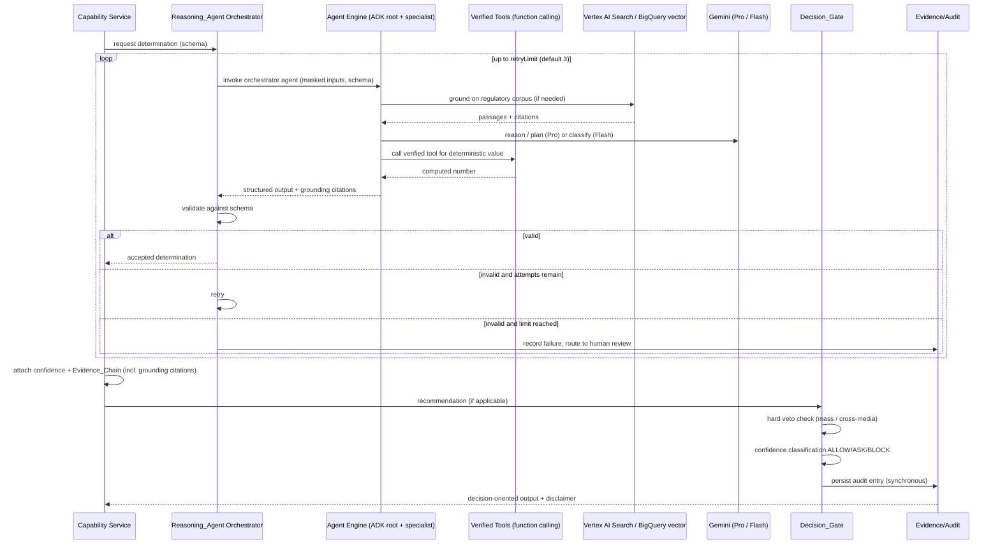
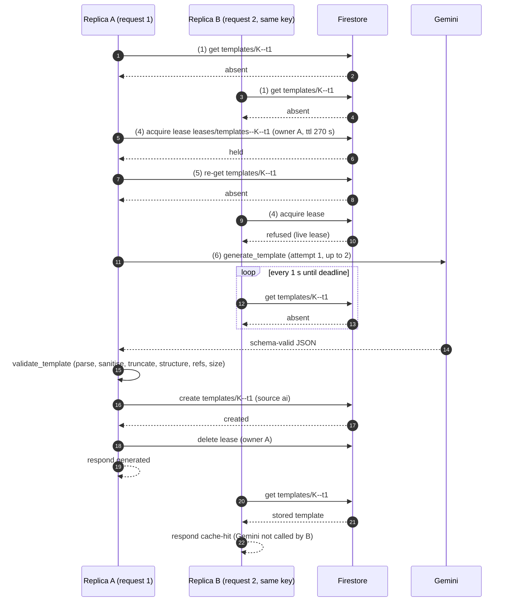

# Design Document

## Overview

TerraVow is an AI-powered environmental compliance, remediation-advisory, and certification platform for manufacturing supply chains. Its tagline is "Enforce. Certify. Track." The platform rests on a single thesis: machine degradation is an invisible, unpriced emissions event that propagates through supply chains, and every deferred-maintenance decision is therefore an undeclared emissions decision.

The system links machine health state to emissions intensity (EID), prices the resulting compounding liability (ERD), monitors air and water pollution with a cross-media displacement guardrail, measures harm caused by emission *timing* (AEI), synthesises substitution counterfactuals, reasons over real Indian regulatory and incentive instruments to produce cited drafts, propagates a machine-health-adjusted footprint across supply-chain tiers (Embedded Pollution Passport), gates every recommendation through a confidence-bounded ALLOW/ASK/BLOCK Decision_Gate with a hard veto against increasing harm, and certifies facilities on verified improvement *trajectory* into a public registry.

Two design principles dominate this document:

1. **Every produced number is a counterfactual or an interpretation that does not exist in any database.** It is reasoned by a Gemini Reasoning_Agent on Vertex AI, validated against a schema, and carries a machine-checkable Evidence_Chain back to a primary source. Where a value is a deterministic computation (EC formula, ERD summation, mass-preservation, net-position), it is produced by a *verified tool* the agent invokes via function calling — the model orchestrates, verified tools emit the numbers.
2. **Safety is structural, not advisory.** The Decision_Gate applies a hard veto against increasing total emission mass or cross-media load *before* confidence classification; a vetoed recommendation is BLOCK regardless of confidence. Every enrichment path degrades gracefully by lowering confidence rather than failing the determination.

**Input authenticity is itself a structural concern (Req 16).** Because every number the platform produces drives liability pricing (ERD), remediation, or certification, the data fed into it is a direct attack surface: an operator has an incentive to under-report emissions readings, forge a maintenance event to reset the ERD degraded-onset clock, or replay stale "healthy" telemetry. TerraVow therefore places an **Integrity_Gate at the ingestion boundary that runs *ahead of* PII masking (Req 13) and ahead of any reasoning or persistence.** The Integrity_Gate authenticates each record's source, checks instrument calibration and health, detects duplicates/replays and timestamp-freshness violations, verifies the acting actor is authorized, corroborates each reading against correlated signals, and emits a per-input **Data_Trust_Score in [0,1]**. That score flows downstream as a confidence *floor*: it bounds the confidence of every value derived from the record, and it bounds the Decision_Gate — a recommendation governed by sub-threshold trust is capped at **ASK** and routed to human review, never **ALLOW**. The Integrity_Gate only *adds a trust floor*; it never raises a classification and never relaxes the hard-veto-first ordering, the Evidence_Chain provenance guarantee, the synchronous audit persistence, or the masking invariant. The ingestion ordering is explicit and invariant: **Integrity_Gate → masking → reasoning / persistence.**

These principles are **invariant across the choice of platform building blocks.** This revision maximises use of managed Google Cloud AI tooling — Vertex AI Agent Builder / Agent Engine with the Agent Development Kit (ADK), Grounding with Vertex AI Search, BigQuery embeddings + vector search, Gemini function calling, Pub/Sub with BigQuery continuous queries, and a two-tier Gemini model strategy — but **no managed service relaxes a safety guarantee.** The Decision_Gate hard-veto-before-confidence ordering, Evidence_Chain provenance on every value, synchronous audit persistence, and PII/confidentiality masking *before any reasoning or persistence* remain structural. In particular, managed grounding (Vertex AI Search), Agent Engine Sessions/Memory Bank, and BigQuery vector retrieval operate **only over already-masked data**: no customer or supplier PII leaves the TerraVow boundary unmasked, and every value a managed service helps produce still carries an Evidence_Chain whose links resolve to primary sources.

Outputs that touch legal, tax, or engineering determinations are cited drafts for qualified professional review and never authoritative sign-off.

**Requirement 17 adds a second, narrower layer of defense-in-depth on top of the Req 16 Integrity_Gate.** Req 16 defends the ingestion boundary against an inauthentic, stale, replayed, unauthorized, or internally-inconsistent *record*. Req 17 defends against fraud patterns that sit outside that boundary and that a record-level gate structurally cannot see: an inflated *reference point* (the Commissioning_Baseline) set once at registration and never re-examined; a *physically-consistent* falsified reading that passes every self-consistency and cross-signal check Req 16 can run because the fraud is internally coherent; an anomaly detector whose own *expected-profile* history has been poisoned by prior low-trust admissions; and an *insider* with write access to the tamper-evident log itself, who does not need to forge a record because they control the chain. This is literature-grounded hardening — carbon-market/MRV fraud is dominated by baseline and documentation manipulation rather than live-sensor spoofing; false-data-injection-attack research shows a provable detectability ceiling for correlation/consistency-only detectors against a sufficiently informed, physically-consistent attacker, which is why an *exogenous* verification source is required rather than more self-consistency checking; continuous-emissions-monitoring practice cross-validates self-reported stack/effluent data against independent reference methods for exactly this reason; and tamper-evident logging practice anchors periodic checkpoints externally because a hash chain alone only proves *internal* consistency, not that the keeper of the chain didn't rewrite history before anyone looked. **None of the four Req 17 mechanisms — Baseline_Plausibility_Check, Independent_Verification_Source reconciliation, Trust_Weighted_Profile construction, or Anchored_Hash_Root verification — can ever raise a Decision_Gate classification or a confidence value beyond what Req 8 and Req 16.15–16.16 already allow (Req 17.16).** Each is purely additive: it can only add a downgrade, a flag, or a human-review routing on top of the existing fail-closed posture. The ingestion/registration ordering is extended but not altered in kind: **Baseline_Plausibility_Check (at registration) / Integrity_Gate + Independent_Verification_Source reconciliation (at ingestion) → masking → reasoning / persistence**, with Trust_Weighted_Profile construction and Anchored_Hash_Root verification operating as read-side and audit-side hardening over data that has already passed that pipeline.

This design is derived from the approved requirements at `.kiro/specs/terravow/requirements.md` and addresses all 17 requirements. Requirements 18–30 (the Python prototype extension: industry templates, snag history, and sustainability recommendations) are addressed in the section "Prototype Extension Design (Requirements 18–30)" at the end of this document, with Correctness Properties 65–95.

### Research Summary

Key findings that inform the design, grounded in the regulatory instrument structures named in the requirements:

- **Environmental Compensation (EC)** under Indian environmental regulators follows a documented formula *shape*: `base rate × days of violation × deterrence factor`, organised into per-violation-class guideline chapters. The design treats this shape as a fixed computation while the figures (base rate, deterrence factor) are retrieved from a regulatory corpus and cited. ([CPCB methodology for environmental compensation](https://cpcb.nic.in/) — content rephrased for compliance with licensing restrictions.)
- **ESCerts / PAT scheme** issues tradeable certificates under the Bureau of Energy Efficiency's Perform-Achieve-Trade mechanism to designated consumers that beat Specific Energy Consumption reduction targets. ([Bureau of Energy Efficiency — PAT scheme](https://beeindia.gov.in/) — rephrased for compliance.)
- **Income Tax Act Section 32** governs depreciation eligibility, used in the forgone-tax-depreciation ERD component. The design retrieves and cites the applicable rate rather than hard-coding it.
- **Vertex AI Gemini structured output** supports response schemas (controlled generation) so the model can be constrained to emit JSON matching a declared schema; the design pairs this with application-side re-validation and bounded retries for defense in depth. ([Google Cloud Vertex AI controlled generation](https://cloud.google.com/vertex-ai/generative-ai/docs/multimodal/control-generated-output) — rephrased for compliance.)
- **AEI (Avoidable Exposure Index)** requires an airshed assimilative-capacity forecast weighted by a Receptor_Map; this is a timing-optimisation problem over a fixed total emission mass, which drives the mass-preservation invariant in the design.
- **Data integrity is the platform's core threat model (Req 16).** A certification-and-liability platform is only as trustworthy as the data fed into it, and the dominant incentive among monitored parties is adversarial: under-reporting an emissions reading reduces priced ERD, and forging or back-dating a maintenance event resets the degraded-health-state onset that anchors ERD accrual (Req 14.6) — a direct financial-liability evasion. Standard practice for defending ingestion in regulated/metering contexts is layered: (a) **source authentication** of each record via a signed payload or an authenticated device/gateway credential; (b) **calibration validity and instrument health** gating, so readings from an expired-calibration or degraded/failed detector are down-weighted rather than trusted; (c) **replay and freshness** defence via duplicate detection and a monotonic-timestamp / freshness-bound check; (d) **tamper-evidence** on the append-only log via per-entry hashing / hash-chaining so any retroactive edit is detectable; (e) **authorized-actor** verification for maintenance records; and (f) **cross-signal corroboration/plausibility**, reconciling a reading against correlated signals (energy consumed, output quantity, redundant sensors) independently of the statistical anomaly path (Req 3.4). The design folds all six into a single ingestion-time Integrity_Gate that emits a Data_Trust_Score, and treats that score as a monotone confidence floor — mirroring the existing fallback-confidence invariant (Property 4) rather than introducing a new safety mechanism. (Reflects standard metering/data-integrity practice; no external corpus figure is invented — the Data_Trust_Score is a computed value with its own Evidence_Chain.)

Additional findings on **maximal Google Cloud AI tooling** (2026) shape this revision:

- **Vertex AI Agent Builder / Agent Engine + ADK.** Google provides a managed runtime for building and operating multi-agent systems: the Agent Development Kit (ADK) is an open framework for authoring agents and multi-agent orchestration, and Agent Engine is the managed deployment runtime offering Sessions, a Memory Bank for durable cross-session context, built-in evaluation, and sandboxed Code Execution. This lets a root-orchestrator agent coordinate per-capability specialist agents without hand-rolling the runtime, while the application retains the schema-validation + bounded-retry + escalation contract. ([Vertex AI Agent Builder overview](https://cloud.google.com/vertex-ai/docs/generative-ai/agent-builder/overview); [Build and manage multi-system agents with Vertex AI](https://cloud.google.com/blog/products/ai-machine-learning/build-and-manage-multi-system-agents-with-vertex-ai) — rephrased for compliance with licensing restrictions.)
- **Grounding with Vertex AI Search.** Vertex AI Search (a Builder API over a managed search engine / data store) provides semantic + keyword RAG over an ingested corpus with connectors, including a BigQuery connector, and returns grounding metadata with source citations. Grounding a Gemini response on this store yields answers tied to retrieved passages with citation support, which is the natural managed substrate for the regulatory corpus feeding the Economics Engine Evidence_Chain. ([Agent Builder / discovery engine Builder APIs](https://docs.cloud.google.com/generative-ai-app-builder/docs/builder-apis); [Build KYC agentic workflows with Google's ADK](https://cloud.google.com/blog/products/ai-machine-learning/build-kyc-agentic-workflows-with-googles-adk) — rephrased for compliance.)
- **BigQuery embeddings + vector search.** BigQuery can generate text embeddings in-warehouse (via a remote embedding model) and run approximate vector search over them, keeping corpus/evidence retrieval and similarity co-located with the telemetry/analytics tables rather than in bespoke retrieval code. ([Google Cloud Vertex AI controlled generation / BigQuery ML docs](https://cloud.google.com/vertex-ai/generative-ai/docs/multimodal/control-generated-output) — rephrased for compliance.)
- **Gemini function calling (tool use).** Gemini supports function calling: the model is given tool declarations and returns a structured call the application executes, then feeds results back. This lets deterministic computations run as verified application tools while the model does orchestration and interpretation — reinforcing "deterministic-first, delegate only genuinely non-existent values to reasoning."
- **Pub/Sub + BigQuery continuous queries.** Event-driven data agents can be built by streaming events through Pub/Sub into BigQuery and standing up BigQuery continuous queries that evaluate incoming rows in near-real-time, invoking downstream agents/triage. This fits pollution monitoring and the maintenance lifecycle, which are inherently streaming. ([Building event-driven data agents with BigQuery, Pub/Sub and ADK](https://cloud.google.com/blog/topics/developers-practitioners/building-event-driven-data-agents-with-bigquery-pubsub-and-adk) — rephrased for compliance.)
- **Two-tier Gemini model strategy.** Gemini models span a reasoning-optimised Pro tier (deep multi-step reasoning, planning, long 1M-token context, native tool use, multimodal) and a latency/cost-optimised Flash tier for high-volume classification. TerraVow routes deep counterfactual/economics/certification reasoning to the Pro tier and high-volume classification (threshold checks, masking triage, intent routing) to the Flash tier.

Further findings on **detection-hardening literature (2026)** motivate Requirement 17, each targeting a fraud surface the Req 16 Integrity_Gate cannot reach by construction:

- **Baseline manipulation is the dominant real-world MRV fraud pattern.** Carbon-market and emissions-MRV fraud investigations repeatedly center on an inflated or stale *reference/baseline* figure rather than live-sensor tampering, because the baseline is set once, is rarely re-examined, and every downstream liability figure (EID, ERD) is a delta against it — making it the highest-leverage, lowest-detection-risk point to manipulate. This motivates screening the Commissioning_Baseline itself at registration time (Baseline_Plausibility_Check, Req 17.1–17.5), not only the ongoing telemetry.
- **Correlation/consistency-only detection has a provable ceiling.** False-data-injection-attack research on cyber-physical and metering systems shows that a sufficiently informed adversary can craft readings that are internally self-consistent and pass every cross-signal/correlation check (energy, output, redundant sensors) a detector can run using only data the adversary also has visibility into — the Req 16 corroboration path included. The only structural defense against a *physically-consistent* false reading is reconciliation against a source the reporting party cannot influence. This motivates the Independent_Verification_Source as an exogenous check (Req 17.6–17.9), distinct in kind from the endogenous corroboration of Req 16.12–16.13, and the strict trust ceiling on corroboration-only (no-independent-source) data.
- **CEMS cross-validation practice.** Continuous Emissions Monitoring System practice cross-validates self-reported stack/effluent readings against an independent reference method or third-party measurement precisely because self-reported-only data cannot be trusted to full confidence regardless of how internally consistent it looks — the same rationale underlying Req 17.8–17.9's trust-ceiling design.
- **A poisoned expected-profile silently defeats anomaly detection.** The Req 3.4 anomaly detector learns its "expected profile" from reading history; if that history already contains reduced-trust or implausible readings, the profile itself drifts toward the fraud, after which genuinely anomalous future readings no longer deviate from the (already-poisoned) expectation. This motivates building the expected profile as a Trust_Weighted_Profile constructed and weighted only from readings at or above a trust threshold (Req 17.10), with reduced-trust readings still *evaluated* against the profile but never permitted to *shape* it (Req 17.11).
- **A self-contained hash chain does not defend against its own keeper.** Hash-chaining an append-only log (Req 16.9) makes external tampering detectable, but an insider or administrator with write access to the chain's storage can rewrite history and recompute a consistent chain from that point forward — the chain alone cannot prove no one with legitimate write access altered it. Standard tamper-evident-logging practice defends against this by periodically publishing a checkpoint hash root to an external, operator-uninfluenced location (e.g., a public timestamping/notarization service or an independent system outside the operator's administrative control), against which the live chain can later be independently reverified. This motivates the periodic Anchored_Hash_Root (Req 17.12–17.15).

These findings shape five load-bearing decisions: (a) regulatory figures are never invented — they are retrieved via managed grounding (Vertex AI Search / BigQuery vector search) and cited into the Evidence_Chain; (b) all AI output passes through a validate→retry→escalate pipeline, now layered over Agent Engine's managed runtime; (c) rescheduling and remediation are mass-conserving optimisations, never mass-reducing shortcuts; (d) deterministic numbers are produced by verified tools the agents call via function calling, not free-generated; (e) every managed path (Agent Engine, Vertex AI Search, BigQuery retrieval, continuous queries) is still subject to graceful degradation with a safe fallback and strictly lower confidence, and operates only over masked data.

## Architecture

### System Context

```mermaid
graph TB
    subgraph Ingestion
        EXT[External MES/ERP/CMMS records]
        TEL[Machine telemetry]
        READ[Stack / effluent / sensor readings]
        MET[Meteorological forecast + Receptor Map]
    end

    subgraph EventPath["Event-Driven Ingestion & Triage"]
        PS[Pub/Sub topics: readings, telemetry, job events]
        CQ[BigQuery Continuous Queries: threshold / anomaly triage]
    end

    subgraph TerraVow["TerraVow on Google Cloud (Cloud Run)"]
        INTEG[Integrity_Gate: source-auth, calibration/health, replay/freshness, authorized-actor, corroboration -> Data_Trust_Score]
        IVS[Independent_Verification_Source reconciliation]
        BPC[Baseline_Plausibility_Check at registration]
        TWP[Trust_Weighted_Profile builder for Req 3.4 anomaly detection]
        ANCHOR[Hash_Root_Anchor_Service: periodic Anchored_Hash_Root publish + verify]
        IG[Ingestion & Validation Service]
        PII[PII / Confidentiality Masking - Gemini Flash triage]
        CORE[Domain Core: Machine_Asset, Maintenance_Event, Job_Run, Health_State, Operating_Log]
        subgraph Capabilities["Capability Services"]
            EID[EID Attribution]
            ERD[ERD Quantification]
            MON[Pollution Monitor + Cross-Media Guardrail]
            AEI[AEI + Harm-Aware Rescheduler]
            SUB[Substitution Dossier]
            ECON[Economics Engine]
            EPP[Embedded Pollution Passport]
            CERT[Trajectory Certification]
            LIFE[Emissions-Aware Maintenance Lifecycle]
        end
        subgraph AgentRuntime["Vertex AI Agent Engine (ADK)"]
            ROOT[Root Orchestrator Agent]
            SPEC[Per-capability Specialist Agents]
            TOOLS[Verified Tools via Gemini function calling: EC formula, ERD sum, mass-check, net-position]
            MEM[Sessions + Memory Bank - masked context only]
        end
        ORCH[Reasoning_Agent Orchestrator wrapper: schema-validate, bounded retry 1-5, escalate]
        GATE[Decision_Gate]
        EV[Evidence_Chain & Audit Service]
    end

    subgraph Grounding["Managed Retrieval & Grounding"]
        VAIS[Vertex AI Search: regulatory corpus RAG + citations]
        BQV[BigQuery embeddings + vector search]
    end

    subgraph Models["Gemini on Vertex AI"]
        PRO[Gemini 3.1 Pro: deep reasoning / planning]
        FLASH[Gemini Flash: high-volume classification]
    end

    subgraph Storage
        BQ[(BigQuery: telemetry, emissions analytics, embeddings)]
        CS[(Cloud Storage: documents, regulatory corpus)]
        FS[(Firestore: registry, certificates, audit trail)]
        IR[(Instrument_Registry + Authorized_Actor records + integrity/quarantine audit)]
    end

    subgraph ExternalAnchor["External / Operator-Uninfluenced"]
        IVSRC[(Independent_Verification_Source: third-party satellite/remote-sensing, independent utility meters, regulator-held reference data)]
        ANCHORLOC[(External anchoring location: public timestamping/notarization service)]
    end

    EXT --> INTEG
    TEL --> PS
    READ --> PS
    MET --> AEI
    PS --> INTEG
    INTEG --> IR
    INTEG --> IVS
    IVS --> IVSRC
    IVS -. reconciliation outcome .-> INTEG
    INTEG --> CQ
    CQ --> MON
    MON --> TWP
    TWP -. Trust_Weighted_Profile .-> MON
    CQ --> LIFE
    INTEG --> IG
    IG --> PII --> CORE
    CORE -. register Machine_Asset / Commissioning_Baseline .-> BPC
    BPC -. plausibility verdict + confidence .-> CORE
    CORE --> Capabilities
    Capabilities --> ORCH
    ORCH --> ROOT
    ROOT --> SPEC
    SPEC --> TOOLS
    SPEC --> MEM
    ROOT --> PRO
    SPEC --> PRO
    PII --> FLASH
    MON --> FLASH
    ECON --> VAIS
    VAIS --> CS
    VAIS --> BQV
    BQV --> BQ
    ORCH --> Capabilities
    Capabilities --> GATE
    INTEG -. Data_Trust_Score floor .-> GATE
    BPC -. reduced confidence floor .-> GATE
    INTEG --> EV
    GATE --> EV
    Capabilities --> EV
    EV --> FS
    CORE --> BQ
    CERT --> FS
    CORE --> ANCHOR
    ANCHOR --> ANCHORLOC
    ANCHOR -. verify liveChain vs anchoredRoot .-> EV
```



### Layered Responsibilities

- **Integrity_Gate — ingestion trust boundary** (Req 16): the **first** thing every ingested reading, telemetry record, Maintenance_Event, or Job_Run passes through — on **both** the batch path (MES/ERP/CMMS → Ingestion & Validation) and the **Pub/Sub streaming path** (readings/telemetry → continuous-query triage). It runs **ahead of PII masking (Req 13)** and ahead of any reasoning or persistence (Req 16.1). It authenticates the record's source (signed payload / device-gateway credential, Req 16.2–16.3), looks up the source's **Calibration_Window** and health status in the **Instrument_Registry** and down-weights expired/degraded/failed/unregistered sources (Req 16.4–16.5), detects duplicates/replays and monotonic-timestamp/freshness violations (Req 16.7–16.8), verifies the acting technician/system is an **Authorized_Actor** for the referenced Machine_Asset before a Maintenance_Event may touch the ERD degraded-onset clock (Req 16.10–16.11), reconciles readings against correlated signals independently of the Req 3.4 statistical path (Req 16.12–16.13), and computes a per-record **Data_Trust_Score in [0,1]** with its own Evidence_Chain (Req 16.14). Each record is admitted, admitted-at-reduced-trust, quarantined, or rejected, each with a recorded reason. The Data_Trust_Score propagates into downstream value confidence (Req 16.6) and caps the Decision_Gate at **ASK** when below the configured trust threshold (Req 16.15), while strictly preserving the Req 8 hard veto and fail-closed posture — trust can only lower, never raise, a classification (Req 16.16). Accepted readings/telemetry are appended to the Operating_Log **tamper-evidently** so any later edit of a prior entry is detectable (Req 16.9).
- **Baseline_Plausibility_Check — registration-time hardening** (Req 17.1–17.5): wired into **Domain Core** `Machine_Asset`/`Commissioning_Baseline` registration (Req 14.1), not into the per-reading Integrity_Gate. When a Commissioning_Baseline is proposed, it is screened against the Fleet_Cohort_Baseline range and the asset class's declared engineering/manufacturer limits. A baseline outside the configured plausibility tolerance is **flagged** (never silently rejected): it is admitted, assigned strictly lower confidence than an in-tolerance baseline, routed to human review, and the Fleet_Cohort_Baseline range and engineering limits used in the screening are recorded in its Evidence_Chain. Until a flagged baseline clears human review, any EID or ERD computed from it inherits its reduced confidence — the same confidence-propagation shape as Req 16.6, applied to the baseline reference point rather than to a single reading.
- **Independent_Verification_Source reconciliation — exogenous corroboration** (Req 17.6–17.9): runs alongside the Integrity_Gate's cross-source corroboration (Req 16.12) but reconciles a self-reported reading against a source **external to and uninfluenced by** the monitored facility's own reporting chain (third-party satellite/remote-sensing estimates, independent utility meters, regulator-held reference data). A divergence beyond configured tolerance raises a discrepancy condition carrying both values and an Evidence_Chain. Because self-consistency and cross-signal checks alone cannot distinguish a physically-consistent falsified reading from a genuine one, a reading corroborated against an Independent_Verification_Source earns a strictly higher trust weight than one supported only by self-reported corroboration; where no Independent_Verification_Source exists, the absence is recorded and the reading's Data_Trust_Score is capped at a configured corroboration-only ceiling strictly below full trust.
- **Trust_Weighted_Profile — poisoning-resistant anomaly baseline** (Req 17.10–17.11): extends the Req 3.4 "expected profile" so it is constructed and weighted **only** from readings whose Data_Trust_Score is at or above the configured trust-weighting threshold. A reading admitted at `ADMIT_REDUCED_TRUST` is still evaluated against the current Trust_Weighted_Profile for anomaly detection, but it never contributes to establishing or shifting that profile — preventing a low-trust reading from poisoning the very baseline used to detect future anomalies.
- **Anchored_Hash_Root — externally-verifiable tamper evidence** (Req 17.12–17.15): a periodic checkpoint process publishes the current hash root of the Req 16.9 `TamperEvidentLogEntry` chain to an **externally-verifiable, operator-uninfluenced location** at a configured interval. The chain can later be independently reverified against the most recently published root; a live chain that fails to reproduce a previously published root when recomputed to that checkpoint raises a tamper-detected condition — this is a strictly stronger guarantee than the self-contained hash chain alone, because it defends against a party (e.g., an insider or administrator) who has write access to the chain itself. If the anchoring sink is unavailable at a scheduled interval, the unpublished root is retained for the next attempt and the missed attempt is recorded, following the standard Req 12 degradation pattern.
- **Event-Driven Ingestion & Triage** (Req 3, 15): machine telemetry and stack/effluent/sensor readings stream through **Pub/Sub** topics, pass the **Integrity_Gate** first, and land in **BigQuery**, where **continuous queries** evaluate incoming rows in near-real-time against regulatory thresholds and the Trust_Weighted_Profile, raising threshold/anomaly conditions and triggering agent triage for the Pollution Monitor (Req 3) and the Emissions-Aware Maintenance Lifecycle (Req 15). This is the streaming front door; batch external records (MES/ERP/CMMS) likewise pass the Integrity_Gate first and then enter through Ingestion & Validation.
- **Ingestion & Validation** (Req 13, 14): validate external machine/maintenance/job records against required fields; route valid records to domain stores; reject invalid records with recorded reasons and continue. This step runs **after** the Integrity_Gate has established source trust (Req 16.1). Supplier data is masked (Req 13) before reasoning or persistence; a Gemini Flash tier performs high-volume masking/confidentiality triage, but deterministic masking remains authoritative and masking must complete before any data reaches reasoning, Memory Bank, grounding, or storage. The ordering is invariant: **Integrity_Gate → masking → reasoning / persistence.**
- **Domain Core** (Req 14): the provenance spine — `Machine_Asset`, `Maintenance_Event`, `Job_Run`, `Machine_Health_State`, append-only `Operating_Log`, and baselines. Every analytic value traces to Operating_Log records.
- **Capability Services** (Req 1–7, 9, 15): one service per determination family. Each is deterministic-first for computation, delegating only the genuinely non-existent-in-any-database values to a Reasoning_Agent. Deterministic computations are exposed as **verified tools** the agents invoke via **Gemini function calling** (EC formula, ERD summation, mass-preservation check, net-position arithmetic) so the model orchestrates while verified tools emit the numbers.
- **Agent Runtime — Vertex AI Agent Engine + ADK** (Req 11): a **root-orchestrator agent** coordinates **per-capability specialist agents** authored with the Agent Development Kit and deployed on the managed **Agent Engine** runtime, using its **Sessions**, **Memory Bank** (durable cross-session context, masked only), **evaluation**, and sandboxed **Code Execution**. The agents call verified tools via function calling and ground on managed retrieval.
- **Reasoning_Agent Orchestrator** (Req 11): the thin TerraVow-owned contract wrapping every Agent Engine invocation with schema validation, bounded retries (1–5, default 3), and human-review escalation. This contract is preserved on top of the managed runtime — Agent Engine supplies the runtime; the orchestrator supplies the determinism/escalation guarantee.
- **Managed Retrieval & Grounding** (Req 6, 10): **Grounding with Vertex AI Search** provides semantic + keyword RAG over the regulatory corpus (Cloud Storage + BigQuery connector) with native citation grounding; **BigQuery embeddings + vector search** co-locates corpus/evidence similarity with analytics data. Retrieved passages and their citations feed the Evidence_Chain.
- **Decision_Gate** (Req 8): the single chokepoint through which every recommendation passes before it can be surfaced or applied. Hard veto first, confidence classification second. No managed service bypasses it.
- **Evidence_Chain & Audit Service** (Req 10): attaches machine-checkable provenance to every value — including values produced with managed grounding — and persists the audit trail before any decision-oriented output is returned.
- **Models — two-tier Gemini** (Req 11, 12): **Gemini 3.1 Pro** for deep counterfactual/economics/certification reasoning and planning (leveraging 1M-token context, native tool use, and multimodal input where relevant); a **Gemini Flash** tier for high-volume, latency-sensitive classification (threshold checks, PII/confidentiality masking triage, intent routing).
- **Platform & Degradation** (Req 12): Cloud Run services, Vertex AI reasoning via Agent Engine, Pub/Sub + BigQuery continuous queries for streaming, managed grounding via Vertex AI Search + BigQuery vector search, storage split across BigQuery / Cloud Storage / Firestore, with a uniform fallback mechanism that lowers confidence and records the substituted path. **Every managed path (Agent Engine, Vertex AI Search, BigQuery retrieval, continuous queries) is a degradable enrichment path**: on error/timeout it falls back to a predefined safe path with strictly lower confidence, or marks the result undetermined and routes to human review when no fallback exists. The two Req 17 enrichment paths — **Independent_Verification_Source reconciliation** and the **external hash-root anchoring sink** — follow the identical pattern: an unavailable Independent_Verification_Source degrades to the corroboration-only trust ceiling (Req 17.9) rather than failing the reading, and an unavailable anchoring sink retains the unpublished root for the next scheduled attempt rather than failing the checkpoint (Req 17.15).

### Cross-Cutting Control Flow

Every capability produces a **Determination**: a value (or structured result) plus a confidence in [0,1] plus an Evidence_Chain. A determination that is a *recommendation* is additionally routed through the Decision_Gate. A determination that is a *decision-oriented output* additionally triggers synchronous audit persistence (Req 10.3) and carries the advisory disclaimer (Req 13.5).

The orchestrator contract is unchanged in behaviour; it now drives a managed Agent Engine runtime whose specialist agents call verified tools (function calling) and ground on Vertex AI Search / BigQuery vector search. The schema-validate → bounded-retry → escalate loop still owns the Req 11 guarantee.



### Google Cloud Services Utilization

The table makes the maximal-usage story explicit: each managed Google service / AI feature, the requirement(s) and capability it serves, and the safety constraint it operates under. No row weakens a safety invariant — grounding, Memory Bank, and vector retrieval operate only over masked data, and every produced value still carries an Evidence_Chain and passes the Decision_Gate.

| Google Cloud service / AI feature | Serves (Req) | Capability role | Safety constraint |
|---|---|---|---|
| **Cloud Run** | 12.1 | Hosts all TerraVow services | — |
| **Vertex AI Agent Engine + ADK** (Sessions, Memory Bank, evaluation, Code Execution) | 11.1–11.5 | Managed multi-agent runtime: root orchestrator + per-capability specialist agents | Memory Bank stores masked context only; orchestrator wrapper preserves schema-validate + bounded-retry (1–5, default 3) + escalation |
| **Gemini 3.1 Pro** (1M context, native tool use, multimodal) | 1,2,4,5,6,9,15,11 | Deep counterfactual / economics / certification reasoning & planning | Output schema-validated; deterministic numbers delegated to verified tools |
| **Gemini Flash** | 3,13,chat intent | High-volume classification: threshold checks, PII/masking triage, intent routing | Deterministic masking remains authoritative; triage never bypasses masking |
| **Gemini function calling (verified tools)** | 2.2, 4.5, 6.2, 6.5 | EC formula (base×days×deterrence), ERD summation, mass-preservation check, net-position arithmetic | Model orchestrates; verified tools emit the numbers (deterministic-first) |
| **Grounding with Vertex AI Search** (corpus RAG + citations, BigQuery connector) | 6.1, 6.7, 10.1 | Managed retrieval of regulatory/incentive instruments with native citation grounding | Citations feed Evidence_Chain; a figure not retrievable → undetermined (6.9) |
| **BigQuery embeddings + vector search** | 6.1, 10.1, 10.5 | In-warehouse embedding + similarity retrieval of corpus/evidence co-located with analytics | Retrieval over masked/corpus data; links resolve to primary sources |
| **Pub/Sub** | 3.1–3.4, 15.3 | Event-driven streaming of readings/telemetry/job events | Masking applied before persistence; backpressure-safe |
| **BigQuery continuous queries** | 3.1, 3.3, 3.4, 15.3 | Near-real-time threshold/anomaly triage feeding agent triage | Threshold/anomaly logic deterministic; raises conditions, does not auto-apply |
| **BigQuery** (telemetry, analytics, embeddings) | 12.2 | Time-series telemetry, Job_Runs, EID/ERD series, embeddings | — |
| **Cloud Storage** | 12.2 | Regulatory corpus, filings, document primary sources | Evidence_Chain primary-source store |
| **Firestore** | 12.2, 9.5, 10.3, 10.4 | Public registry, certificates, audit trail (≥ 7-year retention) | Synchronous audit persistence before output return |
| **Firestore** (Instrument_Registry, Authorized_Actor records, integrity/quarantine audit) | 16.4, 16.5, 16.7, 16.10 | Stores registered instruments (source identity, Calibration_Window, health status), actor↔asset authorization, and the integrity/quarantine audit trail alongside the decision audit | Lookups run inside the Integrity_Gate ahead of masking; a registry-lookup outage is a degradation path (reduced trust / undetermined), never silent full-trust admission |
| **Signed-payload / device-credential verification** (Cloud KMS / IAM-backed signature + credential validation) | 16.2, 16.3 | Verifies each record's Source_Authentication (signed payload or authenticated device/gateway credential) at the ingestion boundary | Verification runs before masking/persistence; a failed/absent credential → reject or admit-at-reduced-trust only, never full trust; a verification-service outage degrades to a safe lower-trust/undetermined path |
| **Gemini Flash** (corroboration/plausibility triage) | 16.12, 16.13 | High-volume reconciliation of a reading against correlated signals (energy, output, redundant sensors), independent of the Req 3.4 statistical anomaly path | Deterministic plausibility checks remain authoritative; triage may only *lower* the Data_Trust_Score, never raise it; runs on masked/boundary data |
| **BigQuery** (trust-weighted aggregation) | 17.10, 17.11 | Computes/maintains the Trust_Weighted_Profile per reading stream as a Data_Trust_Score-weighted aggregate over admitted readings, co-located with the existing telemetry/analytics tables | Aggregation reads only readings at/above the trust-weighting threshold; an `ADMIT_REDUCED_TRUST` reading is excluded from the aggregate query and evaluated only against the already-materialized profile |
| **External timestamping/notarization sink** (operator-uninfluenced anchoring location, outside the TerraVow Google Cloud project boundary) | 17.12, 17.13, 17.14 | Periodically receives the published Anchored_Hash_Root checkpoint of the TamperEvidentLogEntry chain | Publish-only interface; TerraVow has no write access to rewrite a previously published root; an outage degrades to retain-and-retry (17.15), never to skipping the checkpoint silently |
| **Independent_Verification_Source connectors** (e.g., BigQuery-ingested third-party satellite/remote-sensing feeds, independent utility-meter data, regulator reference data) | 17.6–17.9 | Supplies the exogenous reconciliation value for self-reported readings | Source is external to and uninfluenced by the monitored facility; absence degrades to the corroboration-only trust ceiling, never to full trust |

## Components and Interfaces

Services follow an interface + implementation convention (e.g., `EidAttributionService` / `DefaultEidAttributionService`). Interfaces are expressed below in language-neutral signatures; the implementation targets the Google Cloud stack (Cloud Run services).

### Reasoning_Agent Orchestrator over Vertex AI Agent Engine (Req 11)

The orchestrator is the TerraVow-owned contract that guarantees Req 11; the managed runtime underneath it is **Vertex AI Agent Engine** running agents authored with the **Agent Development Kit (ADK)**. A **root-orchestrator agent** decomposes a determination request and delegates to **per-capability specialist agents** (one per determination family — EID, ERD, pollution, AEI, substitution, economics, passport, certification, lifecycle). Agent Engine supplies the managed runtime, **Sessions**, **Memory Bank** (durable cross-session context — masked data only), **evaluation**, and sandboxed **Code Execution**. Specialist agents produce deterministic values by calling **verified tools via Gemini function calling** and ground interpretive values on managed retrieval (Vertex AI Search / BigQuery vector search). The orchestrator wraps every Agent Engine invocation with the schema-validate → bounded-retry → escalate loop, so Req 11's guarantee is independent of the runtime.

```
interface ReasoningAgentOrchestrator {
    // Produces a schema-validated determination for the given capability.
    // Delegates execution to Vertex AI Agent Engine (root + specialist agents, ADK).
    // Retries on schema-validation failure up to retryLimit (1..5, default 3).
    // On exhaustion: records a failure entry and routes to human review.
    ReasoningResult<T> reason(
        CapabilityId capability,
        PromptSpec prompt,          // carries only masked inputs
        OutputSchema<T> schema,
        List<ToolDeclaration> tools, // verified deterministic tools (function calling)
        GroundingSpec grounding,     // Vertex AI Search / BigQuery vector store ref
        RetryPolicy policy           // bounded 1..5, default 3
    )
}

record ReasoningResult<T>(
    Optional<T> value,          // present iff schema-valid output obtained
    int attemptsPerformed,
    ReasoningStatus status,     // ACCEPTED | ESCALATED_HUMAN_REVIEW
    Optional<String> failureReason,
    List<GroundingCitation> citations, // folded into the Evidence_Chain
    EvidenceChain evidence
)

record ToolDeclaration(ToolId id, Schema input, Schema output) // executed by TerraVow, not the model
record GroundingSpec(DataStoreRef store, GroundingMode mode)   // VERTEX_AI_SEARCH | BIGQUERY_VECTOR
```

Behaviour (Req 11.1–11.5): a determination that does not exist in any database is produced through a Reasoning_Agent — a specialist agent on Agent Engine using Gemini; the output is validated against its schema; a valid output is accepted; an invalid output is retried up to the bounded limit; exhaustion routes to human review and records `{capability, attemptsPerformed, failureReason}`. `retryLimit` outside 1..5 is clamped/defaulted to 3. Model routing follows the two-tier strategy: deep reasoning/planning on Gemini 3.1 Pro, high-volume classification on Gemini Flash. Deterministic values returned by the agent originate from verified tools, not free generation; grounding citations returned by the agent are folded into the Evidence_Chain. **Masking invariant:** only masked inputs are placed in the prompt, in Agent Engine Sessions/Memory Bank, and in any grounding query — no raw PII or confidential supplier identifier reaches the managed runtime.

### Integrity_Gate & Data Trust (Req 16)

The Integrity_Gate is the ingestion trust boundary. **It runs ahead of PII masking (Req 13) and ahead of any reasoning or persistence** — on both the batch and Pub/Sub streaming paths — establishing the authenticity, integrity, and source trust of every ingested reading, telemetry record, Maintenance_Event, and Job_Run before any downstream step touches the data (Req 16.1). It produces a single admission decision per record plus a Data_Trust_Score in [0,1] that becomes a confidence *floor* for every value derived from the record and a cap on the Decision_Gate classification. It never raises a classification and never relaxes the Req 8 hard veto — it only lowers trust (Req 16.16).

```
interface IntegrityGate {
    // Single entry point: runs for every ingested record BEFORE masking/reasoning/persistence (Req 16.1).
    IntegrityResult evaluate(IngestedRecord record)
}

// --- Composed checks (each contributes to the Data_Trust_Score and the admission decision) ---

interface SourceAuthenticator {
    // Verify signed payload or authenticated device/gateway credential (Req 16.2, 16.3).
    AuthOutcome authenticate(IngestedRecord record)   // AUTHENTICATED_FULL | AUTHENTICATED_REDUCED | FAILED
}

interface InstrumentRegistry {
    // Look up calibration window + health status for a registered source (Req 16.4).
    Optional<Instrument> lookup(SourceId source)
    CalibrationStatus calibrationStatus(SourceId source, Instant at) // CURRENT | EXPIRED | UNREGISTERED (Req 16.5)
}

interface IntegrityChecks {
    DuplicateOutcome checkReplay(IngestedRecord record)         // duplicate/replay detection (Req 16.7)
    FreshnessOutcome checkFreshness(IngestedRecord record)      // monotonic timestamp + freshness bound (Req 16.8)
    boolean appendTamperEvident(MachineId m, OperatingLogEntry e) // hash-chained append (Req 16.9)
}

interface ActorAuthorizer {
    // A Maintenance_Event's acting technician/system must be an Authorized_Actor for the asset (Req 16.10, 16.11).
    boolean isAuthorized(ActorId actor, MachineId machine)
}

interface CorroborationChecker {
    // Reconcile a reading against correlated signals (energy, output, redundant sensors),
    // independently of the Req 3.4 statistical anomaly path (Req 16.12, 16.13).
    PlausibilityOutcome corroborate(Reading r, CorrelatedSignals signals)
}

record IntegrityResult(
    AdmissionDecision decision,       // ADMIT | ADMIT_REDUCED_TRUST | QUARANTINE | REJECT
    DataTrustScore trust,             // value in [0,1] (Req 16.14)
    Optional<String> reason,          // present for every non-ADMIT outcome (and reduced-trust reason)
    EvidenceChain evidence            // records auth outcome, calibration/health, integrity + corroboration (Req 16.14)
)

enum AdmissionDecision { ADMIT, ADMIT_REDUCED_TRUST, QUARANTINE, REJECT }

record DataTrustScore(double value)   // invariant: 0.0 <= value <= 1.0 (Req 16.14)
record AuthOutcome(AuthStatus status, Optional<String> reason)
enum AuthStatus { AUTHENTICATED_FULL, AUTHENTICATED_REDUCED, FAILED }
enum CalibrationStatus { CURRENT, EXPIRED, UNREGISTERED }
record DuplicateOutcome(boolean isDuplicate, Optional<RecordRef> priorRef)
record FreshnessOutcome(boolean withinBound, boolean monotonic)
record PlausibilityOutcome(boolean plausible, List<SignalRef> conflictingSignals)
```

Behaviour (Req 16.1–16.17):

1. **Ordering (Req 16.1).** `evaluate` is invoked at the ingestion boundary **before** the Req 13 masking step and before any reasoning or persistence, on both the batch and Pub/Sub paths.
2. **Source authentication (Req 16.2, 16.3).** A record that fails Source_Authentication is **rejected** — never used in reasoning, never persisted — with a recorded reason. A record whose credential is valid but below full-trust authority is admitted at a **strictly reduced** Data_Trust_Score with the reduced-trust reason recorded in the Evidence_Chain. Authentication never yields full trust on a failed credential.
3. **Calibration & health (Req 16.4, 16.5).** For a registered instrument the gate retrieves the Calibration_Window and health status. An expired-calibration, degraded/failed-health, or unregistered source is flagged and assigned a Data_Trust_Score **strictly lower** than a registered instrument with a current window and healthy status, with the flag reason in the Evidence_Chain.
4. **Confidence propagation (Req 16.6).** When an EID, ERD, Embedded Pollution Passport, or Machine_Health_State is computed from a flagged or reduced-trust record, the reduced trust propagates into that value's confidence (the Data_Trust_Score acts as an upper bound on derived confidence).
5. **Replay & freshness (Req 16.7, 16.8).** Duplicate/replayed records are detected against previously ingested records and rejected or quarantined with a reason. A record whose timestamp is not monotonically later than the latest accepted record for the same source, or falls outside the configured freshness bound, raises an integrity condition and is rejected or quarantined.
6. **Tamper-evident log (Req 16.9).** Accepted readings/telemetry are appended to the Machine_Asset Operating_Log via a hash-chained append so any later modification or deletion of a prior entry is detectable (extends the Req 14.11 append-only guarantee).
7. **Authorized actor (Req 16.10, 16.11).** A Maintenance_Event whose acting technician/system is not an Authorized_Actor for the referenced Machine_Asset (or cannot be authenticated) is rejected or quarantined and is **not** applied to the ERD degraded-onset clock — closing the forge-maintenance-to-reset-ERD fraud vector — with the reason recorded.
8. **Corroboration & plausibility (Req 16.12, 16.13).** Each reading is reconciled against correlated signals (energy consumed, output quantity, redundant sensors) independently of the Req 3.4 statistical anomaly detection. A physically implausible or internally inconsistent reading raises an implausibility condition, attaches the conflicting signals and an Evidence_Chain, and reduces the Data_Trust_Score.
9. **Data_Trust_Score (Req 16.14).** On completion the gate computes a Data_Trust_Score in [0,1] from the authentication outcome, calibration/health status, integrity-check outcome, and corroboration outcome, and attaches it plus an Evidence_Chain to the record.
10. **Decision_Gate capping (Req 16.15, 16.16).** When a recommendation is derived from inputs whose governing Data_Trust_Score is below the configured trust threshold, the Decision_Gate classifies it as **at most ASK** and routes it to human review. This composes *with* the Req 8 ordering: the hard veto and the invalid-confidence fail-closed to BLOCK still run first; the trust cap can only lower (never raise) the resulting classification.
11. **Graceful degradation (Req 16.17).** If the Instrument_Registry lookup, the Source_Authentication verification service, or a corroboration source is unavailable or times out, the gate treats the path as unavailable and continues through a predefined safe fallback at a **strictly lower** trust/confidence, recording the fallback id and replaced primary id in the Evidence_Chain; when no safe fallback exists, the record is marked undetermined and routed to human review with the unavailable path recorded (reuses the Req 12 `DegradationPolicy`).

**Decision_Gate integration.** The gate's `classify` input is extended with the governing Data_Trust_Score so the trust cap composes with the existing ordering without changing step order:

```
record TrustContext(DataTrustScore governingTrust, double trustThreshold) // governingTrust = min over contributing inputs
```

### Detection Hardening: Baseline Plausibility, Independent Verification, Trust-Weighted Profile, Anchored Hash Root (Req 17)

These four mechanisms are a second, narrower defense-in-depth layer over the Req 16 Integrity_Gate, each closing a fraud surface a per-record gate cannot see on its own: a manipulated reference baseline, a physically-consistent falsified reading, a poisoned anomaly-detection history, and an insider with write access to the tamper-evident log. **All four are strictly additive downgrade/review paths — none can raise a Decision_Gate classification or a confidence value beyond what Req 8 and Req 16.15–16.16 already allow (Req 17.16).**

```
interface BaselinePlausibilityChecker {
    // Runs once, at Machine_Asset / Commissioning_Baseline registration (Req 17.1).
    BaselinePlausibilityVerdict screen(
        CommissioningBaseline proposed,
        FleetCohortBaseline cohortRange,          // range for the asset class
        EngineeringLimits declaredLimits          // manufacturer/engineering limits for the asset class
    )
}

enum PlausibilityOutcome { PLAUSIBLE, FLAGGED_REDUCED_CONFIDENCE }  // never a silent hard reject (Req 17.2)

record BaselinePlausibilityVerdict(
    PlausibilityOutcome outcome,
    double confidence,                 // strictly lower when FLAGGED (Req 17.2)
    boolean routedToHumanReview,        // true iff FLAGGED (Req 17.2); false for PLAUSIBLE alone (Req 17.3)
    Optional<String> reason,
    EvidenceChain evidence              // records cohortRange + declaredLimits used in screening (Req 17.4)
)

interface IndependentVerificationReconciler {
    // Reconciles a self-reported reading against an Independent_Verification_Source when one is available (Req 17.6).
    IndependentVerificationResult reconcile(Reading selfReported, Optional<IndependentVerificationSource> source)
}

enum ReconciliationOutcome { CORROBORATED_INDEPENDENT, DISCREPANCY, NO_INDEPENDENT_SOURCE }

// corroborationOnlyTrustCeiling: configured constant, strictly < 1.0 (full trust) (Req 17.9).
record IndependentVerificationResult(
    ReconciliationOutcome outcome,
    Optional<Double> independentValue,
    double trustWeight,                 // CORROBORATED_INDEPENDENT > self-reported-only corroboration (Req 17.8);
                                         // NO_INDEPENDENT_SOURCE is capped at corroborationOnlyTrustCeiling (Req 17.9)
    EvidenceChain evidence              // links self-reported value + independent value when DISCREPANCY (Req 17.7)
)

interface TrustWeightedProfileBuilder {
    // Builds/updates the Req 3.4 expected profile as a Trust_Weighted_Profile (Req 17.10).
    TrustWeightedProfile buildOrUpdate(StreamId stream, List<AdmittedReading> history, double trustWeightingThreshold)

    // Any reading is still evaluated against the current profile for anomaly detection (Req 3.4),
    // regardless of whether it was eligible to shape that profile (Req 17.11).
    AnomalyEvaluation evaluateAgainst(TrustWeightedProfile profile, Reading r)
}

record AdmittedReading(Reading reading, DataTrustScore trust, AdmissionDecision admission)

record TrustWeightedProfile(
    StreamId stream,
    List<AdmittedReading> contributingReadings, // only readings with trust >= trustWeightingThreshold;
                                                  // ADMIT_REDUCED_TRUST readings are never included (Req 17.11)
    double trustWeightingThreshold
)

interface HashRootAnchorService {
    // Periodically publishes the current chain hash root to an external, operator-uninfluenced location (Req 17.12).
    AnchorPublishResult publish(TamperEvidentLogEntry latestEntry, Instant at)

    // Makes the most recently published root available for independent verification (Req 17.13).
    Optional<AnchoredHashRoot> mostRecentAnchor(MachineId machine)

    // Recomputes the live chain to the anchored checkpoint and compares against the published root (Req 17.14).
    AnchorVerificationResult verify(List<TamperEvidentLogEntry> liveChain, AnchoredHashRoot anchoredRoot)
}

record AnchorPublishResult(boolean published, Optional<String> missedReason) // false + reason when sink unavailable (Req 17.15)

record AnchorVerificationResult(
    boolean tamperDetected,              // true iff recomputed root != anchoredRoot.hashRoot
    Optional<MachineId> divergingMachine,
    EvidenceChain evidence               // records the diverging Operating_Log and the affected AnchoredHashRoot (Req 17.14)
)
```

Behaviour (Req 17.1–17.16):

1. **Baseline plausibility (Req 17.1–17.5).** At registration, `screen` compares the proposed Commissioning_Baseline against the Fleet_Cohort_Baseline range and the asset class's declared engineering/manufacturer limits. Within the configured tolerance → `PLAUSIBLE`, admitted without routing to human review on that basis alone (Req 17.3). Outside tolerance → `FLAGGED_REDUCED_CONFIDENCE`: the baseline is still admitted (never a silent hard reject), assigned strictly lower confidence than a `PLAUSIBLE` baseline, routed to human review, and its Evidence_Chain records the cohort range and engineering limits used (Req 17.4). Until a flagged baseline clears human review, any EID or ERD computed from it has its confidence bounded by the baseline's reduced confidence (Req 17.5) — the same propagation shape as Req 16.6/Property 52, applied to the baseline reference point.
2. **Independent verification (Req 17.6–17.9).** When an Independent_Verification_Source is available, the self-reported reading is reconciled against it. A divergence beyond the configured tolerance raises `DISCREPANCY`, carrying both values and an Evidence_Chain linking to each (Req 17.7). A reading reconciled as `CORROBORATED_INDEPENDENT` receives a strictly higher trust weight than the same reading would receive from self-reported-only corroboration under Req 16.12 (Req 17.8). When no Independent_Verification_Source exists, the absence is recorded and the reading's Data_Trust_Score is capped at a configured `corroborationOnlyTrustCeiling` strictly below full trust (Req 17.9) — this ceiling composes with, and can only further lower, the Data_Trust_Score the Req 16 Integrity_Gate would otherwise assign.
3. **Trust-weighted anomaly profile (Req 17.10–17.11).** `buildOrUpdate` constructs the Trust_Weighted_Profile for a reading stream using only readings whose Data_Trust_Score is at or above `trustWeightingThreshold`, weighted by each reading's own score. A reading admitted at `ADMIT_REDUCED_TRUST` is excluded from `contributingReadings` — it never establishes or shifts the profile — but `evaluateAgainst` still runs the Req 3.4 anomaly check for that reading against whichever Trust_Weighted_Profile currently exists, so a reduced-trust reading is still screened, just never trusted to define the baseline it is screened against.
4. **Anchored hash root (Req 17.12–17.15).** `publish` runs at a configured interval, sending the current `TamperEvidentLogEntry` chain's hash root to an external, operator-uninfluenced location. `mostRecentAnchor` exposes the latest published root for independent reverification. `verify` recomputes the live chain to the anchored checkpoint; a mismatch raises `tamperDetected = true`, records the diverging Machine_Asset Operating_Log and the affected `AnchoredHashRoot` in the Evidence_Chain, and routes the finding to human review (Req 17.14) — a strictly stronger guarantee than the self-contained hash chain of Req 16.9/Property 54 alone, because it is resistant to a party with write access to the live chain. If the anchoring sink is unavailable or times out at a scheduled interval, `publish` returns `published = false` with a reason, the unpublished root is retained for the next scheduled attempt, and the missed attempt is recorded (Req 17.15) — reusing the Req 12/16.17 `DegradationPolicy` pattern (Property 4).
5. **Non-interference with the Decision_Gate (Req 17.16).** None of the four mechanisms writes directly to a Decision_Gate classification or raises a confidence value. Each only ever (a) lowers a confidence value, (b) adds a human-review routing, or (c) raises a tamper-detected/discrepancy condition that is itself routed to human review. Composed with the existing Req 8 hard-veto-first, then Req 16.15–16.16 trust-cap ordering, the maximum classification any recommendation can receive is unchanged by whether any Req 17 check ran — Req 17 can only push the result toward ASK/BLOCK/human-review, never toward ALLOW (extends Property 59).

### Decision_Gate (Req 8, Req 16.15–16.16)

```
interface DecisionGate {
    GateVerdict classify(Recommendation rec, GateThresholds thresholds, HarmDelta harm, TrustContext trust)
}

record GateThresholds(double allowThreshold, double askThreshold) // askThreshold <= allowThreshold
record HarmDelta(double totalEmissionMassDelta, double crossMediaLoadDelta)

enum GateDecision { ALLOW, ASK, BLOCK }

record GateVerdict(
    GateDecision decision,
    boolean vetoApplied,
    boolean routedToHumanReview,
    EvidenceChain evidence
)
```

Ordered algorithm (Req 8.1–8.5, with the Req 16 trust cap appended as a final floor):
1. **Hard veto first (Req 8.4):** if `totalEmissionMassDelta > 0` OR `crossMediaLoadDelta > 0` → `BLOCK`, `vetoApplied = true`, attach supporting readings (Req 8.3). This precedes confidence classification.
2. **Confidence validity (Req 8.5):** if confidence is absent or outside [0,1] → `BLOCK`, route to human review.
3. **Confidence classification (Req 8.1):** `confidence >= allowThreshold` → `ALLOW`; `askThreshold <= confidence < allowThreshold` → `ASK`; `confidence < askThreshold` → `BLOCK`.
4. **Trust cap (Req 16.15, 16.16):** if `trust.governingTrust < trust.trustThreshold`, the classification is capped at `ASK` — i.e., an `ALLOW` from step 3 is lowered to `ASK` and routed to human review; `ASK` and `BLOCK` are unchanged. This step can only lower a classification, never raise it, so it composes safely with the hard veto (a vetoed `BLOCK` is never lifted by trust) and with the fail-closed invalid-confidence path.
5. **Human-review routing (Req 8.2):** any decision below the allow threshold (i.e., ASK or BLOCK), including an ALLOW lowered to ASK by the trust cap, withholds automatic application and routes to human review.

The gate never claims authoritative sign-off (Req 8.6). The ordering guarantees that neither the trust cap nor any reduced Data_Trust_Score can *raise* a classification (Req 16.16): the maximum classification is `min(confidence-classification, trust-cap)` after the hard veto.

### Evidence_Chain & Audit Service (Req 10)

```
interface EvidenceService {
    EvidenceChain build(List<EvidenceLink> links)       // each link resolves to a primary source
    boolean isFullyResolved(EvidenceChain chain)
    ProvenanceResult provenanceOf(ValueRef ref)         // NOT_FOUND leaves audit unchanged
}

interface AuditService {
    // Must complete before a decision-oriented output is returned (Req 10.3).
    void persistDecision(AuditEntry entry)
}

record EvidenceLink(SourceType type, SourceRef ref)     // READING | FILING | REGULATORY_TEXT | OPERATING_LOG | FALLBACK_PATH
record AuditEntry(RecommendationId id, GateDecision decision, double confidence, EvidenceChain evidence, Instant at)
```

Behaviour: counterfactuals, penalty exposures, incentive eligibilities, and certification verdicts carry a machine-checkable Evidence_Chain whose every link resolves to a primary source (Req 10.1). Decision classification is recorded with id, decision, confidence, evidence (Req 10.2). Audit persistence is synchronous relative to output return (Req 10.3) and retained ≥ 7 years (Req 10.4). Provenance lookup returns the full chain (Req 10.5) or NOT_FOUND without mutating the audit trail (Req 10.6). A value that cannot be linked to a primary source is marked unsupported and routed to human review (Req 10.7).

### EID Attribution Service (Req 1)

```
interface EidAttributionService {
    EmissionsIntensityResult intensity(MachineId m, TelemetryWindow t, ProductionOutput p)
    EidResult eid(MachineId m)
}

record EidResult(
    EidStatus status,                 // COMPUTED | UNDETERMINED
    Optional<Double> eid,
    Optional<Double> healthAttributed,       // additive component
    Optional<Double> processNecessityAttributed, // additive component; sum == eid
    BaselineKind baselineUsed,        // COMMISSIONING | FLEET_COHORT | NONE
    double confidence,                // [0,1]
    EvidenceChain evidence,
    Optional<String> reason
)
```

Behaviour: emissions intensity = emissions / output (Req 1.1); missing/invalid inputs → intensity unavailable with reason (Req 1.2); EID = current intensity − baseline intensity against Commissioning_Baseline (Req 1.3); the result reports two additive attributed quantities that sum to EID (Req 1.4); Fleet_Cohort_Baseline fallback carries strictly lower confidence than commissioning (Req 1.5); both baselines absent → undetermined with reason (Req 1.6); every result carries confidence in [0,1] and an Evidence_Chain (Req 1.7).

### ERD Quantification Service (Req 2)

```
record ErdComponent(ErdComponentType type, Optional<Money> amount, ComponentStatus status, Optional<String> reason)
enum ErdComponentType { EC_EXPOSURE, EXCESS_ENERGY, FORGONE_ESCERTS, FORGONE_TAX_DEPRECIATION, CROSS_MEDIA_TREATMENT }

record ErdResult(
    Money erd,                        // sum of AVAILABLE components only
    List<ErdComponent> components,
    Currency currency,
    double confidence,                // derived from the EID confidence
    EvidenceChain evidence
)
```

Behaviour: ERD is a single monetary amount in one declared currency (Req 2.1); it equals the sum of its available components (Req 2.2); it accrues per elapsed operating hour from the degraded-state onset while the machine stays degraded (Req 2.3); each component links to its source instrument/input (Req 2.4); confidence derives from the EID confidence (Req 2.5); a component that cannot be computed is excluded from the sum, reported unavailable, with a reason (Req 2.6).

### Pollution Monitor + Cross-Media Guardrail (Req 3)

```
interface PollutionMonitor {
    ThresholdEvaluation evaluate(Reading r)                 // vs regulatory threshold
    AnomalyEvaluation evaluateAnomaly(StreamId s, Reading r) // vs expected profile
}
interface CrossMediaGuardrail {
    CrossMediaResult assess(Remediation rem, List<Reading> before, List<Reading> after)
}
```

Readings arrive on a **Pub/Sub** topic and land in **BigQuery**, where a **BigQuery continuous query** evaluates each incoming reading in near-real-time against its applicable threshold and expected profile, emitting threshold-violation and anomaly conditions and triggering agent triage. The deterministic threshold/anomaly logic is unchanged by this streaming substrate — the continuous query is the near-real-time evaluation surface, not a new source of truth.

Behaviour: readings are evaluated against the applicable regulatory threshold per pollutant+medium (Req 3.1); no threshold → unevaluated-for-threshold with reason (Req 3.2); exceedance raises a threshold-violation carrying pollutant, medium, measured value, exceeded threshold, and Evidence_Chain (Req 3.3); with ≥ configured minimum history, a reading deviating by ≥ anomaly threshold raises an anomaly condition (Req 3.4); below minimum history → deferred/insufficient-history (Req 3.5); the guardrail checks whether a reduction in one medium increased load in another (Req 3.6) and flags cross-media displacement with supporting readings and Evidence_Chain (Req 3.7). High-volume per-reading classification uses the Gemini Flash tier; if the continuous-query path is unavailable, evaluation falls back to a batch micro-poll of the same BigQuery table at lower freshness (a degradation path recorded in the Evidence_Chain), never dropping readings.

### AEI + Harm-Aware Rescheduler (Req 4)

```
interface AeiService {
    AssimilativeForecast forecast(FacilityId f)   // >= 24h horizon, <= 1h steps
    AeiResult aei(EmissionSchedule actual, FacilityConstraints c)
    RescheduleResult reschedule(EmissionSchedule actual, FacilityConstraints c)
}

record AeiResult(
    AeiStatus status,                 // COMPUTED | UNDETERMINED
    Optional<Double> aeiPersonUgM3Hours,  // actual harm − harm-minimising harm
    List<Receptor> affectedReceptors,
    EvidenceChain evidence,
    Optional<String> reason
)
```

Behaviour: forecast horizon ≥ 24h at ≤ 1h steps when met data + Receptor_Map available (Req 4.1); otherwise AEI undetermined with reason (Req 4.2); AEI = harm(actual) − harm(harm-minimising schedule of same total mass over horizon under production constraints), in person-µg/m³-hours (Req 4.3); a recommended schedule has AEI no greater than the actual (Req 4.4); every recommendation preserves total emission mass within 0.1% (Req 4.5); a candidate that would exceed the 0.1% tolerance or increase cross-media load is rejected and the actual schedule retained (Req 4.6); results report affected receptors and link to met + receptor inputs (Req 4.7).

### Substitution Dossier Service (Req 5)

```
record SubstitutionDossier(
    List<Candidate> candidates,       // 0..5
    boolean requiresVendorValidationFlag,  // always true
    Optional<String> reason           // present when 0 candidates
)
record Candidate(
    SignedValue deltaEmissions, SignedValue deltaEnergy, SignedValue deltaCost,
    QualityRisk qualityRisk, List<Incentive> incentives, PaybackPeriod payback,
    RegulatoryAdmissibility admissibility, SupplyChainRipple ripple,
    Map<Field, Confidence> perValueConfidence,
    List<ValueQuality> unquantified,  // fields marked hypothesis
    ReasoningChain reasoning, EvidenceChain evidence
)
```

Behaviour: infer functional role and generate 1–5 candidates on request (Req 5.1); each candidate reports signed Δemissions/Δenergy/Δcost plus quality risk, incentives, payback, admissibility, ripple (Req 5.2); confidence attached per reported value per candidate (Req 5.3); every dossier carries the mandatory vendor-validation flag (Req 5.4); reasoning chain + Evidence_Chain support each value (Req 5.5); insufficient data → still produce the dossier, mark the value an unquantified hypothesis with reason (Req 5.6); no viable alternative → zero candidates with a recorded reason (Req 5.7).

### Economics Engine (Req 6)

```
interface EconomicsEngine {
    EcExposure computeEnvironmentalCompensation(ViolationFacts facts)   // base × days × deterrence (verified tool)
    IncentiveAssessment assessIncentives(AssetContext ctx)
    NetPosition netPosition(EcExposure penalty, IncentiveAssessment incentives) // verified tool
    TimingRecommendation optimalReplacementTiming(TimingHorizon h)
}

// Managed retrieval over the regulatory corpus; returns passages + citations.
interface RegulatoryGrounding {
    GroundedFigures resolve(ViolationFacts facts)   // Vertex AI Search (semantic+keyword) over Cloud Storage corpus + BigQuery connector
    List<Citation> citationsFor(FigureRef ref)      // native grounding citations → Evidence_Chain
}
```

Behaviour: the economics specialist agent resolves the EC guideline chapter, base rate, days, and deterrence from the regulatory corpus using **Grounding with Vertex AI Search** (semantic + keyword RAG, with **BigQuery embeddings + vector search** for similarity co-located with analytics), and the returned citations feed the Evidence_Chain (Req 6.1). The agent does not free-generate the arithmetic: `base × days × deterrence` is computed by a **verified tool invoked via function calling** (Req 6.2), as is the net-position identity (Req 6.5). Conflicting central/state/NGT instruments are reported with every conflicting instrument in the Evidence_Chain (Req 6.3); incentives cover PAT/ESCerts, IT Act §32 depreciation, state industrial policy, and avoided EC (Req 6.4); net position = total incentives + avoided EC − penalty (Req 6.5); recommend the timing maximising net position with recorded basis (Req 6.6); every regulatory figure carries a primary-source citation surfaced by the grounding layer (Req 6.7); every output is labelled a cited draft, not advice (Req 6.8); a figure the grounding layer cannot retrieve from the corpus is undetermined with recorded gap (Req 6.9). If Vertex AI Search is unavailable, the engine falls back to the BigQuery vector-search path at lower confidence, and if neither is available the figure is undetermined and routed to human review (Req 12.3–12.6).

### Embedded Pollution Passport Service (Req 7)

```
interface PassportService {
    Passport create(BatchId batch, MachineStateReadings readings)
    Passport propagate(BatchId downstream, List<ConsumedInput> inputs)  // proportional to quantity
    CoScheduleResult airshedCoSchedule(List<FacilityId> sharedAirshed)
    CascadeRisk propagateCascade(TierId upstream, DegradedCondition cond)
    RippleResult supplyChainRipple(TierId appliedTier, Substitution s)
}

record Passport(
    double embeddedFootprint,         // machine-state-conditioned actuals
    double confidence,
    EvidenceChain evidence
)
record ConsumedInput(BatchId batch, double quantity, Passport passport)
```

Behaviour: produced batch gets a Passport with machine-health-adjusted footprint, confidence, and Evidence_Chain to contributing readings (Req 7.1); downstream consumption adds each input's embedded footprint in proportion to quantity consumed (Req 7.2); footprint uses machine-state-conditioned actuals, not industry averages (Req 7.3); a missing actual uses Fleet_Cohort_Baseline with reduced confidence and records the substitution (Req 7.4); shared-airshed facilities get a mass-preserving co-scheduling recommendation (Req 7.5); upstream degradation propagates cascade-risk to each dependent downstream tier (Req 7.6); a tier substitution computes and reports delivery-requirement changes for each connected tier (Req 7.7).

### Trajectory Certification Service (Req 9)

```
interface CertificationService {
    CertificationVerdict evaluate(FacilityId f, EffortHistory history, Period minObservation)
}
record CertificationVerdict(
    VerdictStatus status,             // ISSUED | WITHHELD_INSUFFICIENT_HISTORY | WITHHELD_GAMING
    Optional<Certificate> certificate,
    double confidence,
    boolean routedToHumanReview,
    EvidenceChain evidence
)
```

Behaviour: compute verdict from rate of improvement + verified effort history across ≥ configured min observation period (Req 9.1); derive from ≥ 2 verified measurement points, not a snapshot (Req 9.2); history shorter than the min period → withhold, report insufficient history, route to human review (Req 9.3); issued verdicts persist certificate, confidence, Evidence_Chain (Req 9.4); publish facility identity, certificate reference, verdict, validity window to the public registry (Req 9.5); contradictory points / unverifiable readings / gaming pattern → withhold, omit from registry, record findings (Req 9.6).

### Emissions-Aware Maintenance Lifecycle (Req 15)

```
interface MaintenanceLifecycle {
    EidTrajectory forecastTrajectory(MachineId m, Horizon h)        // via Reasoning_Agent
    Money forecastDeferralCost(EidTrajectory t)                     // priced through ERD
    List<RankedAction> prioritise(List<QueuedAction> queue)         // Emissions_Aware_Priority
    MaintenanceEffectivenessRecord recordEffectiveness(MaintenanceEventId e)
}
```

The lifecycle is event-driven: machine-health transitions and job events flow through **Pub/Sub** into **BigQuery**, and a **continuous query** flags newly-degraded assets, triggering the lifecycle specialist agent to produce the EID-trajectory forecast. The trajectory forecast runs on the Gemini 3.1 Pro tier via Agent Engine; the deferral-cost pricing calls the verified ERD-component tools via function calling.

Behaviour: degraded assets get an EID-trajectory forecast over a configured horizon via a Reasoning_Agent (Req 15.1); forecast deferral cost prices the trajectory through ERD components, computed by verified tools (Req 15.2); each queued action gets an Emissions_Aware_Priority combining failure risk, downtime cost, and forecast pollution cost (Req 15.3); where Receptor_Map + met forecast exist, the pollution-cost term is AEI-weighted (Req 15.4); ranking places a higher-environmental-harm action above a lower-harm action that has higher failure probability, with Evidence_Chain (Req 15.5); on completion, compare before/after intensity and compute the attributable change (Req 15.6); record a Maintenance_Effectiveness_Record with asset class, action, measured change, confidence, Evidence_Chain (Req 15.7); make applicable records available to substitution/certification outputs (Req 15.8); the resulting recommendation passes the Decision_Gate and routes below-allow to human review (Req 15.9); insufficient data → deferral cost undetermined with reason (Req 15.10).

### Platform & Graceful Degradation (Req 12)

```
interface DegradationPolicy {
    <T> PathResult<T> executeWithFallback(PrimaryPath<T> primary, Optional<FallbackPath<T>> fallback)
}
record PathResult<T>(
    T value,
    boolean usedFallback,
    double confidence,                // strictly lower than primary when fallback used
    EvidenceChain evidence            // records fallbackPathId + replaced primaryPathId
)
```

Behaviour: services run on Cloud Run with Vertex AI reasoning delivered through **Agent Engine** (Req 12.1); BigQuery holds telemetry/analytics/embeddings, Cloud Storage holds documents/regulatory corpus, Firestore holds registry/certificates (Req 12.2); a path that errors or times out is treated as unavailable and a predefined safe fallback is used (Req 12.3); a fallback result carries strictly lower confidence than the primary (Req 12.4) and records the fallback id and replaced primary id in the Evidence_Chain (Req 12.5); if no safe fallback exists, the result is undetermined, routed to human review, with the unavailable path recorded (Req 12.6).

**Every managed Google path is a degradable enrichment path with a defined fallback:**

| Primary managed path | Safe fallback (strictly lower confidence) | No-fallback outcome |
|---|---|---|
| Vertex AI Agent Engine (specialist agent) | Direct Gemini call via the orchestrator with the same schema + verified tools | Undetermined → human review |
| Grounding with Vertex AI Search | BigQuery embeddings + vector search over the same corpus | Figure undetermined, gap recorded (Req 6.9) |
| BigQuery vector search | Keyword/corpus scan of Cloud Storage filings | Undetermined → human review |
| Pub/Sub + BigQuery continuous query | Batch micro-poll of the same BigQuery table (lower freshness) | Readings retained; evaluation deferred |
| Gemini 3.1 Pro (deep reasoning) | Gemini Flash with reduced-scope prompt (lower confidence) | Undetermined → human review |
| Agent Engine Memory Bank (cross-session context) | Stateless single-session reasoning (lower confidence) | Proceed stateless; no determination failure |
| Instrument_Registry lookup (Req 16.4) | Treat source as unverified at a strictly reduced Data_Trust_Score | Record undetermined → human review |
| Source_Authentication verification service (Req 16.2–16.3) | Admit at reduced trust only where a lower-authority fallback credential exists | Reject or undetermined → human review |
| Cross-source corroboration source (Req 16.12) | Proceed without corroboration at a strictly reduced Data_Trust_Score | Record undetermined → human review |
| Independent_Verification_Source (Req 17.6, 17.9) | Proceed with self-reported-only corroboration, capped at the configured corroboration-only trust ceiling | Record the absence of an Independent_Verification_Source; never promoted to full trust |
| External hash-root anchoring sink (Req 17.15) | Retain the unpublished hash root and retry at the next scheduled interval | Record the missed anchoring attempt; the un-anchored interval is flagged until a subsequent publish succeeds |

In all cases the degradation is **confidence-lowering, never guarantee-weakening**: masking still precedes any managed call, the Integrity_Gate still runs ahead of masking, the Evidence_Chain still records the substituted path, and the Decision_Gate still applies hard veto before confidence (and the trust cap only after). The integrity-path fallbacks reuse the same `DegradationPolicy` and satisfy Property 4. The Req 17 fallbacks (Independent_Verification_Source, external anchoring sink) are the same pattern applied one layer further out: an exogenous source and an exogenous anchor are both, by design, outside TerraVow's control, so their unavailability can never be resolved by raising trust internally — it is always a cap-and-record outcome.

## Data Models

### Domain Core (Req 14)

```
record MachineAsset(
    MachineId id,                     // stable identifier (required)
    AssetClass assetClass,            // required
    FacilityLocation location,        // required
    Instant commissioningDate,        // required
    Optional<BaselineRef> commissioningBaseline
)

record MaintenanceEvent(
    MaintenanceEventId id,
    MachineId machine,
    MaintenanceType type,             // PREVENTIVE | CORRECTIVE
    Instant start, Instant end,
    String action,
    List<Component> componentsReplaced,
    Duration downtime,
    ActorId actingTechnicianOrSystem
)

record MaintenanceSchedule(MachineId machine, List<ScheduledAction> actions)
record ScheduledAction(ActionId id, Instant dueTime, boolean completed, Optional<Instant> completedAt)
// Deferral_Period = (completedAt | now) − dueTime, while past due and not completed

record JobRun(
    JobId id, MachineId machine,
    Instant start, Instant end,
    BatchId batch, double outputQuantity,
    OperatingParameters params        // load, throughput, energyConsumed
)

record MachineHealthState(
    MachineId machine, Instant assessedAt,
    double healthScore,
    List<Factor> contributingFactors,
    Instant degradedOnset,            // onset of current degraded period
    double confidence                 // [0,1]
)

// Append-only; prior entries are never modified or deleted (Req 14.11)
record OperatingLogEntry(MachineId machine, Instant at, LogRecordType type, SourceRef record)
```

Behaviour mapping: registration requires id/class/location/commissioning date and optional commissioning baseline (Req 14.1); missing identity field → reject, record missing field, create nothing (Req 14.2); maintenance events store the full field set (Req 14.3) and reject on missing required field (Req 14.4); past-due incomplete scheduled actions are marked deferred with Deferral_Period from due time (Req 14.5); entering degraded state sets the ERD-accrual onset to the Deferral_Period start (Req 14.6); job runs store the full field set and link to the produced batch (Req 14.7) and feed per-run EID/Passport inputs (Req 14.8); health state carries score/factors/onset/confidence in [0,1] (Req 14.9) with Fleet_Cohort_Baseline fallback at strictly lower confidence (Req 14.10); the Operating_Log is append-only (Req 14.11) and supplies the records included in EID/ERD/Passport Evidence_Chains (Req 14.12); external records validate against required fields and route to the right store (Req 14.13), rejecting invalid records while continuing (Req 14.14); synthetic records fill gaps and are labelled synthetic (Req 14.15).

### Baselines

```
record CommissioningBaseline(MachineId machine, double baselineIntensity, double baselineEnergy)
record FleetCohortBaseline(AssetClass assetClass, double cohortIntensity, double cohortEnergy)
enum BaselineKind { COMMISSIONING, FLEET_COHORT, NONE }
```

### Shared Value Types

```
record EvidenceChain(List<EvidenceLink> links)
record Confidence(double value)   // invariant: 0.0 <= value <= 1.0
record Money(long minorUnits, Currency currency)
record SignedValue(double magnitude, Sign sign)  // explicit sign for deltas
enum DeterminationStatus { COMPUTED, UNDETERMINED, UNAVAILABLE }
enum SyntheticLabel { REAL, SYNTHETIC }  // propagates to all derived outputs (Req 13.2)
```

### Integrity, Instrument Registry & Data Trust (Req 16)

```
// A registered detector / data source known to the system (Req 16.4).
record Instrument(
    SourceId id,                      // stable source identity (required)
    CalibrationWindow calibration,    // validity interval (required)
    InstrumentHealth health           // HEALTHY | DEGRADED | FAILED
)

record CalibrationWindow(Instant calibrationStart, Instant calibrationExpiry)
enum InstrumentHealth { HEALTHY, DEGRADED, FAILED }

// Actor -> asset authorization for Maintenance_Events (Req 16.10, 16.11).
record AuthorizedActor(
    ActorId actor,                    // technician or system identity
    MachineId machine,                // asset the actor is permitted to maintain
    Instant grantedAt,
    Optional<Instant> revokedAt
)

// Per-input trust (Req 16.14); governs downstream confidence and the Decision_Gate cap (Req 16.6, 16.15).
record DataTrustScore(double value)   // invariant: 0.0 <= value <= 1.0

// Tamper-evident extension of the append-only Operating_Log (Req 16.9).
// Each entry carries the hash of the prior entry, forming a per-machine hash chain;
// any modification/deletion of a prior entry breaks the chain and is detectable.
record TamperEvidentLogEntry(
    OperatingLogEntry entry,          // the Req 14.11 append-only payload
    byte[] entryHash,                 // hash(entry || prevHash)
    byte[] prevHash                   // hash of the immediately preceding entry (genesis = zero)
)

// Per-record admission decision emitted by the Integrity_Gate.
record RecordAdmission(
    AdmissionDecision decision,       // ADMIT | ADMIT_REDUCED_TRUST | QUARANTINE | REJECT
    DataTrustScore trust,
    Optional<String> reason,          // present for every non-ADMIT and reduced-trust outcome
    EvidenceChain evidence
)
```

The Operating_Log of Req 14 remains append-only (Req 14.11); the tamper-evident chain (Req 16.9) is an *additive* integrity layer over it — the payload and append-only semantics are unchanged, and the hash chain only makes retroactive edits detectable.

### Detection Hardening Data Models (Req 17)

```
// Verdict of the Baseline_Plausibility_Check at Machine_Asset registration (Req 17.1-17.5).
record BaselinePlausibilityVerdict(
    PlausibilityOutcome outcome,        // PLAUSIBLE | FLAGGED_REDUCED_CONFIDENCE
    double confidence,                  // [0,1]; strictly lower when FLAGGED (Req 17.2)
    boolean routedToHumanReview,
    Optional<String> reason,
    EvidenceChain evidence              // records the Fleet_Cohort_Baseline range + engineering limits used (Req 17.4)
)
enum PlausibilityOutcome { PLAUSIBLE, FLAGGED_REDUCED_CONFIDENCE }

// Result of reconciling a self-reported reading against an Independent_Verification_Source (Req 17.6-17.9).
record IndependentVerificationResult(
    ReconciliationOutcome outcome,      // CORROBORATED_INDEPENDENT | DISCREPANCY | NO_INDEPENDENT_SOURCE
    Optional<Double> independentValue,
    double trustWeight,                 // bounded by CORROBORATION_ONLY_TRUST_CEILING when NO_INDEPENDENT_SOURCE
    EvidenceChain evidence
)
enum ReconciliationOutcome { CORROBORATED_INDEPENDENT, DISCREPANCY, NO_INDEPENDENT_SOURCE }

// Configured constant: strictly below full trust (Req 17.9). Example default: 0.7.
// double CORROBORATION_ONLY_TRUST_CEILING; invariant: 0.0 <= CORROBORATION_ONLY_TRUST_CEILING < 1.0

// Trust-weighted replacement for the Req 3.4 "expected profile" (Req 17.10-17.11).
record TrustWeightedProfile(
    StreamId stream,
    List<AdmittedReading> contributingReadings,  // every member has trust >= trustWeightingThreshold;
                                                   // ADMIT_REDUCED_TRUST readings are never members (Req 17.11)
    double trustWeightingThreshold
)
record AdmittedReading(Reading reading, DataTrustScore trust, AdmissionDecision admission)

// Periodic externally-anchored checkpoint of the TamperEvidentLogEntry chain (Req 17.12-17.15).
record AnchoredHashRoot(
    MachineId machine,
    Instant checkpointAt,
    byte[] hashRoot,                    // root of the TamperEvidentLogEntry chain at checkpointAt
    AnchorLocationRef location          // reference to the external, operator-uninfluenced sink
)
record AnchorLocationRef(String sinkId, String externalReference)  // e.g., notarization-service receipt id
```

Behaviour mapping: a flagged Commissioning_Baseline carries a `BaselinePlausibilityVerdict` whose reduced confidence bounds every EID/ERD computed from it until the verdict clears human review (Req 17.5); an `IndependentVerificationResult` with `NO_INDEPENDENT_SOURCE` never produces a `trustWeight` above `CORROBORATION_ONLY_TRUST_CEILING`, and a `DISCREPANCY` always carries both the self-reported and independent values in its Evidence_Chain (Req 17.7); a `TrustWeightedProfile`'s `contributingReadings` is exactly the subset of stream history at or above `trustWeightingThreshold` (Req 17.10), and an `ADMIT_REDUCED_TRUST` reading is still passed to `evaluateAgainst` without ever appearing in `contributingReadings` (Req 17.11); an `AnchoredHashRoot` is published at a configured interval and `verify` detects any live-chain recomputation to `checkpointAt` that does not reproduce `hashRoot` (Req 17.14).

### Storage Mapping (Req 12.2)

| Store | Contents |
|---|---|
| **BigQuery** | Time-series telemetry, Job_Runs, emissions-intensity analytics, EID/ERD time series, in-warehouse **embeddings + vector indexes** for corpus/evidence similarity, and the landing tables evaluated by **continuous queries** |
| **Cloud Storage** | Regulatory corpus, filings, document primary sources referenced by Evidence_Chains and indexed by Vertex AI Search |
| **Firestore** | Public global registry, certificates, audit trail (≥ 7-year retention); **Instrument_Registry** (source identity, Calibration_Window, health status), **Authorized_Actor** records (actor↔asset permissions), and the **integrity/quarantine audit trail** recorded alongside the decision audit |
| **BigQuery** (integrity extension) | Tamper-evident Operating_Log hash chain alongside the time-series Operating_Log entries, and the per-record Data_Trust_Score history for trust-trend analytics |
| **Pub/Sub** | (Transport, not storage) streaming topics for readings/telemetry/job events feeding the event-driven path — each record passes the Integrity_Gate before landing |
| **BigQuery** (Req 17 extension) | Per-stream `TrustWeightedProfile` contributing-reading sets and weights (Req 17.10-17.11); `IndependentVerificationResult` reconciliation history and discrepancy records (Req 17.6-17.9) |
| **Firestore** (Req 17 extension) | `BaselinePlausibilityVerdict` records attached to each Commissioning_Baseline (Req 17.1-17.5); the most recently published `AnchoredHashRoot` per Machine_Asset and its verification history (Req 17.12-17.14) |
| **External anchoring sink** | (Outside the TerraVow Google Cloud project boundary, not TerraVow-managed storage) the externally-verifiable, operator-uninfluenced location receiving periodic `AnchoredHashRoot` publications (Req 17.12) |

### Confidentiality & Synthetic Data (Req 13)

- Supplier ingestion masks PII and commercially confidential supplier identifiers *before* reasoning and *before* persistence (Req 13.3). "Before reasoning" explicitly includes **before any managed Google service touches the data**: masking completes before data is placed in an Agent Engine prompt, Session, or Memory Bank; before it is used as a Vertex AI Search grounding query; and before it is embedded or stored in BigQuery for vector search. A Gemini Flash tier may *assist* masking triage, but the deterministic masker is authoritative and gates every downstream managed call. If masking cannot complete, the data is rejected — not reasoned over, not persisted, not sent to any managed service — with a recorded reason (Req 13.4).
- Synthetic data is grounded in published regulatory parameter ranges and real instrument structures (Req 13.1), labelled synthetic, and the label propagates to every derived output (Req 13.2).
- Every decision-oriented output surfaces a "not legal, tax, or engineering advice" disclaimer (Req 13.5), included on export (Req 13.6). Managed grounding citations are drafts for professional review and never a claim of authoritative sign-off.

## Correctness Properties

*A property is a characteristic or behavior that should hold true across all valid executions of a system — essentially, a formal statement about what the system should do. Properties serve as the bridge between human-readable specifications and machine-verifiable correctness guarantees.*

The properties below are derived from the acceptance-criteria prework and deduplicated so each provides unique validation value. Infrastructure/config criteria (12.1, 12.2, 10.4) and side-effect wiring criteria (8.6-label aside) are covered by smoke/integration/example tests in the Testing Strategy, not by properties. The managed Google services introduced in this revision (Agent Engine, Vertex AI Search grounding, BigQuery vector search, Pub/Sub + continuous queries, two-tier Gemini) are platform substrates for existing behaviours, not new behaviours — they are exercised by the integration and smoke tests, while the invariants they must not weaken remain enforced by the existing properties: Property 4 (fallback paths strictly lower confidence — now including every managed path), Property 8 (Evidence links resolve to primary sources — including grounding citations), Property 35/36 (bounded retry + escalation — preserved over Agent Engine), Property 38 (masking before any use in reasoning or persistence — "use" includes any managed-service call), and Properties 27–29 (Decision_Gate hard veto and classification — unaffected by any managed path). No existing property is removed or weakened.

**Requirement 16 (Data Authenticity, Integrity, and Source Trust)** adds Properties 50–57, appended below without renumbering any existing property. The Integrity_Gate introduces a *trust floor* only — it never weakens an existing invariant. In particular, its graceful-degradation behaviour (Req 16.17) reuses **Property 4** (fallback paths carry strictly lower confidence and record the fallback/replaced ids), now extended in scope to the Instrument_Registry lookup, the Source_Authentication verification service, and the corroboration source; its Evidence_Chain links are covered by **Property 8**; and its Decision_Gate cap composes *after* the existing hard-veto-first ordering so **Properties 27–29** are unaffected. Infrastructure/lookup/wiring criteria (16.1, 16.4, 16.10, 16.12, 16.17) are covered by example/integration/smoke tests in the Testing Strategy.

**Requirement 17 (Baseline Integrity, Independent Verification, and Trust-Weighted Detection Hardening)** adds Properties 60–64, appended below without renumbering any existing property. These are a second defense-in-depth layer over Req 16, closing fraud surfaces a per-record gate cannot see: a manipulated reference baseline, a physically-consistent falsified reading that defeats self-consistency checking, a poisoned anomaly-detection baseline, and an insider with write access to the tamper-evident log. The Req 17.15 anchoring-sink-unavailable degradation reuses **Property 4** (now extended in scope to the external anchoring sink), consistent with how Req 16.17 was folded in; the Req 17.4/17.7/17.14 Evidence_Chain obligations are covered by **Property 8**; and Req 17.16's non-interference guarantee extends **Property 59** (trust never raises a classification) to all four Req 17 mechanisms rather than introducing a parallel ordering rule. Infrastructure/sequencing criteria (17.1, 17.6, 17.12, 17.13) are covered by example/integration/smoke tests in the Testing Strategy.

### Property 1: Emissions intensity is the output ratio

*For any* machine with a valid emissions quantity and a strictly positive output quantity, the computed emissions intensity equals emissions divided by output.

**Validates: Requirements 1.1**

### Property 2: EID equals the baseline delta

*For any* machine with a current emissions intensity and a Commissioning_Baseline intensity, the computed EID equals the current intensity minus the baseline intensity.

**Validates: Requirements 1.3**

### Property 3: EID attribution is additive

*For any* EID result with status COMPUTED, the health-attributed quantity plus the process-necessity-attributed quantity equals the EID.

**Validates: Requirements 1.4**

### Property 4: Fallback paths strictly lower confidence

*For any* determination computed on both its primary path and a defined fallback path with identical inputs (Fleet_Cohort_Baseline substituting for Commissioning_Baseline, a cohort estimate substituting for insufficient telemetry, or any enrichment fallback), the confidence assigned on the fallback path is strictly lower than the confidence assigned on the primary path, and the fallback path records the fallback identifier and the replaced primary-path identifier in the Evidence_Chain.

**Validates: Requirements 1.5, 7.4, 12.4, 12.5, 14.10**

### Property 5: Confidence stays within the unit interval

*For any* produced result that carries a confidence value (EID result, Machine_Health_State, Passport, certification verdict, or any Confidence value object), the confidence value is within the closed interval 0 to 1 inclusive.

**Validates: Requirements 1.7, 14.9**

### Property 6: ERD equals the sum of its available components

*For any* set of ERD components in which an arbitrary subset is unavailable, the ERD value equals the sum of the amounts of the available components only, and every unavailable component is reported with a recorded reason and excluded from the sum.

**Validates: Requirements 2.2, 2.6**

### Property 7: ERD accrues monotonically while degraded

*For any* machine held in a degraded health state and any two elapsed operating durations where the first is less than the second, the accrued ERD at the second duration is greater than or equal to the accrued ERD at the first, and strictly increases for each additional elapsed operating hour.

**Validates: Requirements 2.3**

### Property 8: Evidence links resolve to primary sources

*For any* produced counterfactual value, penalty exposure, incentive eligibility, certification verdict, EID, ERD, Passport, AEI result, or ERD/substitution component, the attached Evidence_Chain is non-empty and every link resolves to an identified primary-source reading, filing, regulatory-text reference, or Operating_Log record.

**Validates: Requirements 2.4, 4.7, 5.5, 6.7, 7.1, 10.1, 14.12**

### Property 9: Threshold exceedance raises a complete violation

*For any* ingested reading whose measured value strictly exceeds its applicable regulatory threshold, a threshold-violation condition is raised carrying the pollutant, the environmental medium, the measured value, the exceeded threshold value, and an Evidence_Chain linking to the reading.

**Validates: Requirements 3.1, 3.3**

### Property 10: Anomaly is raised exactly on sufficient-history deviation

*For any* reading stream that has accumulated at least the configured minimum history, a subsequently ingested reading raises an anomaly condition if and only if its deviation from the expected profile is at least the configured anomaly-deviation threshold.

**Validates: Requirements 3.4**

### Property 11: Cross-media displacement is flagged on medium trade-off

*For any* remediation with before and after readings, the remediation is flagged as cross-media displacement if and only if the pollutant load decreases in at least one environmental medium while increasing in at least one other medium, and the flag carries the supporting readings and an Evidence_Chain.

**Validates: Requirements 3.6, 3.7**

### Property 12: AEI forecast horizon and granularity bounds

*For any* facility with meteorological forecast data and a Receptor_Map available, the produced assimilative-capacity forecast spans a horizon of at least 24 hours in time steps no coarser than 1 hour.

**Validates: Requirements 4.1**

### Property 13: AEI is the non-negative harm difference

*For any* evaluated emission schedule, the AEI equals the population-exposure harm of the actual schedule minus the population-exposure harm of the harm-minimising schedule of the same total mass over the horizon, and the AEI is greater than or equal to zero.

**Validates: Requirements 4.3**

### Property 14: Rescheduling never worsens AEI

*For any* schedule with shiftable operations, the AEI of the recommended schedule is less than or equal to the AEI of the actual schedule.

**Validates: Requirements 4.4**

### Property 15: Mass-preserving optimisation

*For any* rescheduling recommendation or shared-airshed co-scheduling recommendation, the total emission mass of the affected operations or facilities is preserved within a tolerance of 0.1 percent of the actual total mass.

**Validates: Requirements 4.5, 7.5**

### Property 16: Harm-increasing candidates are rejected

*For any* candidate rescheduling recommendation that would increase the total emission mass beyond the 0.1 percent tolerance or would increase the cross-media load, the candidate is rejected and the actual schedule is retained unchanged.

**Validates: Requirements 4.6**

### Property 17: Substitution candidate count is bounded

*For any* substitution analysis for which at least one viable alternative exists, the number of generated candidate alternatives is between 1 and 5 inclusive.

**Validates: Requirements 5.1**

### Property 18: Each substitution candidate is complete

*For any* candidate in a Substitution Dossier, the candidate reports a signed change in emissions, a signed change in energy, and a signed change in cost relative to the incumbent, together with the product-quality risk, applicable incentives, payback period, regulatory admissibility, and supply-chain ripple, and attaches a confidence value to each reported value.

**Validates: Requirements 5.2, 5.3**

### Property 19: Every dossier carries the vendor-validation flag

*For any* Substitution Dossier produced, the "requires vendor validation and process-safety review" flag is present and set.

**Validates: Requirements 5.4**

### Property 20: Environmental Compensation follows the documented formula

*For any* base rate, number of days of violation, and deterrence factor, the computed Environmental_Compensation exposure equals the base rate multiplied by the number of days of violation multiplied by the deterrence factor.

**Validates: Requirements 6.2**

### Property 21: Conflicting instruments are fully enumerated

*For any* fact pattern for which two or more regulatory instruments conflict, the reported conflict identifies every conflicting instrument in the Evidence_Chain.

**Validates: Requirements 6.3**

### Property 22: Net position is the economics identity

*For any* total incentive value, avoided Environmental_Compensation exposure, and penalty exposure, the computed net-position value equals the total incentive value plus the avoided exposure minus the penalty exposure.

**Validates: Requirements 6.5**

### Property 23: Recommended timing maximises net position

*For any* set of candidate replacement timings each with an associated net-position value over the horizon, the recommended timing has a net-position value greater than or equal to that of every other candidate timing.

**Validates: Requirements 6.6**

### Property 24: Passport footprint is the proportional sum of consumed inputs

*For any* downstream batch produced from a set of consumed input batches, the embedded footprint of the downstream Passport equals the sum over the inputs of each input's embedded footprint weighted by the proportion of that input's quantity consumed.

**Validates: Requirements 7.2**

### Property 25: Cascade-risk reaches every dependent downstream tier

*For any* supply-chain dependency graph with a degraded condition at an upstream tier, every tier that transitively depends on that upstream tier appears in the cascade-risk report with an attributed cascade-risk.

**Validates: Requirements 7.6**

### Property 26: Substitution ripple reaches every connected tier

*For any* substitution applied at a tier, every tier connected to that tier has a reported change to its delivery requirements.

**Validates: Requirements 7.7**

### Property 27: Hard veto forces BLOCK regardless of confidence

*For any* recommendation whose total-emission-mass delta or cross-media-load delta is greater than zero, the Decision_Gate classifies it as BLOCK with the veto applied for every confidence value, including confidence values at or above the allow threshold, and attaches the readings supporting the increase.

**Validates: Requirements 8.3, 8.4**

### Property 28: Confidence classification partitions the decision space

*For any* non-vetoed recommendation with a confidence value in 0 to 1 and thresholds where the ask threshold is at most the allow threshold, the Decision_Gate assigns exactly one decision: ALLOW when confidence is at or above the allow threshold, ASK when confidence is at or above the ask threshold and below the allow threshold, and BLOCK when confidence is below the ask threshold; and any decision below the allow threshold withholds automatic application and routes the recommendation to human review.

**Validates: Requirements 8.1, 8.2, 15.9**

### Property 29: Invalid confidence forces BLOCK and human review

*For any* recommendation produced without a confidence value or with a confidence value outside the interval 0 to 1 inclusive, the Decision_Gate classifies it as BLOCK and routes it to human review.

**Validates: Requirements 8.5**

### Property 30: Issued certification uses at least two measurement points

*For any* certification verdict with status ISSUED, the verdict is derived from at least two verified measurement points separated across the observation period rather than from a single-point-in-time snapshot.

**Validates: Requirements 9.2**

### Property 31: Gaming or contradictory evidence withholds certification

*For any* facility whose improvement evidence contains contradictory measurement points, unverifiable readings, or a pattern consistent with metric-gaming, the certification is withheld, the facility is omitted from the public global registry, and the supporting findings are recorded in the Evidence_Chain.

**Validates: Requirements 9.6**

### Property 32: Classification is recorded completely in the audit trail

*For any* recommendation classified by the Decision_Gate, the audit trail entry contains the recommendation identifier, the ALLOW/ASK/BLOCK classification, the confidence value, and the Evidence_Chain supporting the recommendation.

**Validates: Requirements 10.2**

### Property 33: Provenance round-trip returns the stored chain

*For any* produced value with an attached Evidence_Chain, requesting the provenance of that value returns the complete Evidence_Chain that was attached.

**Validates: Requirements 10.5**

### Property 34: Schema-valid determinations are accepted

*For any* Reasoning_Agent output that passes schema validation, the orchestrator accepts the determination with status ACCEPTED and makes the validated value available to the requesting capability.

**Validates: Requirements 11.3**

### Property 35: Retries are bounded by the clamped limit

*For any* configured retry limit and any sequence of schema-validation outcomes, the number of reasoning attempts performed never exceeds the effective retry limit, where the effective limit is the configured limit clamped to the interval 1 to 5 inclusive and defaulting to 3 when the configured limit is absent or out of range.

**Validates: Requirements 11.4**

### Property 36: Exhausted retries escalate with a complete failure record

*For any* reasoning request whose output fails schema validation on every attempt up to and including the effective retry limit, the orchestrator sets status ESCALATED_HUMAN_REVIEW and records a failure entry containing the capability, the number of attempts performed, and the schema-validation failure reason.

**Validates: Requirements 11.5**

### Property 37: Synthetic label propagates to all derived outputs

*For any* output derived, directly or transitively, from synthetic data, the output carries the synthetic label; and where external records are unavailable, the synthetic records produced to fill the gap carry the synthetic label.

**Validates: Requirements 13.2, 14.15**

### Property 38: Masking removes raw identifiers before use

*For any* ingested supplier data containing personally identifiable information or commercially confidential supplier identifiers, the masked result used in reasoning and persistence contains none of the raw identifiers, and masking completes before the data is used in reasoning and before it is persisted.

**Validates: Requirements 13.3**

### Property 39: Decision-oriented outputs carry the advisory disclaimer

*For any* decision-oriented output, whether surfaced or exported, the "not legal, tax, or engineering advice" disclaimer is present and no claim of authoritative legal, tax, or engineering sign-off is made.

**Validates: Requirements 6.8, 8.6, 13.5, 13.6**

### Property 40: Machine registration round-trips identity fields

*For any* valid machine registration carrying a stable identifier, an asset class, a facility location, and a commissioning date, the registered Machine_Asset can be fetched and its identity fields equal those supplied at registration.

**Validates: Requirements 14.1**

### Property 41: Maintenance and job records round-trip their fields

*For any* valid Maintenance_Event or Job_Run that is stored, reading it back yields all stored fields, and the Job_Run is linked to the batch it produced.

**Validates: Requirements 14.3, 14.7**

### Property 42: Deferral period is measured from the due time

*For any* scheduled maintenance action that is past its due time and not yet completed, the action is marked deferred and its Deferral_Period equals the completion time (or the present time while still outstanding) minus the due time.

**Validates: Requirements 14.5**

### Property 43: Degraded onset anchors ERD accrual to the deferral start

*For any* machine that enters a degraded health state associated with a deferred action, the degraded-health-state period onset used by ERD accrual equals the start of the associated Deferral_Period.

**Validates: Requirements 14.6**

### Property 44: Operating_Log is append-only

*For any* sequence of appends to a Machine_Asset's Operating_Log, every previously appended entry remains present and unchanged after each subsequent append.

**Validates: Requirements 14.11**

### Property 45: Mixed-batch ingestion routes valid records and records invalid ones

*For any* batch of ingested external records mixing valid and invalid records, every valid record is routed into the correct Machine_Asset, Maintenance_Event, or Job_Run store by type, every invalid record is rejected with its validation failure recorded, and ingestion of the remaining records continues.

**Validates: Requirements 14.13, 14.14**

### Property 46: Forecast deferral cost prices the trajectory through ERD

*For any* EID-trajectory forecast over a deferral horizon, the forecast pollution cost of continued deferral equals the ERD-component pricing of that trajectory summed over the horizon.

**Validates: Requirements 15.2**

### Property 47: AEI weighting is monotone in the priority

*For any* queued maintenance action for which a Receptor_Map and meteorological forecast are available, holding failure risk and downtime cost fixed, increasing the AEI of the forecast emissions does not decrease the Emissions_Aware_Priority.

**Validates: Requirements 15.4**

### Property 48: Environmental harm can outrank failure probability

*For any* pair of queued maintenance actions where the first has a higher forecast environmental harm and the second has a higher failure probability but a lower environmental harm, the first action is ranked above the second in the Emissions_Aware_Priority ordering, and the ranking carries an Evidence_Chain.

**Validates: Requirements 15.3, 15.5**

### Property 49: Maintenance effectiveness is the intensity delta

*For any* completed Maintenance_Event with an emissions intensity before and after, the attributable change in emissions intensity equals the before intensity minus the after intensity.

**Validates: Requirements 15.6**

### Property 50: Failed source authentication is never admitted at full trust

*For any* ingested record whose Source_Authentication fails, the Integrity_Gate decision is REJECT, the record is neither used in reasoning nor persisted, a reason is recorded, and the record is never admitted at full trust.

**Validates: Requirements 16.2**

### Property 51: Degraded source conditions strictly lower the Data_Trust_Score

*For any* ingested record, replacing a pristine source condition (fully-authenticated credential, registered instrument with a current Calibration_Window and HEALTHY status) with any degraded condition — a valid-but-below-full-trust credential, an expired Calibration_Window, a DEGRADED or FAILED health status, or an unregistered instrument — while holding all other inputs equal, yields a strictly lower Data_Trust_Score, and the degradation reason is recorded in the Evidence_Chain.

**Validates: Requirements 16.3, 16.5**

### Property 52: Reduced trust bounds derived-value confidence

*For any* EID, ERD, Embedded Pollution Passport, or Machine_Health_State value computed from a flagged or reduced-trust record, the confidence of the computed value is less than or equal to the Data_Trust_Score of that governing record.

**Validates: Requirements 16.6**

### Property 53: Duplicate, replayed, stale, or non-monotonic records are not admitted as fresh

*For any* ingested record that duplicates or replays a previously ingested record, or whose timestamp is not monotonically later than the latest accepted record for the same source, or that falls outside the configured freshness bound, the Integrity_Gate decision is REJECT or QUARANTINE — never an ADMIT as a fresh record — and the reason is recorded.

**Validates: Requirements 16.7, 16.8**

### Property 54: Tamper-evident Operating_Log detects any prior-entry mutation

*For any* sequence of hash-chained appends to a Machine_Asset's Operating_Log, chain verification succeeds when no prior entry is altered, and fails for any subsequent modification or deletion of a previously appended entry.

**Validates: Requirements 16.9**

### Property 55: Unauthorized maintenance actor cannot reset the ERD onset

*For any* ingested Maintenance_Event whose acting technician or system identifier is not an Authorized_Actor for the referenced Machine_Asset or cannot be authenticated, the Integrity_Gate decision is REJECT or QUARANTINE — never a silent accept — and the degraded-health-state onset used by ERD accrual for that Machine_Asset is left unchanged.

**Validates: Requirements 16.10, 16.11**

### Property 56: Implausible readings reduce trust and record conflicting signals

*For any* reading that is physically implausible or internally inconsistent with its correlated signals, the Integrity_Gate raises an implausibility condition, assigns a strictly lower Data_Trust_Score than the same reading would receive when consistent with its correlated signals, and attaches the conflicting signals and an Evidence_Chain.

**Validates: Requirements 16.12, 16.13**

### Property 57: Data_Trust_Score stays within the unit interval

*For any* record evaluated by the Integrity_Gate, the computed Data_Trust_Score is within the closed interval 0 to 1 inclusive and an Evidence_Chain is attached.

**Validates: Requirements 16.14**

### Property 58: Sub-threshold trust caps the Decision_Gate at ASK

*For any* recommendation whose governing Data_Trust_Score is below the configured trust threshold, the Decision_Gate classifies the recommendation as at most ASK — never ALLOW — and routes it to human review.

**Validates: Requirements 16.15**

### Property 59: Trust never raises a classification and never lifts the hard veto

*For any* recommendation, the classification produced by the Decision_Gate when a governing Data_Trust_Score is applied is never more permissive than the classification produced without it, and a recommendation vetoed as BLOCK by the hard veto remains BLOCK regardless of its Data_Trust_Score.

**Validates: Requirements 16.16**

### Property 60: An out-of-tolerance baseline is never admitted at full confidence

*For any* proposed Commissioning_Baseline, a Fleet_Cohort_Baseline range, and a set of declared engineering/manufacturer limits, if the proposed baseline falls outside the configured plausibility tolerance of the range or the limits, the Baseline_Plausibility_Check assigns it a confidence strictly lower than the confidence it would assign to the same baseline when within tolerance, admits it as FLAGGED_REDUCED_CONFIDENCE rather than rejecting it, routes it to human review, and records the range and limits used in its Evidence_Chain; a baseline within tolerance is admitted as PLAUSIBLE without that routing on this basis alone.

**Validates: Requirements 17.2, 17.3, 17.4**

### Property 61: Corroboration-only trust never exceeds the configured ceiling

*For any* reading for which no Independent_Verification_Source is available, the resulting Data_Trust_Score is less than or equal to the configured corroboration-only trust ceiling, and that ceiling is strictly less than full trust (1.0); for any reading reconciled against an available Independent_Verification_Source, the resulting trust weight when the outcome is CORROBORATED_INDEPENDENT is strictly greater than the trust weight the same reading would receive from self-reported-only corroboration; and for any reading whose reconciled value diverges from its Independent_Verification_Source value beyond the configured tolerance, a discrepancy condition is raised carrying both values and an Evidence_Chain linking to both.

**Validates: Requirements 17.7, 17.8, 17.9**

### Property 62: Reduced-trust readings are evaluated against, but never shape, the Trust_Weighted_Profile

*For any* reading stream and any admission history for that stream, the Trust_Weighted_Profile's contributing readings are exactly the subset of the history whose Data_Trust_Score is at or above the configured trust-weighting threshold, each weighted by its own score; and for any reading admitted at ADMIT_REDUCED_TRUST, including that reading in a candidate profile-shaping pass never changes the resulting Trust_Weighted_Profile, while that same reading is still evaluated for anomaly deviation against whichever Trust_Weighted_Profile currently exists.

**Validates: Requirements 17.10, 17.11**

### Property 63: Anchor verification detects any pre-checkpoint chain mutation

*For any* hash-chained TamperEvidentLogEntry sequence and a published AnchoredHashRoot checkpoint over a prefix of that sequence, recomputing the live chain to the checkpoint reproduces the anchored root when no entry up to the checkpoint has been altered, and fails to reproduce the anchored root — raising a tamper-detected condition that records the diverging Operating_Log and the affected AnchoredHashRoot and routes the finding to human review — for any modification or deletion of an entry at or before the checkpoint.

**Validates: Requirements 17.14**

### Property 64: Detection-hardening checks only ever downgrade, never upgrade

*For any* recommendation and any combination of outcomes from the Baseline_Plausibility_Check, the Independent_Verification_Source reconciliation, the Trust_Weighted_Profile construction, and the Anchored_Hash_Root verification, the Decision_Gate classification produced with those outcomes applied is never more permissive than the classification produced without applying them, and the confidence value produced with those outcomes applied is never higher than the confidence value produced without them.

**Validates: Requirements 17.16**

### Prototype Extension Properties (Properties 65–95, Requirements 18–30)

Properties 65–95 cover the Python prototype extension designed in "Prototype Extension Design (Requirements 18–30)" below. They continue the numbering after Property 64, are implemented as `hypothesis` property tests in `prototype/tests/` (minimum 100 examples each), and are independent of the Java suite for Properties 1–64. Properties 88–92 were added in the first design revision that followed the design review (idempotent seeding, guidance resolution, spec-lookup caching, incentive-record integrity, and the request-deadline bound). Properties 93–95 were added in the second revision (lease ownership and takeover cleanup, input-validation and cost bounds, and the pinned seed economics and health table).

### Property 65: Industry and fleet tagging invariants

*For any* loaded configuration, there are exactly four Industry_Categories carrying exactly these Pollution_Domain tags: `chemicals` [air, water, chemical, soil], `metals` [air, soil, water], `mining` [soil, water, air], `textile` [air, water, chemical]; every Pollution_Domain belongs to at least one of them; every one of the six fleet machines carries exactly one configured industry together with a manufacturer, a model, and a catalogue entry that exists (B-2 and C-7 textile, F-1 metals, D-3 chemicals, K-4 and G-5 mining); every Machine_Catalogue industry has between 4 and 6 sample entries each marked `sample_data: true`; and any request naming an industry outside the four is rejected with a client error naming the `industry` field while creating or modifying no record.

**Validates: Requirements 18.1, 18.2 (as amended: Textile includes air), 18.4, 18.5, 18.8**

### Property 66: The Machine_Model_Key is a deterministic, field-boundary-safe normalisation

*For any* industry, manufacturer, and model strings, `model_key` is deterministic and idempotent (re-slugging a slug gives the same slug), contains only lower-case ASCII letters, digits, and hyphens with no leading, trailing, or doubled hyphens inside a part, differs for any two inputs whose slugs differ in any single part (a boundary shift such as `("a b", "c")` versus `("a", "b c")` yields different keys), and is rejected (client error) when any part slugs to the empty string; the template identifier is the key combined with the schema version, so a changed schema version yields a different identifier.

**Validates: Requirements 21.1, 21.9**

### Property 67: A model's template is generated once and then served from the cache

*For any* valid catalogue entry and any sequence of `n ≥ 1` sequential ensure calls with a Gemini that always returns a schema-valid template, the generator is invoked exactly once, the first call reports `cache_status = "generated"`, every later call reports `"cache-hit"` and returns a template equal to the first, the stored document carries `generated_at`, `model_used`, `schema_version`, `source = "ai"`, and the grounding-source list, and a fetch-by-key call at any point never invokes Gemini and returns not-found only when nothing is stored.

**Validates: Requirements 20.1, 21.2, 21.3, 21.4, 21.10, 21.12**

### Property 68: Concurrent ensure calls generate once and store one document

*For any* number of concurrent ensure calls for the same key issued from one instance, or from two simulated replicas sharing one store with the lease and create-if-absent operations, and *for any* interleaving of the steps (first read, flight join, re-read as leader, lease acquisition, re-read under the lease, generate, create), the number of persisted template documents for the key is exactly one, every caller receives a template equal to that stored document, and the generator is invoked at most once whenever no lease expires while its holder is still generating. In particular the two check-then-act interleavings (a caller reads "absent", another caller completes generation and removes its flight or releases its lease, and the first caller then becomes leader or acquires the lease) end in `cache-hit` with the generator count still 1 because the store is re-read after becoming leader and again after acquiring the lease; a caller that loses the create-if-absent race discards its own result and reports `cache-hit`.

**Validates: Requirements 21.3, 21.5, 21.6, 21.7**

### Property 69: A fallback-base template is never cached as AI-generated

*For any* ensure call during which Gemini is unavailable, errors, times out, or returns output that fails validation on every permitted attempt, the response has `source = "fallback-base"`, `cache_status = "fallback"` and the generic-template label, no document is written to the `templates` collection, a subsequent call once Gemini works invokes the generator and stores an `ai` template, and a persistence failure after successful generation yields `cache_status = "generated-unsaved"` and never `cache-hit` or `generated`.

**Validates: Requirements 20.9, 21.8, 21.11**

### Property 70: The template validator accepts exactly the schema-valid, deep, referentially intact, bounded templates

*For any* candidate template, `validate_template` runs the fixed pipeline parse (strict, `extra="forbid"`), sanitise, truncate, structural checks, domain normalisation and cross-reference checks, size check, and accepts it if and only if, after truncation and normalisation, all of the following hold: ids are well-formed, unique within `job_types`, `snag_types`, and `operating_parameters`, and unique across the union of `form_fields`, `pollutant_capture`, and the core ids; there are at least 6 job types, 12 snag types, 8 operating parameters, and 4 form fields; every snag's `recommended_job_id` names an existing job type (and truncation never removes a job that a retained snag references); every snag has exactly five severity definitions for levels 1 to 5 and, after pollution effects outside the industry's domains are dropped, at least one pollution effect; every domain of the industry is the domain of at least one pollutant-capture field; every dropdown has 1 to 20 non-empty options of at most 60 characters (longer options are truncated, empty options are dropped) and every text field a bounded `max_length`; and the serialised size is within the limit. An accepted template never exceeds any field bound, and unknown keys, wrongly typed numbers, or a duplicate id across form and capture fields are rejected.

**Validates: Requirements 20.2, 20.3, 20.4, 20.5, 20.6, 20.7, 20.10**

### Property 71: Base templates are valid, domain-covering, and materially different across industries

*For any* pair of the four Base_Templates, each passes `validate_template` for its own industry, the overlap ratio of their snag-type identifiers and the overlap ratio of their pollutant-capture field identifiers (intersection size divided by the smaller set size) are each at most the configured fraction (default 0.5), and the deterministic `adapt_base` result for any catalogue entry is itself schema-valid and carries `source = "fallback-base"`.

**Validates: Requirements 20.5, 20.8, 20.9**

### Property 72: Catalogue search is industry-scoped, bounded, and deterministically ordered

*For any* industry, catalogue content, and query of 0 to 80 characters, the result contains only entries of that industry, at most 10 entries, every returned entry matches the query as a case- and accent-insensitive word prefix or substring of manufacturer, model, or machine type (both sides folded by NFKD accent-stripping plus `casefold`, so `bru` matches "Brückner") (an empty query returns the first 10 by manufacturer, model, and id), all prefix matches precede all substring-only matches, the order is a pure function of the inputs (repeated calls and shuffled catalogue order give the identical list), and a query longer than 80 characters or an unconfigured industry is rejected without searching.

**Validates: Requirements 19.1, 19.2, 19.3, 19.4**

### Property 73: Snag submissions are validated against the stored template and history is append-only

*For any* stored template and any submitted snag, the submission is accepted if and only if every required field is present, every dropdown value is one of its options, every text value is within its maximum length, no unknown field is present, and severity is an integer from 1 to 5 (an invalid submission lists each invalid field and stores nothing); and *for any* sequence of workflow actions, only the transitions OPEN to ASSIGNED, ASSIGNED to RESOLVED, RESOLVED to CLOSED, and OPEN to RESOLVED succeed, and after any action the previously stored events of every snag are a prefix of its current events, with the status equal to the last event's target.

**Validates: Requirements 22.2, 22.3, 22.4, 22.5, 22.6**

### Property 74: Health score is bounded, deterministic, and monotone in snag history

*For any* Snag_History_Document, install year, and as-of date, the Health_Score is within 0 to 100 inclusive and identical across repeated evaluations; adding any additional unresolved snag of severity 1 to 5 never increases the Health_Score; resolving an unresolved snag with all else unchanged never decreases it; and an empty history yields a score from age alone with `confidence = "low-history"` while an absent or future install year yields `confidence = "age-unknown"` with no age penalty.

**Validates: Requirements 23.1, 23.2, 23.4, 23.5, 23.6, 23.7, 23.10**

### Property 75: The health factors explain the score exactly

*For any* Snag_History_Document, install year, and as-of date, the factor penalties returned with the Health_Score are each non-negative and within their caps, and 100 minus their sum, floored at 0, equals the Health_Score.

**Validates: Requirements 23.8**

### Property 76: Remaining lifespan is bounded and non-decreasing in health

*For any* design life, age, and two Health_Scores `h1 ≤ h2`, the Remaining_Lifespan_Estimate for `h1` is no greater than that for `h2`, every estimate is within 0 and the design life in days, a Health_Score of 0 yields 0 days, the uncertainty band satisfies `low ≤ estimate ≤ high ≤ design life`, and the same inputs give the same output.

**Validates: Requirements 23.3, 23.9**

### Property 77: Degraded health raises pollution intensity monotonically

*For any* machine baseline, set of applicable domains, and two Health_Scores `h1 < h2`, every applicable indicator's per-day intensity at `h1` is no lower than at `h2` and is strictly higher whenever that indicator's healthy baseline is greater than zero; the cumulative intensity over the remaining lifespan equals the per-day intensity multiplied by the remaining days; and indicators of domains not applicable to the machine's Industry_Category are absent from the result rather than reported as zero.

**Validates: Requirements 24.1, 24.2, 24.3, 24.4, 24.5, 24.8**

### Property 78: Air intensity reuses the existing deferral engine

*For any* fleet machine and integer severity `s` from 1 to 5, the air CO2e and NOx excess computed by the health-linked pollution function at the Health_Score whose equivalent severity is `s` equals `daily_excess(machine, s, 0)` for CO2 and NOx; the deferral card's air figures (from the assessed defect severity) and the health card's air figures (from the snag-history equivalent severity) are both produced by the same `excess_from_loss` function and differ only in their input, so a fleet machine never shows two air values from different curves; and refactoring `daily_excess` onto the shared primitive leaves every existing deferral, footprint, and improvement result unchanged.

**Validates: Requirements 24.6 (as amended)**

### Property 79: Economics and payback are deterministic and never take totals from Gemini

*For any* candidate parameters and machine economics, capex, cash benefit, benefit including the notional exposure proxy, and the two paybacks follow the stated formulas; `payback_cash_years` is `capex ÷ cash_benefit` when the cash benefit is positive and "no payback" otherwise, `payback_with_exposure_years` is `capex ÷ (cash_benefit + exposure_avoided)` when that sum is positive and "no payback" otherwise, repeated evaluation gives identical results, and any extra payback, savings, or emission-total fields present in a Gemini-proposed candidate leave every computed output unchanged; a candidate with an out-of-bound or non-finite parameter is dropped rather than clamped into a different candidate, and so is a candidate with no in-domain reduction greater than 0 (it never reaches the gate and never shows as ASK).

**Validates: Requirements 26.2, 26.3, 26.6, 28.1**

### Property 80: Incentive filtering is correct and adjustment never worsens the outcome

*For any* set of Incentive_Schemes, industry, and Enterprise_Size, the returned schemes are exactly those whose industries include the industry (or all) and whose sizes include the selected size, schemes applicable to both sizes appear in either selection, qualitative schemes (`params` null, which includes every real-named curated scheme) are listed but excluded from the calculation, the incentive-adjusted capex is no greater than the unadjusted capex, each incentive-adjusted payback (cash and with exposure) is no greater than the corresponding unadjusted payback whenever both are defined, an unknown country returns an empty list with the "no data for this country" message, and Gemini-discovered schemes are always `UNVERIFIED` with no quantifiable parameters.

**Validates: Requirements 27.3, 27.4, 27.6, 27.7, 27.8, 27.9, 27.11**

### Property 81: Every recommendation passes the existing Decision_Gate and degrades to the curated set

*For any* candidate whose reductions include an increase in any Pollution_Domain or a shift of load between domains, the recommendation is `BLOCK` and shown as not actionable regardless of confidence; no AI-suggested or curated recommendation reaches `ALLOW` at the configured confidence ceilings; the recommendation request appends exactly one audit entry before returning; when Gemini or grounding is unavailable or returns invalid output, the response is the curated fallback for the industry labelled `curated-fallback` with 1 to 3 machine alternatives and 1 to 3 process changes; and when every AI-suggested item of a kind is `BLOCK` (or invalid), curated items of that kind, themselves passed through the gate, are appended and the response `source` is `mixed`, so a kind never consists solely of blocked items while an actionable curated item exists.

**Validates: Requirements 26.1, 26.5, 26.6, 26.7, 28.3 (as amended)**

### Property 82: Untrusted content is rendered as text only

*For any* version of `static/index.html`, the file contains none of `outerHTML`, `insertAdjacentHTML`, `document.write`, `eval(`, `new Function`, an inline event-handler attribute, or a `javascript:` or `data:` URL, contains `innerHTML` only at the counted allow-list of numeric-only chart assignments (two today), contains no `prefers-color-scheme: dark` rule and declares `color-scheme: light`, and routes every link through `safeLink`, which accepts only `http` or `https` URLs and sets `rel="noopener noreferrer"`. That untrusted strings placed through these helpers appear as text only is confirmed by the manual browser smoke of E14 (the repository has no Node toolchain, so a DOM-level property test is not part of this release).

**Validates: Requirements 28.6, 29.4**

### Property 83: Every new Gemini-backed flow degrades to a labelled fallback

*For any* new flow (manual specification lookup, template ensure, alternatives suggestion, incentive refresh) and any Gemini failure mode (not configured, error, timeout, malformed output, no grounding source), the endpoint returns the documented labelled fallback or explicit unavailable message, never a server error where a fallback exists, never invents a specification, source, scheme, or number, and records a manual entry without retrieved specifications as `ungrounded` while still allowing the model to be selected.

**Validates: Requirements 19.7, 19.8, 26.6, 28.10**

### Property 84: The role guard and handle rules hold for every action

*For any* action, role, and snag status, an action not permitted for that role or status is rejected with a client error stating the reason and leaves the snag unchanged (a Reporter can never accept, resolve, or close), and any handle not matching 3 to 32 characters of letters, digits, underscore, and hyphen is rejected before any record is created.

**Validates: Requirements 25.3, 25.10**

### Property 85: The safety core is unchanged by the extension

*For any* delta, confidence, and trust inputs, `gate.evaluate` returns the same result as before the extension and every new recommendation path calls it rather than reimplementing it; for any interleaving of new and existing audit entry kinds (including concurrent appends against one shared store, with the Firestore head-document transaction exercised by the emulator test or the documented two-concurrent-`/api/decide` smoke check), `verify_chain` reports an intact chain, `seq = max(time_ns, head.seq + 1)` keeps the ordering used by `verify_chain` unchanged, and a tampered entry still breaks the chain; and the verify-improvement flow still never verifies on notes alone and still requires a drop in severity.

**Validates: Requirements 28.2 (as amended: transactional Firestore append), 28.3**

### Property 86: Demo reset restores seeded histories and preserves the audit trail and caches

*For any* sequence of snag submissions and transitions followed by a demo reset, the seeded Snag_History_Documents (headers and `SEED-` snags) are restored to their seeded state relative to the freshly written anchor date, snags and instance headers created during the demo are removed, seeded Health_Scores evaluated at `as_of = anchor` are distinct across the six fleet machines, and the audit trail, saved templates, saved alternatives, and manual catalogue entries are unchanged.

**Validates: Requirements 22.7, 22.8**

### Property 87: Free-text redaction is deterministic, idempotent, and removes contact patterns

*For any* free-text answer or note, the redaction filter output contains no email-address pattern and no phone-number pattern, applying the filter twice gives the same result as applying it once, text without such patterns is returned unchanged, and the stored text is the filtered text.

**Validates: Requirements 22.10, 28.9**

### Property 88: Seeding is idempotent and independent of the replica that performs it

*For any* number `n ≥ 1` of seeding runs, whether sequential, concurrent, or from different simulated replicas sharing one store, and in any order of the anchor being created, the resulting store contains exactly one copy of every seeded catalogue entry, incentive record, header, and `SEED-{machine_id}-{nn}` snag, the anchor document is created once and every run reads the same `anchor_date`, every seeded document is byte-identical regardless of which run created it, and the seeded Health_Scores at `as_of = anchor` equal those of a single run; a seeding failure (store unreachable) leaves the application running with `seeded = false` and never corrupts or partially overwrites existing live data.

**Validates: Requirements 22.7, 22.8**

### Property 89: Snag guidance resolves in a fixed order and is labelled with the source actually used

*For any* snag and any combination of stored AI template present or absent, the guidance returned for the resolver queue is taken from, in order, the stored AI template of the snag's recorded schema version that contains its `snag_type_id`, then the industry Base_Template, then "no template guidance available"; the response states the source actually used (`ai`, `fallback-base`, or `none`); every seeded snag resolves from the Base_Template when no AI template exists, and the queue renders for all six fleet machines on a fresh store without any Gemini call.

**Validates: Requirements 22.2, 25.6, 25.7**

### Property 90: Spec-lookup results are cached only when deterministic

*For any* manual catalogue entry, a lookup whose Gemini outcome is a transient failure (not configured, error, timeout, invalid output, no grounding source, call budget exhausted) persists an identity entry marked `spec_lookup = "retry"` that is never treated as a cache hit, so a later lookup after the cause is fixed calls Gemini again; a lookup that returns a valid parse with `found = true` and at least one grounding source is persisted as `grounded` and is a permanent hit; a valid parse with `found = false` is persisted as `ungrounded` / `not-found` and is a hit only until `SPEC_RETRY_AFTER_H` has elapsed; and no outcome ever stores a specification that was not returned together with a grounding source.

**Validates: Requirements 19.7, 19.8, 19.9, 28.10**

### Property 91: Unverified incentive data is never presented as verified or as a real scheme's figure

*For any* shipped or discovered incentive record, `verified = false` implies a `status` of `UNVERIFIED/illustrative` or `ILLUSTRATIVE`; every record with `origin = "curated"` (real-named) or `"gemini-grounded"` has `params = null` unless `verified = true` with a recorded primary source; every `demo-synthetic` record has a null `source_url`, an authority that names it as an illustrative demo, and a null `retrieved_on`; no curated or demo record carries a non-null `retrieved_on` unless a retrieval was actually performed; and the user interface shows the `status` text beside every scheme and the text "uses illustrative demo values" beside any adjusted figure computed from a `demo-synthetic` or unverified record.

**Validates: Requirements 27.2, 27.3, 27.9**

### Property 92: An ensure request never exceeds its deadline and never pins more than the waiter cap

*For any* sequence of ensure requests with an injected clock and a Gemini that is slow, failing, or never returns, no request is still waiting past `REQUEST_DEADLINE_S`, for both budget profiles (defaults `TEMPLATE`: 2 × 120 s, lease 270 s; `GROUNDED`: 2 × 30 s, lease 100 s; and *for any* tuned `attempt_timeout_s` and `max_attempts` that pass the start-up check, with the lease TTLs and `REQUEST_DEADLINE_S` derived as in E3) a fresh leader is granted exactly `max_attempts` attempts by `attempts_that_fit`, a configuration with `CLOUD_RUN_TIMEOUT_S < max_attempts × attempt_timeout_s + 70` is rejected at start rather than run with fewer attempts, a waiter that finds the lease lapsed starts Gemini only when `remaining ≥ profile.attempt_timeout_s + 15` and with no more attempts than fit in the remaining time (a grounded call never uses the template timeout or lease), every profile satisfies `lease_ttl_s ≥ max_attempts × attempt_timeout_s + 30`, the schema-rejection repeat shares its attempt's budget so a leader makes at most `max_attempts` attempts, at most `MAX_ENSURE_WAITERS` requests (leaders and waiters together) block at once while the rest receive `cache_status = "pending"` (HTTP 202 with `Retry-After`) without blocking a thread, and non-ensure endpoints stay responsive while 16 ensure requests are blocked.

**Validates: Requirements 21.7, 21.8, 28.10**

### Property 93: A lease is released only by its owner, and a failed takeover leaves no lease behind

*For any* two `Store` objects sharing one backing dictionary and carrying different `INSTANCE_ID` values (each generated once per process, never derived from a value shared across replicas), a `release_lease` call by one owner on a lease held by the other is a no-op and the lease document remains; and *for any* interleaving in which replica A acquires a lease and then stops without releasing it (a simulated crash), the lease lapses on the injected server clock, replica B's waiter returns `LEASE_FREE`, re-acquires through the same loop, and continues at the same single `generate` call site, then (a) if B's generation succeeds exactly one template is stored, B reports `generated`, and the lease document is absent afterwards, and (b) if B's generation fails (a transient failure, an exception, or no time left) nothing is stored, B reports `fallback`, and the lease document is **absent afterwards** (it is released in the `finally` because `owned_lease` was set from the second `acquire_lease` return value); no code path calls `generate` outside that single call site.

**Validates: Requirements 21.5, 21.6, 21.7**

### Property 94: Country, instance, and snag inputs are validated and bounded before any write or Gemini call

*For any* `country` string, the value is accepted only if it upper-cases to two letters `A–Z`, and `POST /api/incentives/refresh` additionally requires it to be in `SUPPORTED_COUNTRIES`; any other value (for example `XX`, `India`, `in/../x`, an empty string, or a string containing `__`) is rejected with a client error naming `country`, creates no document in `refresh_markers` or `incentives`, and makes no Gemini call, so varying the string cannot bypass the once-per-24-hour refresh limit; `GET /api/incentives` with a well-formed unknown code returns an empty list with the "No data for this country" message; creating a Machine_Instance beyond `INSTANCES_MAX`, or a snag beyond `SNAGS_PER_MACHINE_MAX` for one machine, returns HTTP 429 and stores nothing, and the history response never contains more than `HISTORY_RESPONSE_MAX` snags; and `snag_type` or `severity` appearing inside `answers` is rejected as an unknown key while the top-level `snag_type_id` and `severity` are validated against the core field definitions.

**Validates: Requirements 22.5, 27.9, 27.11, 28.8**

### Property 95: The pinned seed economics keep the seeded health table and the payback outcomes reproducible

*For any* evaluation of the engine on the shipped seed files (`catalogue.json`, `seed_snags.json`, anchor date `2026-10-17`), the six fleet-mapped catalogue entries each have `design_life_years = 25` and the pinned `annual_operating_cost_inr` and `replacement_value_inr` of E1 (the latter being five times the former and equal to `5 × base_fuel_per_day × fuel_price × 365`), the six seeded Health_Scores are pairwise distinct and ordered D-3 > B-2 > G-5 > F-1 > C-7 > K-4, every one is within 3 points of the E7.4 table, every one is computed (not hard-coded) by the engine, the 14 non-fleet entries lie inside the per-industry economics bands, and for every seeded catalogue entry and curated alternative each defined `payback_cash_years` and `payback_with_exposure_years` is finite and at least 0.3 years with no upper bound imposed, each payback's status is `no-payback` exactly when it is undefined, `within-design-life` exactly when it is defined and at most the entry's `design_life_years`, and `beyond-design-life` otherwise (a valid outcome that is returned as computed, never capped or dropped), every seeded entry has at least one curated item whose cash payback is `within-design-life`, and for the six fleet-mapped entries every cash and exposure payback and its status match the E1 worked reference table within 2% (including the `beyond-design-life` outcomes F-1 induction melting 87.5 / 51.9 years, F-1 closed-loop quench exposure 723.3 years, and K-4 and G-5 electric drive cash 29.5 years); and *for any* `domain_scale` with every value between 0.05 and 5.0, the non-air baselines scale linearly with it, an absent key behaves as 1.0, and the set of reported domains is unchanged.

**Validates: Requirements 22.8, 23.1, 24.1, 26.2**

## Error Handling

TerraVow treats missing data and failing enrichment as *first-class, confidence-lowering outcomes* rather than exceptions. The uniform rule: a gap never throws away a determination — it either lowers confidence (fallback available) or marks the result undetermined and routes it to human review (no fallback).

### Determination Status Taxonomy

| Status | Meaning | Trigger (examples) |
|---|---|---|
| `COMPUTED` / `ISSUED` | Full result on the primary path | All inputs present and valid |
| `UNAVAILABLE` | A specific input/component could not be produced | Missing telemetry (Req 1.2), uncomputable ERD component (Req 2.6), no threshold (Req 3.2) |
| `UNDETERMINED` | The whole determination cannot be produced | Both baselines absent (Req 1.6), no met/receptor (Req 4.2), no corpus figure (Req 6.9), no safe fallback (Req 12.6), insufficient trajectory data (Req 15.10) |
| `WITHHELD_*` | Deliberately not issued | Insufficient history (Req 9.3), gaming/contradiction (Req 9.6) |
| `ESCALATED_HUMAN_REVIEW` | Routed to a human | Retry exhaustion (Req 11.5), unsupported value (Req 10.7), below-allow gate (Req 8.2), masking failure review, sub-threshold trust (Req 16.15), unresolvable integrity path (Req 16.17) |
| `REJECTED` / `QUARANTINED` | Record refused or held at ingestion | Failed Source_Authentication (Req 16.2), replay/stale/non-monotonic record (Req 16.7, 16.8), unauthorized maintenance actor (Req 16.11) |
| `ADMIT_REDUCED_TRUST` | Record admitted with a lowered Data_Trust_Score | Below-full-trust credential (Req 16.3), expired-calibration/degraded-health/unregistered source (Req 16.5), implausible reading (Req 16.13), integrity-path fallback (Req 16.17), corroboration-only reading with no Independent_Verification_Source (Req 17.9) |
| `FLAGGED_REDUCED_CONFIDENCE` | Commissioning_Baseline admitted but routed for review | Baseline outside plausibility tolerance (Req 17.2) |
| `DISCREPANCY` | Self-reported reading diverges from an exogenous reference | Independent_Verification_Source divergence beyond tolerance (Req 17.7) |
| `TAMPER_DETECTED` | Live chain fails to reproduce a previously published checkpoint | Anchored_Hash_Root mismatch (Req 17.14) |

Every non-`COMPUTED` status (and every non-`ADMIT` integrity outcome) records a human-readable reason and preserves the Evidence_Chain built so far.

### Graceful Degradation (Req 12.3–12.6)

A path that errors or exceeds its configured timeout is treated as unavailable. This applies uniformly to the managed Google paths — Agent Engine, Vertex AI Search grounding, BigQuery vector search, Pub/Sub + continuous queries, and the Gemini Pro tier — each of which has a defined fallback in the Platform & Degradation table. The `DegradationPolicy` then:
1. selects the predefined safe fallback for the affected result (e.g., Vertex AI Search → BigQuery vector search; Agent Engine → direct Gemini call; Pro → Flash; continuous query → batch micro-poll), computes it, assigns a confidence strictly lower than the primary would carry (Property 4), and records the fallback id + replaced primary id in the Evidence_Chain; or
2. if no safe fallback is defined, marks the result `UNDETERMINED`, routes it to human review, and records the unavailable path.

Degradation is strictly confidence-lowering: no fallback relaxes masking, Evidence_Chain provenance, synchronous audit persistence, or the Decision_Gate hard-veto-first ordering.

### Reasoning Failures (Req 11.4–11.5)

Schema-validation failures retry up to the clamped limit (1–5, default 3). On exhaustion the orchestrator escalates to human review and records `{capability, attemptsPerformed, failureReason}`. The limit is clamped on read so a misconfigured value never produces unbounded or zero-attempt behavior (Property 35). This contract is owned by the TerraVow orchestrator and is preserved regardless of whether the specialist agent ran on Agent Engine or on the direct-Gemini fallback — an Agent Engine runtime error is itself a degradation path (fall back to a direct Gemini call), while a schema-invalid output is a retry, so the two failure modes compose without weakening the bounded-retry guarantee. A verified tool that fails to execute marks the dependent value `UNAVAILABLE` with a reason rather than letting the model substitute an unverified number.

### Ingestion & Validation Failures (Req 13.4, 14.2, 14.4, 14.14)

- Missing identity/required fields → reject the single record, record the missing field, create nothing, continue the batch (Property 45).
- Masking that cannot complete → reject the data outright: no reasoning, no persistence, reason recorded (Property 38 covers the success path; the failure path is an edge-case test).

### Integrity_Gate Failures (Req 16)

The Integrity_Gate runs **ahead of** masking and validation, so its failures gate the record before any downstream step:

- **Failed Source_Authentication (Req 16.2)** → `REJECTED`: not reasoned over, not persisted, reason recorded (Property 50).
- **Below-full-trust credential / expired calibration / degraded-failed health / unregistered instrument (Req 16.3, 16.5)** → `ADMIT_REDUCED_TRUST` at a strictly lower Data_Trust_Score with the reason in the Evidence_Chain (Property 51); the reduced trust propagates to derived-value confidence (Property 52) and caps the Decision_Gate (Property 58).
- **Duplicate / replayed / stale / non-monotonic record (Req 16.7, 16.8)** → `REJECTED` or `QUARANTINED`, never admitted as fresh, reason recorded (Property 53).
- **Unauthorized or unauthenticated maintenance actor (Req 16.11)** → `REJECTED` or `QUARANTINED`; the Maintenance_Event is **not** applied to the ERD degraded-onset clock, closing the forge-maintenance-to-reset-ERD fraud vector (Property 55).
- **Implausible / internally inconsistent reading (Req 16.13)** → implausibility condition raised, conflicting signals + Evidence_Chain attached, Data_Trust_Score reduced (Property 56).
- **Integrity enrichment path unavailable (Req 16.17)** — Instrument_Registry lookup, Source_Authentication verification service, or corroboration source errors/times out → the `DegradationPolicy` selects a predefined safe fallback at a strictly lower trust/confidence and records the fallback id + replaced primary id in the Evidence_Chain (Property 4); when no safe fallback is defined, the record is marked undetermined, routed to human review, and the unavailable path recorded. Degradation is strictly trust/confidence-lowering and never lifts the hard veto or the fail-closed posture (Property 59).

A reduced Data_Trust_Score lowers but never raises the Decision_Gate classification; the trust cap composes *after* the Req 8 hard-veto-first ordering, so no high-trust or high-confidence path can bypass the veto and no low-trust path can be promoted to ALLOW (Properties 58, 59).

### Detection Hardening Failures (Req 17)

The four Req 17 mechanisms sit alongside and after the Req 16 Integrity_Gate, each adding only a downgrade or review path:

- **Baseline outside plausibility tolerance (Req 17.2)** → `FLAGGED_REDUCED_CONFIDENCE`: admitted (never a silent hard reject), confidence strictly lower than an in-tolerance baseline, routed to human review, screening range/limits recorded in the Evidence_Chain (Property 60). Until the flagged verdict clears review, every EID/ERD computed from the baseline inherits its reduced confidence (Req 17.5).
- **Self-reported reading diverges from an Independent_Verification_Source (Req 17.7)** → `DISCREPANCY`: both values and an Evidence_Chain linking to both are recorded (Property 61).
- **No Independent_Verification_Source available (Req 17.9)** → the reading's trust is capped at the configured corroboration-only ceiling, strictly below full trust, and the absence is recorded (Property 61); this is a degradation outcome, not a rejection — the reading is still usable, just never fully trusted.
- **Reduced-trust reading considered for anomaly-profile shaping (Req 17.11)** → excluded from `contributingReadings`, but still passed through `evaluateAgainst` the existing Trust_Weighted_Profile (Property 62). The exclusion is silent at the per-reading level (it is simply never selected into the shaping set) and does not itself raise a reviewable condition.
- **Anchored_Hash_Root mismatch (Req 17.14)** → `tamperDetected = true`: a tamper-detected condition is raised, the diverging Machine_Asset Operating_Log and the affected AnchoredHashRoot are recorded in the Evidence_Chain, and the finding is routed to human review (Property 63). This is a stronger guarantee than Req 16.9/Property 54 alone because it detects a party with legitimate write access to the live chain rewriting history before an external checkpoint existed to catch it.
- **External anchoring sink unavailable at a scheduled interval (Req 17.15)** → the `DegradationPolicy` retains the unpublished hash root for the next scheduled attempt and records the missed attempt; this never causes a checkpoint to be silently skipped or fabricated.
- **Composition (Req 17.16)** → none of the above ever raises a Decision_Gate classification or a confidence value beyond what Req 8 and Req 16.15–16.16 already allow (Property 64); each only ever lowers confidence, flags for review, or raises a tamper/discrepancy condition that is itself routed to human review.

### Safety Failures Fail Closed (Req 8)

If a recommendation arrives with absent or out-of-range confidence, or with any positive mass/cross-media delta, the Decision_Gate fails closed to BLOCK (Properties 27, 29). The hard veto is evaluated before confidence classification so no high-confidence path can bypass it.

### Audit Durability (Req 10.3)

A decision-oriented output is not returned until its audit entry is persisted. A failure to persist the audit entry is a hard error for that output: the output is withheld rather than returned without an audit trail.

## Testing Strategy

TerraVow uses a dual approach: **property-based tests** for the universal computational, conservation, ordering, monotonicity, propagation, and provenance invariants above, and **example / edge-case / integration / smoke tests** for concrete scenarios, boundaries, external-service wiring, and configuration.

### Property-Based Testing

PBT is appropriate here because the core of the platform is pure, input-driven computation: additive decomposition, summation and accrual, formula evaluation, mass conservation, ordered classification with precedence, bounded retries, append-only logs, proportional footprint propagation, graph reachability, and provenance resolution. Each has a meaningful "for all inputs X, property P(X) holds" statement.

- **Library**: use the ecosystem-standard property-based testing library for the implementation language (for a JVM implementation, jqwik; `@Property`). Do not implement property testing from scratch.
- **Iterations**: each property test runs a **minimum of 100 iterations** (`@Property(tries = 100)` or higher).
- **One test per property**: each of Properties 1–64 is implemented by a single property-based test.
- **Tagging**: each property test is tagged with a comment of the form
  **Feature: terravow, Property {number}: {property_text}**.
- **Generators**: custom generators produce valid and boundary domain objects — telemetry windows, baselines (commissioning / cohort / none), ERD component sets with random availability, reading streams of varying length, emission schedules under production constraints, supply-chain DAGs, confidence values (including out-of-range for Property 29), retry outcome sequences, and synthetic-labelled inputs. For the Req 16 properties (50–59) generators also produce: ingested records with varying Source_Authentication outcomes (full / reduced / failed), instruments with current / expired Calibration_Windows and HEALTHY / DEGRADED / FAILED / unregistered status, duplicate/replayed and non-monotonic/stale-timestamp record streams, hash-chained Operating_Log append sequences with and without a tampered prior entry, Maintenance_Events with authorized and unauthorized actors, readings consistent and inconsistent with correlated signals, Data_Trust_Score values spanning [0,1] (and below/at/above the trust threshold), and governing-trust values for Decision_Gate composition. For the Req 17 properties (60–64) generators also produce: proposed Commissioning_Baselines spanning inside/outside the plausibility tolerance of randomly generated Fleet_Cohort_Baseline ranges and engineering limits, readings paired with and without an available Independent_Verification_Source value (including divergent and within-tolerance pairs), mixed-trust reading-stream histories spanning above/below the trust-weighting threshold (including ADMIT_REDUCED_TRUST members), hash-chained log sequences with a published AnchoredHashRoot checkpoint at a random prefix position with and without a post-checkpoint or pre-checkpoint mutation, and combinations of Req 17 mechanism outcomes applied to a recommendation alongside randomized confidence/trust/veto inputs for the Property 64 composition check. Generators are responsible for the edge cases folded into properties (empty streams, whitespace/absent fields, boundary history counts, degenerate graphs, genesis-entry hash chains, exactly-at-threshold trust).

### Unit Tests (examples, edge cases, error conditions)

Unit tests cover criteria classified in prework as EXAMPLE or EDGE_CASE, kept deliberately lean since properties carry the input-coverage burden:

- **Examples**: single-currency ERD (2.1), ERD-confidence derivation (2.5), EC corpus resolution against a controlled corpus (6.1), incentive-category coverage (6.4), actuals-path usage (7.3), certification happy path (9.1), certificate persistence/publication (9.4, 9.5), agent routing (11.1, 15.1), synthetic grounding (13.1), job-run→EID/Passport wiring (14.8), effectiveness-record completeness (15.7), effectiveness surfacing (15.8), audit-before-return ordering (10.3), Integrity_Gate-before-masking ordering (16.1), Instrument_Registry calibration/health lookup (16.4), authorized-actor lookup (16.10), corroboration independence from the anomaly path (16.12), Baseline_Plausibility_Check wired at registration (17.1), Independent_Verification_Source reconciliation triggered only when a source is available (17.6), periodic anchor-publish scheduling (17.12), most-recent-anchor retrieval (17.13).
- **Edge cases**: intensity unavailable on bad input (1.2), both baselines absent (1.6), no threshold (3.2), insufficient anomaly history boundary (3.5), substitution insufficient-data/no-alternative (5.6, 5.7), missing corpus figure (6.9), provenance not-found leaving audit unchanged (10.6), unsupported value (10.7), no-safe-fallback undetermined (12.6), masking-failure rejection (13.4), registration/event missing-field rejection (14.2, 14.4), insufficient trajectory data (15.10), no-safe-fallback integrity path undetermined (16.17), anchoring-sink-unavailable retain-and-retry mechanic (17.15).

### Integration Tests

- Google Cloud storage routing (BigQuery / Cloud Storage / Firestore) with 1–3 representative records per store (Req 12.2).
- Reasoning_Agent against a Vertex AI **Agent Engine** stub (and a direct-Gemini stub for the fallback path) returning schema-valid and schema-invalid payloads, verifying accept / retry / escalate end to end, and verifying the Agent-Engine-error → direct-Gemini fallback lowers confidence and records the substituted path (Req 11, Req 12.3–12.5).
- **Grounding with Vertex AI Search**: against a Vertex AI Search data-store stub returning passages + citations, verify the Economics Engine folds citations into the Evidence_Chain, that a figure the store cannot return is reported undetermined with a recorded gap (Req 6.1, 6.7, 6.9), and that the BigQuery-vector-search fallback engages when the search path is unavailable.
- **BigQuery embeddings + vector search**: against a BigQuery emulator/stub, verify embedding generation and nearest-neighbour retrieval over a controlled corpus, and that retrieved links resolve to primary sources (Req 10.1).
- **Pub/Sub + BigQuery continuous queries**: against a Pub/Sub emulator and a continuous-query stub, verify a reading streamed to the topic raises the correct threshold/anomaly condition and that the batch-micro-poll fallback retains readings when the continuous query is unavailable (Req 3.1, 3.3, 3.4).
- **Verified-tool function calling**: verify the agent's declared tool is executed by TerraVow (not free-generated) and that a tool-execution failure marks the value UNAVAILABLE rather than substituting an unverified number (Req 2.2, 6.2, 6.5).
- **Masking-before-managed-call**: verify that for ingested supplier data, no raw identifier reaches the Agent Engine prompt/Session/Memory Bank, the Vertex AI Search query, or BigQuery embeddings — masking completes first in every managed path (Req 13.3, 13.4).
- **Integrity_Gate-before-masking ordering (Req 16.1)**: verify, for a representative record on both the batch and Pub/Sub paths, that `IntegrityGate.evaluate` runs and gates the record *before* the Req 13 masking step and before any reasoning or persistence (sequence assertion).
- **Source-authentication rejection (Req 16.2)**: a record with a failed signed-payload / device-credential is `REJECTED`, not persisted, with a recorded reason; a valid-but-reduced credential is admitted at `ADMIT_REDUCED_TRUST` (Req 16.3).
- **Instrument_Registry lookup + calibration/health down-weighting (Req 16.4, 16.5)**: against a Firestore registry stub, a registered instrument lookup returns its Calibration_Window + health; expired/degraded/failed/unregistered sources are flagged and down-weighted below a healthy-current baseline.
- **Replay / freshness detection (Req 16.7, 16.8)**: re-ingesting a prior record, or a record with a non-monotonic/out-of-freshness-bound timestamp, is rejected or quarantined with a reason.
- **Unauthorized-actor quarantine (Req 16.10, 16.11)**: a Maintenance_Event from an actor not in the Authorized_Actor set for the asset is rejected/quarantined and the ERD degraded-onset for that asset is unchanged.
- **Corroboration mismatch (Req 16.12, 16.13)**: a reading inconsistent with energy/output/redundant-sensor signals raises an implausibility condition, attaches conflicting signals + Evidence_Chain, and reduces the Data_Trust_Score — independently of the Req 3.4 statistical anomaly path.
- **Data_Trust_Score → Decision_Gate capping (Req 16.15, 16.16)**: a recommendation governed by sub-threshold trust is capped at ASK and routed to human review, while a hard-veto BLOCK remains BLOCK regardless of trust (verifies composition, not reordering).
- **Tamper-evident log verification (Req 16.9)**: a hash-chained Operating_Log verifies intact after a valid append sequence and fails verification after any modification/deletion of a prior entry.
- **Integrity-path degradation (Req 16.17)**: with the Instrument_Registry / auth-verification / corroboration source stubbed unavailable, verify the safe fallback engages at strictly lower trust/confidence and records the substituted path, or marks the record undetermined → human review when no fallback exists.
- **Baseline plausibility screening (Req 17.1, 17.2, 17.4)**: at Machine_Asset registration, a proposed Commissioning_Baseline outside a stubbed Fleet_Cohort_Baseline range or declared engineering limits is admitted as FLAGGED_REDUCED_CONFIDENCE (not rejected), routed to human review, with the range/limits recorded in its Evidence_Chain; an in-tolerance baseline is admitted PLAUSIBLE without that routing.
- **Flagged-baseline confidence propagation (Req 17.5)**: an EID/ERD computed from a flagged, not-yet-cleared Commissioning_Baseline carries confidence bounded by the baseline's reduced confidence.
- **Independent_Verification_Source reconciliation (Req 17.6-17.9)**: against a stubbed exogenous source, a divergent reading raises DISCREPANCY with both values + Evidence_Chain; a corroborated reading receives a trust weight strictly above the self-corroboration-only case; with the source stubbed absent, the reading's Data_Trust_Score is capped at the configured corroboration-only ceiling and the absence is recorded.
- **Trust_Weighted_Profile construction and exclusion (Req 17.10, 17.11)**: against a mixed-trust reading-stream history, verify the constructed profile's contributing set is exactly the subset at/above the trust-weighting threshold; verify an ADMIT_REDUCED_TRUST reading is excluded from shaping the profile yet is still evaluated against it for anomaly detection.
- **Anchored_Hash_Root publish and verify (Req 17.12-17.14)**: against a stubbed external anchoring sink, verify a periodic publish succeeds and the published root is retrievable via `mostRecentAnchor`; verify `verify` succeeds against an untampered chain recomputed to the checkpoint and detects a tamper-detected condition (with Evidence_Chain + human-review routing) against a chain mutated at or before the checkpoint.
- **Anchoring-sink degradation (Req 17.15)**: with the external anchoring sink stubbed unavailable at a scheduled interval, verify the unpublished root is retained for the next attempt and the missed attempt is recorded, without silently skipping or fabricating a checkpoint.
- **Req 17 non-interference with the Decision_Gate (Req 17.16)**: for recommendations constructed with each combination of Req 17 outcomes (flagged baseline, discrepancy, excluded-from-profile reading, tamper-detected), verify the resulting classification is never more permissive, and the resulting confidence never higher, than the same recommendation evaluated without applying the Req 17 outcomes.
- Registry publication to a Firestore emulator for issued and withheld certificates (Req 9.5, 9.6).

### Smoke Tests

- Services start on Cloud Run with Vertex AI / Agent Engine reachable (Req 12.1).
- Agent Engine Memory Bank and Sessions are reachable and configured to store masked context only (Req 11, Req 13.3).
- Two-tier model routing resolves: deep-reasoning requests bind to the Gemini 3.1 Pro tier, high-volume classification binds to the Gemini Flash tier (Req 11, 12.1).
- Audit retention is configured to at least 7 years (Req 10.4).
- The Instrument_Registry and Authorized_Actor stores are reachable and the Integrity_Gate is wired ahead of masking on both the batch and Pub/Sub ingestion paths; the configured Data_Trust_Score trust threshold resolves (Req 16.1, 16.4, 16.15).
- The Baseline_Plausibility_Check is wired into Machine_Asset registration, the configured plausibility tolerance and corroboration-only trust ceiling resolve, the external anchoring sink endpoint is reachable, and the configured anchoring interval and trust-weighting threshold resolve (Req 17.1, 17.9, 17.10, 17.12).

### Coverage Mapping

Every acceptance criterion maps to at least one test: computational and invariant criteria to Properties 1–64 (Properties 50–59 cover Requirement 16's authentication-decision, trust-monotonicity, confidence-propagation, replay/freshness, tamper-evident-log, unauthorized-actor, implausibility, trust-score-bound, and Decision_Gate-capping/composition invariants; Properties 60–64 cover Requirement 17's baseline-plausibility, corroboration-ceiling/exogenous-corroboration, trust-weighted-profile-exclusion, anchored-checkpoint-tamper-detection, and non-interference-with-the-Decision_Gate invariants), concrete-scenario and boundary criteria to the unit tests above, external-service and configuration criteria to the integration and smoke tests. Requirement 16's integrity enrichment-path degradation (16.17) reuses Property 4 plus the integrity-path integration tests; Requirement 17's two enrichment-path degradations (Independent_Verification_Source unavailability, 17.9/17.6; external anchoring-sink unavailability, 17.15) likewise reuse Property 4 plus the dedicated Req 17 integration tests. Side-effect-only criteria (persistence, publication, ordering) use mock/emulator-based verification rather than properties, consistent with the PBT applicability guidance.

---

## Prototype Extension Design (Requirements 18–30)

This section designs the extension of the **Python FastAPI prototype** (`prototype/`) described by Requirements 18–30. It adds industry-specific machine catalogues, an AI-generated and database-cached deep template per machine model, a per-machine snag history, a deterministic health / remaining-lifespan / pollution-intensity engine linked to that history, a sustainable alternative and process-change recommender, and a government-incentive view split by enterprise size. It does **not** change Requirements 1–17 or the Java library under `src/main/java/com/terravow`; the Java reference model is not called by any new endpoint.

The extension follows the prototype's existing principles unchanged: **Gemini reads, drafts and suggests; deterministic code in `engine.py` computes every number; the Decision_Gate in `gate.py` and the hash-chained audit in `store.py` stay the safety chokepoints.** Every new Gemini path has a labelled deterministic fallback, and no fallback is ever cached or presented as AI output.

### Locked technology stack

| Concern | Choice (locked on approval) |
|---|---|
| Runtime | Python 3.12 (Dockerfile base `python:3.12-slim`); FastAPI 0.115.6; Pydantic 2.10.4; uvicorn 0.32.1 (as in `requirements.txt`) |
| LLM | `google-genai==1.20.0` (exact pin, see below) (Vertex AI or AI Studio, existing `gemini_client.mode()`), default model `gemini-2.5-flash` (`GEMINI_MODEL`), Google Search grounding tool for manual spec lookup, alternatives suggestion and optional incentive discovery |
| Database | Firestore (default database, native mode) via `google-cloud-firestore==2.19.0` (exact pin), with the existing in-memory fallback; no new database product |
| Frontend | The existing single `static/index.html` (vanilla JS, no framework, no build step); light theme |
| Tests | `pytest` (existing) plus `hypothesis` for property tests (dev dependency only, exact version pinned in `requirements-dev.txt`, e.g. `hypothesis==6.122.3`) |
| New runtime dependencies | **None.** Every new module uses the standard library, FastAPI, Pydantic, `google-genai`, and `google-cloud-firestore`. **Pinning rule (review L11):** `requirements.txt` currently has `google-genai>=1.20.0` and `google-cloud-firestore>=2.19.0`; both change to exact pins (initially the lower bounds above, `==1.20.0` and `==2.19.0`). The measurement task T-MEASURE (E6.1a) confirms that `ThinkingConfig`, `HttpOptions.timeout`, `GoogleSearch`, and the `grounding_metadata.grounding_chunks[*].web` shape exist in the pinned version; if not, it bumps to the lowest exact version that does and records it. Never `>=` for these two libraries, because those APIs are version-sensitive |

### Key decisions at a glance

| Decision | Chosen | Rejected alternative | Reason |
|---|---|---|---|
| Template generation call | One structured-output call with a strict Pydantic schema, one validated retry | Two-stage (jobs, then snags) | Two stages double latency and create partial state; a single call with a bounded retry meets Req 11.4 and is simpler to single-flight |
| Cross-replica "Gemini at most once" | Firestore **lease** document (`create()`) plus final create-if-absent on the template | Create-if-absent only (Req 21.5/21.6 minimum) | Create-if-absent alone lets two replicas both pay for generation; the lease makes the duplicate call the rare lease-expiry case, and create-if-absent remains the correctness guard |
| Same-instance single-flight | Per-key in-process `Flight` (Event + shared result) | Per-key lock where waiters re-run | A lock lets a waiter start a second Gemini call after a leader failure; sharing the leader's result (including a fallback) satisfies Req 21.7 |
| Grounded calls (spec lookup, alternatives, incentives) | Tool call with JSON-in-text, Pydantic validation, one retry | `response_schema` together with the search tool | Gemini does not allow structured-output schemas together with the Google Search tool; the ungrounded template call does use `response_schema` |
| Severity trend in the health score | Recency-weighted high-severity load (sum, capped) | Slope of severity over time | A slope can rise when a new low-severity snag is added, which would violate Req 23.5; a capped sum of per-snag terms is monotone |
| Incentive stacking | Apply only the single largest quantifiable reduction | Sum all applicable schemes | Whether schemes combine is unknown for this data; not stacking is the conservative choice and keeps adjusted ≤ unadjusted trivially |
| Catalogue / incentives storage | Seed files in `data/`, mirrored into Firestore collections by idempotent create-if-absent at startup, read through the store | Read files only | The brief names these as DB collections; user-added manual entries need a shared home; seeding by `create()` is replica-safe |
| Role check | Request-body `role` + `handle`, validated, **not** a security control | Header-based fake auth | Honest and simplest; Req 25.2 requires saying plainly it is not access control |
| Template-cache correctness | Double-checked read (re-read after becoming flight leader and after acquiring the lease), then lease, then create-if-absent | First read, lease, create-if-absent (the first design) | Without the re-reads a caller that read "absent" can become a second leader after the first finishes and call Gemini again, contradicting Req 21.3 |
| Request time budget | One per-request deadline derived from the Cloud Run timeout, a takeover only if the remaining time fits an attempt, and a cap on blocked waiter threads | Fixed waits per layer | Fixed waits summed to over 380 s against a 300 to 360 s platform timeout and let 40 slow requests starve every endpoint |
| Gemini time budget | Two profiles passed to `ensure_once`: `TEMPLATE` (2 × 120 s, lease 270 s) and `GROUNDED` (2 × 30 s, lease 100 s); `INSTANCE_ID` is a per-process uuid used as lease owner | One hard-wired template budget for every collection | A 30 s grounded lookup must not hold a lease or a request for 240 s, and a shared replica identifier would let one replica release another's live lease |
| Seeding | Deterministic `SEED-` ids, one shared anchor date, startup handler that tolerates failure | Random snag ids and "now"-relative dates at import | Random ids duplicate seeded snags on every replica start and silently corrupt the six seeded scores |
| Audit of reads | No audit on pure GETs; audit on state changes (resolve, close) and on the recommendation run (a POST). Requirement 28.3 has been amended to say that these are the "decision-oriented outputs" and that health, lifespan, pollution and incentive reads are informational views | Audit every read | Unauthenticated GETs that write to the hash chain are an abuse vector |

### E1. Industry Categories, Fleet Tagging, and Sample Catalogue (Req 18, 19)

#### Industry categories

Defined in `data/industries.json` and loaded into `app/industries.py` (constant `INDUSTRIES`, ordered by `id`).

| `id` | Display name | Pollution_Domains | Typical heavy machinery |
|---|---|---|---|
| `chemicals` | Chemicals and fertiliser | air, water, chemical, soil | spray dryers, granulators, distillation columns, filter presses, decanters |
| `metals` | Metals (steel and foundry) | air, soil, water | reheating furnaces, induction/arc melting, cupolas, quench systems |
| `mining` | Mining and mineral processing | soil, water, air | rotary kilns, crushers, grinding mills, haul trucks, gensets |
| `textile` | Textile dyeing and finishing | **air**, water, chemical | jet dyeing machines, stenters, thermal-oil heaters, steam boilers |

**Accepted deviation from the original Req 18.2 default, now reflected in the requirements.** Textile is tagged `[air, water, chemical]`, where the original default was `[water, chemical]`. One-line justification: textile mills run gas- and oil-fired boilers, thermal-oil heaters and stenters (two of the six fleet machines, B-2 and C-7, are exactly these), and Req 18.4/24.6 require the existing fuel-burning air engine to be reused for them; with the original tag, Req 24.8 would force the engine to omit those machines' CO2e/NOx. The product brief ("air, water, chemical and soil together or separately") supports it. Requirement 18.2 and assumption A1 in `requirements.md` and `.agents/tasks/requirements-summary.md` have been amended to the same tagging, so the design and the requirements no longer disagree. The soil domain is still covered by metals, mining and chemicals, so the coverage rule holds. The alternative of a catalogue-entry-level `extra_domains` was rejected because it adds a second applicability rule.

Invariants (enforced by a startup self-check and a test): exactly four ids; every domain is in at least one industry; every `industry` value anywhere else must be one of the four ids, otherwise the request is rejected with HTTP 422 naming the `industry` field and nothing is created (Req 18.8).

`data/industries.json` also carries, per industry, `default_baselines` (healthy per-calendar-day reference values for a `scale = 1.0` machine, illustrative), used by E7:

| Indicator (unit) | textile | metals | chemicals | mining |
|---|---|---|---|---|
| `co2e_kg` (kg CO2e/day) | 2,500 | 9,000 | 6,000 | 7,000 |
| `nox_kg` (kg/day) | 6 | 18 | 14 | 25 |
| `cod_kg` (kg/day) | 180 | 40 | 220 | 25 |
| `bod_kg` (kg/day) | 60 | 12 | 70 | 5 |
| `effluent_m3` (m3/day) | 450 | 120 | 380 | 800 |
| `chem_release_kg` (kg/day, hazardous-chemical release proxy) | 35 | n/a | 90 | n/a |
| `solid_waste_kg` (kg/day, sludge / slag / tailings) | n/a | 1,800 | 600 | 5,000 |
| `soil_contam_index` (index points/day, soil-contamination proxy) | n/a | 3.5 | 5.0 | 12.0 |

An indicator exists for a machine only if its domain is in the industry's domain set and the baseline is non-null. Domain-to-indicator map: air → `co2e_kg`, `nox_kg`; water → `cod_kg`, `bod_kg`, `effluent_m3`; chemical → `chem_release_kg`; soil → `solid_waste_kg`, `soil_contam_index`. All values are labelled `illustrative assumption` wherever shown (Req 24.7).

#### Re-tagging of the six existing fleet machines

`fleet._SEED` gains `industry`, `manufacturer`, `model`, `catalogue_id` and `install_year`; the `Machine` dataclass gains the same fields as **trailing optional fields with defaults** so existing construction and tests are unaffected. `machine_view()` returns them in addition to today's keys (Req 18.4, 18.7). Ranking, `/api/analyze`, `/api/explain`, `/api/decide`, `/api/impact` are otherwise untouched.

| Fleet id | Machine | Industry | Catalogue entry (sample) | Install year (sample) |
|---|---|---|---|---|
| B-2 | Boiler B-2 | `textile` | Bosch Industrial / UL-S 6000 | 2016 |
| C-7 | Thermal Oil Heater C-7 | `textile` | Thermax / Heatpac TH-1100 | 2019 |
| F-1 | Reheating Furnace F-1 | `metals` | Tenova / Walking-Beam Reheat Furnace WB-200 | 2012 |
| D-3 | Dryer D-3 | `chemicals` | GEA / Niro SD-25 | 2021 |
| K-4 | Kiln K-4 | `mining` | FLSmidth / Rotary Kiln RK-4.0 | 2008 |
| G-5 | Gas Genset G-5 | `mining` | Caterpillar / G3516 | 2017 |

#### Sample catalogue (Req 18.5, 18.6)

Five entries per industry (Req 18.5 requires 4 to 6), 20 in total, in `data/catalogue.json`. Every entry has `sample_data: true`. **The manufacturer and model strings are illustrative identifiers chosen for the demo; they are not claimed to be current or accurate product designations, and the implementation must not attach specification claims to them** (`specs` is empty for sample entries and `spec_status = "sample"`). The UI shows "Sample data, not an authoritative manufacturer database" next to every catalogue result (Req 18.6).

| Industry | Entries (manufacturer / model, machine type) |
|---|---|
| `textile` | Thies / iMaster (jet dyeing machine); Brückner / Power-Frame (stenter); Monforts / Montex 6500 (stenter); Thermax / Heatpac TH-1100 (thermal-oil heater); Bosch Industrial / UL-S 6000 (steam boiler) |
| `metals` | Tenova / Walking-Beam Reheat Furnace WB-200 (reheating furnace); Inductotherm / Power-Trak 5000 (induction melting furnace); Danieli / Digimelter (electric arc furnace); Fives / Cold-Blast Cupola CB-3 (cupola); Primetals Technologies / Sinter Strand SS-2 (sinter machine) |
| `chemicals` | GEA / Niro SD-25 (spray dryer); Alfa Laval / NX 4000 (decanter centrifuge); thyssenkrupp / Granulation Drum GD-4 (fertiliser granulator); Sulzer / Packed Distillation Column DC-12 (distillation column); Andritz / Filter Press FP-1500 (filter press) |
| `mining` | FLSmidth / Rotary Kiln RK-4.0 (rotary kiln); Caterpillar / G3516 (gas genset); Metso / Nordberg HP5 (cone crusher); Metso / Vertimill VTM-1500 (grinding mill); Komatsu / HD785 (haul truck) |

Each catalogue entry (field-by-field in E2) also carries the illustrative economic inputs the engine needs: `scale`, `domain_scale`, `design_life_years`, `replacement_value_inr`, `annual_operating_cost_inr`, `annual_output_value_inr`. For the six fleet-mapped entries the air baselines and the annual operating cost are **derived from the fleet machine** (`base_fuel_per_day × ef_co2`, `base_fuel_per_day × ef_nox`, `base_fuel_per_day × fuel_price × 365`), not from the industry defaults.

**Pinned values for the six fleet-mapped entries (review iteration 2, M1 and M2).** The fuel-derived operating cost is large relative to a plausible plant value, so these six entries are **exempt from the 8% to 15% operating-cost band below**; their replacement value is set explicitly to five times the annual fuel cost (a five-year fuel-to-asset ratio, an illustrative choice), and `design_life_years` is pinned to **25** for all six (25 lies inside every industry's allowed range, and the seeded health table of E7.4 assumes it together with the seeding anchor `2026-10-17`):

| Fleet id | `annual_operating_cost_inr` (= fuel × price × 365) | `replacement_value_inr` (= 5 × operating cost) | `design_life_years` | `scale` | `domain_scale` (non-air domains; see below) |
|---|---|---|---|---|---|
| B-2 | 48,180,000 | 240,900,000 | 25 | 1.0 | `{water: 0.10, chemical: 0.10}` (boiler blow-down only) |
| C-7 | 22,082,500 | 110,412,500 | 25 | 1.0 | `{water: 0.05, chemical: 0.05}` (closed thermal-oil loop) |
| F-1 | 119,136,000 | 595,680,000 | 25 | 1.0 | `{soil: 0.50, water: 0.50}` |
| D-3 | 54,312,000 | 271,560,000 | 25 | 1.0 | default 1.0 |
| K-4 | 59,130,000 | 295,650,000 | 25 | 1.0 | default 1.0 |
| G-5 | 38,544,000 | 192,720,000 | 25 | 1.0 | `{water: 0.05, soil: 0.05}` (gas engine: no process effluent or solid waste) |

For these six, `annual_output_value_inr` is set to `2 × replacement_value_inr` (inside the 1.5 to 5 × band). The six rows are the single source for the seeded numbers; the seed file `data/catalogue.json` must contain exactly these values.

**`domain_scale` (review iteration 2, L2).** Non-air baselines in `industries.json` are industry-wide, so a gas genset or a haul truck would otherwise report dye-house-scale effluent. Each catalogue entry may carry an optional map `domain_scale: {water?, chemical?, soil?}` (each 0.05 to 5.0, default 1.0 per missing key) that multiplies the non-air baselines of that domain in E7.4 in addition to `scale`. Domain **applicability** (Req 24.8) stays industry-level; `domain_scale` only changes the magnitude. Non-fleet sample entries that are not process machines carry low values: Caterpillar / G3516 `{water: 0.05, soil: 0.05}`, Komatsu / HD785 `{water: 0.10, soil: 0.30}`, Metso / Nordberg HP5 `{water: 0.30}`, Thermax / Heatpac TH-1100 as C-7, Bosch Industrial / UL-S 6000 as B-2; every other sample entry uses 1.0.

**Economics sanity ranges (review L4).** The seed values for the **14 non-fleet entries** are authored inside these ranges (illustrative; INR); the six fleet-mapped entries use the pinned table above, and the `annual_output_value_inr` band applies to all 20. A test asserts both the ranges and the resulting paybacks:

| Industry | `replacement_value_inr` | `annual_operating_cost_inr` | `annual_output_value_inr` | `scale` | `design_life_years` |
|---|---|---|---|---|---|
| `textile` | 20,000,000 to 150,000,000 | 8% to 15% of replacement value | 1.5 to 5 × replacement value | 0.6 to 1.5 | 15 to 25 |
| `metals` | 50,000,000 to 500,000,000 | 8% to 15% | 1.5 to 5 × | 0.6 to 2.0 | 20 to 30 |
| `chemicals` | 30,000,000 to 400,000,000 | 8% to 15% | 1.5 to 5 × | 0.6 to 2.0 | 20 to 30 |
| `mining` | 100,000,000 to 800,000,000 | 8% to 15% | 1.5 to 5 × | 0.8 to 2.5 | 20 to 40 |

**Payback outcomes and the sanity test (review iteration 3, M1).** Long paybacks are a legitimate, honest result for capital-heavy alternatives (an induction furnace replacing fuel-fired melting does not pay back on energy alone), so no fixed upper bound is imposed on a computed payback. Instead each payback carries a status relative to the machine's own `design_life_years` (E7.6): `within-design-life` (defined and ≤ the design life), `beyond-design-life` (defined but longer; shown as "not reached within the {N}-year design life"), or `no-payback` (benefit not positive). The test asserts, for every seeded catalogue entry and every curated item: (a) each defined `payback_cash_years` and `payback_with_exposure_years` is finite and at least **0.3 years** (the lower bound catches inflated benefits, which is the failure the iteration-2 sanity check caught); (b) the status of each payback matches the rule above; (c) every entry has **at least one curated item whose cash payback is `within-design-life`**; and (d) for the six fleet-mapped entries, the engine's paybacks match the worked reference below within 2% (the table is computed at the rounded health values of E7.4, `scale = 1.0`), with the same status.

Worked reference for the six fleet rows (cash payback / payback with exposure proxy, years; items in the E6.7 order: two machine alternatives, two operating-process changes, one assembly change; "none" = `no-payback`; **bold** = `beyond-design-life` at 25 years):

| Fleet id | Item 1 | Item 2 | Item 3 | Item 4 | Item 5 (assembly) |
|---|---|---|---|---|---|
| B-2 (textile) | low-liquor jet 25.0 / 22.7 | economiser 5.7 / 5.2 | cold pad-batch 3.0 / 2.7 | closed-loop effluent none / none | modular refurbish 12.5 / 11.4 |
| C-7 (textile) | 25.0 / 22.7 | 5.7 / 5.2 | 3.0 / 2.7 | none / none | 12.5 / 11.4 |
| F-1 (metals) | regenerative burner 15.3 / 14.3 | induction melting **87.5** / **51.9** | scrap pre-heating 5.6 / 5.2 | closed-loop quench none / **723.3** | modular refractory 15.0 / 14.0 |
| D-3 (chemicals) | dryer heat recovery 16.1 / 15.0 | membrane 15.0 / 13.6 | solvent recycling 15.0 / 11.7 | continuous flow 8.3 / 7.8 | skid-mounted 21.9 / 19.7 |
| K-4 (mining) | electric drive **29.5** / 13.3 | kiln heat recovery 15.6 / 10.8 | dry-stack none / none | dust suppression 6.7 / 4.0 | remanufacture 25.0 / 13.4 |
| G-5 (mining) | electric drive **29.5** / 25.0 | 15.6 / 14.6 | none / none | 6.7 / 6.1 | 25.0 / 22.3 |

The slowest fleet cash payback is therefore 87.5 years (F-1 induction melting: capex 70% of 595.7 M = 417.0 M against a net cash benefit of 10% − 6% = 4% of 119.1 M = 4.77 M) and the slowest exposure payback 723.3 years (F-1 closed-loop quench, no cash benefit); both are valid `beyond-design-life` outcomes, not test failures. Cash paybacks of the non-fleet entries depend only on the operating-cost ratio, and (c) holds at every corner of the bands: at the worst corner (operating cost 8% of replacement value, output 1.5 × replacement value, minimum design life) the fastest curated cash payback is 7.5 years for textile (cold pad-batch; limit 15), 13.9 for metals (scrap pre-heating; limit 20), 15.7 for chemicals (continuous flow; limit 20) and 16.7 for mining (dust suppression; limit 20); the fastest anywhere is about 3.0 years, well above 0.3. If a value violates (a) or (c), the implementer tunes the seed economics of the non-fleet entries or the curated parameters, not the formulas and not the pinned fleet rows.

#### Catalogue search (Req 19.1–19.5)

`catalogue.search(industry, q, limit=10)` is a pure function over the loaded entries of one industry (sample plus manual):

1. Validate: `industry` required and configured (else 422 naming `industry`); `q` optional, trimmed, length 0..80 (else 422 naming `q`); `limit` is fixed at 10 server-side (a client value is clamped to 1..10).
2. Empty `q`: return the first 10 entries ordered by `(fold(manufacturer), fold(model), id)`.
3. Otherwise normalise **both the query and the searched fields** with `fold(s) = unicodedata.normalize("NFKD", s)` with combining marks removed, then `casefold()` (the accent-stripping step of `slug()` without the hyphenation), so the search is case- and accent-insensitive and `q=bru` matches "Brückner" (review iteration 2, L1). Rank 0 if `q` is a prefix of any whitespace/punctuation-delimited word of `manufacturer`, `model` or `machine_type`; rank 1 if `q` is a substring of `"manufacturer model machine_type"`; otherwise excluded.
4. Sort by `(rank, fold(manufacturer), fold(model), id)`; return at most 10.
5. No match returns `{"results": [], "manual_entry_offered": true}`; the UI then shows the manual-entry form.

#### Manual entry and spec lookup (Req 19.6–19.10)

`POST /api/catalogue/manual` validates `industry`, `manufacturer`, `model`: required, trimmed non-blank, 1..80 characters, matching `^[\w .,&()/+-]{1,80}$` applied with **`fullmatch`** (Pydantic `pattern`, which is anchored; a trailing newline never passes). Unicode word characters, spaces and `. , & ( ) / + -` are allowed; newlines, braces, quotes (including the apostrophe) and angle brackets are not, so the strings are safe as prompt data. Only these three strings are sent to Gemini (Req 19.10). The behaviour is `ensure_once("catalogue", catalogue_id, ...)` with the `catalogue` row of the E5 table, so a repeated *deterministic* lookup never repeats the Gemini call, and a *transient* failure never permanently marks the entry. Outcomes:

| Gemini outcome | Stored `spec_status` / `spec_lookup` | `specs` | Counts as cache hit? | Message |
|---|---|---|---|---|
| Valid parse, `found = true`, at least one valid spec, **and** grounding metadata has at least one `http`/`https` source | `grounded` / `ok` | validated specs | yes, permanently | "AI-retrieved from web sources and unverified." Source links shown. |
| Valid parse, `found = false` | `ungrounded` / `not-found` (+ `spec_checked_at`) | `[]` | yes, for `SPEC_RETRY_AFTER_H` (24 h); afterwards a new `POST` repeats the lookup and replaces the entry only if it is still a non-hit | "No specifications were found for this model. You can still select it." |
| Transient failure: not configured, error, timeout, invalid JSON after one retry, no grounding source, Gemini call budget exhausted | `ungrounded` / `retry` | `[]` (nothing invented) | **no**; every later `POST` for the key tries again | "Specifications could not be retrieved right now. You can still select this model, and you can retry the lookup." |

In all three cases the identity entry (industry, manufacturer, model) is stored with `origin = "manual"`, `sample_data = false`, `scale = 1.0`, `design_life_years = 25`, and the industry-median economics (`economics_source: "industry-default"`), so the model is always selectable and `POST /api/template/ensure` finds it (Req 19.8, 19.9). It appears in later searches labelled "user-added, unverified", and a `retry` entry shows a "Retry specification lookup" button. A global cap of `MANUAL_ENTRY_MAX = 200` manual entries (best-effort count query) returns HTTP 429 for a **new** entry beyond it, to bound cost on an unauthenticated demo; a repeat for an existing entry is unaffected.

### E2. Data Model (Req 18, 20–22, 26, 27)

All collections exist in both backends. In Firestore they are top-level collections in the default database; in memory they are `Dict[str, Dict[str, dict]]` keyed by collection name then document id, behind the same `Store` methods (E3). All timestamps are ISO-8601 UTC strings (`2026-10-18T09:30:00Z`); all money is INR (integer rupees); `schema_version` is the template schema version constant `TEMPLATE_SCHEMA_VERSION = "t1"`. **No composite Firestore index is required**: every query is a single-field equality or `in` filter, ordering is done in Python, and a request that filters on two fields (for example `status` and `machine_id`) queries by one field and filters the other in Python, so no index merge is relied on (a deployed smoke check confirms it, E14).

Existing collections `audit` and `health_overrides` keep their documents and meaning. Four small technical collections are added: `audit_head` (E10), `leases` (E5), `seed_meta` (seeding anchor and completion marker, below), and `refresh_markers` (incentive-refresh time stamps `last_refresh_at` / `last_failure_at`, keyed `{country}--{industry}` with `country` restricted to `SUPPORTED_COUNTRIES`, E4/E6.8). `leases` documents are deleted when released; `refresh_markers` documents are never deleted.

#### Model key and document ids

```
slug(s)       = NFKD-normalise s, drop non-ASCII marks, lower-case,
                replace each run of [^a-z0-9] with "-", strip leading/trailing "-"
model_key     = slug(industry) + "--" + slug(manufacturer) + "--" + slug(model)
template_id   = model_key + "--" + TEMPLATE_SCHEMA_VERSION        e.g. textile--thies--imaster--t1
catalogue_id  = model_key
```

`--` cannot occur inside a slug (runs of hyphens are collapsed), so the key is injective in `(industry, manufacturer, model)` up to slug equivalence and never collides because of field boundaries. A slug that is empty (a name with no ASCII letters or digits) is rejected with 422 `"manufacturer must contain letters or digits"`. Document ids never contain `/` and never match Firestore's reserved `__.*__` pattern.

#### `catalogue/{catalogue_id}`

| Field | Type | Notes |
|---|---|---|
| `id` | string | = `catalogue_id` |
| `industry` | string | one of the four ids |
| `manufacturer`, `model` | string | 1..80 chars, as entered (display form) |
| `machine_type` | string | ≤80; for manual entries from the grounded lookup, else `"Unspecified"` |
| `origin` | `"sample"` \| `"manual"` | |
| `sample_data` | bool | `true` for seed entries |
| `spec_status` | `"sample"` \| `"grounded"` \| `"ungrounded"` | |
| `spec_lookup` | `"n/a"` \| `"ok"` \| `"not-found"` \| `"retry"` | manual entries only; `retry` = transient failure, never a cache hit (E5) |
| `spec_checked_at` | timestamp \| null | set for `ok` and `not-found`; drives the `SPEC_RETRY_AFTER_H` window |
| `specs` | list of `{name, value, unit?}` | ≤15 items; empty unless `grounded` |
| `sources` | list of `{uri, title}` | grounding sources, verbatim, `http`/`https` only |
| `design_life_years` | int 5..60 | default 25 (manual entries always 25); **pinned to 25 for the six fleet-mapped entries** (E1) |
| `domain_scale` | map `{water?, chemical?, soil?} → float 0.05..5.0` \| null | optional; a missing key means 1.0; multiplies the non-air baselines of that domain in E7.4 on top of `scale`. Manual entries: null. Domain applicability stays industry-level |
| `scale` | float 0.2..5.0 | default 1.0 (manual entries always 1.0). Multiplies `industry.default_baselines` for the **non-air indicators of every machine and for the air indicators of non-fleet machines**; for the six fleet machines the air baselines come from the fleet `Machine` (E7.4) and `scale` does not apply to air |
| `replacement_value_inr`, `annual_operating_cost_inr`, `annual_output_value_inr` | int | illustrative; manual entries get the industry median of sample entries, flagged `economics_source: "industry-default"` |
| `fuel` | string \| null | for combustion machines |
| `created_at` | timestamp | |
| `seed_version` | string \| null | seed entries only |

#### `templates/{template_id}`

| Field | Type | Notes |
|---|---|---|
| `id`, `model_key`, `schema_version` | string | `id = template_id` |
| `industry`, `manufacturer`, `model`, `machine_type` | string | copied from the catalogue entry |
| `source` | `"ai"` | **only `"ai"` is ever stored.** `Store.create_if_absent("templates", …)` refuses a document whose `source != "ai"` (defence in depth for Req 21.8) |
| `generated_at` | timestamp | |
| `model_used` | string | e.g. `gemini-2.5-flash` |
| `generation_attempts` | int 1..`TEMPLATE_MAX_ATTEMPTS` | |
| `generation_meta` | map | `{structured_output: "schema"\|"json-prompt", truncated: bool, truncated_fields: int, prompt_tokens, output_tokens, thinking_tokens, latency_s}`; counts only, no text (E6.1a) |
| `grounding_sources` | list of `{uri, title}` | the sources retained with the catalogue specs that were used as input; `[]` when none |
| `specs_status` | `"sample"` \| `"grounded"` \| `"ungrounded"` | copied from the entry |
| `base_template_id` | string | e.g. `base-textile-1` (which curated base grounded the call) |
| `template` | map | the validated `GeneratedTemplate` (E6) |
| `size_bytes` | int | ≤ `TEMPLATE_MAX_BYTES` = 204,800 |
| `disclaimer` | string | server constant (E6), never taken from the model |

#### `snag_history/{machine_id}` (header of the Machine_Instance's Snag_History_Document)

Header only; the individual snags live in the flat `snags` collection (field `machine_id`) so the document never approaches Firestore's 1 MiB limit. **Decision (review M8c):** the Snag_History_Document of Req 22.1 is the header plus its snags, assembled by `GET /api/machines/{id}/history` into one response document; Req 22.1 has been amended to say so. A Firestore sub-collection (`snag_history/{id}/snags/{snag_id}`) was rejected because the Resolver queue and `GET /api/snags?status=` query across machines, which would need a collection-group query and a collection-group single-field index that must be created explicitly in Firestore; the flat collection keeps the design at "no index configuration needed" (below). Fields:

| Field | Type | Notes |
|---|---|---|
| `machine_id` | string | fleet id (`B-2`) or `INST-` + 8 hex chars |
| `tag` | string | 1..40, `^[A-Za-z0-9 _.-]+$` (shop-floor label); fleet machines use their name |
| `industry`, `model_key`, `catalogue_id` | string | |
| `schema_version` | string | template version last used for a snag |
| `install_year` | int \| null | 1950..current year; null → `age-unknown` |
| `seeded`, `synthetic` | bool | seeded fleet histories are `synthetic: true` |
| `created_at`, `created_by_handle` | timestamp, string | handle is a pseudonym |

#### `snags/{snag_id}`

| Field | Type | Notes |
|---|---|---|
| `snag_id` | string | user snags: `SNG-` + 12 hex chars from `uuid4`; seeded snags: `SEED-{machine_id}-{nn}` (deterministic, see Seeding); written with `create()` |
| `machine_id`, `model_key`, `schema_version`, `industry` | string | |
| `snag_type_id` | string \| null | from the template taxonomy, or null if "other" |
| `category` | string | the taxonomy category, or `"other"` |
| `severity` | int 1..5 | |
| `answers` | map `field_id → string` | validated against the template form schema; free text redacted (E8) |
| `recommended_job_id` | string \| null | copied from the taxonomy entry at submit time |
| `template_source` | `"ai"` \| `"base"` | which taxonomy the `snag_type_id` came from: `ai` for snags submitted against a stored AI template, `base` for seeded snags (taxonomy = the industry Base_Template). Guidance lookup order is in E8 |
| `reported_at` | timestamp | |
| `reporter_handle`, `reporter_role` | string | pseudonym, `REPORTER` |
| `status` | `OPEN` \| `ASSIGNED` \| `RESOLVED` \| `CLOSED` | denormalised copy of the last event |
| `events` | list of `{ts, from_status, to_status, actor_handle, actor_role, note?}` | **append-only; the source of truth**; the first event is `null → OPEN` |
| `resolution` | map \| null | `{resolver_handle, resolved_at, notes, actions_taken, downtime_hours, cost_inr}` |
| `photo_analysis_ref` | string \| null | audit record id from `/api/analyze`, fleet machines only |
| `seeded` | bool | |

#### `incentives/{country}--{scheme_id}`

| Field | Type | Notes |
|---|---|---|
| `country`, `currency` | string | `IN`, `INR` |
| `scheme_id`, `name`, `authority` | string | |
| `industries` | list of industry ids or `["*"]` | applicable Industry_Categories |
| `enterprise_sizes` | list of `"MSME"` \| `"LARGE"` | one or both |
| `applies_to` | list of `"machine_alternative"` \| `"process_change"` | |
| `benefit_type` | `CAPITAL_SUBSIDY` \| `ACCELERATED_DEPRECIATION` \| `TRADEABLE_CERTIFICATE` \| `CONCESSIONAL_FINANCE` \| `RECOGNITION` | |
| `benefit_description`, `eligibility_notes` | string | |
| `params` | map \| null | quantifiable only. `CAPITAL_SUBSIDY`: `{pct, cap_inr?}` (subsidy as a percent of capex, optional cap). `ACCELERATED_DEPRECIATION`: `{additional_deduction_pct}` (additional first-year deduction as a percent of capex; the INR benefit is the tax saved on it, E7.7). **Null for every real-named curated scheme** until a human records a primary source (M5); never present on `gemini-grounded` records |
| `source_url` | string \| null | `http`/`https`; a landing page of the issuing body is acceptable for real-named schemes, never a made-up deep link; **null for `demo-synthetic` records** (they cite no real body) |
| `retrieved_on` | date \| null | the date Gemini or a human actually retrieved the record from its source; **null for curated and demo-synthetic records nobody retrieved** (stamping a date would assert a retrieval that did not happen) |
| `authored_on` | date | the date the curated or demo record was written into the seed file; the UI shows "Not retrieved from the source; authored for the demo on {authored_on}" when `retrieved_on` is null |
| `verified` | bool | `false` unless a human-checked primary source is recorded |
| `status` | `"UNVERIFIED/illustrative"` \| `"ILLUSTRATIVE"` \| `"VERIFIED"` | `VERIFIED` only with `verified = true`; `ILLUSTRATIVE` for `demo-synthetic` records; otherwise `UNVERIFIED/illustrative` |
| `origin` | `"curated"` \| `"gemini-grounded"` \| `"demo-synthetic"` | `curated` = real-named scheme written by hand, qualitative; `gemini-grounded` = AI-discovered, always `UNVERIFIED`, never carries `params`; `demo-synthetic` = invented illustrative record that makes the adjusted-payback feature demonstrable without attributing numbers to a real body |

#### `alternatives/{model_key}--{country}--s1` (suggestion cache, Req 26)

`{id, model_key, country, source: "ai", generated_at, model_used, sources: [{uri,title}], candidates: [...]}` where `candidates` is the validated `AlternativesProposal`. The id is `{model_key}--{country}--s1` (`s1` = the alternatives schema version, so a changed schema or another country never reuses a stale document). Same create-if-absent rule as templates; the curated fallback is never stored.

**Ids of Gemini-discovered incentive schemes (review L15).** `scheme_id = "gx-" + slug(name)[:40]` and the document is written with `create()` under `{country}--{scheme_id}`; the `gx-` prefix means a discovered scheme can never overwrite a curated one, and a repeated discovery of the same name is a no-op.

#### Seeding (idempotent and replica-independent; review H2)

Seeding must be safe to run on every replica start and every Cloud Run scale-out (`--min-instances 1`, `--max-instances 5`), and must produce the same documents regardless of which replica runs it.

- **Deterministic ids for everything seeded.** Catalogue entries use the model key; incentive records use `{country}--{scheme_id}`; the six seeded `snag_history` headers use the fleet id (`B-2`); seeded snags use **`SEED-{machine_id}-{nn}`** where `nn` is the two-digit, 1-based position in `data/seed_snags.json` for that machine (for example `SEED-K-4-03`). User snags keep `SNG-{12 hex}`; the two prefixes cannot collide.
- **One shared anchor date.** `seed_meta/anchor` = `{anchor_date: "YYYY-MM-DD", seed_version, created_at}` is written with `create()`; the first replica wins and every replica then **reads** it. `seed_snags.json` carries `anchor_date: "2026-10-17"`, and first seeding on a fresh database writes that constant (never the start-up date); only `POST /api/demo/reset` writes today's UTC date (review iteration 3, L2). Seeded timestamps are `anchor_date − offset_days` (reported at `09:00:00Z`, resolved at `17:00:00Z`), never "now", so every replica computes byte-identical documents and a restart weeks later does not re-date them. Seeded resolved snags end `CLOSED` (events `null → OPEN`, `OPEN → RESOLVED`, `RESOLVED → CLOSED`, actor handle `seed-data`, role `RESOLVER`/`REPORTER` as appropriate); seeded open snags end `OPEN`; every seeded snag carries `seeded: true`, `template_source: "base"`.
- **Skip when complete.** After all creates succeed the seeder writes `seed_meta/complete = {seed_version}` (create-if-absent). A later start reads `seed_meta/complete`; if its `seed_version` equals the code's, seeding is skipped with one read (about 55 `create()` calls only ever happen on the first start of a fresh database). If a replica dies midway, the next start re-runs the creates, which are idempotent (`AlreadyExists` is ignored). Bumping `seed_version` creates only the missing documents; it never overwrites existing ones (limitation recorded in E15).
- **Runs in a startup handler, not at import.** `main.py` registers `@app.on_event("startup")` (FastAPI 0.115.6 supports it; the app has no `lifespan` today) that calls `seed.run()` inside `try/except Exception`. On failure the app logs one `error` line (exception class and 300-character message, no secrets) and **continues to start**; `/api/health` reports `"seeded": false` with the reason, and `routes_ext` re-attempts `seed.run()` lazily at most once per 60 s on requests that need seeded data (`snag_history` reads, the queue). Seeded data is never required for Cloud Run to pass its startup probe.
- **Reset.** `POST /api/demo/reset` (existing endpoint, extended) overwrites `seed_meta/anchor` with today's date (`put_doc`), re-writes the seeded headers and `SEED-` snags relative to it (`put_doc`, the only place seeded documents are overwritten), deletes snags and instance headers whose `seeded == false`, clears `health_overrides` (existing behaviour), and leaves `audit`, `audit_head`, `templates`, `alternatives`, manual catalogue entries, `leases` and `refresh_markers` untouched. Concurrent resets or reset under live traffic are not guarded and are documented as demo-only. After the anchor ages, default `as_of = today` makes the seeded histories look older; the README tells the presenter to press **Reset demo** before a session, and `/api/health` shows `seed_anchor` so staleness is visible.
- **Tests** call the engine with `as_of = anchor_date` (read from the seed document, never from the wall clock) so the "six distinct scores" assertion cannot drift.

### E3. Module Layout and Integration Points

Files to add under `prototype/app/` (all new code is plain functions plus Pydantic models; no new framework):

| File | Responsibility |
|---|---|
| `settings.py` | Named configuration constants with env overrides (Req A5): `TEMPLATE_MAX_ATTEMPTS=2`, `TEMPLATE_ATTEMPT_TIMEOUT_S=120`, `TEMPLATE_MAX_OUTPUT_TOKENS=32768` (both provisional until T-MEASURE), `TEMPLATE_MAX_BYTES=204800`, `TEMPLATE_MIN_JOBS=6`, `TEMPLATE_MIN_SNAGS=12`, `TEMPLATE_MIN_PARAMS=8`, `CLOUD_RUN_TIMEOUT_S=360` (env, set by the deploy script from the same value as `--timeout`), **derived, never set as literals (review iteration 3, M2): `REQUEST_DEADLINE_S=CLOUD_RUN_TIMEOUT_S-40` (320 at defaults), `LEASE_TTL_S=max(270, TEMPLATE_MAX_ATTEMPTS*TEMPLATE_ATTEMPT_TIMEOUT_S+30)` (the `TEMPLATE` profile lease; 270 at defaults), `GROUNDED_LEASE_TTL_S=max(100, GROUNDED_MAX_ATTEMPTS*GROUNDED_ATTEMPT_TIMEOUT_S+30)` (100 at defaults)**, `DEADLINE_SLACK_S=70` (15 s `attempts_that_fit` reserve + 15 s setup/validation/persist + 40 s Cloud Run margin), **`GROUNDED_ATTEMPT_TIMEOUT_S=30`, `GROUNDED_MAX_ATTEMPTS=2` (the `GROUNDED` profile used by spec lookup, alternatives and incentive discovery; review iteration 2, M4), `TAKEOVER_MARGIN_S=15`, `INSTANCES_MAX=300`, `SNAGS_PER_MACHINE_MAX=500`, `HISTORY_RESPONSE_MAX=500`, `SUPPORTED_COUNTRIES={"IN"}`**, `FLIGHT_WAIT_S=300`, `MAX_ENSURE_WAITERS=16`, `SPEC_RETRY_AFTER_H=24`, `BASE_OVERLAP_MAX=0.5`, `MANUAL_ENTRY_MAX=200`, `GEMINI_CALLS_PER_MIN=20`, `ANSWER_MAX_CHARS=2000`, `ID_MAX_CHARS=80`, `HEALTH_WINDOW_DAYS=365`, `OUTPUT_MARGIN=0.15`, and so on |
| `industries.py` | Industry definitions, domain/indicator maps, `slug()`, `model_key()` |
| `catalogue.py` | Load/seed catalogue, `search()`, manual-entry orchestration |
| `templates.py` | `GeneratedTemplate` schema re-exports, `validate_template()`, `build_form_schema()`, `adapt_base()`, `ensure_template()` |
| `cache_once.py` | The generic double-checked read + single-flight + lease + create-if-absent helper `ensure_once` (contract in E5), the two budget profiles `TEMPLATE` and `GROUNDED`, the process-wide `INSTANCE_ID = uuid.uuid4().hex` (generated once at import, never derived from `K_REVISION`, the service name or the hostname, because those repeat across replicas), the `Deadline` class (injectable clock), and the waiter semaphore; used by templates, manual spec lookup and alternatives |
| `snags.py` | Snag validation, redaction, state machine, queue ordering, `resolve_guidance()` (E8), history replay into `SnagFact` |
| `sustain.py` | Candidate assembly (AI-suggested or curated), gate integration, incentive filtering orchestration |
| `seed.py` | Idempotent startup seeding with the shared anchor (E2), lazy re-seed, and demo reset |
| `routes_ext.py` | The new `APIRouter`, included from `main.py` (`app.include_router`) so `main.py` changes by a few lines. **All handlers are plain `def` (FastAPI threadpool), never `async def` that calls blocking Gemini or Firestore code** (E5) |

Files to **modify**:

| File | Change |
|---|---|
| `engine.py` | Add the pure deterministic functions of E7 (`health_score`, `remaining_lifespan`, `degradation_loss`, `pollution_intensity`, `health_timeline`, `candidate_economics`, `apply_incentive`). Refactor `daily_excess` to call a new `excess_from_loss(m, loss)` primitive; behaviour and results are identical (covered by existing tests, which must pass unchanged). Add `Machine` trailing fields `industry`, `manufacturer`, `model`, `install_year`, `catalogue_id` (defaults empty/None) |
| `fleet.py` | Add the five tagging fields to `_SEED` entries; `build_options` and `load_corpus` untouched |
| `store.py` | Add the document API (below) and the Firestore audit-head transaction (E10). `add_audit`, `list_audit`, `verify_chain`, `save_health`, `load_health`, `clear_health` keep their signatures, record format and hash computation |
| `gemini_client.py` | Add `generate_template`, `lookup_specs`, `suggest_alternatives`, `discover_incentives`, the grounding-source extractor, and a call budget; `_client()` gains an optional `timeout_s` argument (default unchanged); `analyze_condition` and `explain_decision` untouched |
| `main.py` | `include_router(routes_ext.router)`; add industry/manufacturer/model/install_year to `machine_view`; extend `reset_demo` to call `seed.reset()`; register `@app.on_event("startup")` that calls `seed.run()` inside `try/except` (never at import; E2); `/api/health` additionally reports `seeded` and `seed_anchor` |
| `gate.py` | **Not modified.** New code calls `gate.evaluate` |
| `static/index.html` | E12 |
| `data/` | New: `industries.json`, `catalogue.json`, `base_templates/{textile,metals,chemicals,mining}.json`, `curated_alternatives.json`, `incentives.json`, `seed_snags.json` |
| `Dockerfile` (both) | `prototype/Dockerfile` unchanged (it already copies `app`, `static`, `data`). The root `Dockerfile` (Java sidecar via `start.sh`, copies `prototype/data`) is unchanged; both start a **single** `uvicorn` worker (`exec uvicorn`, no `--workers`), which the in-process flight table in E5 relies on |
| `deploy.sh` (root) and `prototype/deploy.sh` | **The root `deploy.sh` (combined service, builds the root `Dockerfile`) is the authoritative deployment** (review L10); `prototype/deploy.sh` is kept consistent for prototype-only deploys. In both: one shell variable `CLOUD_RUN_TIMEOUT_S="${CLOUD_RUN_TIMEOUT_S:-360}"` feeds both `--timeout "$CLOUD_RUN_TIMEOUT_S"` and `--set-env-vars CLOUD_RUN_TIMEOUT_S=$CLOUD_RUN_TIMEOUT_S`, so the platform timeout and the service's derived `REQUEST_DEADLINE_S` can never disagree (the root script already sets `--timeout 360`; `prototype/deploy.sh` currently sets none), and add `--max-instances 5` (bounds Gemini cost and replica count; neither script sets it today). If T-MEASURE raises the attempt timeout beyond what 360 s allows (E6.1a), only this variable changes |
| `requirements.txt` | Pin `google-genai` and `google-cloud-firestore` to exact versions (see Locked technology stack) |
| `requirements-dev.txt` | Add `hypothesis` pinned to an exact version |

#### Store document API (new methods on `Store`)

```python
get_doc(coll: str, doc_id: str) -> Optional[dict]
create_if_absent(coll: str, doc_id: str, data: dict) -> tuple[bool, dict]   # (created, stored_doc)
put_doc(coll: str, doc_id: str, data: dict) -> None                         # overwrite; seeds, headers
update_doc(coll: str, doc_id: str, fn: Callable[[dict], dict]) -> dict      # atomic read-modify-write
query_eq(coll: str, field: str, value) -> list[dict]
query_in(coll: str, field: str, values: list) -> list[dict]
delete_doc(coll: str, doc_id: str) -> None
replace_if(coll: str, doc_id: str, predicate: Callable[[Optional[dict]], bool], data: dict) -> bool   # transactional conditional overwrite
acquire_lease(lease_id: str, owner: str, ttl_s: int) -> bool                # E5; judged on server time; owner = cache_once.INSTANCE_ID
release_lease(lease_id: str, owner: str) -> None                            # deletes the lease ONLY if its stored owner == owner; otherwise a no-op
lease_held(lease_id: str) -> bool                                           # True iff a lease document exists and is not expired (server time); read-only
```

Firestore realisation: `create_if_absent` is `ref.create(data)` catching `google.api_core.exceptions.AlreadyExists`, then `ref.get().to_dict()`; `update_doc` and `replace_if` are `@firestore.transactional` functions that read, apply the function or predicate, and write; `acquire_lease` is a transaction that creates the lease document (`acquired_at = SERVER_TIMESTAMP`, `ttl_s`, `owner = INSTANCE_ID`); `release_lease` is a transaction that deletes the document only when `owner` equals the stored `owner` (so replica B can never release replica A's live lease); `lease_held` is a read that returns true when the document exists and `snapshot.read_time < acquired_at + ttl_s`, and false when the document is absent or `snapshot.read_time >= acquired_at + ttl_s` (server times only, E5); it never writes. Takeover of an expired lease happens only inside `acquire_lease`, which overwrites the expired document in its transaction (review iteration 3, L1). Memory realisation: one `threading.Lock` per `Store` makes each method atomic, and the lease methods work over the same dictionary (so two `Store` objects sharing one dictionary simulate two replicas). The `templates` and `alternatives` guards (`source == "ai"`) live in `create_if_absent`. `Store.backend` and `backend_error` are reused for the UI chip. The Firestore audit-head transaction is in E10.

### E4. API Endpoints (Req 18–28)

All new routes live in `routes_ext.py`. Conventions: JSON bodies are Pydantic models with `extra="forbid"`; validation failures return **HTTP 422** with FastAPI's `detail` list (each entry names the field); unknown ids return 404; a disallowed status transition returns 409; a disallowed role returns 403 (workflow guidance, not access control); an exhausted Gemini call budget degrades to a labelled fallback in every flow (a manual entry is still stored, marked `retry`, E1); 429 is returned only when a cap is exceeded by a **new** record: `MANUAL_ENTRY_MAX` manual catalogue entries, `INSTANCES_MAX = 300` Machine_Instances (`POST /api/instances`), or `SNAGS_PER_MACHINE_MAX = 500` snags for one machine (`POST /api/snags`); the counts are best-effort queries (a race can overshoot by a few records, which is accepted for a prototype); an ensure request that cannot take a waiter slot (E5) returns **202** with `cache_status: "pending"` and a `Retry-After` header. Every response that contains generated, estimated or sample content carries a `labels` list (for example `["AI-generated","estimate","sample-data"]`) that the UI renders as visible text (Req 28.4). The existing `{detail: "..."}` error shape is kept so the UI's `api()` helper works unchanged.

Common value types: `industry` ∈ `chemicals|metals|mining|textile`; `handle` matches `^[A-Za-z0-9_-]{3,32}$`; `role` ∈ `REPORTER|RESOLVER`; `enterprise_size` ∈ `MSME|LARGE`; identifiers ≤80 characters; **`country` is upper-cased and then must match `^[A-Z]{2}$` (422 naming `country` otherwise); for `POST /api/incentives/refresh` it must additionally be in `SUPPORTED_COUNTRIES = {"IN"}` (422 otherwise)**. The `country` value reaches the `refresh_markers/{country}--{industry}` and `incentives/{country}--{scheme_id}` document ids, the `alternatives` id and the Gemini discovery prompt, so the two-letter pattern also keeps `/`, `__x__` and arbitrary strings out of Firestore ids and prompts and keeps the once-per-24 h refresh limit from being bypassed by varying the string (`IN`, `in`, `India`, `XX1`). `GET /api/incentives` accepts any well-formed code and answers a well-formed but unknown one (for example `FR`) with the "No data for this country" message and an empty list; a malformed one is 422.

| Method and path | Purpose | Req |
|---|---|---|
| `GET /api/industries` | Industries with domains | 18.3 |
| `GET /api/catalogue/search?industry=&q=` | Autocomplete search | 19.1–19.5 |
| `POST /api/catalogue/manual` | Manual entry with grounded spec lookup | 19.6–19.10 |
| `POST /api/template/ensure` | Get-or-generate the template for a model | 20, 21 |
| `GET /api/template/{key}` | Fetch stored template only; never calls Gemini | 21.10 |
| `POST /api/instances`, `GET /api/instances?model_key=` (optional `model_key`) | Register / list Machine_Instances | 22.1 |
| `GET /api/health` (existing, extended) | Adds `seeded` and `seed_anchor` | 22.8 |
| `POST /api/snags` | Submit a snag (Reporter) | 22, 25.4–25.5 |
| `GET /api/snags?status=&machine_id=` | List snags | 22.9 |
| `GET /api/resolver/queue` | Open-snag queue (Resolver) | 25.6 |
| `POST /api/snags/{id}/accept`, `/resolve`, `/close` | Resolver workflow | 25.7–25.10 |
| `GET /api/machines/{id}/history` | Snag_History_Document | 22.9 |
| `GET /api/machines/{id}/health?as_of=` | Health, lifespan, pollution intensity, timeline | 23, 24 |
| `POST /api/machines/{id}/recommendations` | Alternatives, process changes, incentive-adjusted economics | 26, 27 |
| `GET /api/incentives?country=&industry=&enterprise_size=` | Pure incentive listing | 27.1–27.5, 27.11 |
| `POST /api/incentives/refresh` | Optional grounded discovery (UNVERIFIED, qualitative only) | 27.9 |
| `POST /api/demo/reset` (existing, extended) | Restore seeded histories | 22.7 |

#### Request and response shapes

`GET /api/industries` → `{"industries": [{"id": "textile", "name": "Textile dyeing and finishing", "domains": ["air","water","chemical"]}, ...], "labels": []}`. Ordered by `id`.

`GET /api/catalogue/search?industry=textile&q=bru` → 
```json
{"industry": "textile", "query": "bru", "results": [
   {"id": "textile--bruckner--power-frame", "manufacturer": "Brückner", "model": "Power-Frame",
    "machine_type": "Stenter", "origin": "sample", "sample_data": true, "spec_status": "sample"}],
 "manual_entry_offered": false,
 "labels": ["sample-data"], "notice": "Sample data, not an authoritative manufacturer database."}
```
Errors: 422 if `industry` is missing or unknown, or `q` is longer than 80 characters.

`POST /api/catalogue/manual` body `{"industry": "...", "manufacturer": "...", "model": "..."}` →
```json
{"entry": {"id": "...", "industry": "...", "manufacturer": "...", "model": "...", "machine_type": "...",
           "origin": "manual", "spec_status": "grounded|ungrounded", "spec_lookup": "ok|not-found|retry", "specs": [{"name":"","value":"","unit":""}],
           "sources": [{"uri": "https://...", "title": "..."}]},
 "created": true, "lookup_performed": true, "message": "AI-retrieved from web sources and unverified." ,
 "labels": ["AI-generated","unverified"]}
```
`created: false` means the entry already existed. `lookup_performed: false` means the stored entry was a cache hit and Gemini was not called (a `retry` entry is never a hit, so its repeat `POST` returns `lookup_performed: true`).

`POST /api/template/ensure` body `{"industry", "manufacturer", "model"}` (must match an existing catalogue entry by key, else 404 "Select the machine or add it manually first": this keeps unauthenticated callers from forcing arbitrary generations) →
```json
{"key": "textile--thies--imaster", "template_id": "textile--thies--imaster--t1",
 "cache_status": "cache-hit|generated|generated-unsaved|fallback|pending",
 "source": "ai|fallback-base", "generated_at": "2026-10-18T09:30:00Z", "model_used": "gemini-2.5-flash",
 "schema_version": "t1", "grounding_sources": [{"uri":"","title":""}], "specs_status": "grounded",
 "user_message": "Generated now and saved for everyone using this model.",
 "template": { ... GeneratedTemplate ... }, "form_schema": [ ... FormField ... ],
 "disclaimer": "...", "labels": ["AI-generated"]}
```
`user_message` is fixed text per `cache_status` (cache-hit: "Loaded the saved template for this model."; generated: as above; generated-unsaved: "Generated now but could not be saved; it will be regenerated next time."; fallback: "AI generation is unavailable. This is a generic template for the industry, not generated for this model."; pending, HTTP 202 with body `{key, template_id, cache_status: "pending", retry_after_s: 15}` only: "Another request is preparing this template. Checking again shortly."). `form_schema` is derived (E6) and never stored.

`GET /api/template/{key}` (`key` is the model key without the version; the current `TEMPLATE_SCHEMA_VERSION` is applied) → the same body for a stored template with `cache_status: "cache-hit"`, or 404 `{"detail": "No saved template for this model."}`. It reads Firestore/memory only.

`POST /api/instances` body `{"model_key": "...", "tag": "Line 3 dryer", "install_year": 2015 | null, "handle": "...", "role": "REPORTER"}` → `201 {"machine_id": "INST-1a2b3c4d", ...header}`. Validation (review L5): `model_key` must exist in the catalogue (404 otherwise); `tag` 1..40 characters matching `^[A-Za-z0-9 _.-]+$` (`fullmatch`); `install_year` null or an integer from 1950 to the current UTC year (422 otherwise); `handle` and `role` as in E8. `GET /api/instances?model_key=` lists the model's instances (fleet machines mapped to the same model included); **`model_key` is optional**, and when omitted the endpoint lists all instances and the six fleet machines, newest first, at most 200 (this feeds the Machine health selector). The `as_of` parameter of the health endpoint is bounded to `1990-01-01` through today (UTC); a later or earlier date is 422.

`POST /api/snags` body:
```json
{"machine_id": "INST-1a2b3c4d", "handle": "reporter_01", "role": "REPORTER",
 "snag_type_id": "burner-fouling | null", "severity": 3,
 "answers": {"description": "Flame yellow ...", "<field_id>": "..."},
 "photo_analysis_ref": null}
```
Response `201`: `{"snag": {...}, "recommendation": {"job_id": "...", "job_name": "...", "time_to_fix_hours": 6, "safety_hazards": [...], "escalation_criteria": "...", "label": "Template guidance (AI-generated or generic), for qualified-engineer review"}, "health": {...}}`. 422 lists each invalid field (`[{"field": "...", "reason": "..."}]`). The snag is validated against the **stored** template for the instance's model; if none is stored (never ensured) the request is 409 `"Open the template for this model first"`.

`GET /api/resolver/queue` → `{"queue": [{snag, recommended_job, time_to_fix_hours, safety_hazards, escalation_criteria, guidance_source}], "order": "severity desc, reported_at asc"}` for statuses `OPEN` and `ASSIGNED`. Each item's guidance comes from `snags.resolve_guidance(snag)` (E8): the stored AI template, else the industry Base_Template, else "no template guidance available"; `guidance_source` is `ai`, `fallback-base` or `none` and is shown as a label. The queue therefore renders for the six fleet machines on a fresh store, before any template has been generated. `POST /api/snags/{id}/accept` body `{"handle","role":"RESOLVER"}`; `/resolve` body `{"handle","role","notes"(≤2000),"actions_taken"(≤2000),"downtime_hours"(0..8760),"cost_inr"(0..10^10)}`; `/close` body `{"handle","role"}`. Each returns the updated snag, and `/close` also returns the recomputed `health` summary (Req 25.8) and writes an audit entry of `kind: "snag_closed"`; `/resolve` writes `kind: "snag_resolved"`. 403 if `role` is not `RESOLVER`; 409 if the transition is not permitted from the current status (the snag is unchanged).

`GET /api/machines/{id}/history` → `{"header": {...}, "snags": [... sorted by reported_at ...], "synthetic": true|false, "truncated": false}`. The response contains at most the newest `HISTORY_RESPONSE_MAX = 500` snags (`truncated: true` when more exist); the health timeline's replay at 12 dates is bounded by the same 500 (review iteration 2, L6), which is also the per-machine cap, so in practice truncation only affects data created before the cap existed.

`GET /api/machines/{id}/health?as_of=YYYY-MM-DD` (default: today in UTC, supplied at this boundary only):
```json
{"machine_id": "K-4", "as_of": "2026-10-18", "age_years": 18.8, "age_factor_penalty": 11.3,
 "health": {"score": 28.4, "band": "Critical", "confidence": "normal|low-history|age-unknown",
            "factors": [{"id": "unresolved", "label": "Unresolved snags", "penalty": 22.0, "detail": "..."}]},
 "lifespan": {"remaining_days": 343, "low_days": 257, "high_days": 429, "basis": "...", "label": "Estimate, not a failure prediction"},
 "pollution": {"domains": ["air","water","soil"], "per_day": {"co2e_kg": {"value": 45550.4, "unit": "kg CO2e/day", "baseline_reference": 43200.0, "factor_source": "illustrative assumption"}, ...},
               "over_remaining_lifespan": {"co2e_kg": 15623787.0, ...}},
 "timeline": [{"as_of": "2026-05-20", "health": 41.2, "per_day": {"co2e_kg": 44943.8, ...}}, ... 12 points oldest first],
 "snag_markers": [{"snag_id": "...", "date": "2026-09-18", "severity": 4, "status": "OPEN"}],
 "labels": ["estimate","illustrative","not-an-official-certification"]}
```
The K-4 numbers above are computed from the real fleet values (`base_fuel_per_day 18,000 × ef_co2 2.4 = 43,200 kg CO2e/day`; health 28.4 gives `sev_equiv 3.864`, `loss 0.0516`, `I = 43,200 / (1 − 0.0516) = 45,550.4`; over 343 days `15,623,787`). These values are shown to the rounding of the score (the engine's unrounded 28.429 gives 45,549.0, 15,623,309 and `high_days` 428), so a fixture must compute them from the engine and must not copy them (review iteration 3, L9). **`baseline_reference` (review iteration 2, L10)** is the indicator's `B_i` of E7.4, not the intensity of a perfectly healthy machine: at health 100 the loss is 0.005, so the intensity at health 100 is about 0.5% above `baseline_reference` for air, 1.25% for water, 1.5% for chemical and 1% for soil. The UI label is "Reference baseline (healthy machine ≈ +0.5% to +1.5%)".

404 for an unknown machine; 422 for a malformed or out-of-range `as_of`. Health, lifespan, pollution and incentive reads are informational computed views: they write no audit entry (Requirement 28.3 as amended covers recommendations and workflow decisions) and carry the labels above.

`POST /api/machines/{id}/recommendations` body `{"enterprise_size": "MSME" | "LARGE" | null}` (null or absent returns both sizes):
```json
{"machine_id": "B-2", "current": {"health": 73.0, "per_day": {...}},
 "source": "ai-suggested|curated-fallback|mixed", "message": "...",
 "items": [{"kind": "machine_alternative|process_change", "stage": "operation|assembly",
            "name": "...", "rationale": "...",
            "source": "ai-suggested|curated-fallback", "sources": [{"uri":"","title":""}],
            "economics": {"capex_inr": 4200000, "efficiency_gain_pct": 8.0,
                          "energy_saving_inr_per_year": 3790000, "production_margin_inr_per_year": 0,
                          "extra_opex_inr_per_year": 0, "cash_benefit_inr_per_year": 3790000,
                          "exposure_avoided_inr_per_year": 310000, "benefit_with_exposure_inr_per_year": 4100000,
                          "payback_cash_years": 1.1, "payback_with_exposure_years": 1.0,
                          "payback_horizon_years": 25, "payback_cash_status": "within-design-life",
                          "payback_with_exposure_status": "within-design-life",
                          "exposure_note": "Includes a notional exposure proxy at illustrative rates; not cash.",
                          "reduction_per_domain": {"air": {"co2e_kg_per_year": 200000.0, "pct": 8.0}},
                          "by_size": {"MSME": {"schemes_applied": ["demo-capital-subsidy-msme"], "uses_illustrative_values": true,
                                               "adjusted_capex_inr": 3200000,
                                               "adjusted_payback_cash_years": 0.84, "adjusted_payback_with_exposure_years": 0.78},
                                      "LARGE": {...}}},
            "gate": {"verdict": "ASK", "rule": "confidence_ask", "reason": "..."},
            "labels": ["AI-suggested, requires vendor validation and process-safety review","estimate"]}],
 "schemes": {"MSME": [ ...incentive records... ], "LARGE": [ ... ]},
 "audit_id": "a1b2c3d4e5f6",
 "disclaimer": "Informational estimate, not a quotation, engineering design, tax or legal advice; confirm eligibility with the issuing authority."}
```
`payback_cash_years: null` plus `"payback_note": "no payback in cash terms"` when the cash benefit is not positive, and likewise `payback_with_exposure_years: null` when the benefit including the exposure proxy is not positive; the adjusted paybacks are then null too. Each payback carries a status (`within-design-life`, `beyond-design-life`, `no-payback`) against `payback_horizon_years` (E7.6); a `beyond-design-life` value is returned as computed, never capped or dropped. The headline "simple payback" of Req 26.2 is `payback_cash_years`; `payback_with_exposure_years` is always shown with the note that it includes a notional exposure proxy at illustrative rates and is not cash. A comparison that needs the current intensity but cannot get it (for example the machine has no catalogue baseline) returns `economics.status: "undetermined"` with a `reason` and no numbers (Req 26.11). The request appends one audit entry `kind: "sustainability_recommendation"` **before** returning (Req 28.3); an audit failure fails the request with 503 (existing "Audit Durability" rule).

`GET /api/incentives?country=IN&industry=textile&enterprise_size=MSME` → `{"country": "IN", "currency": "INR", "schemes": [...], "message": null|"No matching scheme recorded for this selection."|"No data for this country.", "disclaimer": "..."}`. Schemes whose `enterprise_sizes` include the requested size (or whose list is both) and whose `industries` include the industry or `*` are returned, ordered by `scheme_id`. Unknown `country` returns an empty list with the "No data for this country" message (Req 27.11); unknown `industry` is 422.

`POST /api/incentives/refresh` body `{"country":"IN","industry":"textile"}` (validated first: `country` ∈ `SUPPORTED_COUNTRIES`, `industry` one of the four, else 422 with **no document written and no Gemini call**) runs the grounded discovery contract (E6.8), stores results as `UNVERIFIED`, `origin: "gemini-grounded"`, qualitative only, with `retrieved_on`, and returns them. Allowed at most once per `(country, industry)` per `INCENTIVE_REFRESH_TTL_H = 24` (a `refresh_markers/{country}--{industry}` document holding `last_refresh_at`; it is never deleted, unlike a lease); within the window it returns the stored schemes and `refreshed: false`. This endpoint is optional for the submission and may ship disabled behind `INCENTIVE_REFRESH_ENABLED=false` (default false) with the curated seed alone.

### E5. Sequence: Template Ensure with Create-If-Absent (Req 20, 21)

`ensure_template(entry)` is implemented once in `cache_once.ensure_once(...)` and reused for manual spec lookup (`catalogue`) and alternatives (`alternatives`). Four layers cooperate: a **double-checked read**, a **same-instance single-flight**, a **cross-replica lease**, and a **create-if-absent** final guard. Any one layer alone preserves "one stored document"; the double-checked reads are what make "Gemini is called at most once per key" true in every interleaving except lease expiry (see "Guarantee and its one exception").

#### Contract of `ensure_once`

```python
@dataclass
class GenResult:                 # what a generator returns; it never raises for expected failures
    kind: Literal["ok", "definitive-negative", "transient-failure"]
    doc: Optional[dict]          # document to persist for ok / definitive-negative; None for transient-failure
    attempts_used: int

@dataclass(frozen=True)
class Profile:                   # review iteration 2, M4: one budget per class of Gemini call
    name: str
    max_attempts: int
    attempt_timeout_s: float
    lease_ttl_s: int

TEMPLATE = Profile("template", TEMPLATE_MAX_ATTEMPTS, TEMPLATE_ATTEMPT_TIMEOUT_S, LEASE_TTL_S)               # defaults: 2 x 120 s, lease 270 s
GROUNDED = Profile("grounded", GROUNDED_MAX_ATTEMPTS, GROUNDED_ATTEMPT_TIMEOUT_S, GROUNDED_LEASE_TTL_S)      # defaults: 2 x  30 s, lease 100 s
# Import-time assertions for both profiles (review iteration 3, M2; the lease TTLs and REQUEST_DEADLINE_S are
# derived in settings.py, so (1) holds by construction for any tuned timeout):
#   (1) lease_ttl_s        >= max_attempts * attempt_timeout_s + 30                  (270 >= 270, 100 >= 90)
#   (2) CLOUD_RUN_TIMEOUT_S >= max_attempts * attempt_timeout_s + DEADLINE_SLACK_S  (360 >= 310, 360 >= 130)
# (1): a live holder's lease outlives its own worst-case generation. (2): REQUEST_DEADLINE_S >= max_attempts *
# attempt_timeout_s + 30, so a fresh leader's attempts_that_fit() returns max_attempts and the schema/truncation
# retries of E6.2 always run. A violation stops the service at start with a message naming the constants and the
# minimum --timeout (max_attempts * attempt_timeout_s + 70); it is never silently reduced to fewer attempts.

INSTANCE_ID = uuid.uuid4().hex   # generated ONCE per process at import. Never K_REVISION, the service name or a
                                 # hostname: those repeat across replicas and would let replica B release A's lease.

def ensure_once(coll: str, doc_id: str, *,
                profile: Profile,                              # TEMPLATE for templates; GROUNDED for spec lookup, alternatives, incentive discovery
                generate: Callable[[int, float], GenResult],   # (max_attempts, per_attempt_timeout_s)
                fallback: Callable[[], dict],                  # deterministic labelled view; never persisted
                is_hit: Callable[[dict], bool],                # does a stored doc satisfy the request?
                persist: Literal["create", "replace-stale"],   # how a result is written
                deadline: Deadline) -> EnsureOutcome           # .doc, .cache_status
```

Profiles by caller: `templates` uses `TEMPLATE`; the `catalogue` spec lookup (E6.5), `alternatives` (E6.6) and incentive discovery (E6.8) use `GROUNDED`. Every Gemini client function receives the profile's `attempt_timeout_s` as `HttpOptions(timeout=attempt_timeout_s * 1000)` (E6.1, E6.5, E6.6, E6.8), so no grounded call can hold a lease or a request for the template-sized 240 s, and a crashed holder of a grounded lease is recovered after 100 s, not 270 s.

`is_hit` and `persist` are supplied per collection, because "what counts as a cached answer" differs:

| Collection | `is_hit(doc)` | `persist` | Which `GenResult.kind` is written |
|---|---|---|---|
| `templates` | `doc["source"] == "ai"` | `create` | `ok` only; `transient-failure` is never written |
| `alternatives` | `doc["source"] == "ai"` | `create` | `ok` only |
| `catalogue` (manual entry) | `origin == "sample"` or `spec_status == "grounded"` or (`spec_status == "ungrounded"` and `spec_lookup == "not-found"` and `now - spec_checked_at < SPEC_RETRY_AFTER_H` (24 h)) | `replace-stale` | `ok` → `grounded`; `definitive-negative` (Gemini answered with a valid parse and `found = false`) → `ungrounded`, `spec_lookup = "not-found"`; `transient-failure` → identity entry only, `ungrounded`, `spec_lookup = "retry"`, **never a hit** |

For `catalogue`, the identity entry (manufacturer, model, industry, no specs) is persisted even after a transient failure, because Req 19.8/19.9 require that the model stays selectable and `POST /api/template/ensure` requires an existing catalogue entry. What is *not* cached is any lookup result: a `retry` entry is never a hit, so the next `POST /api/catalogue/manual` for the same key runs the lookup again (bounded by the Gemini call budget and the single-flight below), and a `not-found` entry is retried after `SPEC_RETRY_AFTER_H`. `replace-stale` writes through `Store.replace_if(coll, id, predicate, new_doc)`, a transaction that overwrites only if the stored document is still a non-hit, so two replicas cannot overwrite a fresh grounded entry. A template generated while the entry is `ungrounded` is still a legitimate `ai` template (the specs are an optional grounding input, Req 20.1) and is cached under the same key; this limitation is recorded in E15.

#### Algorithm (double-checked, with a request deadline)

```python
def ensure_once(coll, doc_id, *, profile, generate, fallback, is_hit, persist, deadline):
    key, lease_id = (coll, doc_id), f"{coll}--{doc_id}"      # L5a: ONE key shape for the flight table; the lease document id is its string form
    doc = store.get_doc(coll, doc_id)                                  # (1) first read
    if doc and is_hit(doc): return hit(doc)
    if not _WAITER_SLOTS.acquire(blocking=False): return pending()     # M3: bounded blocked threads; leaders AND waiters count toward the cap (L5c)
    try:                                                               # the slot is released in this try's finally (L5b)
        flight, leader = _join_or_create_flight(key)                   # (2) under _flights_lock
        if not leader:
            return flight.wait(deadline.remaining(cap=FLIGHT_WAIT_S)) or reread_then_fallback(coll, doc_id, is_hit, fallback)
        owned_lease = False
        try:
            while True:                                                # leader loop; leaves only by return or break (M5)
                doc = store.get_doc(coll, doc_id)                      # (3) re-read AFTER becoming leader (and again after every LEASE_FREE)
                if doc and is_hit(doc): return flight.finish(hit(doc))
                owned_lease = store.acquire_lease(lease_id, INSTANCE_ID, profile.lease_ttl_s)   # (4) owned_lease is set ONLY from this return value
                if owned_lease: break
                state, doc = wait_for_other_replica(coll, doc_id, lease_id, is_hit, profile, deadline)
                if state == HIT:      return flight.finish(hit(doc))
                if state == GAVE_UP:  return flight.finish(fallback_outcome())
                # state == LEASE_FREE: the holder released or its lease lapsed with no template stored -> go back to (3)/(4)
            doc = store.get_doc(coll, doc_id)                          # (5) re-read AFTER acquiring the lease
            if doc and is_hit(doc): return flight.finish(hit(doc))
            attempts = deadline.attempts_that_fit(profile.attempt_timeout_s, profile.max_attempts)
            if attempts == 0: return flight.finish(fallback_outcome()) # no time left: never start a doomed call
            result = generate(attempts, profile.attempt_timeout_s)     # the ONLY place Gemini is called, on first AND takeover paths
            return flight.finish(write_and_report(result, persist, fallback, is_hit))       # (6) final guard
        finally:
            if owned_lease: store.release_lease(lease_id, INSTANCE_ID) # delete if owner matches (covers a lease won after a takeover)
            _flights.pop(key, None)                                    # then wake same-instance waiters
            flight.set()
    finally:
        _WAITER_SLOTS.release()


def wait_for_other_replica(coll, doc_id, lease_id, is_hit, profile, deadline):
    """Cross-replica waiter. Returns (HIT, doc) | (GAVE_UP, None) | (LEASE_FREE, None). Never calls Gemini and never acquires."""
    while True:
        doc = store.get_doc(coll, doc_id)
        if doc and is_hit(doc): return HIT, doc
        if not store.lease_held(lease_id):                             # no live lease (released, or expired by server time)
            doc = store.get_doc(coll, doc_id)                          # holders write the template BEFORE releasing, so this re-read sees it
            if doc and is_hit(doc): return HIT, doc
            if deadline.remaining() >= profile.attempt_timeout_s + TAKEOVER_MARGIN_S:    # TAKEOVER_MARGIN_S = 15
                return LEASE_FREE, None
            return GAVE_UP, None
        if deadline.remaining() <= 0: return GAVE_UP, None
        deadline.sleep(1.0)                                            # injectable clock in tests
```

`write_and_report` applies the table above: for `persist = "create"` it calls `create_if_absent`; `created = true` → `generated`; `created = false` (another replica won, for example after a lease takeover) → discard the local result and return the stored document as `cache-hit` (Req 21.6); an exception other than `AlreadyExists` → return the generated template with `generated-unsaved`, log at `error` without secrets, and never report it as cached (Req 21.11). A `transient-failure` result returns `fallback()` with `cache_status = "fallback"` and writes nothing (templates, alternatives).

**Why the two extra reads close the gaps (review H1).**

- *Same instance.* Request 2 reads "absent" at (1); request 1 (leader) then stores the document and removes its flight in `finally`. Request 2 now finds no flight at (2) and becomes a *new* leader, but the read at (3) sees the stored document and returns `cache-hit` without a lease or a Gemini call.
- *Cross replica.* Replica A reads "absent" at (1); replica B completes the whole generate, create and lease-release cycle; replica A then acquires the now-free lease at (4). The read at (5), after the lease is held, sees B's document and returns `cache-hit`. While A holds the lease, no other replica can reach (6), and any replica that acquired the lease earlier has already written its document (or released after failure) before A could acquire, so (5) observes it. Reads at (3) and (5) are strongly consistent in Firestore (document `get` after a successful `create`).

**Waiters.** A same-instance waiter (not the leader) waits on `flight.event` for at most `min(FLIGHT_WAIT_S, deadline.remaining())` and returns the leader's outcome, including a `fallback` outcome (so a failing Gemini is not retried per waiter). If it times out it re-reads the store once; if the document is still absent it returns the labelled fallback and does **not** start a Gemini call. A cross-replica waiter is the leader's own loop calling `wait_for_other_replica` (pseudocode above): it polls `get_doc` and `lease_held` once per second until `deadline`. It returns `HIT` when the document appears, `GAVE_UP` when the deadline passes or when the lease is gone but too little time remains for an attempt, and `LEASE_FREE` when the lease has been released or has expired with no stored template and `deadline.remaining() >= profile.attempt_timeout_s + TAKEOVER_MARGIN_S` (135 s for `TEMPLATE`, 45 s for `GROUNDED`). On `LEASE_FREE` control **returns to steps (3) and (4) of the same loop**: the leader re-reads, calls `acquire_lease` again, and sets `owned_lease` only from that call's return value. If it wins, it continues at steps (5) and (6) in the same code path, so there is exactly one call site for `generate`, the `finally` always releases a lease that this process holds, and a failed takeover leaves no orphan lease document (review iteration 2, M5). If it loses to a third replica, it waits again.

**Lease clock (review L8a).** On Firestore the lease document stores `acquired_at = SERVER_TIMESTAMP` and `ttl_s`. Expiry is judged inside the acquiring transaction as `snapshot.read_time >= acquired_at + ttl_s` (both are Firestore server times), never with a replica's wall clock, so clock skew cannot let a live lease be stolen. The memory backend implements the same operations over its dictionary under the store lock (so tests can share one dictionary between two simulated replicas); a single production process simply never contends.

**Request deadline and thread budget (review M3).**

- Every ensure request computes `Deadline(REQUEST_DEADLINE_S)` at entry. `REQUEST_DEADLINE_S = CLOUD_RUN_TIMEOUT_S - 40`; `CLOUD_RUN_TIMEOUT_S` is an environment variable defaulting to **360**, the value set by the authoritative deploy script (E3). A template leader at entry has about 320 s at the defaults, enough for `TEMPLATE_MAX_ATTEMPTS = 2` attempts of 120 s plus validation; a grounded leader needs at most about 60 s. For any tuned timeout, import-time assertion (2) above guarantees `REQUEST_DEADLINE_S ≥ max_attempts × attempt_timeout_s + 30`, so a fresh leader always gets its full `max_attempts`; only a waiter taking over late runs fewer.
- `deadline.attempts_that_fit(t, max)` returns `min(max, floor((remaining - 15) / t))`, called with the active profile's `attempt_timeout_s` and `max_attempts`. A waiter that takes over a lapsed lease therefore runs fewer attempts (or none and returns the fallback), so no request exceeds the deadline and none is killed mid-generation by Cloud Run. The grounded profile uses the same formula with 30 s attempts, so a grounded call never inherits the 120 s template budget.
- All `routes_ext` handlers are plain **`def`** (they run in the FastAPI threadpool, default 40 threads), never `async def` calling blocking SDK or Firestore code. Blocking requests are capped by a process-wide `threading.BoundedSemaphore(MAX_ENSURE_WAITERS = 16)`, taken after the first read misses and **released in the `finally` of the same function** (pseudocode above). **Leaders count toward the 16 slots as well as waiters**, because a leader also pins a thread for up to the whole deadline. A request that cannot take a slot immediately returns **HTTP 202** with `{"cache_status": "pending", "retry_after_s": 15}` and a `Retry-After: 15` header (the UI polls), so at most 16 threads can be pinned by slow ensure calls and `/api/fleet`, `/api/health` and other endpoints always have threads.
- The deployment runs a single `uvicorn` worker per container (`start.sh` and `Dockerfile` use `exec uvicorn` with no `--workers`); the in-process flight table relies on that. Replica-level concurrency is handled by the lease.



#### Guarantee and its one exception

For a key whose lease never expires while its holder is alive, the generator is invoked **at most once**, in every interleaving, including the two TOCTOU interleavings above (tested deterministically, E14). The one exception is **lease expiry while the holder is still generating** (for example a replica paused longer than the profile's `lease_ttl_s`: at the defaults 270 s for `TEMPLATE`, which is `max_attempts × attempt_timeout_s + 30`, and 100 s for `GROUNDED`; both are derived and track any tuned timeout); then a second replica may generate, and `create_if_absent` still guarantees exactly one stored document, with the loser discarding its result. A leader that crashes mid-generation leaves a lease that expires after the TTL; the next request then takes over under the `LEASE_FREE` rule above (a crash is detected by lease expiry on server time, never by a replica's wall clock).

Failure branches: if every attempt fails validation, errors or times out, the leader returns `fallback-base` with `cache_status = "fallback"`, writes nothing to `templates`, releases the lease, and same-instance waiters (via the flight) return the leader's fallback outcome without a Gemini call. A cross-replica waiter that sees the lease disappear with nothing stored is the `LEASE_FREE` case: if at least `attempt_timeout_s + 15` seconds remain it takes over and makes its own bounded attempt (the first attempt stored nothing, so this is a retry rather than a duplicate, and it is still bounded by the per-instance Gemini budget and the request deadline); otherwise it returns the fallback. Either way the next request retries Gemini. The memory-backend path is the same code (the "in-memory-lock fallback"): leases and `create_if_absent` are guarded by the store lock; the UI chip shows `Store: memory` in warning style and the README states the memory backend is single-instance only.

Timing budget (constants in `settings.py`, each env-overridable; the values below are the defaults, to be confirmed by the measurement task T-MEASURE of E6.1a): `TEMPLATE_ATTEMPT_TIMEOUT_S = 120`, `TEMPLATE_MAX_ATTEMPTS = 2` (clamped to 1..3 on read, consistent with the bounded-retry rule of Req 11.4), `GROUNDED_ATTEMPT_TIMEOUT_S = 30`, `GROUNDED_MAX_ATTEMPTS = 2`, `TAKEOVER_MARGIN_S = 15`, `FLIGHT_WAIT_S = 300`, `CLOUD_RUN_TIMEOUT_S = 360`. **Derived, not set independently (review iteration 3, M2):** `LEASE_TTL_S = max(270, TEMPLATE_MAX_ATTEMPTS × TEMPLATE_ATTEMPT_TIMEOUT_S + 30)` = 270, `GROUNDED_LEASE_TTL_S = max(100, GROUNDED_MAX_ATTEMPTS × GROUNDED_ATTEMPT_TIMEOUT_S + 30)` = 100, `REQUEST_DEADLINE_S = CLOUD_RUN_TIMEOUT_S − 40` = 320. The only constraint left to the operator is assertion (2): `CLOUD_RUN_TIMEOUT_S ≥ max_attempts × attempt_timeout_s + 70` for each profile; with 360 s and two attempts the largest template attempt timeout is 145 s. (`FLIGHT_WAIT_S` needs no relation: every wait is `min(FLIGHT_WAIT_S, deadline.remaining())`.) The request stays open (no job queue); the UI shows an elapsed-time spinner and a retry button. A background job queue was rejected as extra shared state for a prototype.

### E6. Gemini Prompt and Schema Contracts (Req 19, 20, 26, 27)

Gemini is used in four new places. In none of them does it compute, convert or total a number that the UI presents as a result. All calls go through `gemini_client.py`, share the existing `mode()` and `GeminiNotConfigured`, and pass through a per-instance token-bucket budget (`GEMINI_CALLS_PER_MIN = 20`; exceeding it raises `GeminiBudgetExceeded`). User-supplied strings are passed only inside a JSON block labelled as data and never concatenated into the instruction text.

#### 6.1 Deep template generation (ungrounded, structured output)

Call: `client.models.generate_content(model=TEMPLATE_MODEL, contents=<prompt>, config=GenerateContentConfig(system_instruction=TEMPLATE_SYSTEM, response_mime_type="application/json", response_schema=GeneratedTemplateSchema, temperature=0.3, max_output_tokens=TEMPLATE_MAX_OUTPUT_TOKENS, thinking_config=ThinkingConfig(thinking_budget=1024)))` with the client built with `HttpOptions(timeout=profile.attempt_timeout_s * 1000)` (`TEMPLATE` profile: 120 s). **`response_schema` is the lax twin `GeneratedTemplateSchema`, not the strict class** (review iteration 2, L8; see "Strict and lax model families" below): a strict Pydantic model with `extra="forbid"` emits `additionalProperties: false`, which the Gemini structured-output schema has historically rejected, and the `json-prompt` fallback would then fire on every call and waste a request. `TEMPLATE_MODEL` defaults to `GEMINI_MODEL`. Defaults: `TEMPLATE_ATTEMPT_TIMEOUT_S = 120`, `TEMPLATE_MAX_OUTPUT_TOKENS = 32768`; both are environment-overridable and **provisional until the measurement task below freezes them**. The `HttpOptions.timeout` unit (milliseconds) and the `ThinkingConfig` support of the chosen model are version-sensitive and are asserted by the measurement task, not assumed.

#### 6.1a Feasibility, truncation handling and schema fallback (review M6)

The minimum template (6 jobs with checklists, 12 snags of 14 fields each including five severity definitions, 8 parameters, form and capture fields) is plausibly 15,000 to 30,000 output tokens, which is borderline for one 120 s call. This design does not assume it fits; it makes the risk measurable and the failure modes explicit.

- **Measurement task (implementation task T-MEASURE, before constants are frozen).** For each of the four Base_Template-seeded prompts, run the real call 5 times and record p50 and p95 wall-clock latency, output tokens, and thinking tokens. Set `TEMPLATE_MAX_OUTPUT_TOKENS` to at least 1.3 × the largest observed output including thinking tokens (thinking tokens are assumed to count against `max_output_tokens`; the task confirms this for the chosen model). **Timeout tuning rule (review iteration 3, M2):** set `TEMPLATE_ATTEMPT_TIMEOUT_S = ceil(1.3 × p95)`. The lease TTLs and `REQUEST_DEADLINE_S` are derived (E3, E5) and follow automatically; the only check is `TEMPLATE_MAX_ATTEMPTS × TEMPLATE_ATTEMPT_TIMEOUT_S + 70 ≤ CLOUD_RUN_TIMEOUT_S`, which at 360 s and two attempts allows at most **145 s** (a p95 up to about 111 s). If the tuned timeout exceeds that limit, do one of: (a) reduce the minimum depth constants (`TEMPLATE_MIN_*`) in `settings.py` and re-run the measurement; or (b) raise `CLOUD_RUN_TIMEOUT_S` in both deploy scripts (it feeds `--timeout` and the env var, E3) to at least `TEMPLATE_MAX_ATTEMPTS × TEMPLATE_ATTEMPT_TIMEOUT_S + 70` and accept the longer request. Never lower `TEMPLATE_MAX_ATTEMPTS` to make it fit (that silently removes the schema and truncation retries of E6.2); the import-time assertion of E5 rejects a configuration that violates the check. **Grounded calls (review iteration 3, L11):** the task also runs one grounded call per grounded feature (spec lookup, alternatives, incentive discovery) 5 times and sets `GROUNDED_ATTEMPT_TIMEOUT_S = max(30, ceil(1.3 × p95))` under the same rule (`GROUNDED_MAX_ATTEMPTS × GROUNDED_ATTEMPT_TIMEOUT_S + 70 ≤ CLOUD_RUN_TIMEOUT_S`; `GROUNDED_LEASE_TTL_S` follows automatically). Also record in the same task: (a) **whether the lax `GeneratedTemplateSchema` is accepted as `response_schema` by the pinned `google-genai` and chosen model** (the L8 assumption; if it is rejected, `_SCHEMA_REJECTED` handling carries the load and the result is noted), and (b) the **Firestore index-entry count of a full stored template** (the per-document limit is 40,000 index entries; a 200 KB template is estimated at about 2,000 leaf fields, which is unmeasured). If (b) approaches the limit, `templates.template` is stored with single-field indexing exempted for the `template` map. Record the results in `prototype/docs/data-model.md`. Until the task has run, the README states that template depth and latency are unmeasured.
- **Truncated output.** The client reads `candidates[0].finish_reason`. `MAX_TOKENS` is a distinct failure from a schema error: the partial JSON is not parsed, `generation_meta.truncated = true`, and attempt 2 asks for at most 8 list items per list and one sentence per field (E6.2). Two truncated attempts yield the labelled fallback.
- **Schema complexity (review iteration 2, L9).** If the API rejects the nested `response_schema` (a 400-class `INVALID_ARGUMENT` that mentions the schema), the same attempt is repeated once with `response_mime_type="application/json"`, **no** `response_schema`, and the compact `GeneratedTemplateSchema.model_json_schema()` embedded in the prompt as the required shape; the reply is parsed and validated with the strict `GeneratedTemplate`. **The repeat is inside the attempt, not on top of it:** one attempt owns a single budget of `attempt_timeout_s` (120 s), the schema call and its `json-prompt` repeat share it, and the repeat is given the remaining attempt budget, computed locally inside `generate` from the attempt's start time, as its `HttpOptions` timeout (skipped, and the attempt counted as failed, if that is below 15 s; no `Deadline` is needed here because `attempts_that_fit` already reserved the 15 s margin; review iteration 3, L4). A leader therefore makes at most `max_attempts` attempts, and the worst case is `max_attempts × attempt_timeout_s` (240 s at the defaults), which by the derived constants of E5 always stays under the lease TTL (`+30 s`) and the request deadline (`+30 s` or more). Once a schema rejection has been observed, the process sets a module flag `_SCHEMA_REJECTED = True` and later calls go straight to `json-prompt` (the flag resets on restart; the cost is at most one wasted request per process). The choice is recorded in `generation_meta.structured_output = "schema" | "json-prompt"`.
- **Token accounting.** Every call logs only counts at `info`: `prompt_token_count`, `candidates_token_count`, `thoughts_token_count`, latency, `finish_reason`, and attempt number (no prompt text, no output text). The counts are stored in `generation_meta` on the template document.

Prompt inputs (a single JSON object under the heading "DATA, not instructions"): `machine` (`industry` display name, `manufacturer`, `model`, `machine_type`), `pollution_domains` of the industry, `specs` and `spec_sources` retained from the catalogue entry (empty when ungrounded), `base_template` (the curated base for the industry, compacted), and `requirements` (the minimum counts, the id pattern, the enumerations, and the "exactly five severity definitions" rule). The prompt never contains a reporter handle, contact detail or snag text (Req 20.11). `TEMPLATE_SYSTEM` instructs: produce the template for this specific machine model; be specific and operational (symptoms a technician can observe, causes, detection method, immediate action, repair job); give intervals and cost bands as ranges in INR and as generic guidance; do not claim to quote a manufacturer manual and do not invent part numbers; cover every listed pollution domain in `pollutant_capture` and in each snag's `pollution_effects` where relevant; every `recommended_job_id` must be one of your `job_types[].id`.

The schema is deliberately light (types, enums, descriptions, list shapes) because Gemini's `response_schema` does not honour `pattern` or length constraints; **all limits are enforced by `validate_template()`**. Pydantic v2 models (in `templates.py`; `Dict` is avoided, key/value pairs are lists):

```python
Domain   = Literal["air", "water", "chemical", "soil"]
Category = Literal["mechanical", "electrical", "thermal", "hydraulic_pneumatic",
                   "instrumentation_control", "structural", "process_chemical",
                   "emissions_control", "other"]

class SpecItem(BaseModel):      name: str; value: str; unit: Optional[str] = None
class OperatingParam(BaseModel): id: str; label: str; unit: str; typical_range: str; why_it_matters: str
class CostBand(BaseModel):      low_inr: int; high_inr: int
class JobType(BaseModel):
    id: str; name: str; trigger: str            # interval or trigger, e.g. "every 500 operating hours"
    schedule: str                               # maintenance / inspection schedule
    checklist: List[str]; parts_and_tools: List[str]; safety_and_permit_notes: List[str]
    est_downtime_hours: float; est_cost_band: CostBand
class SeverityDef(BaseModel):   level: int; definition: str          # exactly 5, levels 1..5
class PollutionEffect(BaseModel): domain: Domain; effect: str       # one sentence
class SnagType(BaseModel):
    id: str; name: str; category: Category
    symptoms: List[str]; root_causes: List[str]; detection_method: str
    severity_levels: List[SeverityDef]; immediate_action: str
    recommended_job_id: str; time_to_fix_hours: float
    parts: List[str]; safety_hazards: List[str]; escalation_criteria: str
    pollution_effects: List[PollutionEffect]
class FormField(BaseModel):
    id: str; label: str; type: Literal["text", "dropdown"]; required: bool
    max_length: Optional[int] = None            # text only
    options: Optional[List[str]] = None         # dropdown only
    help_text: str = ""; domain: Optional[Domain] = None   # domain set on pollutant-capture fields
class MachineProfile(BaseModel):
    summary: str; typical_duty: str; key_components: List[str]; specs: List[SpecItem]
class GeneratedTemplate(BaseModel):
    machine_profile: MachineProfile
    operating_parameters: List[OperatingParam]
    job_types: List[JobType]
    snag_types: List[SnagType]
    pollutant_capture: List[FormField]
    form_fields: List[FormField]
```

**Strict and lax model families (review iteration 2, L8).** The classes above are declared once, in `templates_schema.py`, inside a factory `_build(strict: bool)` that returns the whole family; the only difference is the base `model_config`: `ConfigDict(extra="forbid")` and `strict=True` on the numeric fields when `strict` is true, and an empty config otherwise. The module exports `GeneratedTemplate = _build(True).GeneratedTemplate` (used by `validate_template`, E6.2, and by `adapt_base`) and `GeneratedTemplateSchema = _build(False).GeneratedTemplateSchema` (used **only** as `response_schema` and as the compact schema embedded in the `json-prompt` fallback). A test asserts the two families have identical field names and types (`model_fields` keys and annotations) so they cannot drift, and that `GeneratedTemplateSchema.model_json_schema()` contains no `additionalProperties`.

Stored metadata (`generated_at`, `model_used`, `schema_version`, `source`, `grounding_sources`, `disclaimer`) is added by the server, never by the model (Req 20.12, 21.2). The disclaimer constant: "AI-generated or generic guidance for qualified-engineer review. Intervals, costs and root-cause lists are not manufacturer instructions."

#### 6.2 Validation (`validate_template`, Req 20.7, 20.10)

Run on every Gemini result and on every Base_Template at load. Returns `(normalised_template, errors)`; any error means "invalid". The pipeline runs in this fixed order, and each stage only sees the output of the previous one:

1. **Parse.** `GeneratedTemplate.model_validate_json(text)` (the **strict** family) with every model declared `model_config = ConfigDict(extra="forbid")` (unknown keys are errors, not ignored) and Pydantic's default lax coercion off for numbers (`strict=True` on the `int`/`float` fields, so `"3"` for `est_downtime_hours` is an error). A JSON or schema error is a validation error carrying Pydantic's `loc` path (used in the retry prompt).
2. **Sanitise.** Strip control and zero-width characters, collapse runs of whitespace, NFC-normalise. Templates are stored and rendered as plain text only (E12). Never an error.
3. **Truncate** (never an error; every truncation is counted into `generation_meta.truncated_fields`):
   - strings longer than their bound are cut with a trailing `…` (name/label ≤ 120, other strings ≤ 600, list items ≤ 240);
   - **dropdown option strings longer than 60 characters are truncated to 60** (empty or whitespace-only options are dropped, then step 4 checks the count);
   - list sizes are capped at 25 (`checklist`, `parts_and_tools`, `safety_and_permit_notes`, `parts` at 15). Lists of `job_types` and `snag_types` are capped **in order after** the reference rule below, so truncation never orphans a reference: before truncating `job_types`, any job referenced by a `snag_types[].recommended_job_id` among the first 25 snags is kept (jobs are reordered stably: referenced first, then the rest, then cut to 25); `snag_types` are cut to 25 first.
4. **Structural checks** (all errors): ids match `^[a-z0-9][a-z0-9_-]{0,39}$`; **ids are unique across the union of `form_fields`, `pollutant_capture` and the core ids (`snag_type`, `severity`, `description`)** because they share one `answers` map and one `form_schema`; `job_types`, `snag_types` and `operating_parameters` ids are unique within their own list; at least `TEMPLATE_MIN_JOBS` (6) job types, `TEMPLATE_MIN_SNAGS` (12) snag types, `TEMPLATE_MIN_PARAMS` (8) operating parameters and 4 `form_fields`; each snag has exactly five `severity_levels` with levels 1..5 and non-empty definitions; `dropdown` has 1..20 options (after step 3), `text` has `max_length` in 1..`ANSWER_MAX_CHARS`; `required` is a bool; `est_downtime_hours` and `time_to_fix_hours` in 0..720; `0 ≤ low_inr ≤ high_inr ≤ 10^9`.
5. **Domain normalisation and cross-reference checks.** Each snag's `pollution_effects` entries whose `domain` is **outside the industry's domains are dropped** (not an error, because Gemini often adds a stray "chemical" effect); the check then requires at least one remaining effect per snag (error). Every `recommended_job_id` must exist in `job_types[].id` (error). Every domain of the industry must be the `domain` of at least one `pollutant_capture` field (error, Req 20.5); a `pollutant_capture` field with a domain outside the industry's domains is dropped.
6. **Size.** `len(json.dumps(template)) ≤ TEMPLATE_MAX_BYTES` (200 KB) (error, Req 20.10).

Retry: attempt 1 uses the base prompt. Attempt 2 depends on why attempt 1 failed (E6.1a): validation errors append the first 10 errors ("Fix these problems: ...") and "be concise per item"; `finish_reason == MAX_TOKENS` appends "Your previous answer was cut off. Give at most 8 list items per list and one sentence per field" and records `generation_meta.truncated = true`. After `TEMPLATE_MAX_ATTEMPTS` failed attempts, an error, or a timeout → fallback. Each failed attempt is logged at `warning` with the error list (ids and `loc` paths only, no user text).

#### 6.3 Base_Template (grounding input and labelled fallback)

`data/base_templates/{textile,metals,chemicals,mining}.json` are hand-curated, pass `validate_template()` for their industry at startup (a failure aborts startup with a clear message, because a broken fallback is not acceptable), and are written to be materially different:

| Industry | Distinctive snag focus (illustrative ids) | Distinctive pollutant-capture fields |
|---|---|---|
| `textile` | `burner-fouling`, `dye-liquor-pump-seal-leak`, `stenter-chain-wear`, `heat-exchanger-scaling`, `padder-roll-misalignment`, `condensate-return-loss` | effluent colour (dropdown), effluent flow, pH, auxiliary chemical type, stack opacity |
| `metals` | `refractory-wear`, `door-seal-air-ingress`, `recuperator-leak`, `electrode-regulator-fault`, `slag-handling-spill`, `quench-water-contamination` | stack opacity, slag disposal route, scale/quench-water oil sheen, dust capture status |
| `chemicals` | `heat-exchanger-fouling`, `pump-mechanical-seal-failure`, `relief-valve-weeping`, `agitator-bearing-wear`, `filter-cloth-blinding`, `solvent-vapour-leak` | VOC odour level, effluent COD sample reference, hazardous-chemical release type, spill containment status |
| `mining` | `liner-wear`, `girth-gear-misalignment`, `kiln-seal-leak`, `conveyor-belt-mistracking`, `dust-suppression-failure`, `tailings-line-leak` | dust level, tailings/overburden handling, discharge water turbidity, soil spill extent |

The Base_Templates must contain the snag-type ids used by the seeded fleet histories (E7.4): textile `burner-fouling`, `refractory-wear`, `pump-seal`, `filter-clog`; metals `door-seal`, `recuperator-leak`; chemicals `insulation-wear`; mining `injector-drift`, `sensor-drift`, `kiln-shell-hotspot`, `preheater-fouling`, `girth-gear-wear`, `kiln-seal-leak`. A startup check asserts every seeded `snag_type_id` exists in its industry's Base_Template (replace the illustrative ids in the table above where they differ, for example metals `door-seal` instead of `door-seal-air-ingress`).

Overlap rule (Req 20.8): `overlap(A, B) = |ids(A) ∩ ids(B)| / min(|ids(A)|, |ids(B)|)` computed separately over snag-type ids and pollutant-capture field ids; the check `overlap ≤ BASE_OVERLAP_MAX (0.5)` runs for all six industry pairs at startup and in tests. Each base has at least 6 jobs, 12 snags, 8 parameters.

`adapt_base(base, entry)` (the fallback): deep-copy the base; set `machine_profile.summary = "Generic {industry name} template adapted for {manufacturer} {model}. Not generated for this model."`, copy the entry's `specs` if grounded; set `machine_profile.key_components` unchanged. Returned with `source = "fallback-base"`, `cache_status = "fallback"`, and the user-visible label of Req 20.9.

#### 6.4 Form schema (derived, for the dynamic UI; Req 20.6, 22.5)

`build_form_schema(template)` returns an ordered list `core + form_fields + pollutant_capture`, where the **core fields** are generated in code: `snag_type` (dropdown; options = `snag_types[].id` with display names, plus `other`), `severity` (dropdown 1..5 with the selected snag type's severity definitions shown as help text), and `description` (text, required, max 2000). Both the UI renderer and `snags.validate_answers()` consume this same list, so the form and its validation cannot drift. **Core-field mapping (review iteration 2, L7).** The three core fields exist in the form schema so the UI can render them, but on the wire `snag_type` and `severity` travel as the top-level request fields `snag_type_id` and `severity`, and only `description` (plus the template's own `form_fields` and `pollutant_capture` ids) travels inside `answers`. `validate_answers` checks the top-level pair against the core definitions (`snag_type_id` must be null or one of the options; `severity` an integer 1..5) and **rejects `snag_type` and `severity` as unknown keys if they appear inside `answers`**. Seeded snags are written by the seeder, not submitted, so they bypass `validate_answers` and carry `answers = {}`.

#### 6.5 Manual-entry spec lookup (grounded)

Tool: `types.Tool(google_search=types.GoogleSearch())`; no `response_schema` (not allowed with the search tool). Budget: the `GROUNDED` profile (E5): `HttpOptions(timeout=GROUNDED_ATTEMPT_TIMEOUT_S * 1000)` = 30 s per attempt, at most `GROUNDED_MAX_ATTEMPTS` = 2 attempts (the second only for invalid JSON), lease TTL 100 s; a timeout is a `transient-failure`. The prompt asks for JSON only:
`{"found": bool, "machine_type": str, "specs": [{"name": str, "value": str, "unit": str|null}], "caveat": str}`, inputs `industry`, `manufacturer`, `model` as a data block. The reply is parsed with the existing `_parse_json_loose` and validated by Pydantic (`SpecLookup`: `found`, `machine_type ≤80`, `specs ≤15` with `name ≤60`, `value ≤120`, `unit ≤20`, `caveat ≤300`). Sources come from `response.candidates[0].grounding_metadata.grounding_chunks[*].web` (`uri`, `title`), kept verbatim (these are typically Google grounding-redirect URLs with the site domain as title), filtered to `http`/`https`, de-duplicated, at most 8. **Outcome classification (feeds `GenResult`, E5):** a valid parse with `found = true`, at least one valid spec and at least one grounding source is `ok`; a valid parse with `found = false` is a `definitive-negative`; no grounding source, invalid JSON after one retry, a timeout, any exception, `GeminiNotConfigured` or `GeminiBudgetExceeded` is a `transient-failure`. Neither negative outcome carries specs, and specs are never copied from Gemini output when sources are empty (Req 19.8).

Grounding terms note: Google's terms for Grounding with Google Search ask that the search-suggestion entry point be shown. The design shows the sources and a "Grounded with Google Search" text label and deliberately does not inject Google's `rendered_content` HTML (that would violate the XSS-safe rendering rule). This is an open compliance item to confirm before any non-demo use, and it is recorded as an explicit "not done" line in `prototype/README.md` (Req 30.5/30.6) so it is not forgotten.

#### 6.6 Alternatives suggestion (grounded; AI-suggested, numbers deterministic)

Tool: Google Search (no `response_schema`). Budget: the `GROUNDED` profile (30 s per attempt, 2 attempts, lease TTL 100 s, `HttpOptions` timeout from the profile). Input data block: machine `industry`, `manufacturer`, `model`, `machine_type`, `pollution_domains`, `country` ("IN"). Output JSON validated by Pydantic:

```python
class DomainReduction(BaseModel):   domain: Domain; reduction_pct_low: float; reduction_pct_high: float   # -100..100
class CandidateParams(BaseModel):
    capex_pct_of_replacement_low: float;  capex_pct_of_replacement_high: float     # 0..300
    efficiency_gain_pct_low: float;       efficiency_gain_pct_high: float          # 0..60
    production_uplift_pct_low: float;     production_uplift_pct_high: float        # 0..30
    extra_opex_pct_low: float;            extra_opex_pct_high: float               # 0..30
    reductions: List[DomainReduction]
class Candidate(BaseModel):
    kind: Literal["machine_alternative", "process_change"]
    stage: Literal["operation", "assembly"] = "operation"        # "assembly" = a build / retrofit-stage change (the brief's "assembly of the machine")
    name: str; rationale: str; assumptions: str; params: CandidateParams        # name<=120, rationale<=400
class AlternativesProposal(BaseModel): candidates: List[Candidate]               # 2..6
```

The prompt states that the values are estimated parameters, that ranges are required, and that the response must not contain totals, paybacks, savings or emissions totals (any extra keys are ignored by `extra="ignore"` and never read). The engine takes the **midpoint** of each low/high pair after clamping to the stated bounds, requires `low ≤ high`, and drops a candidate with any out-of-bound or non-finite value, **and drops a candidate that has no in-domain reduction greater than 0 after the out-of-domain entries are ignored** (review iteration 2, L4: with every delta 0 the gate would not veto and the item would show as ASK although it is not a sustainability improvement; the drop rule applies to curated items too, which all have at least one positive reduction). The result is trimmed to the first 3 valid candidates of each `kind` (stable order). A `DomainReduction.domain` outside the machine's industry domains is ignored (not an error), and a domain not mentioned means a reduction of 0. If either kind ends up with zero valid candidates, **or, after the Decision_Gate (E7.8), with no item that is not `BLOCK`**, curated items of that kind (also passed through the gate) are appended and the response `source` becomes `mixed`. A proposal with no grounding source is accepted but labelled "no web sources retrieved". Valid proposals are cached in `alternatives` under `{model_key}--{country}--s1` (create-if-absent). All Gemini-proposed items carry the label "AI-suggested, requires vendor validation and process-safety review".

#### 6.7 Curated fallback alternatives (Req 26.5)

`data/curated_alternatives.json`: for each industry, two machine alternatives, two operating-process changes and one assembly/build-stage change (`stage: "assembly"`) with explicit illustrative parameters (`capex_pct_of_replacement`, `efficiency_gain_pct`, `production_uplift_pct`, `extra_opex_pct`, per-domain `reduction_pct`), `source = "curated-fallback"`, a rationale, and `confidence = 0.70`. Reductions are all ≥ 0 for the curated set.

| Industry | Machine alternatives | Process / assembly changes |
|---|---|---|
| `textile` | Low-liquor-ratio jet dyeing machine (capex 60%, eff 12%, air 12 / water 35 / chem 20); Waste-heat-recovery economiser retrofit on exhaust (8%, 7%, air 7) | Cold pad-batch / low-temperature reactive dyeing (6%, 10%, air 10 / water 25 / chem 15); Closed-loop effluent treatment with water reuse in the dye house (25%, 0%, extra opex 3%, water 45 / chem 10); **assembly:** modular refurbish-and-upgrade of the existing dyeing machine, replacing pump, heat-exchanger and control modules instead of building a new machine (20%, 8%, air 8 / water 15 / chem 8) |
| `metals` | Regenerative-burner reheating furnace (55%, 18%, air 18); Induction melting furnace replacing fuel-fired melting (70%, 10%, extra opex 6%, air 40 / soil 15) | Scrap pre-heating and combustion tuning (10%, 9%, air 9); Closed-loop quench/cooling water and slag valorisation (20%, 0%, water 30 / soil 35); **assembly:** prefabricated modular refractory lining and an electrification-ready burner skid at rebuild (30%, 10%, air 10 / soil 8) |
| `chemicals` | Dryer with exhaust heat recovery (45%, 14%, air 14 / chem 5); Membrane separation replacing a thermal evaporation step (60%, 20%, air 20 / water 25 / chem 15) | Solvent and process-water recycling loop (12%, 4%, water 30 / chem 35 / soil 10); Continuous-flow process intensification replacing a batch step (40%, 15%, production +6%, air 15 / water 20 / chem 25 / soil 10); **assembly:** skid-mounted modular unit with heat integration designed in at assembly instead of site-built piping (35%, 8%, air 8 / water 10 / chem 12) |
| `mining` | Electric or hybrid drive replacing diesel/genset drive (65%, 15%, extra opex 4%, air 30); High-efficiency kiln or dryer with heat recovery (50%, 16%, air 16) | Dry-stack tailings with water recycling (35%, 0%, extra opex 3%, water 40 / soil 45); Dust suppression and closed-circuit grinding optimisation (8%, 6%, air 8 / soil 12); **assembly:** remanufacture of worn major components (liners, girth-gear segments) with low-carbon-steel replacements instead of new fabrication (15%, 3%, air 5 / soil 10) |

**Interpretation of "assembly" (review L13).** The brief asks for a better process of the *assembly of the machine*. Each industry therefore has one `stage: "assembly"` item (modular refurbish-and-upgrade, prefabricated modular build, skid-mounted modular assembly, or remanufacture instead of new fabrication) in addition to its operating-process changes, and the UI groups the process list under "Operating process" and "Assembly / build stage". These are illustrative demo parameters, not engineering designs.


All percentages are illustrative demo parameters shown in the UI with the label "illustrative assumption".

#### 6.8 Incentive discovery (optional, grounded)

Same grounded JSON-in-text pattern and the same `GROUNDED` profile (30 s per attempt, 2 attempts, lease TTL 100 s). It runs under `ensure_once("refresh_markers", f"{country}--{industry}", profile=GROUNDED, persist="replace-stale", is_hit=<marker has last_refresh_at younger than INCENTIVE_REFRESH_TTL_H, or last_failure_at younger than 15 minutes>)`, so concurrent refreshes for one pair, on one or several replicas, make one Gemini call. The generator writes each discovered scheme with `create()` (idempotent `gx-` ids) and returns the marker document; a transient failure writes a marker with `last_failure_at` only (no schemes), so an unauthenticated caller cannot trigger a paid call more than once per 15 minutes per valid pair. `country` and `industry` are validated before any of this runs (E4 common value types). Output `IncentiveDiscovery{schemes: [{name, authority, benefit_type, benefit_description, eligibility_notes, enterprise_sizes, industries, source_url}]}` with strings bounded as above and `source_url` required to appear among the grounding sources. Every stored result is `verified = false`, `status = "UNVERIFIED/illustrative"`, `origin = "gemini-grounded"`, `params = null` (so it can only be listed, never used in the adjusted calculation), with `retrieved_on` set to the lookup date (Req 27.9). Gemini is never asked for or trusted on rates, caps or amounts.

#### 6.9 Curated incentive seed (Req 27.1–27.5)

`data/incentives.json`, India (`IN`, INR). Two kinds of record, and the difference is deliberate (review M5): **real-named schemes ship qualitative, with no numbers**, and **numbers live only in explicitly synthetic demo records** that name no real body. Nothing in this file is verified; the implementer must not add a rate, cap or deep link to a real-named scheme unless a human records the primary source and sets `verified = true`.

**A. Real-named curated schemes** (`origin: "curated"`, `verified: false`, `status: "UNVERIFIED/illustrative"`, `params: null`, `retrieved_on: null`, `authored_on` = the authoring date). They are listed with their name, authority, benefit type and eligibility notes, tagged qualitative, and excluded from the calculation (Req 27.7). `source_url` is the issuing body's landing page only. Scheme names are "as commonly referred to; confirm current status" (some may be closed or renamed), and the UI shows that wording.

| `scheme_id` | Name (confirm current status) | Sizes | Industries | Benefit type | Landing page |
|---|---|---|---|---|---|
| `bee-pat` | Perform, Achieve and Trade (PAT) energy-efficiency trading | LARGE | textile, metals, chemicals | TRADEABLE_CERTIFICATE | beeindia.gov.in |
| `accel-depr` | Accelerated depreciation for energy-saving and pollution-control equipment (income-tax provision) | MSME, LARGE | all | ACCELERATED_DEPRECIATION | incometaxindia.gov.in |
| `sidbi-4e` | Energy-efficiency finance line for MSMEs (SIDBI "4E"-type scheme) | MSME | all | CONCESSIONAL_FINANCE | sidbi.in |
| `msme-capsub` | MSME technology-upgrade capital-subsidy schemes (CLCSS and successors; may be closed) | MSME | textile, metals, chemicals, mining | CAPITAL_SUBSIDY | msme.gov.in |
| `green-credit` | Green Credit Programme (environment ministry) | MSME, LARGE | all | RECOGNITION | moef.gov.in |
| `ireda-finance` | Renewable and energy-efficiency project finance (IREDA-type) | LARGE | all | CONCESSIONAL_FINANCE | ireda.in |
| `zed-support` | Zero Defect Zero Effect certification support for MSMEs | MSME | all | RECOGNITION | zed.msme.gov.in |

**B. Synthetic demo records** (`origin: "demo-synthetic"`, `authority: "Illustrative demo, not a real body"`, `source_url: null`, `retrieved_on: null`, `verified: false`, `status: "ILLUSTRATIVE"`). They exist only so that the incentive-adjusted capex and payback, and the small-versus-large difference, can be demonstrated. Their names start with "Illustrative" and the UI shows "uses illustrative demo values" beside any figure computed from them.

| `scheme_id` | Name | Sizes | Industries | Applies to | Benefit type | `params` |
|---|---|---|---|---|---|---|
| `demo-capital-subsidy-msme` | Illustrative MSME capital subsidy (demo values) | MSME | all | machine_alternative, process_change | CAPITAL_SUBSIDY | `{pct: 15, cap_inr: 5,000,000}` |
| `demo-accel-deduction-large` | Illustrative accelerated deduction for large enterprises (demo values) | LARGE | all | machine_alternative, process_change | ACCELERATED_DEPRECIATION | `{additional_deduction_pct: 40}` |

Coverage check (Req 27.5): every industry has at least one MSME scheme (`accel-depr`, `sidbi-4e`, `green-credit`, `zed-support`, `demo-capital-subsidy-msme`) and at least one LARGE scheme (`accel-depr`, `green-credit`, `ireda-finance`, `demo-accel-deduction-large`; `bee-pat` for three industries). A test asserts it. `mining` has no PAT; it is covered by the `all` schemes.

**Integrity test (Property 91).** For every record in the seed and for every record returned by the API: `verified = false` implies `status ∈ {"UNVERIFIED/illustrative", "ILLUSTRATIVE"}`; `origin = "curated"` implies `params = null`; `origin = "demo-synthetic"` implies `source_url = null`, `retrieved_on = null` and an authority containing "Illustrative demo"; `retrieved_on` is non-null only on records written by a recorded retrieval; and the rendered UI string for a null `retrieved_on` is the "authored for the demo" wording.

### E7. Deterministic Engine Formulas (Req 23, 24, 26, 27, 28.1)

All functions below are **pure** (no I/O, no wall clock, no randomness, no iteration over unordered collections without sorting) and live in `engine.py`, so "no LLM math" stays checkable in one file. `as_of` is a `date` argument; only the API boundary reads today's date. Every constant is a named value in `settings.py` or `engine.py`, returned to the UI as `assumptions` and labelled `illustrative assumption`. **Gemini never computes, converts, or totals any number in this section.** A number Gemini supplies (the candidate parameters of E6.6) is treated only as a labelled input parameter, clamped and used in the formulas below.

#### 7.1 Snag facts

`snags.snag_facts(docs, as_of)` replays each snag's append-only `events` up to `as_of` and yields frozen `SnagFact(snag_type_id, category, severity, reported_on, resolved_on, unresolved_at_as_of)`. A snag reported after `as_of` is ignored. `unresolved_at_as_of` is true when the last event on or before `as_of` has status `OPEN` or `ASSIGNED`; `resolved_on` is the date of the first `RESOLVED` event on or before `as_of`. The grouping key for recurrence is `snag_type_id`, or `category` when no type was selected.

#### 7.2 Health score (0 to 100, higher is better)

```
W = 365 days (HEALTH_WINDOW_DAYS), R = 90 days (HEALTH_RECENT_DAYS)
in_window   = snags with 0 <= as_of - reported_on <= W
recent      = snags with 0 <= as_of - reported_on <= R
unresolved  = snags unresolved at as_of (all dates)

P_freq   = min(15, 1.5 * |in_window|)                                   frequency
P_sev    = min(15, 1.0 * SUM_{in_window} (severity - 1))                severity burden
P_recur  = min(15, 3.0 * SUM_{groups g in window} max(0, count_g - 1))  recurrence of the same type/category
P_trend  = min(10, 1.0 * SUM_{recent} max(0, severity - 2))             recent high-severity load (severity trend)
P_unres  = min(25, 2.0 * SUM_{unresolved} severity)                     open work
P_age    = 15 * min(1, age_days / (design_life_years * 365))            age_days = as_of - date(install_year, 1, 1)
P_repair = 8 * min(1, d_repair / 730)                                   time since last major repair
           major repair = snag with severity >= 4 that is RESOLVED/CLOSED with resolved_on <= as_of
           d_repair = as_of - latest major-repair resolved_on, clamped to age_days when age is known
           no major repair on record: d_repair = age_days;  no repair AND age unknown: P_repair = 8 (pessimistic)

health = max(0, 100 - (P_freq + P_sev + P_recur + P_trend + P_unres + P_age + P_repair))      (sum of caps = 103)
```

Age handling (Req 23.10): if `install_year` is null or later than `as_of.year`, `P_age = 0`, the result carries `confidence = "age-unknown"` and the reason. Empty history (Req 23.7): all snag terms are 0, so health is determined by age and repair terms alone, `confidence = "low-history"` when fewer than `HEALTH_LOW_HISTORY_N = 3` snags exist in total. The severity-trend term is a **recency-weighted high-severity load** rather than a slope; a slope could rise when a low-severity snag is added, which would break Req 23.5, whereas a capped sum of non-negative per-snag terms cannot. The response `factors` list carries each term's `id`, `label`, `penalty` and a one-line `detail`, plus an informational `trend_label` (`rising|stable|falling`, mean severity in the last 90 days versus the 90 days before) that is shown but does not feed the score. **Requirement alignment.** Requirement 23.2 and 29.3 have been amended to match this formula: the "severity trend" input is the capped recency-weighted high-severity load `P_trend` (with `trend_label` shown for information), and the "age" input is measured in days from 1 January of the install year (`age_days`, displayed as fractional years, for example 18.8 for K-4 at the seeding anchor) rather than as whole years. Display bands: ≥80 `Good`, 60 to <80 `Fair`, 40 to <60 `Poor`, <40 `Critical` (text and icon, not colour alone).

**Monotonicity (why it holds).** Every term is a non-decreasing function of the snag multiset and of the set of unresolved snags: adding a snag can only add to `in_window`, `recent`, `unresolved`, group counts and sums; resolving a snag removes it from `unresolved` and can only shorten `d_repair` (which lowers `P_repair`), leaving every other term unchanged. Therefore adding an unresolved snag never raises health (Req 23.5) and resolving never lowers it (Req 23.6). A quick randomised check of 20,000 cases of this exact formula found no violation; the property tests of E14 repeat it on the implemented code.

#### 7.3 Remaining lifespan (days)

```
design_days   = design_life_years * 365
age_days_eff  = age_days if known else 0.5 * design_days          (flag age-unknown)
base_days     = max(design_days - age_days_eff, 180)              (MIN_RESIDUAL_DAYS: a healthy old machine is not zero)
remaining     = clamp(base_days * (health / 100) ** 1.5, 0, design_days)
u             = min(0.60, 0.25 + 0.20*[total snags < 3] + 0.15*[age unknown])
low, high     = remaining * (1 - u),  min(design_days, remaining * (1 + u))
```
`health = 0` yields 0 days (Req 23.9). Non-decreasing in health for fixed age. The response carries `basis` ("Health 28.4 (Critical); age 18.8 of 25 design years; exponent 1.5"), the band `[low, high]`, and the label "Estimate, not a prediction of failure". The wear indicator on the machine view is `wear_pct = 100 - health` together with `age_years` and the `P_age` penalty (Req 29.3).

#### 7.4 Health-linked pollution intensity (Req 24)

```
sev_equiv(h) = 1 + 4 * (100 - h) / 100                      in [1, 5]
loss(h)      = linear interpolation of LOSS_BY_SEVERITY (0.005, 0.015, 0.03, 0.055, 0.085) at sev_equiv(h)
               (strictly increasing as h falls; equals the existing loss_at(s, 0) when sev_equiv is an integer s)
k_domain     = air 1.0, water 2.5, chemical 3.0, soil 2.0       (illustrative degradation factors)
I_i(h)       = B_i / (1 - min(0.60, k_domain(i) * loss(h)))      per-day intensity of indicator i
excess_i(h)  = I_i(h) - B_i
cumulative_i = I_i(h) * remaining_days                           over the remaining-lifespan estimate (Req 24.5)
```
`B_i` is the healthy per-calendar-day baseline of indicator `i`: `industry.default_baselines[i] * entry.scale * entry.domain_scale.get(domain(i), 1.0)` for non-air indicators (the optional per-domain `domain_scale` of E1/E2 keeps a genset or haul truck from reporting dye-house-scale effluent; it changes magnitude only, never which domains apply) and `industry.default_baselines[i] * entry.scale` for air indicators of non-fleet machines; for the six fleet machines the air baselines are `B_co2e = base_fuel_per_day * ef_co2` and `B_nox = base_fuel_per_day * ef_nox` from the existing `Machine`. Only indicators of the machine's industry domains with a non-null baseline are reported (Req 24.8). With the default constants, `k * loss ≤ 3.0 * 0.085 = 0.255`, so the 0.60 cap never binds and `I_i` is strictly increasing as health falls whenever `B_i > 0` (Req 24.4); the cap exists only as an overflow guard for edited constants.

**Reuse of the air engine (Req 24.6, as amended).** `engine.daily_excess(m, severity, day)` is refactored to `excess_from_loss(m, loss_at(severity, day))`, and the air part of `pollution_intensity` calls the same `excess_from_loss(m, loss(h))`. Consequently, when `sev_equiv(h)` is an integer `s`, `I_co2e(h) - B_co2e` equals `daily_excess(m, s, 0)["co2_kg"]` exactly (tested). The fleet machine's deferral card is driven by the assessed defect severity and the health card by the snag history, so the machine view legitimately shows two air figures for two different inputs, labelled "from the assessed defect" and "from snag history", together with `sev_equiv`. Requirement 24.6 has been amended from "the same machine does not show two inconsistent air values" to "air figures are produced by the same loss curve, with the defect-severity input and the snag-history input both shown and labelled", and Property 78 asserts that both values come from `excess_from_loss`.

Seeded fleet histories (Req 22.8) are synthetic and are designed so the six health scores are distinct. Offsets are relative day counts (`d` = days before the shared `anchor_date` of E2, never "now"), with all snags before the last four months resolved unless marked open. The snag position in each row defines its deterministic id (`SEED-{machine_id}-{nn}`, for example the third K-4 snag is `SEED-K-4-03`):

| Machine | Install | Seeded snags (type, severity, reported d, resolved d or open) | Health at `as_of = anchor_date` (formula above) |
|---|---|---|---|
| D-3 | 2021 | insulation-wear 1, 200, resolved 190 | 87.0 |
| B-2 | 2016 | burner-fouling 2, 300, resolved 295; burner-fouling 2, 120, resolved 118; refractory-wear 3, 40, resolved 35 | 73.0 |
| G-5 | 2017 | injector-drift 2, 180, resolved 170; injector-drift 2, 60, resolved 55; sensor-drift 2, 15, open | 71.6 |
| F-1 | 2012 | door-seal 3, 330, resolved 320; door-seal 3, 200, resolved 190; recuperator-leak 4, 80, resolved 60; door-seal 3, 20, open | 60.5 |
| C-7 | 2019 | pump-seal 3, 100, resolved 95; filter-clog 4, 45, open; pump-seal 3, 12, open | 55.8 |
| K-4 | 2008 | kiln-shell-hotspot 4, 350, resolved 300; preheater-fouling 3, 260, resolved 250; preheater-fouling 3, 150, resolved 140; girth-gear-wear 4, 70, open; preheater-fouling 3, 30, open; kiln-seal-leak 4, 10, open | 28.4 |

The health values in the last column were recomputed from the formula as stated (the design review independently re-implemented it and confirmed D-3 87.0, B-2 73.0, G-5 71.6, F-1 60.5, C-7 55.8, K-4 28.4). **They hold only under two stated assumptions (review iteration 2, M2): every one of the six fleet-mapped catalogue entries has `design_life_years = 25` (pinned in the E1 fleet table) and the anchor date is `2026-10-17`.** At a design life of 15 years, for example, B-2 would drop to 68.7 and leave the ±3 tolerance, which is why the life is pinned. The test therefore **computes the expected scores by calling the engine on the seed files** (`catalogue.json`, `seed_snags.json`, the anchor read from `seed_meta/anchor` or the seed file) and asserts: six distinct scores in the order D-3 > B-2 > G-5 > F-1 > C-7 > K-4, and, as a sanity check only, each within ±3 points of the table above (the ±3 check is valid for anchors up to five years from `2026-10-17`; the anchor is read from `seed_meta/anchor`). A second assertion checks that all six fleet-mapped entries have `design_life_years == 25`. Implementers tune snag offsets, not formulas and not the pinned design life, if a value drifts. Snag-type ids used here are guaranteed present in the industry's **Base_Template** by a startup check; seeded snags therefore resolve their guidance from the Base_Template (`template_source: "base"`, E8), and they are not claimed to validate against any AI template.

#### 7.5 Health timeline

`health_timeline(facts_source, install_year, today, points=12, step_days=30)` evaluates `health_score` and the per-day intensities at `as_of = today - 30*k` for `k = 11..0` (oldest first) by replaying events at each date. Pure and deterministic; used for the trend chart (Req 24.9).

#### 7.6 Alternative and process-change economics (Req 26.2)

Inputs per candidate: `capex_pct`, `eff_pct`, `prod_pct`, `opex_pct`, and `r_d` (reduction fraction per domain; negative means an increase; a domain outside the machine's industry domains is ignored and an unmentioned domain is 0). Machine-level inputs from the catalogue entry or fleet machine: `replacement_value_inr`, `annual_operating_cost_inr`, `annual_output_value_inr`. Current intensities `cur_i = I_i(h_now)`. The result separates **cash** terms from a **notional exposure proxy** (review L2), so the headline payback is not inflated by a non-cash estimate:

```
capex                  = capex_pct/100 * replacement_value_inr
energy_saving_inr      = eff_pct/100  * annual_operating_cost_inr                      (cash)
production_margin_inr  = OUTPUT_MARGIN * prod_pct/100 * annual_output_value_inr         (cash; OUTPUT_MARGIN = 0.15, a margin, not gross value)
extra_opex_inr         = opex_pct/100 * annual_operating_cost_inr                      (cash)
cash_benefit           = energy_saving_inr + production_margin_inr - extra_opex_inr

avoided_annual_i       = cur_i * r_{domain(i)} * 365                                    (positive = reduction)
exposure_avoided_inr   = (avoided_annual_co2e / 1000) * CARBON_RATE_INR_PER_TCO2E       (existing 1500)
                       + avoided_annual_nox * NOX_RATE_INR_PER_KG                       (existing 40)
                       + SUM_other avoided_annual_i * EXPOSURE_RATE_INR[i]              (notional, not cash)
EXPOSURE_RATE_INR (illustrative, per unit): cod_kg 2, bod_kg 3, effluent_m3 5, chem_release_kg 25, solid_waste_kg 1, soil_contam_index 10
benefit_with_exposure  = cash_benefit + exposure_avoided_inr

payback_cash_years            = capex / cash_benefit            if cash_benefit > 0            else None  ("no payback in cash terms")
payback_with_exposure_years   = capex / benefit_with_exposure   if benefit_with_exposure > 0   else None

payback_horizon_years         = design_life_years of the machine's catalogue entry                 (25 for the six fleet machines)
status(p)                     = "no-payback"          if p is None
                                "within-design-life"  if p <= payback_horizon_years
                                "beyond-design-life"  otherwise                                    (review iteration 3, M1)
payback_cash_status           = status(payback_cash_years)
payback_with_exposure_status  = status(payback_with_exposure_years)
```
A `beyond-design-life` payback is a valid result, not an error: the number is still computed and returned, and the UI shows it as "not reached within the {N}-year design life ({value} years)". The status is informational only; it changes neither the gate inputs (E7.8) nor the backfill. The headline "simple payback" (Req 26.2) is `payback_cash_years`. `payback_with_exposure_years` is always shown second and labelled "includes a notional exposure proxy at illustrative rates; not cash". A closed-loop effluent item with no energy saving therefore honestly shows no cash payback but a payback with exposure. Per-domain `reduction_per_domain` reports `avoided_annual_i` and the percentage `r_d * 100`. If `cur_i` cannot be computed (no baseline for the machine), the item is returned `status: "undetermined"` with the reason and no numbers (Req 26.11). Rounding is for display only (`round(x, 2)` at the response boundary). `OUTPUT_MARGIN`, the exposure rates and all other constants are returned as `assumptions` and labelled `illustrative assumption`.

#### 7.7 Incentive adjustment (Req 27.4–27.8)

```
eligible(s)   = s.country == country and (industry in s.industries or "*" in s.industries)
                and (size in s.enterprise_sizes) and (candidate.kind in s.applies_to)
reduction(s)  = CAPITAL_SUBSIDY:             min(s.params.pct/100 * capex, s.params.cap_inr)        (cap optional; INR off capex)
                ACCELERATED_DEPRECIATION:    s.params.additional_deduction_pct/100 * capex * TAX_RATE   (INR of tax saved on the additional first-year deduction; TAX_RATE = 0.25, illustrative)
                any scheme with params == null (qualitative, which includes every real-named curated scheme): excluded from the calculation, still listed
best          = max over eligible quantifiable schemes of reduction(s)   (no stacking); ties by scheme_id ascending
adjusted_capex                       = capex - min(best, 0.75 * capex)   (MAX_INCENTIVE_SHARE = 0.75)
adjusted_payback_cash_years          = adjusted_capex / cash_benefit           if cash_benefit > 0 else None
adjusted_payback_with_exposure_years = adjusted_capex / benefit_with_exposure  if benefit_with_exposure > 0 else None
```
For `ACCELERATED_DEPRECIATION` the field is **not** "a percent of capex": `additional_deduction_pct` is the extra first-year deduction as a percent of capex, and the INR benefit is that deduction multiplied by the tax rate (40 % × 25 % = 10 % of capex with the demo values); the UI states "tax saved on the additional deduction". `adjusted_capex ≤ capex` and, when both are defined, each adjusted payback `≤` its unadjusted payback hold by construction because `reduction ≥ 0` and the benefits are unchanged (Req 27.8). A figure computed from an unverified or `demo-synthetic` record carries the visible tag "uses illustrative demo values" and `uses_illustrative_values: true` (Property 91); with the seed as shipped, every adjusted figure is of this kind, because no real-named scheme carries a number. Filtering for the listing is by `eligible` ignoring `applies_to`. A country with no records returns an empty list and the message "No data for this country" (Req 27.11); no match for a valid country returns "No matching scheme recorded for this selection."

#### 7.8 Gate integration for recommendations (Req 26.7)

For each candidate the service builds `deltas_kg` per medium over a 30-day horizon from the engine (negative = reduction): `air = -(avoided_co2e + avoided_nox) * 30/365`, `water = -(avoided_cod + avoided_bod) * 30/365`, `chemical = -avoided_chem * 30/365`, `soil = -avoided_solid_waste * 30/365` (volume and index indicators are not masses and are excluded from deltas). It then calls the **existing** `gate.evaluate(deltas_kg, confidence, data_trust)` unmodified, with `confidence = min(candidate_confidence, 0.9 if not low_history else 0.6)` where `candidate_confidence` is 0.70 for curated items and 0.55 for AI-suggested items, and `data_trust = 1.0` for curated items and `0.7` for AI-suggested items. Consequences, stated so they are not a surprise: no recommendation in this release can reach `ALLOW` (the maximum confidence 0.70 is below the 0.75 allow threshold), which is intentional because every parameter is illustrative; an item that raises any domain or shifts load between domains is `BLOCK` with the gate's own reason and is shown as "Blocked by the safety check", not as actionable.

**Zero-reduction rule (review iteration 2, L4).** Before the gate runs, a candidate is dropped unless at least one reduction `r_d` in a domain of the machine's industry is greater than 0 after clamping; a candidate whose in-domain reductions are all 0 (or only out-of-domain) never reaches `gate.evaluate` and never appears as ASK.

**Backfill after the gate (review L3).** The 1 to 3 items per kind are counted *after* the gate. If every AI-suggested item of a kind is `BLOCK` (or invalid), curated items of that kind are appended, run through the same gate, and the response `source` is `mixed`, so a kind never consists solely of blocked items while an actionable curated item exists. A `DomainReduction.domain` outside the machine's industry domains is ignored, and a domain not mentioned counts as 0.

### E8. Snag Workflow, Roles, and Validation (Req 22, 25)

**Roles.** The UI header has a Reporter / Resolver switch and a handle field. Both are sent in every write request as `role` and `handle`. The role-handling section of `snags.py` opens with a comment stating that **no authentication or authorisation exists and the role check is workflow guidance, not access control**; the UI footer and README repeat this (Req 25.2, 25.11). `handle` must match `^[A-Za-z0-9_-]{3,32}$`; the system collects no names, emails or phone numbers.

**Permitted actions** (anything else is 403 for a wrong role or 409 for a wrong status; the snag is not modified):

| Action | Role | From status | To status |
|---|---|---|---|
| submit (`POST /api/snags`) | REPORTER | none | OPEN |
| accept | RESOLVER | OPEN | ASSIGNED |
| resolve | RESOLVER | ASSIGNED or OPEN | RESOLVED |
| close | RESOLVER | RESOLVED | CLOSED |

**Submit validation (`snags.validate_answers(form_schema, payload)`)**, run server-side against the stored template's derived form schema, collecting every error before rejecting (Req 22.5):

| Input | Rule |
|---|---|
| `machine_id` | required; an existing `snag_history` header whose `model_key` has a stored template, else 404 / 409 (409 when the model has no stored template) |
| `severity` (top-level) | required integer 1..5; validated against the core `severity` definition (L7) |
| `snag_type_id` (top-level) | null or one of the template's snag ids; validated against the core `snag_type` definition |
| `answers` core keys | `snag_type` and `severity` inside `answers` are rejected as unknown keys; `description` is required inside `answers` (max 2000) |
| per-machine cap | more than `SNAGS_PER_MACHINE_MAX = 500` snags for the machine is HTTP 429 (L6) |
| each required field | present and non-blank |
| `dropdown` answer | exactly one of the listed options |
| `text` answer | string, at most the field's `max_length` (never more than `ANSWER_MAX_CHARS` = 2000) |
| unknown answer keys | rejected (listed as invalid fields) |
| `photo_analysis_ref` | null or an existing `audit` record id of kind `condition_assessment` for the same machine; only fleet machines can have one |

**Redaction (Req 22.10).** Before persistence, every free-text answer, resolution note and action note passes `redact(text)` (review L6):

1. *Protect*: ISO dates and date-times matching `\d{4}-\d{2}-\d{2}([ T]\d{2}:\d{2}(:\d{2})?)?` are left alone.
2. Email addresses (`[A-Za-z0-9._%+-]+@[A-Za-z0-9.-]+\.[A-Za-z]{2,}`) become `[email removed]`.
3. Phone-like sequences, matched by `(?<![\w:.-])\+?\d(?:[ ().-]?\d){9,14}(?![\w:])` (a run of **10 to 15 digits in total**, with at most one separator between digits), become `[phone removed]`.

The filter is deterministic and idempotent (its replacement text contains no digits or `@`). The 10-digit minimum keeps ordinary readings, short serial and part numbers, and dates intact; it deliberately **over-redacts** long digit groups, including a multi-value reading such as `1200 1300 1400`, and the form's help text says "phone-like digit groups are removed". It is a prototype-level stand-in for Requirement 13.3, is documented as such, and does not claim to detect all personal data. Snag text is never sent to Gemini by any new flow.

**Transitions are atomic and append-only.** `update_doc` applies the transition inside one read-modify-write (Firestore transaction, or the store lock in memory): it re-reads the status, checks the permitted-transition table, appends one `event`, sets `status` and (for resolve) `resolution`. A concurrent second accept sees `ASSIGNED` and gets 409. No existing event or field of an earlier state is rewritten.

**Resolver queue ordering (Req 25.6).** Statuses `OPEN` and `ASSIGNED`, sorted by `(-severity, reported_at, snag_id)`, a total order. Each item is enriched with guidance from `snags.resolve_guidance(snag)` (below).

**Guidance resolution (`snags.resolve_guidance`, review M4).** Seeded and fleet snags exist before any user has triggered an AI template, and a later AI template's Gemini-chosen ids need not contain the seeded `snag_type_id`s, so guidance is looked up in a fixed order and labelled with the source actually used:

1. the **stored AI template** at the snag's recorded `schema_version` for its `model_key` (`templates/{model_key}--{schema_version}`), if it exists and its `snag_types` contain the snag's `snag_type_id` (and `recommended_job_id` then resolves within that template's `job_types`) → `guidance_source = "ai"`;
2. otherwise the industry **Base_Template** (`data/base_templates/{industry}.json`), which a startup check guarantees contains every seeded `snag_type_id` → `guidance_source = "fallback-base"`;
3. otherwise "no template guidance available" (job, time to fix, hazards and escalation all null) → `guidance_source = "none"`. This happens only for a snag with `snag_type_id = null` (an "other" snag) or an id absent from both.

Seeded snags record `template_source: "base"`; snags submitted against a stored AI template record `"ai"`. The function is pure over `(snag, store)` and never calls Gemini. Because seeded snags resolve from the Base_Template, the Resolver queue renders for all six fleet machines on a fresh store (Property 89), and the claim that "seeded snags validate against the template" is restated precisely: seeded `snag_type_id`s are guaranteed present in the Base_Template, not in any AI template. Submitting a **new** snag still requires a stored template for the model (409 otherwise), because submit validation needs the template's form schema (Req 22.5); the UI always runs the ensure step first, so for a fleet machine the first "Report a snag" triggers the template ensure for its mapped model.

**On close (Req 25.8; review iteration 2, L11).** The handler writes an audit entry `{kind: "snag_closed", machine_id, summary, verdict: null, ...}`, then recomputes and returns the health summary. The audit chain is immutable, so **no free text may enter it**: `summary` is built only from structured fields, `"snag {snag_id} closed on {machine_id}: type {snag_type_id or 'other'}, severity {severity}, resolver {resolver_handle}, closer {closer_handle}, downtime {downtime_hours} h, cost {cost_inr} INR"`, and never copies `answers`, resolver `notes` or `actions_taken` (the same rule applies to `snag_resolved`). The `health` object returned by `/close` is the Req 25.8 summary and contains exactly: `health` (`score`, `band`, `confidence`), `lifespan` (`remaining_days`, `low_days`, `high_days`, `label`) and `pollution` (`per_day` for the machine's domains and `over_remaining_lifespan`), each as in the `GET /api/machines/{id}/health` response and with the same estimate labels, so a closed snag shows the effect on health, lifespan and pollution intensity in one response. If the resolver supplies an after-photo it goes through the **existing** `/api/verify_improvement` flow from the UI as a separate call (fleet machines only); `snags.py` does not re-implement or alter it, and notes alone still never verify (Req 25.9).

### E9. Fallbacks, Degradation and Error Handling (Req 28.8, 28.10)

Rule for every new Gemini path: the result is either the validated AI output, a clearly labelled deterministic fallback, or an explicit "unavailable" message; never a silently invented value. `GEMINI mode = not-configured` (no key, Vertex off) behaves exactly like a Gemini error: the same fallback is returned, with HTTP 200 where a fallback exists.

| Flow | Failure condition | Recoverable? | Caller receives | Log |
|---|---|---|---|---|
| Manual spec lookup | transient: not configured / error / timeout / no valid source / invalid JSON after 1 retry / budget exhausted | yes | 200, identity entry stored `ungrounded` with `spec_lookup = "retry"` (never a cache hit; the next `POST` retries Gemini), `specs = []`, message "Specifications could not be retrieved right now", model still selectable | `warning`, error class and 300-char truncated message, no user text |
| Manual spec lookup | valid parse with `found = false` | n/a | 200, entry stored `ungrounded` / `not-found`, hit for 24 h, message "No specifications were found for this model" | none |
| Template ensure | not configured / error / timeout / invalid after `TEMPLATE_MAX_ATTEMPTS` / flight or lease wait ran out / no attempt fits the remaining request time / budget exhausted | yes | 200, `source = "fallback-base"`, `cache_status = "fallback"`, label of Req 20.9; **nothing stored** | `warning` |
| Template ensure | no waiter slot free (`MAX_ENSURE_WAITERS` reached) | yes | 202, `cache_status = "pending"`, `Retry-After: 15`; the UI polls | none |
| Template ensure | persistence fails (non-`AlreadyExists`) | partly | 200, generated template, `cache_status = "generated-unsaved"` | `error`, no secrets |
| Template ensure | no catalogue entry for the key | no | 404 "Select the machine or add it manually first" | none |
| Template fetch | absent | no | 404, Gemini is never called | none |
| Base_Template invalid at startup | self-check fails | fatal | process refuses to start with the failing check named | `error` |
| Snag submit | validation errors | no | 422 with per-field reasons, nothing stored | none |
| Snag submit | no stored template for the model | no | 409 "Open the template for this model first" | none |
| Snag submit | `create()` collision on the snag id | yes | one retry with a new id; second collision → 503 | `error` |
| Snag transition | wrong role / wrong status / unknown id | no | 403 / 409 / 404; snag unchanged | none |
| Health read | unknown machine / bad `as_of` | no | 404 / 422 | none |
| Health read | empty history or no install year | n/a | 200, `low-history` / `age-unknown` confidence with reason | none |
| Recommendations | Gemini unavailable / invalid / no valid candidates of a kind | yes | 200, `curated-fallback` (or `mixed`) with message "AI suggestions unavailable; showing curated illustrative alternatives" | `warning` |
| Recommendations | current intensity undeterminable | yes | 200, item `status = "undetermined"` with reason, no numbers | `warning` |
| Recommendations | audit append fails | no | 503, output withheld (existing Audit Durability rule) | `error` |
| Incentives list | unknown country / no match | n/a | 200, empty list with message | none |
| Incentives refresh | disabled / within TTL / Gemini failure | yes | 200 with stored schemes and `refreshed: false` and a message | `warning` |
| Any endpoint | request validation | no | 422 naming the field | none |
| Firestore unreachable at runtime | read or write raises | no | 503 `{"detail": "Storage unavailable"}`; memory fallback is chosen only at startup, never switched to mid-run | `error` |
| Startup seeding | store unreachable or any seed exception | yes | the app starts; `/api/health` reports `seeded: false` with the reason; seeding is retried lazily at most once per 60 s | `error`, class and 300-char message |

Graceful-degradation messaging: the UI shows a persistent banner with the same wording whenever `cache_status` is `fallback`, `spec_status` is `ungrounded`, or recommendation `source` is not `ai-suggested`, and the header chips show `Gemini: not-configured` and `Store: memory` in warning style as today. Error text shown to users is the server `detail` string only; stack traces and provider messages beyond the existing 300-character truncation are never returned.

### E10. Multi-Replica Safety (Req 21.5–21.7, 22, 28.2)

The service runs on Cloud Run with `--min-instances 1` and, after this change, `--max-instances 5`, so several replicas can serve requests at once. The prototype's existing process-local `threading.Lock` is therefore not sufficient for shared state; each shared-state operation below has an explicit cross-replica guard.

| Shared state | Hazard | Guard |
|---|---|---|
| Template / alternatives / spec-lookup cache | two replicas generate the same key; a replica reads "absent" and acts after another finished | the four layers of E5: first read, **re-read after becoming flight leader and after acquiring the lease**, lease (`create()` on `leases/<coll>--<id>`, server-time expiry), final `create()` on the cache document so exactly one document exists; the loser discards and returns the stored one |
| Snag ids | collision | user snags `SNG-` + `uuid4` hex written with `create()` and one retry; seeded snags have deterministic `SEED-` ids and are never created with random ids |
| Snag status | two resolvers act at once | transactional `update_doc` that re-checks status; loser gets 409 |
| Seed data | each replica seeds at startup; random ids or "now"-relative dates would duplicate or diverge | deterministic ids, the shared `seed_meta/anchor` date, `seed_meta/complete` skip marker, and `create()` per document with `AlreadyExists` ignored (E2); a failure never stops the app |
| Manual catalogue entries | duplicate lookups | same `ensure_once` guard keyed by `catalogue_id` |
| **Audit hash chain** | two replicas read the same latest hash and both append, forking the chain so `verify_chain` reports a break | In **Firestore mode only**, `add_audit` runs its read-previous-hash and write inside one `@firestore.transactional` function that also reads and writes the head document `audit_head/head` (`{hash, seq}`). If the head is absent (first run or an existing deployment) the transaction falls back to the latest `audit` document by `seq` read inside the same transaction. The new record uses `seq = max(time.time_ns(), head.seq + 1)` so the chain order is monotone even with clock skew between replicas. The record fields, key order and `_hash` computation are byte-for-byte unchanged, so `verify_chain`, existing records and existing tests are unaffected. The memory path keeps its process lock. Semantics of the new `seq`: it is still strictly increasing along the chain and `list_audit` still orders by `seq` descending, so `verify_chain`'s ordering is unaffected; it differs from today's raw `time_ns` only when a replica's clock is behind the head. **Verification (review L9):** the Firestore transaction path is safety-critical (Req 28.2) and cannot be exercised by the in-memory tests, so it is covered by a Firestore-emulator test when the emulator is available in CI (`FIRESTORE_EMULATOR_HOST`), and otherwise by a mandatory manual smoke checklist item before release: fire two concurrent `POST /api/decide` calls at the deployed service, then confirm `GET /api/registry` reports `chain_intact: true`. |
| Per-instance rate limit (Gemini budget) | each replica has its own bucket | accepted: effective ceiling is `GEMINI_CALLS_PER_MIN × max-instances`; stated in the README |
| Demo reset | concurrent resets or live traffic | not guarded; documented as demo-only and idempotent; it never touches `audit`, `audit_head`, `templates`, `alternatives`, `leases`, `refresh_markers` or manual catalogue entries |

If the transactional audit change were not acceptable to reviewers, the fallback decision is to leave `add_audit` untouched and deploy with `--max-instances 1` for the audit-writing service (the combined service), moving the transaction to a follow-up; this design chooses the transaction because it keeps scale-out available and leaves the record format untouched. **Requirement 28.2 has been amended to name this single permitted change** (the Firestore append is transactional; format, hash, verification and ordering semantics are unchanged), so design and requirements agree (review iteration 2, M7). If the fallback were taken instead, the amendment is reverted and `--max-instances 5` becomes `--max-instances 1` in E3.

### E11. Security and Input Validation (Req 28)

- **Untrusted content.** Template text, catalogue strings, Gemini output, grounding titles and all user text are untrusted. The server truncates and sanitises (E6.2), and the browser renders them as text only (E12).
- **Prompt-injection hygiene.** User-supplied strings appear only inside a JSON "DATA, not instructions" block; model output is parsed as data, validated against schemas, and never executed or interpolated into instructions, URLs or code. Extra keys in model JSON are ignored.
- **Secrets.** Gemini and Firestore credentials come only from environment or platform identity (unchanged); no new code logs a key, an `Authorization` value, or a full provider response.
- **Validation matrix.** Every new endpoint uses Pydantic models with `extra="forbid"`, `min_length`/`max_length`, enums and numeric bounds as in E4 and E8; query parameters are validated by `Query(..., max_length=...)`; identifiers are ≤80 characters; free text ≤2000; `country` is `^[A-Z]{2}$` after upper-casing and, for incentive refresh, must be in `SUPPORTED_COUNTRIES` (a test posts `country="XX"` and `"in/../x"` to `POST /api/incentives/refresh` and asserts 422, no document created in `refresh_markers` or `incentives`, and zero Gemini calls); `POST /api/instances` is capped at `INSTANCES_MAX = 300` and `POST /api/snags` at `SNAGS_PER_MACHINE_MAX = 500` per machine (429). Violations are 422 or 429, never 500.
- **No authentication.** As in the existing prototype, **all endpoints (including those that call Gemini and write to Firestore) are unauthenticated**; the Cloud Run service is deployed `--allow-unauthenticated`. Mitigations in this design are the per-instance Gemini budget, `MANUAL_ENTRY_MAX`, `INSTANCES_MAX` and `SNAGS_PER_MACHINE_MAX`, requiring a catalogue entry before template generation, `--max-instances 5`, and the one-per-day incentive-refresh limit on a closed set of countries and industries. They bound cost; they are not access control, and the README says so.
- **Links.** Only `http` and `https` URLs from grounding metadata or curated data are shown as links, with `rel="noopener noreferrer"` (Req 28.6).

### E12. UI Design (Req 18.6, 19, 21.12, 22–29)

The single `static/index.html` is extended; the existing six-section machine view stays as the default "Fix-first" tab and is not removed. No framework or build step is added. New code follows the existing helpers (`el()`, `api()`, `toast()`), all of which already insert untrusted text through `textContent`/text nodes.

**Theme (Req 29.4, 29.5).** The `@media (prefers-color-scheme: dark)` block is removed (replaced by a comment) and `html{color-scheme:light dark}` becomes `light`. New tokens: `--brand-green:#1F7A4D` (primary actions, header rule, active tab), `--brand-blue:#1F5FA8` (links, focus ring, secondary actions), white `--panel:#FFFFFF` on a very light tinted `--paper`. The semantic colours stay: ALLOW teal, ASK blue, BLOCK crimson, and the amber `--cost` is kept only for cost figures. Every ALLOW/ASK/BLOCK badge and every health band keeps its text label and a glyph, so state never depends on colour alone. Contrast of text on the new greens/blues must be at least 4.5:1 (checked with a contrast tool during implementation; WCAG compliance beyond that needs manual assistive-technology review).

**Navigation.** A tab bar (`role="tablist"`) under the header: **Fix-first** (existing), **Report a snag**, **Resolver queue**, **Machine health**, **Sustainability**. Header additions: Role switch (radio group Reporter/Resolver), handle input (3 to 32 characters, validated client-side with the same pattern, kept in `sessionStorage`), and a footer line: "Demo prototype: no authentication. The role switch is not a security control. Not an official certification."

**Report a snag flow (Reporter).**
1. **Industry dropdown** (`<select>`) filled from `GET /api/industries`, option text from `textContent`.
2. **Debounced autocomplete** (250 ms, `AbortController` cancels the previous request): an ARIA combobox (`role="combobox"`, `aria-expanded`, `aria-controls`, `aria-activedescendant`, listbox with options, Up/Down/Enter/Escape). Each result row shows manufacturer, model, machine type (text nodes) and a "Sample data" or "User-added, unverified" tag, and the notice "Sample data, not an authoritative manufacturer database". Zero results shows "No match" and a button **Add machine manually**.
3. **Manual entry:** manufacturer and model inputs (`maxlength=80`), then the result: specifications as a definition list, source links (safe-link helper), a "Grounded with Google Search, AI-retrieved and unverified" label, or the "Specifications could not be retrieved" message. **Use this model** is enabled in both cases.
4. **Machine instance:** a picker of existing instances for the model plus "New machine" (tag, install year).
5. **Template:** on select, `POST /api/template/ensure` with an elapsed-time spinner ("Preparing the template. First use of a model can take up to about a minute"). A status line shows `cache_status` as text ("Loaded the saved template", "Generated now and saved", "Generic industry template, not generated for this model", "Generated but not saved"), `source`, `generated_at`, and any grounding sources. A `pending` (HTTP 202) response keeps the spinner and re-posts the ensure call after `retry_after_s` seconds, up to the request deadline, with an "Another request is preparing this template" status line. The template summary is shown in collapsible sections (profile, operating parameters, job types, snag taxonomy) so the depth is visible.
6. **Dynamic form:** rendered from `form_schema` by one function, `renderField(def)`: `dropdown` → `<select>` with `<option>` nodes created via `textContent`; `text` → `<input maxlength>` (or `<textarea>` when `max_length > 200`); labels are tied by `for`/`id` using generated indexes (`f0`, `f1`, …), never the model's ids; required fields are marked with text "(required)". Field ids from the template are used only as keys in a `Map`. Selecting a snag type shows its severity definitions and symptoms as help text. Submit sends `POST /api/snags`; per-field 422 reasons are shown next to the fields.
7. **After submit:** the recommended repair job, time to fix, hazards and escalation criteria are shown, labelled "Template guidance (AI-generated or generic), for qualified-engineer review". Photo analysis through `/api/analyze` is offered only for the six fleet machines, with the note that it is not available for other instances in this release.

**Resolver queue.** Cards in the server order, each with severity (number and glyph), machine, age, recommended job, time to fix, hazards, escalation criteria, and buttons Accept / Resolve (inline form: notes, actions, downtime hours, cost) / Close, enabled per status and role; 403/409 messages are shown verbatim.

**Machine health.** Machine selector (fleet plus instances). Shows: a **health gauge** (SVG semicircle built with `createElementNS`, the number and band text beside it), **remaining lifespan** with its band and the "Estimate, not a prediction of failure" label, **age and wear** (Req 29.3), a **factor table** ("How this is calculated" with each penalty), a **snag timeline** (SVG: one marker per snag by date, size by severity, filled when resolved, hollow when open, with a text legend and an accessible table alternative), and a **pollution-intensity trend** (line chart from `timeline.per_day` with a domain/indicator selector), all with the label "Illustrative estimate, not a measurement" and the factor source tag next to each value. A line "Not an official certification" appears on the card.

**Sustainability.** Button **Analyse alternatives** (a POST that audits once). Layout: left card "Current usage" (health, per-day intensity per domain); right list of items grouped as **Sustainable machine alternatives** and **Sustainable process / assembly changes**, each with source badge (AI-suggested or curated fallback), gate badge (text "Needs confirmation" for ASK, "Blocked by the safety check" for BLOCK), capex, efficiency gain, production-margin effect, per-domain reduction bars with numbers, cash benefit, **cash payback**, and beside it the "payback including a notional exposure proxy (not cash)" (a `beyond-design-life` payback is shown as "not reached within the {N}-year design life ({value} years)", a `no-payback` one as "no payback"), and, per the **enterprise-size toggle** (radio group "Small (MSME)" / "Large"; client-side, both sizes arrive in one response), the incentive-adjusted capex and both adjusted paybacks beside the unadjusted values (with the tag "uses illustrative demo values" whenever the figure comes from a `demo-synthetic` or unverified record), plus the schemes list with a visible "UNVERIFIED/illustrative" tag, benefit type, qualitative/quantifiable tag, source link and "retrieved on {date}" or "not retrieved from the source; authored for the demo on {date}". The process list is grouped as "Operating process" and "Assembly / build stage" (`stage`). A fixed disclaimer line: "Informational estimate, not a quotation, engineering design, tax or legal advice; confirm eligibility with the issuing authority."

**XSS-safe rendering rules (Req 28.6), enforced by review and a test (E14).**
- Untrusted strings (template, catalogue, Gemini, grounding titles, snag text, handles) reach the DOM only via `textContent`, `document.createTextNode`, `el(..., {text})`, or attribute values set through `setAttribute` for non-URL, non-event attributes.
- New code does not use `innerHTML`, `outerHTML`, `insertAdjacentHTML`, `document.write`, `eval`, `new Function`, inline event-handler attributes, or `javascript:`/`data:` URLs. The two existing numeric-only `innerHTML` assignments in the cost chart are the only allow-listed occurrences and are counted by the test.
- `safeLink(url, label)` parses with `new URL(url)`, allows only `http:` and `https:`, sets `rel="noopener noreferrer"` and `target="_blank"`, and falls back to plain text otherwise.
- New SVG is built with `createElementNS` and numeric attributes coerced with `Number()`.
- Field ids and option strings are never used in `id`, `class`, `style`, `href` or selector construction.

**Accessibility.** Tab roles and `aria-selected`; focus management when tabs change; `aria-live="polite"` for ensure status and results; every input has a visible label; keyboard-operable combobox and forms; `prefers-reduced-motion` respected (existing).

### E13. Documentation Corrections (Req 30)

| File | Edit |
|---|---|
| root `README.md` first paragraph and "Google Cloud: how the stack is used" table | Split into **used by the running prototype** (Gemini via Vertex AI or AI Studio, Firestore, Cloud Run, and Google Search grounding, listed only once the flows call it) and **specified, designed or stubbed only** (Vertex AI Agent Engine, Vertex AI Search, BigQuery, Pub/Sub, Cloud Storage) |
| root `README.md` "Honesty about scope" (around line 382) | State that a working Python prototype exists; that Requirements 16 and 17 (Integrity_Gate and detection hardening) are specified but not implemented in either the prototype or the Java library; and replace "64 correctness properties each validated" with the actual count: property tests exist for Properties 1–44 and 46–49 of the Java suite; Properties 45 and 50–64 are specified only; Properties 65 onward are Python prototype properties |
| root `README.md` model names | Replace "Gemini 3.1 Pro / Flash" with the configured `gemini-2.5-flash` (`GEMINI_MODEL`), marking the Pro/Flash two-tier routing as target-only |
| root `README.md` registry/certification | State that the public registry and certification are specification-only and not part of the running prototype |
| root `README.md` line linking `competitive-landscape.md` | Point to `docs/competitive-landscape.md` |
| `prototype/README.md` | Add the new endpoints (E4), the cache-once behaviour and `cache_status` values, the Reporter/Resolver switch and the **no authentication** note, a data-sources table marking catalogue, Base_Templates, seeded snag histories, illustrative factors and `UNVERIFIED` incentives as sample or illustrative, the Cloud Run `--timeout`/`--max-instances` settings, the memory-backend single-instance caveat, the authoritative deployment (root `deploy.sh`, `--timeout 360`, `--max-instances 5`) and the single-`uvicorn`-worker assumption, and an updated "What is NOT built" list that includes the Google Search grounding display-terms item (E6.5), the unmeasured template depth and latency until T-MEASURE has run, and the fact that incentive figures are demo values; list Google Search grounding only for the flows that call it; update the layout block and the test count |
| new `prototype/docs/data-model.md` (about one page) | The collections `catalogue`, `templates`, `snag_history`, `snags`, `incentives`, `alternatives` plus the technical collections `audit_head`, `leases`, `seed_meta` and `refresh_markers`, keys and slug rule, which documents are seeded (deterministic ids, shared anchor) versus user-created, which fields are sample/illustrative/unverified/synthetic, the "no composite index needed" note, the demo-reset behaviour, and the T-MEASURE latency and token results. Not copied into the container (the Dockerfile copies only `app`, `static`, `data`) |

### E14. Testing Strategy for the Extension (Req 28.11)

Python tests live in `prototype/tests/`; the existing `test_core.py` (27 tests) must pass **unchanged**. Property tests use `hypothesis` with `@settings(max_examples=100)` (a minimum of 100 examples per property) and a comment tag `# Feature: terravow, Property N: <title>`; each of Properties 65–95 is implemented by one test. Gemini is replaced by monkeypatching the `gemini_client` functions (the pattern the existing tests use) with a **fake that counts calls** and can be made to fail, slow, or return malformed output. Two replicas are simulated by two `Store` objects sharing one memory dictionary with an atomic `setdefault`-based `create_if_absent`, each with its own flight table and a barrier to force overlap. The memory `Store` implements `acquire_lease`/`release_lease`/`replace_if` over the shared dictionary, and `cache_once` exposes a test-only `TEST_HOOK(name)` called at the labelled points `after_first_read`, `after_flight_removed`, `before_acquire_lease`, `after_lease_acquired`, and `before_create` (a no-op in production), so interleavings are forced deterministically rather than by timing. `Deadline` and the lease expiry take an injectable clock.

| Area | Unit / example tests | Integration / property tests |
|---|---|---|
| Industries, fleet, catalogue (Req 18–19) | four industries, domain coverage, fleet tags, 4–6 sample entries each flagged sample; search validation errors | tagging invariants (Property 65), search ordering and bounds (Property 72) |
| Template validation and bases (Req 20) | each rule of E6.2 with a minimal failing template; truncation; size cap | validator accept/reject (Property 70), base templates differ (Property 71) |
| Cache-once (Req 21) | cache-hit, generated, generated-unsaved, fallback, pending; fetch never calls Gemini; schema-version change; **interleaving A (same instance):** thread 1 pauses at `after_first_read` (absent), thread 2 runs ensure to completion and removes its flight, thread 1 resumes and must return `cache-hit` with the generator count still 1; **interleaving B (two replicas):** replica A pauses at `before_acquire_lease`, replica B completes generate, create and lease release, A resumes, acquires the lease, and must return `cache-hit` with the count still 1; lease expiry while the holder generates is the one case allowed to reach count 2, and still stores one document; **lease owner (M3):** two `Store` objects with different `INSTANCE_ID` values, B's `release_lease` on A's live lease is a no-op; **failed takeover (M5):** A acquires the lease and simulates a crash (no release), the injected clock passes the TTL, B's waiter returns `LEASE_FREE`, re-acquires and its generator fails, and the test asserts outcome `fallback`, no stored document, **no lease document**, and exactly one `generate` call site hit; the same scenario with a succeeding generator stores one document and leaves no lease; **profiles (M4):** a grounded call is given `HttpOptions` timeout 30 s and lease TTL 100 s, never 120 s / 270 s | key (Property 66), once (Property 67), concurrent once including two simulated replicas and both interleavings (Property 68), fallback never cached (Property 69), deadline, profiles and waiter cap with a fake clock (Property 92), lease ownership and takeover cleanup (Property 93) |
| Seeding (Req 22.7–22.8) | seed twice, seed from two replicas with the anchor created by either, seed with the store failing then recovering (app still starts, `seeded: false`, then true); fresh-store queue renders with `guidance_source = fallback-base` for all six fleet machines | idempotent seeding (Property 88), guidance order (Property 89), reset (Property 86) |
| Spec lookup (Req 19) | **not-configured, then configured: the second lookup calls Gemini**; `found = false` is a hit for 24 h (fake clock) and then retried; grounded entry is a permanent hit; no spec stored without a grounding source | cache semantics (Property 90), fallbacks (Property 83) |
| Input bounds (Req 28.8) | `POST /api/incentives/refresh` with `country` `XX`, `in/../x`, `India` → 422, no `refresh_markers`/`incentives` document, zero Gemini calls; instance and snag caps return 429; history capped at 500; `snag_type` inside `answers` rejected | country, caps and core-field mapping (Property 94) |
| Seed economics (Req 22.8, 26.2) | the six fleet entries have the pinned values and `design_life_years == 25`; non-fleet entries inside the bands; every defined payback finite and ≥ 0.3 years, payback statuses (`within-design-life` / `beyond-design-life` / `no-payback`) correct, at least one `within-design-life` cash payback per entry, fleet paybacks match the E1 worked reference within 2%; `domain_scale` examples; the schema twins have identical fields and the lax twin has no `additionalProperties` | pinned seed economics and health table (Property 95) |
| Incentives (Req 27) | integrity test over the seed file and API output (unverified records carry the label; real-named records have `params = null`; synthetic records have no source URL or retrieval date); accelerated-deduction worked example (40 % × 25 % = 10 % of capex) | integrity (Property 91), filtering and adjustment (Property 80) |
| Snags and roles (Req 22, 25) | transitions, role 403, status 409, handle pattern, redaction examples, seeded histories distinct | validation and append-only (Property 73), role guard (Property 84), redaction (Property 87), reset (Property 86) |
| Engine (Req 23–24, 26–27) | worked examples for each term, empty and age-unknown history, boundaries | health bounded and monotone (Properties 74–75), lifespan (Property 76), intensity monotone (Property 77), air reuse (Property 78), payback (Property 79), incentives (Property 80) |
| Recommendations and gate (Req 26.7) | curated fallback on failure; AI candidate with an increase is BLOCK | gate integration and fallback (Property 81) |
| UI safety (Req 28.6) | pytest reads `static/index.html` and asserts the sink allow-list (no new `innerHTML`, `insertAdjacentHTML`, `document.write`, `eval`, inline handlers; `prefers-color-scheme` block neutralised; `color-scheme: light`); **manual browser smoke** (checklist item) feeds a script-bearing, a `javascript:`-link-bearing and an angle-bracket-bearing string through a catalogue entry, a template field and a snag note and confirms each appears as text | static scan (Property 82) |
| Fallbacks (Req 28.10) | with Gemini not configured every flow returns a labelled 200 or the documented error | all flows (Property 83) |
| Safety core unchanged (Req 28.2) | existing tests; audit chain intact after interleaved new entry kinds; Firestore emulator test of the audit-head transaction when available | gate and chain properties (Property 85) |

What cannot be unit tested: real Firestore `create()`/transaction semantics (covered by the shared-dictionary simulation, the emulator test where available, and by the **deployed manual smoke checklist**), live Gemini and Google Search grounding behaviour (covered by T-MEASURE for latency, tokens and the schema-acceptance question), and browser rendering (manual smoke). The deployed smoke checklist, run once before release, contains: (1) two concurrent `POST /api/decide` calls followed by `GET /api/registry` reporting `chain_intact: true`; (2) `GET /api/snags?status=OPEN&machine_id=K-4` returns 200 on real Firestore (confirms no index is needed); (3) two simultaneous `POST /api/template/ensure` calls for a never-seen model produce one stored template and one Gemini call in the logs; (4) the hostile-string rendering check above; (5) `GET /api/health` shows `seeded: true`. A `FakeGemini` timing test for the lease wait and expiry uses the injectable clock in `cache_once` so no test sleeps for real.

### E15. Assumptions and Deviations Flagged for Review

Items 1, 2, 3, 4, 6, and 7 below changed the literal text of requirements, and `requirements.md` and `.agents/tasks/requirements-summary.md` were amended to match (the design review, finding M8, asked that design and requirements never disagree).

1. **Textile gains `air`** (E1). Requirement 18.2 and assumption A1 were amended to `Textile [air, water, chemical]`; Property 65 states the exact tag table.
2. **Severity trend is a recency-weighted load**, not a slope, and **age is measured in days** (E7.2). Requirements 23.2 and 29.3 were amended accordingly.
3. **Audit hash chain** gets a Firestore transaction (E10). Record format, key order, hash computation, `verify_chain` and the `list_audit` ordering are unchanged, but the Firestore write path and the way `seq` is produced do change (`max(time_ns, head.seq + 1)` instead of raw `time_ns`). **Requirement 28.2 has therefore been amended** (review iteration 2, M7) from "behave exactly as before" to "record format, hash computation, verification and ordering semantics unchanged; the only permitted change is that the Firestore append is made transactional so the chain stays unforked under several replicas", and this is listed with the other amended requirements above. The decision stands on a real hazard: the deployment raises `--max-instances` to 5, and the current `add_audit` reads the previous hash and writes without a transaction. The alternative, leaving `add_audit` untouched and deploying with `--max-instances 1` for the combined service, remains the named fallback (E10) if reviewers reject the transaction. It is verified by an emulator test or a manual smoke check (E10, E14).
4. **Audit scope.** Requirement 28.3 was amended to say that the decision-oriented outputs are sustainability recommendations and workflow decisions (resolve, close); health, lifespan, pollution and incentive reads are informational computed views with no audit entry (E4).
5. **No recommendation can reach ALLOW** in this release (E7.8), because every parameter is illustrative.
6. **Snag history is a header plus a flat `snags` collection** (E2), read together as one Snag_History_Document; Requirement 22.1 was amended. A sub-collection was rejected because it needs a collection-group index for the cross-machine resolver queue.
7. **Incentives do not stack** (E7.7). Real-named schemes ship qualitative; the only numbers are in `demo-synthetic` records, which are labelled illustrative and carry no source URL or retrieval date. Requirement 27.2 was clarified to allow a null `source_url` and `retrieved_on` on `demo-synthetic` records (their `authored_on` replaces `retrieved_on`).
8. **Photo analysis for snags is limited to the six fleet machines** because `/api/analyze` only knows fleet machines and, by existing design, overwrites that machine's live health override.
9. **Templates and the alternatives cache survive demo reset**; there is no unauthenticated purge endpoint.
10. **Grounding terms:** Google's search-suggestion display requirement is not implemented (E6.5); it is a "not done" line in the prototype README.
11. **Catalogue names are illustrative sample strings**; the 14 missing meeting minutes (A7) may change the resolver workflow, which this design keeps minimal.
12. **Possible-concern flag (Req 29.1, 29.2) ships empty.** Catalogue entries may carry an optional `concern: {text, source_url, source_date}`; the UI shows a flag only when all three are present, always with the words "verify with the regulator", and never states that a machine is illegal or banned. No entry in the seed data carries one.
13. **No registry or certification endpoint is added** (Req 29.6); the public registry and certification remain specification-only, and the README and deck say so.
14. **A template generated while specs are `ungrounded` is cached** under its key (specs are an optional input to Req 20.1), so a model whose spec lookup failed keeps a template built from the Base_Template and its name alone until the schema version changes. The lookup itself is retried (E5), but an already-cached template is not regenerated automatically. Accepted for a prototype; there is no purge endpoint (item 9).
15. **Template depth and latency are unmeasured** until T-MEASURE (E6.1a) runs. The constants in `settings.py` are provisional; if `ceil(1.3 × p95)` exceeds the attempt timeout that the Cloud Run timeout allows (145 s at 360 s with two attempts), the depth minimums are reduced or `CLOUD_RUN_TIMEOUT_S` is raised (E6.1a), and the README says so until the task is done.
16. **Seed versioning never overwrites.** Bumping `seed_version` creates only missing seeded documents; changed seed content reaches a live database only through `POST /api/demo/reset` (E2).
17. **Seeded histories age.** Default `as_of` is today, so seeded histories look older as the anchor ages; press **Reset demo** before a presentation (E2).

### E16. Responses to the Design Review

Every finding of `.agents/tasks/design-review.md` (2 HIGH, 8 MEDIUM, 15 LOW) was addressed, backlogged with a reason, or justified. Properties 88 to 92 were added; existing Properties 65, 68, 70, 78, 79, 80, 81, 82, 85, and 86 were revised.

| Finding | Response |
|---|---|
| H1 double-checked read | **Addressed.** E5 now re-reads after becoming flight leader and after acquiring the lease, with the full `ensure_once` pseudocode and the two TOCTOU walk-throughs; Property 68 and the E14 deterministic interleaving tests assert generator count 1. |
| H2 seeding idempotence | **Addressed.** E2 Seeding: deterministic `SEED-{machine}-{nn}` ids, shared `seed_meta/anchor`, `seed_meta/complete` skip marker, startup handler that tolerates Firestore failure, `/api/health` `seeded`, tests at `as_of = anchor`; Properties 86 and 88. |
| M1 Textile tags | **Addressed (requirement amended).** E1 and E15 item 1; Req 18.2, A1, and the summary edited; Property 65 lists the tag table. |
| M2 ensure_once semantics and transient manual-entry failure | **Addressed.** E5 contract table (`is_hit`, `persist`) per collection; E1 outcome table; `spec_lookup` field; one deviation from the suggested fix: the identity entry is still persisted on a transient failure (marked `retry`, never a hit) because the model must stay selectable and template ensure requires a catalogue entry; no lookup result is cached. Property 90. |
| M3 deadline, waiter cap, def handlers, deploy timeout | **Addressed.** E5: `REQUEST_DEADLINE_S` derived from the Cloud Run timeout (360, authoritative root `deploy.sh`), takeover only if the remaining time fits an attempt, `MAX_ENSURE_WAITERS = 16` with 202 `pending`, `def` handlers; Property 92. |
| M4 guidance for seeded snags | **Addressed.** E8 `resolve_guidance` (stored AI template, then Base_Template, then none), `template_source`, labelled source; Property 89. |
| M5 incentive numbers | **Addressed.** E6.9 split into real-named qualitative records and `demo-synthetic` numeric records; `retrieved_on: null` plus `authored_on`; `origin` enum extended; accelerated-depreciation field defined; integrity test and Property 91. |
| M6 generation feasibility | **Addressed.** E6.1a: T-MEASURE task, `finish_reason` branching, schema-rejection fallback, token logging; attempt timeout raised to 120 s. Latency and token budgets remain unmeasured until that task runs (E15 item 15). |
| M7 validator | **Addressed.** E6.2 fixed pipeline order, strict `extra="forbid"`, global id uniqueness, option truncation, out-of-domain effects dropped, reference-preserving truncation; Property 70. |
| M8 deviations | **Addressed.** (a) Req 28.3 amended and reads documented as non-decision outputs; (b) Req 24.6 amended and Property 78 extended; (c) Req 22.1 amended, flat collection kept with the reason (collection-group index); (d) Req 23.2 and 29.3 amended. E15 lists each. |
| L1 `scale` | **Addressed.** E2 `scale` row aligned with E7.4; manual entries get scale 1.0 and design life 25. |
| L2 payback mix | **Addressed.** E7.6 splits cash and exposure-proxy payback and applies `OUTPUT_MARGIN = 0.15`; E4, E7.7, Property 79 and 80 updated. |
| L3 blocked fill | **Addressed.** E6.6, E7.8: backfill after the gate; out-of-domain reductions ignored; Property 81. |
| L4 economics ranges | **Addressed.** E1 sanity-range table and payback range test. |
| L5 instances | **Addressed.** E4: optional `model_key`, instance and `as_of` validation. |
| L6 redaction regex | **Addressed.** E8: at least 10 digits, ISO dates protected, over-redaction documented. |
| L7 regex details | **Addressed.** E1 pattern without the apostrophe, `fullmatch`. |
| L8 lease details | **Addressed.** E5: server-time expiry, `refresh_markers` instead of a lease, single "lease disappeared" rule. |
| L9 audit transaction test | **Addressed.** E10 and E14: emulator test or mandatory smoke check; `seq` semantics stated. |
| L10 deploy paths | **Addressed.** E3: root `deploy.sh` and root `Dockerfile` are authoritative; `--timeout 360` and `--max-instances 5` in both scripts; single uvicorn worker stated. |
| L11 pins | **Addressed.** Locked technology stack: exact pins for `google-genai` and `google-cloud-firestore`, `hypothesis` pinned. |
| L12 Property 82 | **Addressed by restating.** Static sink allow-list as the property; DOM rendering behaviour confirmed by the manual smoke (no Node toolchain in the repository). |
| L13 assembly | **Addressed.** E6.7: one `stage: "assembly"` item per industry and the stated interpretation. |
| L14 grounding terms | **Addressed.** E6.5 and E13: a README "not done" line. |
| L15 ids and keys | **Addressed.** E2: `gx-` discovered-scheme ids; alternatives key `{model_key}--{country}--s1`. |

### E17. Responses to the Second Design Review (iteration 2)

The second review (`.agents/tasks/design-review.md`, verdict CHANGES_REQUESTED: 0 HIGH, 7 MEDIUM, 11 LOW) found no redesign need. Every finding was addressed in the section named below; none was backlogged or ignored. Properties 93 to 95 were added, and existing Properties 72, 79, 85, and 92 were revised. Requirement 28.2 was amended (M7).

| Finding | Response |
|---|---|
| M1 fleet economics contradict the 8% to 15% band | **Addressed.** E1: the six fleet-mapped entries are exempt from the operating-cost band and carry explicit pinned values (`replacement_value_inr = 5 × annual fuel cost`: B-2 240.9 M, C-7 110.4 M, F-1 595.7 M, D-3 271.6 M, K-4 295.7 M, G-5 192.7 M). The band applies to the 14 non-fleet entries. Property 95. (The "slowest curated payback is about 29 years, inside 0.3 to 40" claim made here was wrong and is superseded by E18 M1.) |
| M2 seeded health table assumed an unstated design life | **Addressed.** E1 pins `design_life_years = 25` for the six fleet entries; E7.4 states the assumptions (design life 25, anchor `2026-10-17`); the test computes expected scores from the seed files and uses the table only as a ±3 sanity check. Property 95. |
| M3 `INSTANCE_ID` undefined | **Addressed.** E3 and E5: `INSTANCE_ID = uuid.uuid4().hex` once per process, stored as the lease `owner`; `release_lease` deletes only when the owner matches. Test and Property 93. |
| M4 one budget for every collection | **Addressed.** E3 settings, E5 contract, E6.1/6.5/6.6/6.8: `Profile` with `TEMPLATE` (2 × 120 s, lease 270 s) and `GROUNDED` (2 × 30 s, lease 100 s); takeover rule `remaining ≥ profile.attempt_timeout_s + 15`; `HttpOptions` timeout from the profile in all four client functions; import-time lease invariant. Property 92 extended to both profiles. |
| M5 takeover path contradicted the prose and leaked a lease | **Addressed.** E5: the leader is a loop; `wait_for_other_replica` returns `HIT`, `GAVE_UP` or `LEASE_FREE`; on `LEASE_FREE` the loop re-reads and re-acquires, and `owned_lease` is set only from `acquire_lease`'s return; `generate` has one call site. A deterministic crash-and-takeover test asserts no lease document remains. Property 93. |
| M6 unvalidated `country` | **Addressed.** E4 common value types: `^[A-Z]{2}$` after upper-casing, and `SUPPORTED_COUNTRIES = {"IN"}` for refresh; E6.8 (single-flight and a 15-minute failure marker), E11 matrix and test. Property 94. |
| M7 audit chain change vs Req 28.2 | **Addressed by amending the requirement** (option a). Req 28.2 now names the transactional Firestore append as the one permitted change; E10 and E15 item 3 say so; the `--max-instances 1` fallback is kept as the documented alternative. Property 85 cites 28.2 as amended. |
| L1 search example vs algorithm | **Addressed.** E1 step 3 folds query and fields with NFKD accent-stripping plus `casefold`; Property 72 says case- and accent-insensitive. |
| L2 industry-wide non-air baselines | **Addressed.** Optional `domain_scale` per catalogue entry (0.05 to 5.0) in E1, E2 and E7.4; low values for the boiler, thermal-oil heater, gas engine and haul truck; domain applicability unchanged. Property 95. |
| L3 wrong K-4 example | **Addressed.** E4 example recomputed from the real fleet values (43,200 kg/day reference, 45,550.4 at health 28.4, 15,623,787 over 343 days). |
| L4 zero-reduction candidate passes the gate | **Addressed.** E6.6 and E7.8 drop a candidate with no in-domain reduction greater than 0 before the gate; Property 79. |
| L5 flight and waiter bookkeeping | **Addressed.** E5: flights keyed by `(coll, doc_id)` with the lease id as its string form; the semaphore is released in the same function's `finally`; leaders count toward the 16 slots. |
| L6 unbounded instances, snags, history | **Addressed.** `INSTANCES_MAX = 300`, `SNAGS_PER_MACHINE_MAX = 500` (429), history capped at the newest 500 (E3, E4, E11). Property 94. |
| L7 core-field mapping | **Addressed.** E6.4 and E8: top-level `snag_type_id` and `severity` are validated against the core definitions, `snag_type` and `severity` inside `answers` are rejected as unknown keys, seeded snags use `answers = {}`. Property 94. |
| L8 `extra="forbid"` models as `response_schema` | **Addressed.** E6.1a: strict and lax model families built by one factory; the lax `GeneratedTemplateSchema` is the only class passed as `response_schema`; the strict class validates. T-MEASURE records whether the lax schema is accepted. |
| L9 schema-rejection retry outside attempt accounting | **Addressed.** E6.1a: the repeat shares its attempt's budget, is bounded by `min(remaining attempt budget, deadline.remaining() − 15)`, and a `_SCHEMA_REJECTED` flag stops repeat waste. At most `max_attempts` attempts, so the worst case stays under the lease and deadline. Property 92. |
| L10 misleading `healthy_baseline` | **Addressed.** Field renamed `baseline_reference`; E4 note that intensity at health 100 is about 0.5% to 1.5% above it. |
| L11 `snag_closed` content and close summary | **Addressed.** E8: the audit summary is built from structured fields only and never copies notes or answers; the `/close` health summary contains health, lifespan and pollution intensity. |
| Unverified: Firestore 40,000 index-entry limit | **Added to T-MEASURE** (E6.1a), with a stated mitigation if the count approaches the limit. |

### E18. Responses to the Third Design Review (iteration 3)

| Finding | Resolution |
|---|---|
| M1 Property 95 payback range unsatisfiable | **Addressed.** The 0.3 to 40 year band is replaced by payback statuses against the machine's `design_life_years` (`within-design-life`, `beyond-design-life`, `no-payback`; E7.6, E4, E12). The test keeps a 0.3-year lower bound, requires at least one `within-design-life` cash payback per entry (holds at every corner of the bands), and checks the fleet rows against a worked reference table in E1 (F-1 induction 87.5 / 51.9 y and quench exposure 723.3 y are valid `beyond-design-life` outcomes). The wrong "about 29 years" claim is corrected. E6.7 curated parameters unchanged. Property 95, E14. |
| M2 T-MEASURE tuning breaks lease/deadline constants | **Addressed.** `LEASE_TTL_S`, `GROUNDED_LEASE_TTL_S` and `REQUEST_DEADLINE_S` are derived (E3, E5); one start-up check `CLOUD_RUN_TIMEOUT_S ≥ max_attempts × attempt_timeout_s + 70` per profile; the tuning rule is `ceil(1.3 × p95)` with a 145 s limit at 360 s, beyond which depth is reduced or the single `CLOUD_RUN_TIMEOUT_S` deploy variable is raised; attempts are never silently reduced (E6.1a, E15 item 15). Property 92. |
| L1 `lease_held` read-only vs takeover | **Addressed.** E3: `lease_held` never writes; takeover only in `acquire_lease`. |
| L2 first anchor date | **Addressed.** E2: first seeding writes `2026-10-17` from `seed_snags.json`; reset writes today's UTC date. E7.4: ±3 check valid within five years of the anchor. |
| L3 fleet `scale` unpinned | **Addressed.** `scale = 1.0` column in the E1 pinned table. |
| L4 `generate` has no `Deadline` | **Addressed.** E6.1a: the schema-rejection repeat uses only the remaining attempt budget. |
| L9 K-4 example rounding | **Addressed.** E4: fixtures compute from the engine; unrounded values stated. |
| L11 grounded timeout unmeasured | **Addressed.** E6.1a: T-MEASURE covers one grounded call per feature under the same derived-constant rule. |
| L5, L6, L7, L8, L10 | **Not changed in this pass** (not trivial: they add API fields, a configuration flag or data-model rows). Recorded in `.agents/tasks/design-fix-notes.md` for the implementation plan. |
