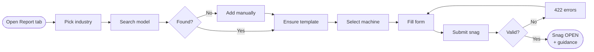
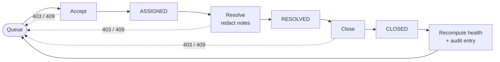
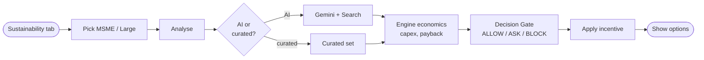
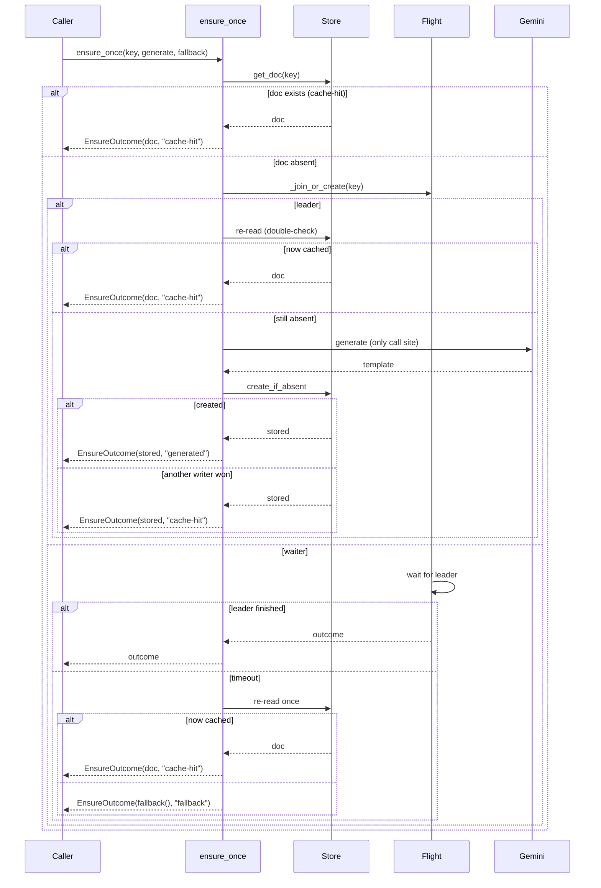
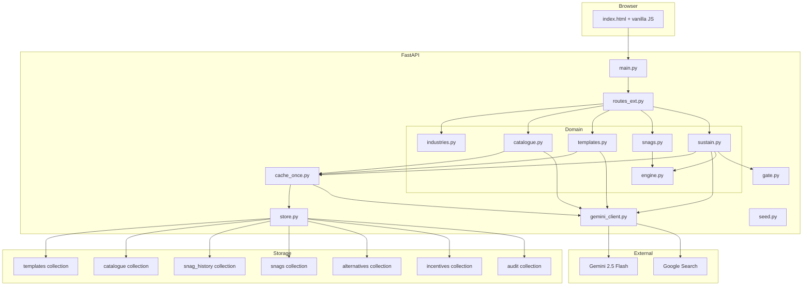
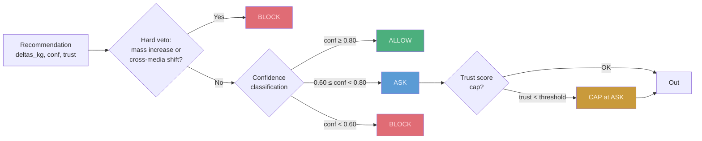

# TerraVow

**Machine health meets environmental accountability.**

TerraVow is an AI-powered environmental compliance and remediation-advisory platform that links factory machine health to pollution intensity, financial liability, and sustainable alternatives — with India government incentive schemes.

---

## TL;DR

| | |
|---|---|
| **What it is** | A prototype (Requirements 18–30) showing machine-health-driven pollution tracking, snag reporting, resolver workflow, health scoring, and sustainability recommendations with incentive schemes. |
| **Who it's for** | Plant reliability engineers, CFOs, environmental compliance officers, operations directors. |
| **What runs today** | Python FastAPI prototype with in-memory store or Firestore, Gemini 2.5 Flash for AI generation, Java Decision_Gate (tested but import fixes pending). No Vertex AI Agent Engine, Pub/Sub, BigQuery, or Cloud Storage used. |
| **What needs work** | Multi-replica safety (cross-replica lease), Integrity_Gate (Req 16), detection hardening (Req 17), verified trajectory certification, cross-replica lease. |

---

## The Problem

Factories are the growth engine of the world — but they're also the largest source of air, water, chemical, and soil pollution. A worn machine doesn't just cause downtime; it:

1. **Burns more energy and emits more pollution per unit of output** than when healthy.
2. **Creates an invisible financial liability** — regulatory penalties, wasted energy cost, forfeited efficiency incentives — that compounds hourly.
3. **Stays invisible to the people who could act** — maintenance tracks downtime cost, finance tracks capital budgets, compliance files reports after the fact. Nobody connects "deferred repair" to "₹X regulatory exposure and Y kilograms of avoidable emissions."

Existing systems don't close this loop: MES/ERP/CMMS optimize for downtime, not emissions; ESG tools produce threshold snapshots after the fact; carbon-accounting uses industry averages, not actual machine health.

---

## The Solution

TerraVow links **machine health → emissions → financial liability → actionable remediation** continuously and auditably:

1. **Machine health drives pollution intensity.** Health score (0–100) degrades from deferred maintenance. Degraded machines emit more — per day and over remaining lifespan.
2. **Deterministic engine computes every number.** Health score, lifespan, pollution intensity, capex, payback — all computed by pure Python, never by Gemini.
3. **AI generates deep per-model templates.** Gemini creates machine-specific snag taxonomies, job types, operating parameters — cached once per model.
4. **Sustainability recommendations with Decision Gate.** AI-suggested or curated alternatives pass through a safety gate (hard veto → confidence → trust cap). All items in demo are ASK or BLOCK.
5. **India incentives included.** Real-named schemes (UNVERIFIED/illustrative) + demo-synthetic schemes (ILLUSTRATIVE), filtered by enterprise size (MSME/Large).
6. **Graceful degradation.** No Gemini? Templates fall back to industry Base_Templates. Alternatives fall back to curated set. The flow never blocks.

---

## Features by Capability

### ✅ Built and Tested

| Feature | User Value | Status |
|---------|-----------|--------|
| **Four Industries** | Select textile, metals, chemicals, or mining — each with its pollution domains (air/water/chemical/soil) | Built |
| **Catalogue Search** | Search 20 sample machines (5 per industry) with auto-complete, scoped to industry | Built |
| **Manual Entry + Spec Lookup** | Add machines not in catalogue; Gemini retrieves specs via Google Search (T1+) | Built |
| **AI Deep Templates** | Gemini generates per-model snag taxonomy (≥12 snag types, ≥6 jobs, ≥8 parameters), cached once | Built |
| **Base_Template Fallback** | Deterministic industry template when Gemini unavailable | Built |
| **Dynamic Snag Form** | Form fields driven by stored template (3 core + template fields + pollutant-capture) | Built |
| **PII Redaction** | Emails and 10–15-digit phone numbers removed before storage | Built |
| **Reporter/Resolver Roles** | Role switch (workflow guidance only, no auth) | Built |
| **Status Transitions** | OPEN → ASSIGNED → RESOLVED → CLOSED with append-only events | Built |
| **Resolver Queue** | Open/Assigned snags sorted by severity | Built |
| **Health Score** | 6 penalty terms computed deterministically (frequency, severity, recurrence, trend, unresolved, age) | Built |
| **Remaining Lifespan** | Formula: `(design_life × 365 − age_days) × (health_score/100)^1.5`, ±15% band | Built |
| **Pollution Intensity** | Per-day kg CO2e/NOx/COD/BOD/effluent/chemical/solid/soil, scaled by health degradation | Built |
| **Health Timeline** | 12-point history (1 per month) showing health and pollution trends | Built |
| **Sustainable Alternatives** | Machine alternatives, operating-process changes, assembly changes — with economics | Built |
| **Decision Gate** | Hard veto (mass increase → BLOCK) → confidence classification (ALLOW/ASK/BLOCK) | Built |
| **Incentives (India)** | 7 real-named schemes (UNVERIFIED) + 2 demo-synthetic (ILLUSTRATIVE), filtered by MSME/Large | Built |
| **Audit Trail** | Hash-chained append-only audit entries | Built |
| **Demo Reset** | Restore seeded snags, delete demo data, preserve templates/alternatives | Built |

### 📋 Specified Only (Not Built)

| Feature | User Value | Status |
|---------|-----------|--------|
| **Integrity_Gate** | Source auth, calibration/health gating, replay defense, authorized-actor check, Data_Trust_Score | Specified (Req 16) |
| **Detection Hardening** | Baseline plausibility, independent verification source, trust-weighted profile, anchored hash root | Specified (Req 17) |
| **Multi-replica Safety** | Cross-replica lease, request deadline, waiter semaphore | Specified (task 14) |
| **Vertex AI Agent Engine** | Managed multi-agent runtime | Specified, prototype uses direct Gemini |
| **Pub/Sub + BigQuery** | Streaming ingestion, continuous queries | Specified, prototype uses polling |
| **Trajectory Certification** | Publish to public registry after verified improvement | Specified, not wired |
| **Java Requirements 16–17** | Core logic exists; test import fixes pending | Specified, tests not green |

---

## User Flows

### Reporter Journey: Report a Snag



### Resolver Journey: Accept → Resolve → Close

The queue shows open snags worst-first. Each snag moves `OPEN -> ASSIGNED -> RESOLVED -> CLOSED`; every action checks the role is `RESOLVER` (else 403) and the status is valid for that step (else 409).



### Machine Health View


### Sustainability View



### Cache-Once Template Sequence



---

## Architecture

### Component Map



### Data Model (Collections)

| Collection | Key | Purpose |
|---|---|---|
| **industries** | `{id}` | 4 industries, domain-to-indicator map |
| **catalogue** | `{model_key}` | 20 sample entries + manual entries |
| **templates** | `{model_key}--{version}` | AI-generated or Base_Template |
| **snag_history** | `{machine_id}` | Machine header (industry, model_key, install_year) |
| **snags** | `{snag_id}` | Snag documents with events |
| **alternatives** | `{model_key}--{country}--s1` | Cached AI alternatives |
| **incentives** | `{country}--{scheme_id}` | 7 real-named + 2 demo-synthetic schemes |
| **audit** | `AUD-{ts}-{hex}` | Hash-chained audit entries |

### API Endpoints

#### Industries & Catalogue

| Method | Path | Purpose |
|--------|------|---------|
| GET | `/api/industries` | List 4 industries |
| GET | `/api/catalogue/search?industry={id}&q={query}` | Search catalogue (≤10, sample data) |
| POST | `/api/catalogue/manual` | Add machine manually with specs |

#### Templates

| Method | Path | Purpose |
|--------|------|---------|
| POST | `/api/template/ensure` | Get-or-generate template (cache-once) |
| GET | `/api/template/{key}` | Fetch cached template (never calls Gemini) |

#### Instances & Snags

| Method | Path | Purpose |
|--------|------|---------|
| POST | `/api/instances` | Register machine instance |
| GET | `/api/instances?model_key={key}` | List machines |
| POST | `/api/snags` | Submit snag report |
| GET | `/api/snags?status={status}&machine_id={id}` | Query snags |
| POST | `/api/snags/{id}/accept` | Resolver: OPEN → ASSIGNED |
| POST | `/api/snags/{id}/resolve` | Resolver: ASSIGNED → RESOLVED |
| POST | `/api/snags/{id}/close` | Resolver: RESOLVED → CLOSED |

#### Resolver Queue

| Method | Path | Purpose |
|--------|------|---------|
| GET | `/api/resolver/queue` | List OPEN + ASSIGNED snags (severity-first) |

#### Health

| Method | Path | Purpose |
|--------|------|---------|
| GET | `/api/machines/{id}/health?as_of={date}` | Health score, lifespan, pollution, timeline |
| GET | `/api/machines/{id}/history` | Snag history (≤500) |

#### Sustainability

| Method | Path | Purpose |
|--------|------|---------|
| POST | `/api/machines/{id}/recommendations` | Alternatives + incentives (body: enterprise_size, country) |
| GET | `/api/incentives?country={CC}&industry={id}&enterprise_size={size}` | List schemes |

#### System

| Method | Path | Purpose |
|--------|------|---------|
| GET | `/api/health` | Health check (gemini_mode, store_backend, seeded) |
| POST | `/api/demo/reset` | Reset demo (gated by DEMO_RESET_ENABLED) |
| GET | `/api/registry` | Audit chain integrity check |

### Decision Gate

The **Decision Gate** is the single safety chokepoint for every sustainability recommendation:



1. **Hard veto first** — any increase in total emission mass or shift between media → BLOCK regardless of confidence
2. **Confidence classification** — ALLOW (≥0.80), ASK (≥0.60), BLOCK (<0.60)
3. **Trust cap** — can only lower classification, never raise it

In the demo, all items are ASK or BLOCK (tuned for human review).

### Deterministic-Numbers vs. LLM Boundary

- **Engine (never touches Gemini):** health_score, remaining_lifespan, pollution_intensity, health_timeline, candidate_economics, incentive filtering
- **Gemini (orchestrated by engine):** template generation (drafts structure), spec lookup (searches web), alternatives suggestion (returns ranges, engine computes midpoint)

Numbers shown to users are always computed by the deterministic engine, never free-generated.

### Graceful Degradation

| Path | Primary | Fallback |
|------|---------|----------|
| Template generation | Gemini generates deep template | Industry Base_Template (source: fallback-base) |
| Spec lookup | Gemini + Google Search | Entry with no specs (specs_status: sample) |
| Alternatives | Gemini suggests with ranges | Curated 5-item set (source: curated-fallback) |

---

## Tech Stack

| Component | Technology | Used? |
|-----------|------------|-------|
| **Backend API** | FastAPI (Python) | ✅ Yes |
| **Data validation** | Pydantic | ✅ Yes |
| **LLM** | Gemini 2.5 Flash via google-genai | ✅ Yes |
| **Grounding** | Google Search tool | ✅ Yes |
| **Storage** | Firestore (or in-memory fallback) | ✅ Yes |
| **Frontend** | Vanilla JS + index.html | ✅ Yes |
| **Hosting** | Cloud Run (or local uvicorn) | ✅ Yes |
| **Java engine** | Spring Boot 3.4.13, Java 17 | ⚠️ Partial (Decision_Gate core exists; tests pending import fixes) |
| **Testing** | pytest (151 tests), JUnit + jqwik (490 tests) | ✅ Yes |

### Explicitly NOT Used

| Service | Reason |
|---------|--------|
| **Vertex AI Agent Engine** | Prototype uses direct Gemini calls |
| **Pub/Sub** | Prototype uses request-response |
| **BigQuery** | Prototype uses Firestore/in-memory |
| **Cloud Storage** | Regulatory corpus not in prototype |
| **Vertex AI Search** | Prototype uses direct Gemini + Google Search |

---

## Honesty and Limitations

- **No authentication** — role switch is workflow guidance, not access control
- **Sample data** — 20 catalogue models are illustrative, not authoritative
- **Illustrative economics** — replacement values, degradation factors, incentive rates are demo assumptions
- **UNVERIFIED incentives** — real-named India schemes are qualitative only; quantitative figures from demo-synthetic schemes labeled ILLUSTRATIVE
- **Estimates, not measurements** — health, lifespan, pollution intensity are computed from snag history, not sensor data
- **No official certification** — platform records evidence, doesn't issue certificates
- **Single-instance cap** — cross-replica lease not implemented; demo runs one worker
- **Java tests pending** — Decision_Gate core logic exists but test import fixes needed

---

## How to Run and Test

### Prerequisites

- Python 3.11+ (tested on 3.13)
- JDK 17+ (for Java engine)

### Zero-Service Tier (No Gemini)

```bash
cd /Users/rachit.gupta/IdeaProjects/terravow/prototype

# Setup
python3 -m venv .venv
.venv/bin/pip install -r requirements.txt

# Run (no API key needed)
.venv/bin/uvicorn app.main:app --port 8080
```

### With Gemini (Tier 1)

```bash
export GEMINI_API_KEY=your-key
export GOOGLE_GENAI_USE_VERTEXAI=false
.venv/bin/uvicorn app.main:app --port 8080
```

### Demo Reset

```bash
curl -s -X POST localhost:8080/api/demo/reset
```

### Run Python Tests

```bash
cd /Users/rachit.gupta/IdeaProjects/terravow/prototype
.venv/bin/python -m pytest tests -v
# 151 tests: all pass
```

### Run Java Tests

```bash
cd /Users/rachit.gupta/IdeaProjects/terravow
./mvnw test
# 490 tests: property-based (jqwik) + unit tests
```

---

## Repository Layout

```
terravow/
├── .kiro/specs/terravow/     # Full specification (gitignored locally)
├── src/main/java/com/terravow/
│   ├── domain/               # Machine_Asset, Maintenance_Event, etc.
│   ├── gate/                 # Decision_Gate (hard veto → confidence → trust)
│   ├── evidence/             # Evidence_Chain & Audit
│   ├── capability/           # EID, ERD, AEI, Substitution, etc.
│   └── ...
├── prototype/
│   ├── app/                  # FastAPI application
│   │   ├── main.py           # Entry point, seeding
│   │   ├── routes_ext.py     # All API endpoints
│   │   ├── engine.py         # Deterministic health/pollution/economics
│   │   ├── gemini_client.py  # Gemini wrapper
│   │   ├── gate.py           # Decision Gate
│   │   └── ...
│   ├── data/                 # Seeded JSON data
│   ├── static/               # index.html UI
│   └── tests/                # 151 pytest tests
├── docs/                     # Detailed docs (do NOT delete)
│   ├── product-features.md
│   ├── system-architecture.md
│   ├── user-flow.md
│   └── demo-testing-guide.md
├── README.md                 # ← This file (consolidated)
└── deploy.sh                 # Cloud Run deployment
```

---

## Where to Read More

- [Product Features](./docs/product-features.md) — detailed feature catalogue
- [System Architecture](./docs/system-architecture.md) — component map, data model, cache-once design
- [User Flow](./docs/user-flow.md) — step-by-step journey narratives with Mermaid
- [Demo Testing Guide](./docs/demo-testing-guide.md) — test playbook, tier selection
- `.kiro/specs/terravow/` — full requirements, design, tasks (gitignored locally)

---

## License

MIT — see [LICENSE](./LICENSE).