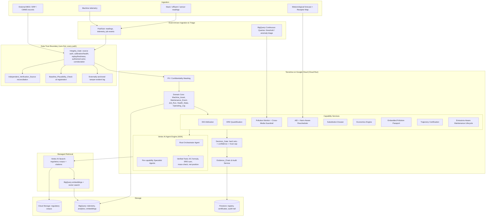
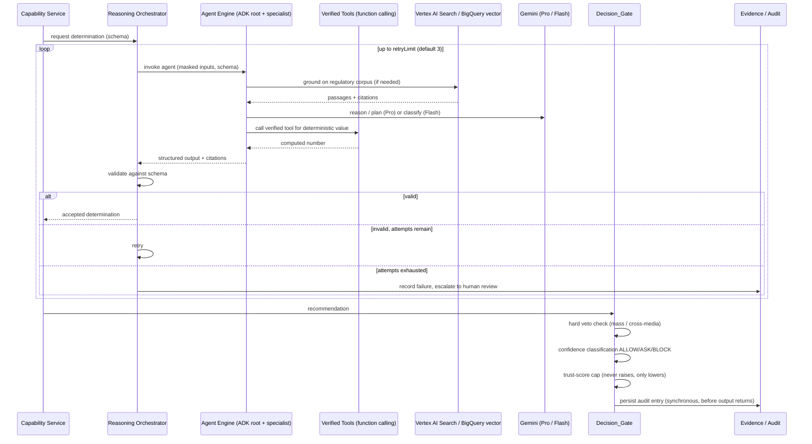

# TerraVow

**Enforce. Certify. Track.**

TerraVow is an AI-powered environmental compliance, remediation-advisory, and certification
platform for manufacturing supply chains, built end-to-end on Google Cloud (Gemini on Vertex AI,
Vertex AI Agent Engine, BigQuery, Cloud Storage, Cloud Run, Firestore, Pub/Sub).

This README covers both the product story and the architecture:

- **Part 1 — Product Overview**: what problem we're solving, who it's for, and why it matters.
  Written for a general audience and judges without a technical background.
- **Part 2 — Design Deep Dive**: how the system actually works, the architecture, the AI
  reasoning pipeline, and the safety/correctness guarantees. Written for technical judges.

---

# Part 1 — Product Overview

## The problem, in one sentence

**A factory's broken machine is an unpriced pollution event, and nobody currently prices it.**

## The thesis

Every factory has machines that are quietly degrading — a worn seal, a drifting burner, a
clogged filter. When maintenance on that machine is deferred, three things happen that no
existing system connects:

1. The machine burns more energy and emits more pollution **per unit of output** than it did
   when it was healthy.
2. That extra pollution is a **real, growing financial liability** — regulatory penalties,
   wasted energy cost, forfeited efficiency incentives — that compounds for every hour the
   machine keeps running degraded.
3. That liability is **completely invisible** to the people who could act on it. Maintenance
   teams track downtime cost. Finance tracks capital budgets. Compliance teams file reports
   after the fact. Nobody connects "we deferred this repair" to "we just created ₹X of
   regulatory exposure and Y kilograms of avoidable emissions."

Conventional systems don't close this loop:

- **MES/ERP/CMMS systems** optimize for downtime cost, not emissions cost.
- **ESG reporting tools** produce threshold-based compliance snapshots after the fact — they
  don't predict or price the liability while it's still accruing.
- **Carbon-accounting tools** use industry-average emission factors, not the actual, current
  health state of the specific machine that made the specific batch.

TerraVow is built to close exactly this loop: **link machine health → emissions → financial
liability → actionable remediation → verified improvement**, continuously, automatically, and
auditably.

## Who this is for

| User | What they get |
|---|---|
| **Plant reliability engineer** | A number that separates "pollution we caused by neglect" from "pollution the process can't avoid" — so maintenance decisions can be defended on environmental grounds, not just downtime cost. |
| **CFO / finance leader** | Deferred maintenance expressed as an accruing balance-sheet liability (Environmental Regulatory Debt), not a hidden engineering judgment call. |
| **Environmental compliance officer** | Continuous air/water monitoring with a guardrail that catches "fixes" that just move pollution from air to water instead of actually reducing it. |
| **Operations director** | AI-generated, cited counterfactuals for replacing a machine or process step — emissions, energy, cost, and payback, before committing capital. |
| **Compliance & finance analyst** | Penalty exposure and incentive eligibility reasoned from real regulatory instruments, with a citation back to the primary source for every figure — never an invented number. |
| **Supply-chain sustainability lead** | A per-batch, machine-health-adjusted emissions footprint that follows the batch through every downstream tier, replacing industry-average Scope-3 guesswork with actual values. |
| **Procurement manager** | A public registry of facilities certified on *verified improvement trajectory* — not a single audit-day snapshot that can be staged. |
| **Auditor / regulator** | Every number traceable back to its primary-source reading, filing, or regulatory text — a complete, retained decision trail. |

## What TerraVow actually does (the pipeline)

1. **Attributes pollution to machine health.** TerraVow computes **EID (Emissions-Intensity
   Degradation)** — the excess emissions per unit of output caused specifically by the
   machine's current health state, isolated from the pollution the process itself inherently
   requires.
2. **Prices the liability.** TerraVow computes **ERD (Environmental Regulatory Debt)** — a
   single, continuously-accruing monetary figure combining expected regulatory penalty
   exposure, excess energy cost, forgone efficiency-certificate value, forgone tax
   depreciation benefit, and cross-media treatment cost.
3. **Monitors pollution with a guardrail against gaming.** Stack, effluent, and sensor
   readings are checked against regulatory thresholds and statistical anomalies — and a
   **Cross-Media Guardrail** specifically catches "fixes" that reduce air pollution by
   dumping more into water (or vice versa).
4. **Measures *when* pollution happens, not just how much.** The **Avoidable Exposure Index
   (AEI)** values the same tonnage of emissions differently depending on *when* it's released
   relative to weather and population exposure — and recommends re-scheduling flexible
   operations to reduce public-health harm at zero additional emissions.
5. **Synthesizes sustainable alternatives.** The **Substitution Dossier** generates AI-reasoned
   counterfactuals for replacing a machine or process step — each with emissions delta, energy
   delta, cost delta, payback period, and a mandatory "requires vendor validation" flag, so it's
   a lead for engineers, never an auto-approved decision.
6. **Reasons over real regulation, not invented numbers.** The **Economics Engine** retrieves
   actual regulatory instrument structures — the real Environmental Compensation formula shape,
   PAT/ESCerts eligibility, Income Tax Act Section 32 depreciation — and cites the primary
   source for every figure it produces. Every output is explicitly labeled a cited draft for
   professional review, never legal or tax advice.
7. **Carries the footprint through the supply chain.** The **Embedded Pollution Passport**
   attaches a machine-health-adjusted emissions footprint to each batch and propagates it
   proportionally into every downstream batch that consumes it — replacing industry-average
   Scope-3 factors with real, machine-conditioned values.
8. **Gates every recommendation with a hard safety veto.** The **Decision Gate** classifies
   every recommendation ALLOW / ASK / BLOCK by confidence — and applies a **hard veto that
   blocks any recommendation that would increase total pollution or shift it between media**,
   regardless of how confident the system is. Nothing auto-applies beyond its own confidence.
9. **Certifies real, sustained improvement.** **Trajectory Certification** publishes facilities
   to a public global registry based on verified improvement measured over time — at least two
   separated measurement points — specifically designed to resist a single staged "audit-day"
   snapshot.
10. **Proves every number.** Every counterfactual, penalty figure, and certification carries a
    machine-checkable **Evidence Chain** back to its primary source, and every decision is
    persisted to an audit trail retained for at least 7 years.

## Why this is hard (and why it matters that we got it right)

The obvious failure mode for a platform like this is: it becomes a black box that invents
numbers, or it becomes gameable by the exact people it's supposed to be holding accountable.
We treated both as first-class design problems, not afterthoughts:

- **Every number is either a cited fact or a disclosed counterfactual.** Nothing is a bare
  LLM assertion. Regulatory figures are retrieved and cited; everything else carries a
  confidence value and a full evidence chain.
- **The system cannot be gamed by its own data.** We built a dedicated **data-authenticity and
  integrity layer** (detailed in Part 2) specifically because the parties being monitored have
  a direct financial incentive to under-report emissions or fake a maintenance record to reset
  their liability clock. This is not a bolt-on — it's structural, and it's informed by real
  fraud patterns documented in carbon-credit markets and false-data-injection-attack research.
- **Safety never degrades silently.** Every AI/network/cloud dependency has a defined fallback
  that *lowers* confidence rather than failing outright — and no fallback, no managed service,
  and no "high confidence" reading can ever override the hard pollution-increase veto.

## The honest caveat

TerraVow produces **cited drafts and advisory determinations**, not authoritative legal, tax, or
engineering sign-off. Every substitution dossier is flagged as requiring vendor validation and
process-safety review. Every economics-engine output is labeled as a draft for qualified
professional review. The platform is designed to make the right decision obvious and
well-evidenced — the accountable human or regulator still makes the call.

---

# Part 2 — Design Deep Dive (for Technical Judges)

## Two design principles that govern everything

1. **Every produced number is either a cited fact or a disclosed counterfactual.** Values that
   exist in a database (a regulatory rate, a filed reading) are retrieved and cited. Values
   that don't exist anywhere — a counterfactual substitution, a timing-optimized schedule, a
   certification verdict — are reasoned by a Gemini agent, schema-validated, and carry a
   machine-checkable Evidence Chain back to a primary source. Deterministic arithmetic (the
   Environmental Compensation formula, ERD summation, mass-preservation checks, net-position)
   is never free-generated by the model — it runs as a **verified tool** the agent calls via
   Gemini function calling.
2. **Safety is structural, not advisory.** The Decision Gate applies a **hard veto** against
   any recommendation that would increase total emission mass or shift load between
   environmental media — applied *before* confidence classification, so a vetoed
   recommendation is BLOCK regardless of how confident the system is. Every enrichment path
   degrades gracefully by lowering confidence, never by failing silently or guessing.

## System architecture



## The AI reasoning pipeline

Every determination flows through the same disciplined pipeline:



**Why this pipeline, concretely:**

- **Gemini 3.1 Pro** handles deep, multi-step reasoning — substitution dossiers, economics
  timing optimization, certification trajectory analysis — using its long context and native
  tool use.
- **Gemini Flash** handles high-volume, latency-sensitive classification — threshold checks,
  masking triage, intent routing — where speed matters more than depth.
- **Function calling** keeps arithmetic honest: the Environmental Compensation formula,
  ERD summation, mass-preservation checks, and net-position math are executed as verified
  application code the agent calls, not generated text the agent might get wrong.
- **Vertex AI Search + BigQuery vector search** ground the Economics Engine on an actual
  regulatory corpus with native citations, so "Section 32 depreciation" is a retrieved,
  cited passage, not a model guess.
- **Bounded retries, hard escalation.** A determination that fails schema validation retries
  up to a configured limit (1–5, default 3); exhausting retries doesn't produce a guess — it
  escalates to human review with a complete failure record.

## The Decision Gate — the single safety chokepoint

Every recommendation, from every capability, passes through one gate before it can be surfaced
or applied:

1. **Hard veto first.** If the recommendation would increase total emission mass or shift
   pollutant load between environmental media by any amount above zero — **BLOCK**,
   unconditionally, before confidence is even considered.
2. **Confidence validity.** A missing or out-of-range confidence value — **BLOCK**, routed to
   human review (fail-closed, never fail-open).
3. **Confidence classification.** Above the allow threshold → ALLOW. Between the ask and allow
   thresholds → ASK. Below the ask threshold → BLOCK.
4. **Trust-score cap.** If the governing Data_Trust_Score (see below) is below its configured
   threshold, the classification is capped at ASK — **this step can only lower a
   classification, never raise one, and never lifts the hard veto.**

No managed Google service, no fallback path, and no AI output can skip this ordering or
override the veto.

## Data authenticity and integrity — why this exists and how deep it goes

A platform that prices financial liability and issues public certifications from fed-in sensor
and maintenance data is a direct fraud target: an operator has a financial incentive to
under-report emissions or forge a maintenance record to reset their liability clock. We treated
this as core architecture, not an afterthought, and hardened it in two layers after researching
real-world fraud patterns (carbon-credit MRV scandals, false-data-injection-attack literature,
continuous-emissions-monitoring cross-validation practice, and tamper-evident logging practice).

**Layer 1 — Integrity_Gate (runs at ingestion, ahead of PII masking, ahead of any reasoning or
persistence, on both the batch and streaming paths):**

| Check | Defends against |
|---|---|
| Source authentication (signed payload / device credential) | An unauthenticated or spoofed data source |
| Instrument registry + calibration/health gating | A drifted, expired-calibration, or failed sensor being trusted at full confidence |
| Replay / freshness / monotonic-timestamp checks | Duplicate or replayed "healthy" readings |
| Authorized-actor check on maintenance events | A forged maintenance record used to reset the ERD liability clock |
| Cross-source corroboration (energy vs. output vs. emissions) | An internally inconsistent, implausible reading |

Every outcome feeds a per-record **Data_Trust_Score in [0,1]** that bounds downstream
confidence and caps the Decision Gate at ASK when trust is low — trust can only ever lower a
classification, never raise one.

**Layer 2 — Detection hardening (added after literature research surfaced the limits of Layer
1 alone):**

| Hardening | The gap it closes |
|---|---|
| **Baseline Plausibility Check** | The dominant real-world MRV fraud pattern isn't live-sensor spoofing — it's an inflated *reference baseline* set once at registration and never re-examined. We screen the Commissioning_Baseline against fleet-cohort ranges and engineering limits at registration time. |
| **Independent Verification Source** | False-data-injection-attack research proves correlation/consistency-only detection has a mathematical ceiling: an attacker who understands their own facility can craft readings that are internally consistent and pass every self-corroboration check. We reconcile against an *exogenous* source (satellite/remote-sensing, independent meters, regulator data) the facility can't influence, and cap self-corroboration-only data below full trust. |
| **Trust-Weighted Anomaly Profile** | A party who controls a sensor's early history can poison what "normal" looks like before detection engages. Our anomaly baseline is built only from readings at or above a trust threshold — a reduced-trust reading is still checked against the baseline, but never allowed to shape it. |
| **Externally-Anchored Tamper Evidence** | A hash-chained log alone only proves internal consistency — it doesn't prove the keeper of the chain didn't rewrite history. We periodically publish the chain's hash root to an external, operator-uninfluenced location for independent reverification. |

Every one of these four hardening mechanisms is **structurally downgrade-only** — proven as a
correctness property — meaning none of them can ever raise a Decision Gate classification or a
confidence value beyond what the base safety rules already allow.

## Google Cloud — how the stack is used, not just named

| Google Cloud capability | Role |
|---|---|
| **Vertex AI Agent Engine + ADK** | Managed multi-agent runtime: a root orchestrator delegates to per-capability specialist agents, with Sessions, Memory Bank (masked data only), evaluation, and sandboxed code execution. |
| **Gemini 3.1 Pro / Gemini Flash** | Two-tier model routing — deep reasoning on Pro, high-volume classification on Flash. |
| **Gemini function calling** | Deterministic computations run as verified tools the agent calls, not free-generated text. |
| **Vertex AI Search** | Grounded retrieval over the regulatory corpus with native citation metadata, feeding the Economics Engine's Evidence Chain. |
| **BigQuery (+ embeddings/vector search)** | Telemetry, emissions analytics, EID/ERD time series, and in-warehouse embedding/vector retrieval co-located with the data it corroborates. |
| **Pub/Sub + BigQuery continuous queries** | Event-driven streaming ingestion for readings/telemetry, feeding near-real-time threshold/anomaly triage. |
| **Cloud Storage** | Regulatory corpus, filings, and primary-source documents referenced by every Evidence Chain. |
| **Firestore** | Public certification registry, certificates, and the 7-year-retained audit trail. |
| **Cloud Run** | Hosts every TerraVow service. |

## Correctness as a first-class deliverable, not a demo

TerraVow's specification defines **64 formally stated correctness properties** — universal
statements like "EID attribution is additive," "a vetoed recommendation is BLOCK regardless of
confidence," "trust never raises a classification," and "an out-of-tolerance baseline is never
admitted at full confidence" — each validated with **property-based tests (jqwik, 100+
generated cases per property)**, not just hand-picked examples. This was a deliberate choice:
a platform whose entire value is "you can trust this number" has to be able to prove it, not
just assert it.

## What's genuinely novel here (for judging criteria)

- **EID / ERD**: a mechanism that attributes a *portion* of emissions specifically to the
  maintenance decision, isolating it from the unavoidable process minimum, and prices it as a
  compounding liability — not an industry-average emissions estimate.
- **AEI**: valuing emissions by *when* they happen relative to weather and population exposure,
  not just how much — a mass-preserving, zero-additional-emissions optimization.
- **Trajectory Certification**: certifying *verified improvement over time* specifically to
  resist the single-audit-day gaming that undermines conventional certification.
- **Embedded Pollution Passport**: replacing Scope-3 industry averages with actual,
  machine-health-conditioned values that propagate through the supply chain.
- **Structural fraud-resistance**: a two-layer data-integrity architecture grounded in real
  literature (MRV fraud cases, FDIA research, CEMS cross-validation, tamper-evident logging)
  rather than a generic "add some validation" afterthought — because a certification-and-
  liability platform is specifically the kind of system an adversary has the strongest
  incentive to feed false data into.

## Honesty about scope

This is a specification-and-architecture submission: requirements, design, and a fully
decomposed, test-driven implementation task list (29 top-level tasks, 64 correctness
properties, property-based + unit + integration + smoke test coverage mapped to every
requirement) are complete. Implementation proceeds task-by-task from that plan. Figures used in
economics-engine examples (Environmental Compensation formula shape, PAT/ESCerts, Income Tax
Act Section 32) are retrieved-and-cited at runtime against a real regulatory corpus — the
platform is designed to never state a regulatory figure it cannot cite back to a primary source.

---

# Appendix — Repository Guide

For where TerraVow sits against adjacent categories (carbon accounting, predictive maintenance,
EHS, CEMS/PEMS, carbon-credit MRV), see [`competitive-landscape.md`](competitive-landscape.md).

The full specification lives under [`.kiro/specs/terravow/`](.kiro/specs/terravow/):
`requirements.md` (EARS-format acceptance criteria), `design.md` (architecture and correctness
properties), and `tasks.md` (the implementation plan).

## Tech stack

- **Java 17**, **Spring Boot 3.4.13**
- **Maven** (wrapper included — no local Maven install required)
- **JUnit 5 + jqwik** (property-based testing) + **AssertJ**
- Target deployment: **Google Cloud** — Cloud Run, Vertex AI (Gemini 3.1 Pro / Flash), Vertex AI
  Agent Engine, Vertex AI Search, BigQuery, Cloud Storage, Firestore, Pub/Sub

## Getting started

### Prerequisites

- JDK 17+

### Build

```bash
./mvnw clean install
```

### Run tests

```bash
./mvnw test
```

Tests include both conventional unit/integration tests (`*Test`, `*Tests`) and jqwik
property-based tests (`*Properties`) that validate the formally stated correctness properties
described above — e.g. "a vetoed recommendation is BLOCK regardless of confidence," "EID
attribution is additive," "trust never raises a Decision_Gate classification."

### Run the application

```bash
./mvnw spring-boot:run
```

Configuration lives in `src/main/resources/application.yml` under the `terravow.*` namespace
and is config-gated with safe, behaviour-preserving defaults.

## Project structure

```
.kiro/specs/terravow/     Requirements, design, and task-list specification
src/main/java/com/terravow/
  domain/                 Machine_Asset, Maintenance_Event, Job_Run, Operating_Log, baselines
  gate/                   Decision_Gate (hard veto -> confidence -> trust cap)
  evidence/               Evidence_Chain & Audit service
  reasoning/              Reasoning_Agent Orchestrator (schema-validate -> retry -> escalate)
  llm/                    Two-tier Gemini model routing (Pro / Flash)
  capability/             EID, ERD, pollution monitor, AEI, substitution dossier,
                          economics engine, embedded pollution passport,
                          certification, maintenance lifecycle
  pii/                    PII/confidentiality masking and synthetic data
  ingest/                 Pub/Sub + BigQuery continuous-query streaming ingestion
  degradation/            Graceful degradation with confidence-lowering fallbacks
  gcp/                    Agent Engine, storage adapters (BigQuery / Cloud Storage / Firestore)
src/test/java/com/terravow/   Mirrors the main tree; property tests validate design.md's
                               correctness properties (jqwik, @Property(tries = 100))
```

## License

MIT — see [`LICENSE`](LICENSE).
