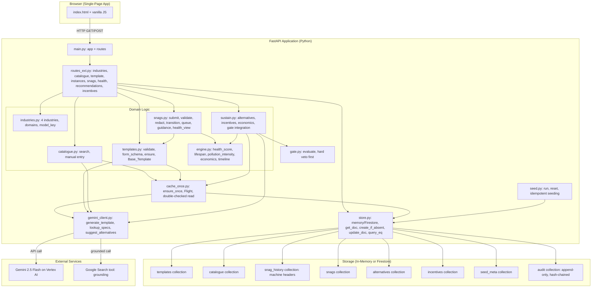
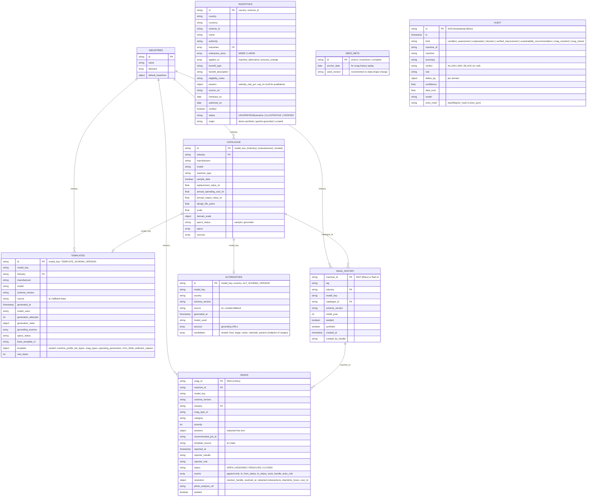
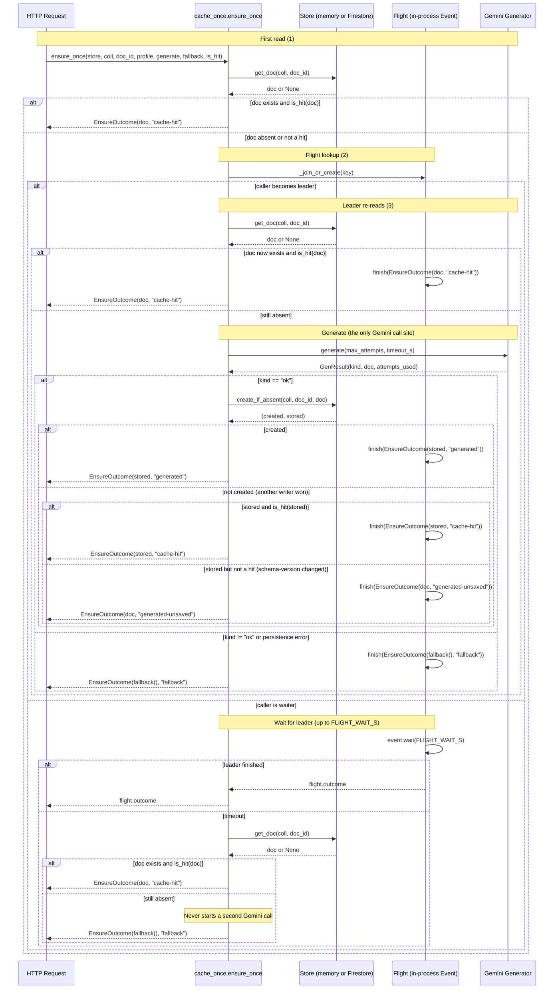

# TerraVow System Architecture (As Built)

**Cross-links:**  
- [Product Features](./product-features.md) — detailed feature catalogue  
- [User Flow](./user-flow.md) — end-to-end journeys for Reporter and Resolver roles

This document describes the **TerraVow prototype system architecture as actually implemented** (Requirements 18–30), covering the component map, data model, API endpoints, cache-once create-if-absent sequence, deterministic-numbers-vs-LLM boundary, graceful degradation, and where the Java engine fits.

---

## Component Map

### Component Responsibilities

| Component | Responsibility |
|-----------|---------------|
| **main.py** | FastAPI app entrypoint, `/api/health`, fleet routes (original fix-first demo), `/` (serves index.html), startup seeding |
| **routes_ext.py** | Extended API router: industries, catalogue, template, instances, snags, resolver queue, health, recommendations, incentives |
| **industries.py** | Four industries, domain-to-indicator map, model_key computation, fold/slug normalization, startup self-check |
| **catalogue.py** | Catalogue search (scoped, case-insensitive, ≤10), manual entry (lookup specs via Gemini + Google Search), `catalogue` collection CRUD |
| **templates.py** | Template validation (10 rules), form schema builder, Base_Template fallback, `ensure_template` (calls cache_once), `get_stored` (fetch-only) |
| **snags.py** | Machine instances, snag submission, validate_answers, redaction, Reporter/Resolver transitions, queue, guidance resolution, health_view |
| **sustain.py** | Sustainable alternatives (curated + AI-suggested), incentives, economics (deterministic engine), gate integration, backfill logic |
| **engine.py** | **Deterministic pure functions:** health_score, remaining_lifespan, pollution_intensity, degradation_loss, health_timeline, candidate_economics, payback_status, incentive_eligible, apply_incentive |
| **cache_once.py** | Get-or-generate with "call Gemini at most once per key": double-checked read, single-flight per key, `create_if_absent` final guard, fallback on failure |
| **gemini_client.py** | Gemini 2.5 Flash API wrapper: `generate_template`, `lookup_specs`, `suggest_alternatives` (all with structured output, bounded retry, timeout) |
| **gate.py** | Decision Gate: hard veto first (mass/cross-media increase → BLOCK), then confidence classification (ALLOW/ASK/BLOCK) |
| **store.py** | Abstract Store interface with memory (dict-of-dicts + lock) and Firestore backends: `get_doc`, `create_if_absent`, `update_doc`, `query_eq`, `add_audit` (hash-chained) |
| **seed.py** | Idempotent seeding of snag histories (anchor-date-based), incentives, demo reset (restores seeds, deletes demo-created data, clears overrides) |
| **index.html** | Single-page app: 5 tabs (Fix-first, Report a snag, Resolver queue, Machine health, Sustainability), vanilla JS, textContent/el()/safeLink only, exactly 2 numeric `innerHTML` SVG uses |

---

## Data Model

### Collection Details

| Collection | Key | Indexed Fields | Seeded? | Reset Behavior |
|------------|-----|----------------|---------|----------------|
| **industries** | `{id}` | — | Loaded from JSON at startup | Never reset |
| **catalogue** | `{model_key}` | `industry`, `model_key` | 20 sample entries + 0–N manual entries | Manual entries preserved |
| **templates** | `{model_key}--{version}` | `model_key`, `schema_version`, `source` | None (generated on demand) | Preserved |
| **snag_history** | `{machine_id}` | `model_key`, `seeded` | 6 fleet machines | Seeded restored, demo-created deleted |
| **snags** | `{snag_id}` | `machine_id`, `status` | 7 open snags at anchor | Seeded restored, demo-created deleted |
| **alternatives** | `{model_key}--{country}--s1` | `model_key`, `country`, `source` | None (generated on demand) | Preserved |
| **incentives** | `{country}--{scheme_id}` | `country`, `industries`, `enterprise_sizes` | 9 schemes (7 real-named + 2 demo-synthetic) | Preserved |
| **seed_meta** | `anchor`, `incentives`, `complete` | — | Anchor date, seed versions | Anchor date updated |
| **audit** | `AUD-{ns}--{6hex}` | — | None | Preserved (append-only) |

**No composite indexes** are required in the prototype (all queries are single-field or in-memory filter).

**Store.create_if_absent refusal:** The `templates` and `alternatives` collections refuse `create_if_absent` for any document whose `source != "ai"` (via `NotAiDocument` exception), preventing fallback documents from being stored.

**Labels:**

- `sample_data: true` — catalogue entry is illustrative, not an authoritative manufacturer database  
- `seeded: true` — snag or machine is part of the demo seed  
- `synthetic: true` — snag history was generated for the demo (carries an anchor date)

---

## Key API Endpoints

### Industries and Catalogue

| Method | Path | Purpose | Parameters | Response |
|--------|------|---------|------------|----------|
| GET | `/api/industries` | List four industries | — | `{industries: [{id, name, domains}]}` |
| GET | `/api/catalogue/search` | Search catalogue | `?industry={id}&q={query}` | `{entries: [...], notice}` (≤10, 422 if q > 80 or industry unknown) |
| POST | `/api/catalogue/manual` | Add machine manually | `{industry, manufacturer, model, handle}` | Entry with specs (grounded) or sample (fallback); 422 if validation fails, 429 if cap reached |

### Template

| Method | Path | Purpose | Parameters | Response |
|--------|------|---------|------------|----------|
| POST | `/api/template/ensure` | Get-or-generate template | `{catalogue_id}` (body) | `{key, template_id, cache_status, source, generated_at, model_used, schema_version, grounding_sources, specs_status, template, form_schema, user_message, disclaimer, labels}` (404 if entry absent, 503 if Gemini configured but fails) |
| GET | `/api/template/{key}` | Fetch stored template | — | Same as ensure (or 404 if not cached); **never calls Gemini** |

### Instances and Snags

| Method | Path | Purpose | Parameters | Response |
|--------|------|---------|------------|----------|
| POST | `/api/instances` | Register new machine | `{catalogue_id, tag, install_year, handle}` (body) | Machine header; 422 if validation fails, 429 if cap reached |
| GET | `/api/instances` | List machines | `?model_key={key}` (optional) | `[{machine_id, tag, industry, model_key, catalogue_id, created_at, ...}]` (≤200) |
| POST | `/api/snags` | Submit snag report | `{machine_id, snag_type_id, severity, answers, photo_analysis_ref, role, handle}` (body) | `{snag, guidance}` or 422 with `[{field, reason}]`; 409 if no template and not fallback-eligible, 429 if per-machine cap reached |
| GET | `/api/snags` | Query snags | `?status={status}&machine_id={id}` (single field only) | `[{snag_id, machine_id, snag_type_id, severity, status, reported_at, ...}]` |
| POST | `/api/snags/{id}/accept` | Resolver accepts snag | `{role, handle}` (body) | Updated snag; 403 if wrong role, 409 if wrong status |
| POST | `/api/snags/{id}/resolve` | Resolver resolves snag | `{role, handle, resolution: {notes, actions_taken, downtime_hours, cost_inr}}` (body) | Updated snag; 403/409 as above |
| POST | `/api/snags/{id}/close` | Resolver closes snag | `{role, handle}` (body) | `{snag, health_summary}` (recomputed health after close); 403/409 as above |

### Resolver Queue

| Method | Path | Purpose | Parameters | Response |
|--------|------|---------|------------|----------|
| GET | `/api/resolver/queue` | List open/assigned snags | — | `[{snag, guidance_source, label, snag_type_name, recommended_job, immediate_action, time_to_fix_hours, safety_hazards, escalation_criteria}]` (sorted by severity desc, reported_at, snag_id) |

### Health

| Method | Path | Purpose | Parameters | Response |
|--------|------|---------|------------|----------|
| GET | `/api/machines/{id}/health` | Health score, lifespan, pollution intensity, timeline | `?as_of={YYYY-MM-DD}` (default today, bounded 1990-01-01..today) | `{machine_id, tag, industry, model_key, as_of, age_years, age_factor_penalty, design_life_years, health: {score, band, confidence, confidence_reason, factors, trend_label, wear_pct}, lifespan: {remaining_days, low_days, high_days, basis, flags, label}, pollution: {domains, sev_equiv, per_day: {domain: {value, unit, domain, factor_source, baseline_reference}}, over_remaining_lifespan: {domain: value}}, timeline: [{date, health, per_day, over_lifespan}], snag_markers, assumptions, synthetic, labels}` (404 if machine unknown, 422 if date invalid) |
| GET | `/api/machines/{id}/history` | Snag history | — | `[{snag_id, reported_at, severity, status, ...}]` (≤500, `truncated` flag if more) |

### Sustainability

| Method | Path | Purpose | Parameters | Response |
|--------|------|---------|------------|----------|
| POST | `/api/machines/{id}/recommendations` | Sustainable alternatives + incentives | `{enterprise_size?, country?}` (body; size MSME/LARGE, country default IN) | `{machine_id, industry, model_key, as_of, country, currency, enterprise_sizes, current: {health, band, confidence, domains, per_day}, source, message, alternatives_cache_status, ai_sources, items: [{id, kind, stage, name, rationale, assumptions, source, sources, parameters, economics: {status, avoided_annual, capex_inr, cash_benefit_inr_per_year, benefit_with_exposure_inr_per_year, payback_horizon_years, by_size: {MSME/LARGE: {adjusted_capex_inr, adjusted_cash_payback_years, adjusted_cash_payback_status, adjusted_exposure_payback_years, adjusted_exposure_payback_status, scheme_applied}}}, confidence, gate: {verdict, rule, reason, badge}, actionable, labels}], schemes: {MSME/LARGE: [{scheme_id, name, authority, industries, enterprise_sizes, applies_to, benefit_type, benefit_description, eligibility_notes, params, source_url, retrieval_label, name_note, uses_illustrative_values}]}, schemes_message, name_note, assumptions, disclaimer, labels}` (503 if audit write fails before return, 422 if country/size invalid) |
| GET | `/api/incentives` | List incentives | `?country={code}&industry={id}&enterprise_size={size}` | `{country, currency, industry, enterprise_size, schemes: [...], message, disclaimer}` |

### Demo and Health

| Method | Path | Purpose | Parameters | Response |
|--------|------|---------|------------|----------|
| GET | `/api/health` | Service health | — | `{status, gemini_mode, gemini_model, store_backend, store_error, runtime, service, seeded, seed_anchor, seed_status, demo_reset_enabled}` |
| POST | `/api/demo/reset` | Reset demo data | — | `{ok: true, anchor_date, seeded_machines, deleted_snags, deleted_instances, audit_preserved, templates_preserved}` (403 if `DEMO_RESET_ENABLED=false`) |

---

## Cache-Once Create-If-Absent Sequence

The `cache_once.ensure_once` function implements **get-or-generate with "call Gemini at most once per key"** using three layers:

### Sequence Diagram

### Properties Guaranteed (as built, slice stage)

1. **Double-checked read** — the store is read before becoming the flight leader and after, so a caller that read "absent" just before another finished never calls Gemini again  
2. **Single-flight per key** — one leader per key within each process; waiters share the leader's outcome (including a fallback), so a failing Gemini is not retried per waiter (Req 21.7)  
3. **Create-if-absent final guard** — a loser discards its own result and returns the stored document as a `cache-hit` (Req 21.6)  
4. **Persistence error → generated-unsaved** — never reported as cached (Req 21.11)  
5. **Fallback never stored** — a fallback document has `source != "ai"` and is rejected by `Store.create_if_absent` (Req 21.8)

### Not Yet Implemented (hardening task)

- **Cross-replica lease** — one leader per key across all replicas (acquire/release via Firestore)  
- **Request Deadline** — per-request time budget (20s for TEMPLATE, configurable)  
- **MAX_ENSURE_WAITERS semaphore** — caps the number of waiters; excess get HTTP 202 `pending` + `Retry-After`  
- **TEST_HOOK** points for interleaving tests (Property 68 A/B)  
- **Profile assertions** — import-time checks that the profile constants are consistent

---

## Deterministic-Numbers-vs-LLM Boundary

The prototype enforces a strict **deterministic-first, LLM-second** boundary:

### Deterministic Engine (Never Touches Gemini)

All **numbers** shown to the user are computed by pure functions in `prototype/app/engine.py`:

- **health_score** — 6 penalty terms (frequency, severity, recurrence, trend, unresolved, age), each capped and non-decreasing in the snag multiset  
- **remaining_lifespan** — `(design_life × 365 − age_days) × (health_score / 100)^1.5`, with low/high band and flags  
- **pollution_intensity** — `baseline × scale × domain_scale × (1 + k_domain × (1 − health/100))`, capped at 60% loss  
- **health_timeline** — replay snag history at 12 points over the past year, recompute health and intensity at each  
- **candidate_economics** — avoided emissions/energy, adjusted capex, cash benefit, exposure benefit, payback horizon, payback status (`within-design-life`, `beyond-design-life`, `no-payback`)  
- **incentive_eligible** — filter by country/industry/size/applies_to  
- **apply_incentive** — single largest scheme, adjusted capex/paybacks (adjusted ≤ unadjusted)

**Inputs:** snag history (append-only events, replayed deterministically), machine identity, catalogue economics (illustrative), industry baselines, domain degradation factors (illustrative), incentive records (seeded).

**No randomness, no wall clock, no LLM calls.**

### Gemini (Orchestrated by the Deterministic Engine)

Gemini may only **suggest** or **explain**; it never computes:

- **Template generation:** Gemini drafts the template structure (job types, snag types, severity definitions, form fields); the engine validates against 10 rules, sanitizes, truncates, and accepts/rejects  
- **Spec lookup:** Gemini searches the web for manufacturer/model specs (grounded); the engine extracts JSON-in-text, validates, and stores or falls back to sample  
- **Alternatives suggestion:** Gemini suggests names, rationale, and labelled input parameter **ranges** (low–high pairs); the engine computes the **midpoint**, validates bounds, drops invalid candidates, and computes all totals (capex, payback, avoided emissions)  
- **Explanation:** Gemini explains a decision to different audiences; it calls the verified `deferral_cost` tool for every figure, never free-generates numbers

**Gemini output is always:**

- Structured (response_schema, JSON-in-text, or Pydantic)  
- Validated (schema compliance, referential integrity, bounds)  
- Bounded-retry (1–5 attempts, default 3, with hints)  
- Timeout-gated (per `TEMPLATE_ATTEMPT_TIMEOUT_S`, `GROUNDED_ATTEMPT_TIMEOUT_S`)  
- Fallback-on-failure (Base_Template, curated alternatives, "Gemini unavailable" message)

---

## Graceful Degradation and Fallbacks

Every Gemini path has a **safe fallback** that degrades to a deterministic alternative:

| Path | Primary | Fallback | Label |
|------|---------|----------|-------|
| **Template generation** | Gemini generates deep per-model template | Industry Base_Template deterministically adapted to the entry | `source: "fallback-base"`, user_message: "AI generation is unavailable. This is a generic template for the industry, not generated for this model." |
| **Spec lookup (manual entry)** | Gemini + Google Search retrieves specs | Entry stored with no specs (`specs_status: "sample"`) | `specs_status: "sample"`, sources: [] |
| **Alternatives suggestion** | Gemini + Google Search suggests alternatives | Curated illustrative set (5 items per industry) | `source: "curated-fallback"`, message: "AI suggestions unavailable; showing curated illustrative alternatives" |
| **Incentive discovery (not yet implemented)** | Gemini searches web for new schemes | Seeded qualitative schemes only | N/A (optional endpoint) |

**Fallback trigger conditions:**

- Gemini not configured (`GEMINI_API_KEY` absent or invalid)  
- Gemini timeout (per attempt timeout × max attempts)  
- Gemini budget exceeded (per-minute call cap)  
- Validation failure after max retries (invalid template/proposal)  
- Persistence error (document generated but not saved → `generated-unsaved`, next request regenerates)

**Fallback never blocks the user:**

- A Reporter can submit a snag against a Base_Template form (recorded `template_source="base"`) if no AI template exists  
- A Resolver can resolve a snag with guidance from the Base_Template if the AI template is absent  
- Sustainable alternatives show curated items with deterministic economics and gate verdicts  
- Manual entry records the machine with sample specs and proceeds to template generation

---

## Where the Java Engine Fits

The prototype **does not use the Java engine** for the main Reporter/Resolver/Health/Sustainability flows. The Java engine exists in the repository (`src/main/java/com/terravow/`) and implements:

- **Decision_Gate** (hard-veto-before-confidence, Properties 27-29, trust-cap logic added but tests not yet green)  
- **Evidence_Chain and Audit service** (Properties 8, 32-33)  
- **Domain core** (Machine_Asset, Maintenance_Event, Job_Run, Machine_Health_State, Operating_Log, Properties 40-44)  
- **EID, ERD, Pollution Monitor, AEI, Substitution, Economics, Passport, Certification, Maintenance Lifecycle services** (full Req 1-9 + design E1-E15, Properties 1-7, 9-26, 30-31, 46-49)  
- **Two-tier Gemini routing, verified-tool function calling, Agent Engine orchestrator, grounding over Vertex AI Search + BigQuery vector search** (Req 11-12)  
- **Integrity_Gate, Baseline_Plausibility_Check, Independent_Verification_Source, Trust_Weighted_Profile, Anchored_Hash_Root** (Req 16-17, core logic exists but tasks 20.7, 22.3, 24.4-24.5, 27, 28 not started)

The prototype's `prototype/app/gate.py` and `prototype/app/engine.py` are **simplified illustrative models for the demo**, not the full Java implementation. The Java Decision_Gate can be called via `/api/java/gate` (proxied through `main.py`) for testing, with transparent fallback to the Python gate if unavailable (graceful degradation).

**Why the separation?**

- The prototype (Req 18-30) demonstrates the **Reporter/Resolver workflow, snag history, health score, and sustainability recommendations** as a **working end-to-end demo** with Gemini + Firestore  
- The Java engine (Req 1-17) is the **full production implementation** targeting Vertex AI Agent Builder, Pub/Sub + BigQuery continuous queries, Vertex AI Search grounding, and BigQuery vector search  
- The two share the **same design principles** (deterministic-first, graceful degradation, fail-safe gates) but target different deployment models (prototype: single Cloud Run service, Java: multi-tier with event-driven streaming)

---

## Multi-Replica Safety (Not Yet Implemented)

The prototype is designed to run on **Cloud Run with HPA** (1–5 replicas, configurable), but the **multi-replica hardening task** (14) is not yet complete. The following are **specified but not built:**

- **Cross-replica lease** — Firestore-backed acquire/release with owner-checked takeover, ensuring one leader per key across all replicas  
- **Request Deadline** — per-request time budget (configurable per profile, e.g., 20s for TEMPLATE), propagated through all downstream calls, client gets 503 on expiry  
- **MAX_ENSURE_WAITERS semaphore** — caps the number of waiters per key; excess get HTTP 202 `pending` + `Retry-After` instead of waiting  
- **Strict float coercion** — all Pydantic models pre-coerce numeric fields before validation (no implicit int → float that Pydantic allows by default)  
- **Firestore audit transaction** — `store.add_audit` wraps the hash-chain append in a Firestore transaction, ensuring `seq = max(time_ns, head.seq + 1)` monotonicity across concurrent writes

**Current state:** The cache-once single-flight mechanism guarantees "one stored document" within a single process but not across replicas. Two replicas can both become leaders, both call Gemini, and both try to write; the loser discards its result and returns the winner's document as a cache-hit (Req 21.6 holds), but both paid the Gemini token cost. The lease will block the loser earlier.

---

## Deployment

The prototype is deployed as a **single Cloud Run service** with:

- **API deployment** — serves `/api/*` and `/` (index.html), runs FastAPI + Gunicorn, HPA 1–5 replicas  
- **Timeout** — `CLOUD_RUN_TIMEOUT_S` env var (default 300s) feeds both `gcloud run deploy --timeout` and the app's `REQUEST_DEADLINE_S` setting  
- **Environment variables:**
  - `GEMINI_API_KEY` — Gemini 2.5 Flash API key (optional; fallback to Base_Template / curated if absent)  
  - `FIRESTORE_PROJECT` — GCP project for Firestore (optional; in-memory fallback)  
  - `DEMO_RESET_ENABLED` — gate `/api/demo/reset` (default `true`)  
  - `TEMPLATE_MAX_ATTEMPTS`, `TEMPLATE_ATTEMPT_TIMEOUT_S`, `GROUNDED_MAX_ATTEMPTS`, `GROUNDED_ATTEMPT_TIMEOUT_S` — cache-once tuning  
- **Deploy script:** `/Users/rachit.gupta/IdeaProjects/terravow/prototype/deploy.sh` (single source for timeout, max-instances, memory, ingress)

---

**See also:**

- [Product Features](./product-features.md) — detailed feature catalogue  
- [User Flow](./user-flow.md) — end-to-end journeys, Mermaid flowcharts, fallback experience
