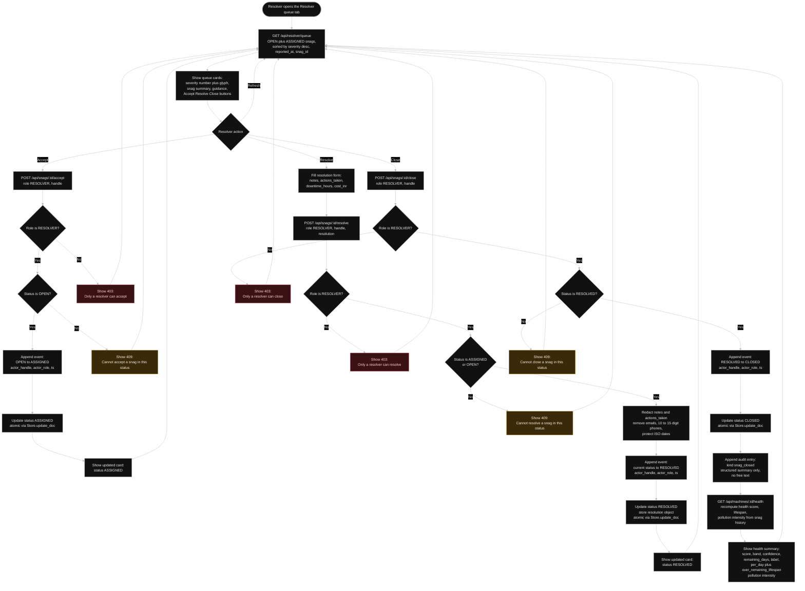

# TerraVow User Flow (As Built)

**Cross-links:**  
- [Product Features](./product-features.md) — detailed feature catalogue  
- [System Architecture](./system-architecture.md) — component map, data model, APIs

This document describes the **TerraVow prototype user flows as actually implemented** (Requirements 18–30), covering end-to-end journeys for Reporter and Resolver roles, the sustainability/analytics view, and the fallback experience when Gemini is not configured. Flows are illustrated with Mermaid diagrams and step-by-step narratives.

---

## Role Overview

The prototype supports two roles:

- **Reporter** — reports snags by selecting a machine model, registering an instance, and filling a dynamic form  
- **Resolver** — accepts, resolves, and closes snags from the queue

**Important:** There is **no authentication or authorisation**. The role is selected via a client-side radio toggle and is **workflow guidance only**, not a security control. Handles are pseudonyms (3–32 chars, alphanumeric/underscore/dash); no names, emails, or phone numbers are collected.

---

## Reporter Journey: Report a Snag

```mermaid
%%{init: {'theme':'base','themeVariables':{'background':'#000000','primaryColor':'#111111','primaryTextColor':'#f0f0f0','primaryBorderColor':'#999999','lineColor':'#bbbbbb','secondaryColor':'#111111','tertiaryColor':'#111111','clusterBkg':'#111111','clusterBorder':'#999999','edgeLabelBackground':'#000000','fontSize':'14px'}}}%%
flowchart TD
    Start(["Reporter opens the Report a snag tab"])
    Start --> SelectIndustry["Select industry from dropdown<br/>textile, metals, chemicals, mining"]
    SelectIndustry --> SearchCatalogue["Type manufacturer or model name<br/>in auto-complete combobox"]
    SearchCatalogue --> MatchFound{"Catalogue match found?"}
    
    MatchFound -->|Yes| LoadTemplate["POST /api/template/ensure<br/>with catalogue_id"]
    MatchFound -->|No| ShowNoMatch["Show No match and<br/>Add machine manually button"]
    
    ShowNoMatch --> UserAddsManual{"User clicks<br/>Add machine manually?"}
    UserAddsManual -->|Yes| ManualForm["Fill manufacturer and model<br/>validated against allowed characters,<br/>max 80 chars"]
    ManualForm --> PostManual["POST /api/catalogue/manual"]
    PostManual --> LookupSpecs{"Gemini configured?"}
    
    LookupSpecs -->|Yes| GeminiLookup["Gemini plus Google Search<br/>lookup specs, grounded call"]
    GeminiLookup --> SpecsResult{"Specs retrieved?"}
    SpecsResult -->|Yes| StoreGrounded["Store entry with specs<br/>specs_status grounded, sources URLs"]
    SpecsResult -->|No| StoreSample["Store entry with no specs<br/>specs_status sample, sources empty"]
    LookupSpecs -->|No| StoreSample
    
    StoreGrounded --> LoadTemplate
    StoreSample --> LoadTemplate
    
    LoadTemplate --> TemplateCheck{"Template cached?"}
    TemplateCheck -->|Yes, cache-hit| ShowTemplate["Show template card<br/>cache_status cache-hit<br/>source ai, generated_at, model_used"]
    TemplateCheck -->|No, cache miss| LeaderCheck{"This request<br/>is flight leader?"}
    
    LeaderCheck -->|Yes, leader| GeminiTemplate{"Gemini configured?"}
    GeminiTemplate -->|Yes| GenerateTemplate["Gemini generates template<br/>response schema, thinking config<br/>bounded retry 1 to 5 attempts"]
    GenerateTemplate --> ValidateTemplate["Validate schema, refs, IDs,<br/>severity levels, depth, domain coverage"]
    ValidateTemplate --> TemplateValid{"Valid?"}
    TemplateValid -->|Yes| CreateIfAbsent["Store.create_if_absent<br/>templates, model_key plus version"]
    CreateIfAbsent --> Created{"Created?"}
    Created -->|Yes| ShowTemplate2["Show template card<br/>cache_status generated<br/>source ai"]
    Created -->|No, another writer won| ShowTemplate3["Show stored doc<br/>cache_status cache-hit"]
    TemplateValid -->|No, after max retries| FallbackBase["Adapt industry Base_Template<br/>source fallback-base"]
    GeminiTemplate -->|No| FallbackBase
    
    LeaderCheck -->|No, waiter| WaitForLeader["Wait for leader<br/>up to FLIGHT_WAIT_S"]
    WaitForLeader --> LeaderDone{"Leader finished?"}
    LeaderDone -->|Yes| ShareOutcome["Share leader outcome<br/>cache-hit, generated, or fallback"]
    LeaderDone -->|No, timeout| ReReadStore["Re-read store once"]
    ReReadStore --> CacheHit{"Now cached?"}
    CacheHit -->|Yes| ShowTemplate
    CacheHit -->|No| FallbackBase
    
    FallbackBase --> ShowFallback["Show template card<br/>cache_status fallback<br/>source fallback-base<br/>user_message Generic template"]
    
    ShowTemplate --> SelectMachine["Select machine:<br/>fleet or registered instance"]
    ShowTemplate2 --> SelectMachine
    ShowTemplate3 --> SelectMachine
    ShareOutcome --> SelectMachine
    ShowFallback --> SelectMachine
    
    SelectMachine --> NewInstance{"Need new instance?"}
    NewInstance -->|Yes| InstForm["Fill tag plus optional install year"]
    InstForm --> PostInst["POST /api/instances"]
    PostInst --> InstCreated["Instance registered<br/>id INST-8hex"]
    InstCreated --> FillForm["Fill dynamic snag form:<br/>3 core plus template fields"]
    NewInstance -->|No| FillForm
    
    FillForm --> FormFields["Core: snag_type dropdown, severity 1 to 5,<br/>description text<br/>plus all template form_fields and pollutant_capture"]
    FormFields --> SubmitSnag["POST /api/snags<br/>validate all fields, redact free text"]
    SubmitSnag --> SubmitValid{"Valid?"}
    
    SubmitValid -->|Yes| SnagStored["Snag stored id SNG-12hex<br/>status OPEN, events reported"]
    SnagStored --> ShowGuidance["Show guidance card:<br/>snag_type_name, recommended_job<br/>checklist, immediate_action,<br/>time_to_fix_hours, safety_hazards"]
    ShowGuidance --> End(["Reporter journey complete"])
    
    SubmitValid -->|No, 422| ShowErrors["Show field-by-field errors<br/>nothing stored"]
    ShowErrors --> FillForm
    
    UserAddsManual -->|No| End2(["Reporter cancels"])

    style GeminiLookup fill:#0d2a4a,stroke:#5b9bd5,color:#eaf2ff
    style GenerateTemplate fill:#0d2a4a,stroke:#5b9bd5,color:#eaf2ff
    style FallbackBase fill:#3a2a0a,stroke:#c99a3b,color:#fff3e0
    style ShowFallback fill:#3a2a0a,stroke:#c99a3b,color:#fff3e0
```

### Step-by-Step Narrative

1. **Reporter opens the "Report a snag" tab** and sees a two-field form: industry dropdown and machine-model combobox.

2. **Select industry** — textile, metal smelting and fabrication, chemical manufacturing, or mining and aggregates.

3. **Search catalogue** — type a manufacturer or model name (e.g., "bru" for Brückner). The combobox shows up to 10 matching entries (case- and accent-insensitive, debounced). Each entry shows manufacturer, model, machine type, and a "Sample data" pill.

4. **Catalogue match found** → the entry is selected, and the system calls `POST /api/template/ensure` with the `catalogue_id`.

5. **Template cache check:**
   - **Cache hit** → the stored AI template is returned immediately (`cache_status: cache-hit`, `source: ai`, generated timestamp, model used).
   - **Cache miss, Gemini configured** → the request becomes the flight leader (or waits if another request is already leading):
     - **Leader** re-reads the store (another writer may have finished), then calls Gemini with `response_schema` (lax twin of strict Pydantic model), `thinking_config`, and HTTP timeout. Gemini drafts the template (machine profile, ≥6 job types, ≥12 snag types, ≥8 operating parameters, ≥8 form fields, pollutant-capture fields covering every industry domain).
     - The response is validated against 10 rules (schema compliance, referential integrity, ID pattern, severity-level completeness, dropdown-options bounds, text-field max-length bounds, minimum depth, domain coverage, 200 KB size cap). Fields are sanitized and truncated; any truncation is recorded but not treated as an error.
     - If valid, the template is stored via `Store.create_if_absent`; if another writer won, the loser discards its result and returns the stored doc as a cache-hit.
     - If invalid after max retries (1–5, default 3), the system falls back to the industry Base_Template (`source: fallback-base`).
   - **Cache miss, Gemini not configured** → the system immediately falls back to the industry Base_Template.
   - **Waiter** shares the leader's outcome (cache-hit, generated, or fallback); on timeout, re-reads the store once and either returns the cached doc or falls back.

6. **Template card displayed** showing:
   - Cache status and user message ("Loaded the saved template for this model" or "Generated now and saved for everyone using this model" or "AI generation is unavailable. This is a generic template for the industry, not generated for this model")
   - Source (ai or fallback-base), generated timestamp, model used, grounding sources (if specs were retrieved)
   - Collapsible sections: machine profile, operating parameters (≥8), job types (≥6), snag taxonomy (≥12)

7. **Select machine** — dropdown lists the six seeded fleet machines plus all registered instances for the selected model.

8. **New machine?** → If the Reporter needs to register a new instance, they click "New machine", fill the tag (shop-floor identifier) and optional install year, and submit. The system assigns a stable `INST-{8hex}` ID and stores the header in `snag_history/{machine_id}`. The instance is now available in the dropdown.

9. **Fill dynamic snag form:**
   - **3 core fields** — snag type (dropdown listing every snag type in the template plus "Other / not listed"), severity (dropdown 1 to 5, with severity-level definitions shown for the selected snag type), description (free text, required, "What did you observe?")
   - **All template form fields** — text or dropdown with 1–20 options, each with label, help text, required flag, and max-length or options list
   - **All pollutant-capture fields** — covering every industry domain (e.g., textile: air, water)
   - Notice: "Phone-like digit groups and email addresses are removed from free text before saving."

10. **Submit snag** → `POST /api/snags` validates every field, collects all errors (field-by-field `{field, reason}`), and rejects with 422 if any error. Free-text answers are **redacted** (emails and 10–15-digit phone numbers removed, ISO dates protected) before storage. If valid, the snag is stored (`SNG-{12hex}`, status `OPEN`, append-only events list, `template_source: "ai"` or `"base"`).

11. **Guidance card displayed** showing:
    - Snag type name, recommended job (ID, name, checklist), immediate action, time to fix (hours), safety hazards, escalation criteria
    - Label: "Template guidance (AI-generated or generic), for qualified-engineer review"
    - Source: `ai` (from stored AI template), `fallback-base` (from industry Base_Template), or `none` (no guidance available)

12. **Reporter journey complete** — the snag is now in the Resolver queue.

### Fallback Experience (Gemini Not Configured)

If Gemini is not configured (`GEMINI_API_KEY` absent or invalid), the Reporter experience is:

- **Manual entry specs lookup** → entry stored with `specs_status: "sample"`, no specs, no sources
- **Template generation** → immediate fallback to the industry Base_Template (`source: fallback-base`, cache_status: `fallback`, user_message: "AI generation is unavailable. This is a generic template for the industry, not generated for this model")
- **Snag submission** → validated against the Base_Template form schema, recorded `template_source: "base"`
- **Guidance** → resolved from the industry Base_Template (`guidance_source: "fallback-base"`)

**The flow never blocks:** every step has a deterministic fallback, and the Reporter can complete the journey without Gemini.

---

## Resolver Journey: Accept, Resolve, Close

### Step-by-Step Narrative

1. **Resolver opens the "Resolver queue" tab** and the system calls `GET /api/resolver/queue`, which returns all `OPEN` and `ASSIGNED` snags sorted by severity descending, reported timestamp, snag ID.

2. **Queue cards displayed** — each card shows:
   - Machine ID, tag, model
   - Snag type name (or "Other"), severity number (1–5) and glyph
   - Reported timestamp, reporter handle
   - **Guidance** (from stored AI template, Base_Template fallback, or "no template guidance available"):
     - Snag type name
     - Recommended job (ID, name, checklist)
     - Immediate action
     - Time to fix (hours)
     - Safety hazards
     - Escalation criteria
   - **Action buttons** (role-gated): Accept / Resolve (with inline form) / Close

3. **Accept** (OPEN → ASSIGNED):
   - Resolver clicks "Accept"
   - System calls `POST /api/snags/{id}/accept` with `role: RESOLVER` and handle
   - **Role check:** only a RESOLVER can accept (403 if Reporter)
   - **Status check:** snag must be OPEN (409 if already ASSIGNED, RESOLVED, or CLOSED)
   - Append event `{ts, from_status: OPEN, to_status: ASSIGNED, actor_handle, actor_role}` to the snag's events list
   - Update status to `ASSIGNED` atomically via `Store.update_doc`
   - Card updates to show status `ASSIGNED`

4. **Resolve** (ASSIGNED or OPEN → RESOLVED):
   - Resolver clicks "Resolve", fills inline form:
     - Notes (free text, redacted before storage)
     - Actions taken (free text, redacted)
     - Downtime hours (optional number)
     - Cost INR (optional number)
   - System calls `POST /api/snags/{id}/resolve` with `role: RESOLVER`, handle, and resolution object
   - **Role check:** only a RESOLVER can resolve (403 if Reporter)
   - **Status check:** snag must be ASSIGNED or OPEN (409 if already RESOLVED or CLOSED)
   - **Redact** notes and actions_taken (emails, 10–15-digit phones removed; ISO dates protected)
   - Append event `{ts, from_status, to_status: RESOLVED, actor_handle, actor_role}`
   - Store resolution object `{resolver_handle, resolved_at, notes, actions_taken, downtime_hours, cost_inr}`
   - Update status to `RESOLVED` atomically
   - Card updates to show status `RESOLVED`

5. **Close** (RESOLVED → CLOSED):
   - Resolver clicks "Close"
   - System calls `POST /api/snags/{id}/close` with `role: RESOLVER` and handle
   - **Role check:** only a RESOLVER can close (403 if Reporter)
   - **Status check:** snag must be RESOLVED (409 if still OPEN, ASSIGNED, or already CLOSED)
   - Append event `{ts, from_status: RESOLVED, to_status: CLOSED, actor_handle, actor_role}`
   - Update status to `CLOSED` atomically
   - **Append audit entry** `kind: snag_closed` with **structured summary only** (snag_id, machine_id, snag_type_id, severity, resolver_handle, closer_handle, downtime_hours, cost_inr) — never free-text notes or actions_taken
   - **Recompute health** by calling `GET /api/machines/{id}/health?as_of={today}`, which replays the snag history (including the just-closed snag) and computes:
     - Health score (6 penalty terms), band, confidence
     - Remaining lifespan (days, low/high band, basis, flags)
     - Pollution intensity per day (kg CO2e, NOx, COD, BOD, etc., per domain)
     - Pollution intensity over remaining lifespan
   - **Show health summary** in the close response:
     - Health: score, band, confidence
     - Lifespan: remaining_days, low_days, high_days, label ("Estimate, not a prediction of failure")
     - Pollution: per_day (value, unit, domain, factor_source, baseline_reference), over_remaining_lifespan (total kg over remaining days)
     - Labels: "estimate", "illustrative", "not-an-official-certification"
   - Snag removed from the queue (status no longer OPEN or ASSIGNED)

6. **Refresh** → reload the queue (same as step 1).

### Role Guard and Workflow Honesty

- The role check is **workflow guidance only**, not a security control (Req 25.2, 25.11)
- A Reporter who switches to Resolver in the UI can accept, resolve, and close snags
- The system records the actor_role in every event, but does not enforce authentication or authorization
- Handles are pseudonyms; no names, emails, or phone numbers are collected

---

## Machine Health View Journey

```mermaid
%%{init: {'theme':'base','themeVariables':{'background':'#000000','primaryColor':'#111111','primaryTextColor':'#f0f0f0','primaryBorderColor':'#999999','lineColor':'#bbbbbb','secondaryColor':'#111111','tertiaryColor':'#111111','clusterBkg':'#111111','clusterBorder':'#999999','edgeLabelBackground':'#000000','fontSize':'14px'}}}%%
flowchart TD
    Start(["User opens the Machine health tab"])
    Start --> SelectMachine["Select machine from dropdown:<br/>fleet plus registered instances"]
    SelectMachine --> LoadHealth["GET /api/machines/:id/health?as_of=today"]
    LoadHealth --> ReplayHistory["Replay snag history:<br/>read snag_history header for the machine<br/>plus query snags by machine_id"]
    ReplayHistory --> ReplayEvents["For each snag, replay append-only events<br/>up to as_of date:<br/>reported_on, resolved_on, unresolved_at_as_of"]
    ReplayEvents --> ComputeHealth["Compute health score:<br/>6 penalty terms - frequency, severity,<br/>recurrence, trend, unresolved, age"]
    ComputeHealth --> HealthScore["Score is 100 minus total_penalty<br/>Band: Good 80+, Fair 60+, Poor 40+, Critical under 40<br/>Confidence: low-history if under 3 snags in 365-day window"]
    HealthScore --> ComputeLifespan["Compute remaining lifespan:<br/>design_life times 365 minus age_days,<br/>scaled by health_score to the power 1.5,<br/>low and high band plus or minus 15 percent, flags"]
    ComputeLifespan --> ComputeIntensity["Compute pollution intensity per day:<br/>baseline times scale times domain_scale,<br/>uplifted as health falls,<br/>capped at 60 percent loss"]
    ComputeIntensity --> ComputeTotal["Compute pollution over remaining lifespan:<br/>per_day times remaining_days per domain"]
    ComputeTotal --> ComputeTimeline["Compute health timeline:<br/>12 points over past year,<br/>replay history at each date"]
    ComputeTimeline --> ShowHealth["Show health card:<br/>SVG gauge via createElementNS<br/>score, band, confidence, wear percent"]
    ShowHealth --> ShowLifespan["Show lifespan:<br/>remaining_days, low_days, high_days,<br/>basis, flags, label"]
    ShowLifespan --> ShowAge["Show age and age-factor penalty:<br/>age_years, age_factor_penalty,<br/>design_life_years"]
    ShowAge --> ShowFactors["Show How this is calculated factor table:<br/>frequency, severity, recurrence,<br/>trend, unresolved, age penalties"]
    ShowFactors --> ShowIntensity["Show pollution intensity per day:<br/>per domain: value, unit, domain,<br/>factor_source, baseline_reference"]
    ShowIntensity --> ShowTotal["Show pollution over remaining lifespan:<br/>per domain: total kg over remaining days"]
    ShowTotal --> ShowTimeline["Show timeline:<br/>SVG line chart via createElementNS<br/>plus accessible table"]
    ShowTimeline --> ShowMarkers["Show snag markers on timeline:<br/>date, severity, status"]
    ShowMarkers --> ShowLabels["Show labels:<br/>Illustrative estimate, not a measurement<br/>estimate, illustrative,<br/>not-an-official-certification"]
    ShowLabels --> End(["Health view complete"])
    
    style ComputeHealth fill:#0f2e18,stroke:#4caf7d,color:#e8f5e9
    style ComputeLifespan fill:#0f2e18,stroke:#4caf7d,color:#e8f5e9
    style ComputeIntensity fill:#0f2e18,stroke:#4caf7d,color:#e8f5e9
    style ComputeTotal fill:#0f2e18,stroke:#4caf7d,color:#e8f5e9
    style ComputeTimeline fill:#0f2e18,stroke:#4caf7d,color:#e8f5e9
```

### Step-by-Step Narrative

1. **User opens the "Machine health" tab** and selects a machine from the dropdown (fleet machines or registered instances).

2. **Load health** → `GET /api/machines/{id}/health?as_of={YYYY-MM-DD}` (default today UTC, bounded 1990-01-01 to today).

3. **Replay snag history:**
   - Read the `snag_history/{machine_id}` header (industry, model_key, install_year, tag)
   - Query all snags for the machine: `snags.query_eq("machine_id", machine_id)`
   - For each snag, replay the append-only events list up to the `as_of` date:
     - `reported_on` (from snag.reported_at)
     - `resolved_on` (from the first RESOLVED event's timestamp, if any)
     - `unresolved_at_as_of` (true if the last event's to_status is OPEN or ASSIGNED)

4. **Compute health score** (deterministic, never LLM):
   - **Frequency penalty** (≤15): 1.5 × count of snags in the 365-day window
   - **Severity penalty** (≤15): 1.0 × sum of (severity − 1) in the window
   - **Recurrence penalty** (≤15): 3.0 × sum of max(0, count − 1) per snag-type group (repeat failures of the same type)
   - **Trend penalty** (≤10): 1.0 × sum of max(0, severity − 2) for snags in the 90-day recent window
   - **Unresolved penalty** (≤25): 2.0 × sum of severity for currently-unresolved snags
   - **Age penalty** (≤15): 15 × min(1, age_days / (design_life × 365)) if install year is known
   - **Score = 100 − (frequency + severity + recurrence + trend + unresolved + age penalty)**
   - **Band:** Good (≥80), Fair (≥60), Poor (≥40), Critical (<40)
   - **Confidence:** `low-history` if <3 snags in the 365-day window, else `estimate`

5. **Compute remaining lifespan** (deterministic):
   - Formula: `remaining_days = (design_life × 365 − age_days) × (health_score / 100)^1.5`
   - If install year is unknown, basis is `design-life-only` and residual is capped at a configured minimum (180 days)
   - Low/high band: ±15% of remaining_days
   - Flags: `low-history`, `age-unknown`, `health-poor` (<40)
   - Label: "Estimate, not a prediction of failure"

6. **Compute pollution intensity per day** (deterministic):
   - For each domain (air, water, chemical, soil) active in the machine's industry:
     - `degradation_factor = k_domain × (1 − health_score / 100)`, capped at 0.60
     - `intensity_per_day = baseline × scale × domain_scale × (1 + degradation_factor)`
   - Fleet machines inherit a per-machine fuel-based air baseline when available; otherwise use industry default baseline
   - Indicators: kg CO2e, kg NOx, kg COD, kg BOD, m3 effluent, kg hazardous-chemical release, kg solid waste, soil-contamination index points
   - Out-of-domain indicators are omitted (e.g., textile machine does not report soil contamination)

7. **Compute pollution over remaining lifespan** (deterministic):
   - For each domain: `total_kg = intensity_per_day × remaining_days`

8. **Compute health timeline** (deterministic):
   - 12 points over the past year (one per month) plus the current date
   - At each point, replay the snag history (filter events up to that date) and recompute health score, per-day intensity, and over-remaining-lifespan pollution

9. **Show health card:**
   - **SVG gauge** (via `createElementNS`, not `innerHTML`) with score (0–100), band label, confidence
   - **Wear %** (100 − score)
   - **Age** (years, if install year known) and age-factor penalty
   - **Design life** (years)
   - **"How this is calculated" factor table** showing each penalty term's contribution

10. **Show lifespan:**
    - **Remaining days** (central estimate), low_days, high_days (±15% band)
    - **Basis** (`design-life-only`, `health-based-with-age`, `health-based-no-age`)
    - **Flags** (`low-history`, `age-unknown`, `health-poor`)
    - **Label** "Estimate, not a prediction of failure"

11. **Show pollution intensity:**
    - **Per day** — for each domain, show value (rounded to 2 decimals), unit, domain, factor_source ("illustrative assumption" or "fleet machine fuel model (from snag history)"), baseline_reference
    - **Over remaining lifespan** — for each domain, show total kg (rounded)
    - **Label** "Illustrative estimate, not a measurement"
    - **Air source** "fleet machine fuel model (from snag history)" or "industry baseline × scale"

12. **Show timeline:**
    - **SVG line chart** (via `createElementNS`) with 12 points, showing health score over the past year
    - **Accessible table** with date, health score, per-day intensity, over-lifespan pollution for each point
    - **Snag markers** on the chart (date, severity, status)

13. **Show labels:**
    - "estimate", "illustrative", "not-an-official-certification"
    - "Illustrative estimate, not a measurement"
    - "How this is calculated" (assumptions table)

14. **Health view complete** — the user can switch to another machine or tab.

---

## Sustainability View Journey

```mermaid
%%{init: {'theme':'base','themeVariables':{'background':'#000000','primaryColor':'#111111','primaryTextColor':'#f0f0f0','primaryBorderColor':'#999999','lineColor':'#bbbbbb','secondaryColor':'#111111','tertiaryColor':'#111111','clusterBkg':'#111111','clusterBorder':'#999999','edgeLabelBackground':'#000000','fontSize':'14px'}}}%%
flowchart TD
    Start(["User opens the Sustainability tab"])
    Start --> SelectMachine["Select machine from dropdown"]
    SelectMachine --> SelectSize["Select enterprise size:<br/>MSME or Large radio toggle"]
    SelectSize --> ClickAnalyse["Click Analyse alternatives button"]
    ClickAnalyse --> LoadHealth["Load machine health:<br/>GET /api/machines/:id/health<br/>current health score, band, per-day intensity"]
    LoadHealth --> PostRecommend["POST /api/machines/:id/recommendations<br/>enterprise_size, country IN"]
    PostRecommend --> LoadCurrent["Show Current usage card:<br/>health score, band, confidence,<br/>per_day intensity per domain"]
    LoadCurrent --> CheckCountry{"Country supported?"}
    
    CheckCountry -->|No| ShowNoCountry["Show No data for this country<br/>curated items, empty schemes"]
    CheckCountry -->|Yes, IN| LoadAlternatives{"AI alternatives cached?"}
    
    LoadAlternatives -->|Yes, cache-hit| ShowAI["Load cached AI alternatives<br/>from alternatives collection"]
    LoadAlternatives -->|No, cache miss| GeminiConfig{"Gemini configured?"}
    
    GeminiConfig -->|Yes| GeminiSuggest["Gemini plus Google Search<br/>suggest alternatives, grounded call<br/>JSON-in-text, Pydantic, one retry"]
    GeminiSuggest --> ValidCandidates{"Any valid<br/>candidates?"}
    ValidCandidates -->|Yes| ComputeParams["Compute midpoint of each<br/>low-high parameter range"]
    ComputeParams --> ValidateParams["Validate bounds, finiteness,<br/>zero-reduction rule"]
    ValidateParams --> AnyCandValid{"Any candidate<br/>valid?"}
    AnyCandValid -->|Yes| StoreCached["Store via cache_once:<br/>create_if_absent,<br/>alternatives collection"]
    StoreCached --> ShowAI
    AnyCandValid -->|No| ShowCurated["Load curated alternatives:<br/>5 items per industry<br/>2 machine, 2 operating, 1 assembly"]
    
    ValidCandidates -->|No| ShowCurated
    GeminiConfig -->|No| ShowCurated
    
    ShowAI --> ProcessAI["Process AI candidates:<br/>for each kind machine_alternative or process_change,<br/>take first 3 valid"]
    ProcessAI --> ComputeEconomics["Compute economics via engine:<br/>avoided_annual emissions and energy,<br/>adjusted_capex, cash_benefit_per_year,<br/>benefit_with_exposure_per_year,<br/>payback_horizon 25y,<br/>payback_status"]
    ComputeEconomics --> GateEval["Pass through Decision Gate:<br/>gate.evaluate deltas_kg, conf, trust<br/>hard veto first: mass or cross-media increase gives BLOCK<br/>then confidence classification ALLOW ASK BLOCK"]
    GateEval --> AIBackfill{"All AI items of<br/>this kind BLOCK<br/>or invalid?"}
    AIBackfill -->|Yes| BackfillCurated["Backfill with curated items<br/>of this kind, up to 3 per kind<br/>source mixed"]
    AIBackfill -->|No| SourceAI["source ai-suggested"]
    
    BackfillCurated --> ShowItems["Show items grouped by kind:<br/>machine alternatives<br/>vs operating-process changes<br/>vs assembly-stage changes"]
    SourceAI --> ShowItems
    ShowCurated --> ProcessCurated["Process curated items:<br/>up to 3 per kind"]
    ProcessCurated --> ComputeEconomics
    
    ShowItems --> ItemCard["For each item show:<br/>name, rationale, assumptions,<br/>source badge, grounding URLs if AI"]
    ItemCard --> ShowParams["Show input parameters:<br/>capex_pct, efficiency_gain_pct,<br/>production_uplift_pct, extra_opex_pct,<br/>reduction_pct per domain<br/>label AI-estimated midpoint or illustrative"]
    ShowParams --> ShowEcon["Show economics:<br/>avoided_annual per domain,<br/>adjusted_capex INR,<br/>cash_benefit_per_year INR,<br/>benefit_with_exposure_per_year INR,<br/>payback_horizon_years 25"]
    ShowEcon --> ShowPayback["Show paybacks:<br/>cash: years, status within or beyond or no-payback<br/>exposure plus cash: years, status"]
    ShowPayback --> ShowGateBadge["Show Decision Gate badge:<br/>ALLOW Allowed by the safety check<br/>ASK Needs confirmation<br/>BLOCK Blocked by the safety check"]
    ShowGateBadge --> ShowLabels1["Show labels:<br/>AI-suggested requires vendor validation<br/>or curated illustrative alternative<br/>estimate, illustrative assumption"]
    
    ShowLabels1 --> LoadIncentives["Load incentives:<br/>GET /api/incentives with country IN,<br/>industry and enterprise_size filters"]
    LoadIncentives --> FilterSchemes["Filter schemes by:<br/>country, industry, enterprise_size,<br/>applies_to machine_alternative or process_change"]
    FilterSchemes --> ShowSchemes["Show schemes list:<br/>name, authority, benefit_type,<br/>benefit_description, eligibility_notes"]
    ShowSchemes --> ShowParams2["Show params if quantifiable:<br/>subsidy_rate_pct, cap_inr<br/>or qualitative only"]
    ShowParams2 --> ShowRetrieval["Show retrieval label:<br/>Retrieved on date or<br/>Not retrieved from the source;<br/>authored for the demo on date"]
    ShowRetrieval --> ShowStatus["Show status tag:<br/>UNVERIFIED illustrative or ILLUSTRATIVE"]
    ShowStatus --> ShowNameNote["Show name note:<br/>Scheme names and descriptions<br/>are for illustrative purposes"]
    
    ShowNameNote --> ApplyIncentive["Apply largest incentive<br/>to each item per size:<br/>adjusted_capex at most unadjusted<br/>adjusted_paybacks"]
    ApplyIncentive --> SizeToggle["Enterprise size toggle:<br/>client-side recompute<br/>adjusted values for MSME or Large"]
    SizeToggle --> ShowDisclaimer["Show disclaimer:<br/>Informational estimate, not a quotation,<br/>engineering design, tax or legal advice;<br/>confirm eligibility with<br/>the issuing authority"]
    ShowDisclaimer --> End(["Sustainability view complete"])
    
    ShowNoCountry --> End
    
    style GeminiSuggest fill:#0d2a4a,stroke:#5b9bd5,color:#eaf2ff
    style ShowCurated fill:#3a2a0a,stroke:#c99a3b,color:#fff3e0
    style BackfillCurated fill:#3a2a0a,stroke:#c99a3b,color:#fff3e0
    style ComputeEconomics fill:#0f2e18,stroke:#4caf7d,color:#e8f5e9
    style GateEval fill:#3a2a0a,stroke:#c99a3b,color:#fff3e0
```

### Step-by-Step Narrative

1. **User opens the "Sustainability" tab** and selects a machine from the dropdown (fleet machines or registered instances).

2. **Select enterprise size** — MSME (small) or Large (radio toggle).

3. **Click "Analyse alternatives"** → the system calls `POST /api/machines/{id}/recommendations` with `enterprise_size` and `country: IN` (default, validated `^[A-Z]{2}$`).

4. **Load current usage:**
   - Calls `GET /api/machines/{id}/health` to get the current health score, band, confidence, and per-day pollution intensity
   - Shows **"Current usage" card** with health score, band, confidence, domains, and per-day intensity (value, unit, domain, factor_source)

5. **Check country support:**
   - If `country` is not `IN`, show "No data for this country", return curated items with empty schemes, and skip Gemini call
   - Otherwise proceed

6. **Load alternatives:**
   - **AI alternatives cached?** → check `alternatives` collection for `{model_key}--IN--s1`
     - **Cache hit** → load cached AI candidates
     - **Cache miss, Gemini configured** → call Gemini with Google Search tool (grounded):
       - Prompt includes machine identity (industry, manufacturer, model, machine_type), pollution domains, country
       - Gemini returns JSON-in-text with `AlternativesProposal` (Pydantic), names/rationale/input parameter ranges (low–high pairs)
       - System computes **midpoint** of each range: `(low + high) / 2`
       - Validates bounds (0–300% capex, 0–60% efficiency, 0–30% production/opex, −100% to +100% reduction), finiteness, `low <= high`
       - Drops invalid candidates (out of bounds, non-finite, `low > high`, no in-domain reduction > 0)
       - If any valid candidate, store via `cache_once.ensure_once` → `create_if_absent` → cached for everyone
       - If no valid candidates or Gemini fails, fall back to curated
     - **Cache miss, Gemini not configured** → immediate fallback to curated
   - **Curated alternatives:** 5 items per industry (2 machine, 2 operating, 1 assembly) from `data/curated_alternatives.json`, each with illustrative input parameters

7. **Process candidates** (AI or curated):
   - For each kind (`machine_alternative`, `process_change`), take the first 3 valid candidates
   - **Compute economics** via deterministic engine (`engine.candidate_economics`):
     - `avoided_annual` emissions/energy per domain (from reduction_pct and current per-day intensity)
     - `adjusted_capex_inr` = replacement_value × capex_pct / 100
     - `cash_benefit_per_year_inr` = energy_savings − extra_opex
     - `benefit_with_exposure_per_year_inr` = cash + avoided environmental-compensation exposure (priced at illustrative rates: ₹1500/t CO2e, ₹40/kg NOx, plus water/chemical/soil proxies)
     - `payback_horizon_years` = 25
     - `payback_cash_status`, `payback_with_exposure_status` = `within-design-life` (<25y), `beyond-design-life` (≥25y), `no-payback` (negative benefit)—**never capped**
   - **Pass through Decision Gate** (`gate.evaluate`):
     - Compute deltas_kg per domain (avoided_annual, negative = reduction)
     - Hard veto first: any increase in total emission mass or cross-media load → `verdict: BLOCK`, attach supporting readings
     - Then confidence classification: ALLOW if conf ≥ allow threshold (0.80), ASK if ≥ ask threshold (0.60), BLOCK otherwise
     - AI candidates: confidence 0.55, trust 0.7 → verdict ASK (requires confirmation)
     - Curated items: confidence 0.70, trust 1.0 → verdict ASK (requires confirmation)
     - **No item reaches ALLOW** in the demo (tuned for human review)
   - **Backfill rule:** if all AI candidates of a kind are BLOCK or invalid, append curated items of that kind (≤3); source becomes `"mixed"`

8. **Show items** grouped by kind:
   - **Machine alternatives** section
   - **Operating-process changes** section
   - **Assembly-stage changes** section (if any)

9. **For each item show:**
   - **Name**, rationale, assumptions
   - **Source badge** — "AI-suggested, requires vendor validation and process-safety review" or "Curated illustrative alternative"
   - **Grounding URLs** (if AI) or "(no web sources retrieved)" pill
   - **Input parameters** (capex_pct, efficiency_gain_pct, production_uplift_pct, extra_opex_pct, reduction_pct per domain) with label "AI-estimated input parameter (midpoint of range)" or "illustrative assumption"
   - **Economics:**
     - Avoided annual emissions/energy per domain (kg/year)
     - Adjusted capex (INR)
     - Cash benefit per year (INR)
     - Benefit with exposure per year (INR)
     - Payback horizon (25 years)
   - **Paybacks:**
     - Cash payback: years, status (`within-design-life`, `beyond-design-life`, `no-payback`)
     - Exposure+cash payback: years, status
   - **Decision Gate badge:**
     - ✓ ALLOW "Allowed by the safety check" (green)
     - ? ASK "Needs confirmation" (blue)
     - ✕ BLOCK "Blocked by the safety check" (red)
   - **Actionable flag** (false if BLOCK)
   - **Labels:** "estimate", "illustrative", "not-an-official-certification"

10. **Load incentives:**
    - Calls `GET /api/incentives?country=IN&industry={id}&enterprise_size={size}`
    - Filters schemes by country, industry, enterprise_size, applies_to (machine_alternative or process_change)
    - Returns up to 9 schemes (7 real-named + 2 demo-synthetic for the selected size)

11. **Show schemes list:**
    - **Name**, authority
    - **Benefit type** (CAPITAL_SUBSIDY, ACCELERATED_DEPRECIATION, TRADEABLE_CERTIFICATE, CONCESSIONAL_FINANCE, RECOGNITION)
    - **Benefit description** (text only, ≤600 chars)
    - **Eligibility notes** (text only, ≤600 chars)
    - **Params** (quantifiable: subsidy_rate_pct, cap_inr; or qualitative: `params: null`)
    - **Retrieval label:**
      - "Retrieved on {date}" if `retrieved_on` is present
      - "Not retrieved from the source; authored for the demo on {date}" otherwise
    - **Status tag:** UNVERIFIED/illustrative or ILLUSTRATIVE
    - **Source URL** (landing page only, e.g., pib.gov.in, jalshakti-dowr.gov.in) or null
    - **Name note:** "Scheme names and descriptions are for illustrative purposes; confirm the current scheme terms and eligibility with the issuing authority."

12. **Apply largest incentive** to each item per enterprise size:
    - For MSME, filter schemes where `enterprise_sizes` includes `MSME` and `applies_to` matches the item kind
    - For Large, filter schemes where `enterprise_sizes` includes `LARGE` and `applies_to` matches the item kind
    - Apply the single largest scheme (by subsidy reduction): `adjusted_capex = capex × (1 − subsidy_rate / 100)`, capped at scheme cap
    - Recompute adjusted paybacks from adjusted_capex (adjusted ≤ unadjusted)
    - Show `by_size: {MSME: {...}, LARGE: {...}}` with adjusted values and `scheme_applied` name

13. **Enterprise size toggle** (client-side):
    - User switches between MSME / Large radio buttons
    - UI recomputes adjusted values for the selected size on the fly (no API call)
    - Shows "uses illustrative demo values" tag if the scheme is `demo-synthetic` or UNVERIFIED

14. **Show disclaimer:**
    - "Informational estimate, not a quotation, engineering design, tax or legal advice; confirm eligibility with the issuing authority."

15. **Sustainability view complete** — the user can switch machines, sizes, or tabs.

### Fallback Experience (Gemini Not Configured)

If Gemini is not configured, the Sustainability view shows:

- **Alternatives:** curated illustrative set only (`source: "curated-fallback"`, message: "AI suggestions unavailable; showing curated illustrative alternatives")
- **Incentives:** seeded qualitative schemes only (7 real-named + 2 demo-synthetic)
- **Economics and Decision Gate:** computed deterministically from curated parameters, same as AI path
- **Cache status:** `not-requested` (never attempted to cache AI alternatives)

**The flow never blocks:** the user sees curated items with deterministic economics and gate verdicts, and can still explore incentives and paybacks.

---

## Template Ensure Cache Sequence (Detailed)

This sequence diagram shows the cache-once template-ensure path in detail, illustrating the three layers (double-checked read, single-flight, create-if-absent):

```mermaid
%%{init: {'theme':'base','themeVariables':{'background':'#000000','primaryColor':'#111111','primaryTextColor':'#f0f0f0','primaryBorderColor':'#999999','lineColor':'#bbbbbb','actorBkg':'#111111','actorTextColor':'#f0f0f0','actorBorder':'#999999','signalColor':'#bbbbbb','signalTextColor':'#f0f0f0','noteBkgColor':'#222222','noteTextColor':'#f0f0f0','noteBorderColor':'#999999','sequenceNumberColor':'#000000','labelBoxBkgColor':'#111111','labelTextColor':'#f0f0f0'}}}%%
sequenceDiagram
    participant Reporter as Reporter (Browser)
    participant API as POST /api/template/ensure
    participant EnsureOnce as cache_once.ensure_once
    participant Store as Store (memory or Firestore)
    participant Flight as Flight (in-process Event)
    participant Gemini as Gemini 2.5 Flash
    
    Reporter->>API: POST /api/template/ensure<br/>{catalogue_id}
    API->>EnsureOnce: ensure_once(store, "templates", doc_id,<br/>profile=TEMPLATE, generate=_generator, fallback=_fallback_doc, is_hit=is_hit)
    
    Note over EnsureOnce,Store: First read (1)
    EnsureOnce->>Store: get_doc("templates", doc_id)
    Store-->>EnsureOnce: doc or None
    
    alt doc exists and is_hit(doc)
        EnsureOnce-->>API: EnsureOutcome(doc, "cache-hit")
        API-->>Reporter: {template, cache_status: "cache-hit",<br/>source: "ai", generated_at, model_used}
    else doc absent or not a hit (schema version changed)
        Note over EnsureOnce,Flight: Flight lookup (2)
        EnsureOnce->>Flight: _join_or_create(key)
        
        alt this request becomes leader
            Note over EnsureOnce,Store: Leader re-reads (3)
            EnsureOnce->>Store: get_doc("templates", doc_id)
            Store-->>EnsureOnce: doc or None
            
            alt doc now exists and is_hit(doc)
                Flight->>Flight: finish(EnsureOutcome(doc, "cache-hit"))
                EnsureOnce-->>API: EnsureOutcome(doc, "cache-hit")
                API-->>Reporter: {template, cache_status: "cache-hit"}
            else still absent
                Note over EnsureOnce,Gemini: Generate (the only Gemini call site)
                EnsureOnce->>Gemini: generate_template(prompt_data,<br/>timeout_s=TEMPLATE_ATTEMPT_TIMEOUT_S,<br/>hint=None)
                Gemini-->>EnsureOnce: text (structured output), meta
                
                EnsureOnce->>EnsureOnce: validate_template(text, industry)<br/>10 rules: schema, refs, IDs, severity,<br/>depth, domain coverage, 200KB cap
                
                alt valid after ≤ max_attempts
                    EnsureOnce->>Store: create_if_absent("templates", doc_id, doc)
                    Store-->>EnsureOnce: (created, stored)
                    
                    alt created = true (this request won)
                        Flight->>Flight: finish(EnsureOutcome(stored, "generated"))
                        EnsureOnce-->>API: EnsureOutcome(stored, "generated")
                        API-->>Reporter: {template, cache_status: "generated",<br/>source: "ai", generated_at, model_used}
                    else created = false (another writer won)
                        alt stored and is_hit(stored)
                            Flight->>Flight: finish(EnsureOutcome(stored, "cache-hit"))
                            EnsureOnce-->>API: EnsureOutcome(stored, "cache-hit")
                            API-->>Reporter: {template, cache_status: "cache-hit"}
                        else stored but not a hit (version changed)
                            Flight->>Flight: finish(EnsureOutcome(doc, "generated-unsaved"))
                            EnsureOnce-->>API: EnsureOutcome(doc, "generated-unsaved")
                            API-->>Reporter: {template, cache_status: "generated-unsaved",<br/>user_message: "Generated now but<br/>could not be saved"}
                        end
                    end
                else invalid after max_attempts or Gemini not configured
                    Note over EnsureOnce: Fallback (never stored)
                    EnsureOnce->>EnsureOnce: _fallback_doc(entry)<br/>adapt industry Base_Template
                    Flight->>Flight: finish(EnsureOutcome(fallback_doc, "fallback"))
                    EnsureOnce-->>API: EnsureOutcome(fallback_doc, "fallback")
                    API-->>Reporter: {template, cache_status: "fallback",<br/>source: "fallback-base",<br/>user_message: "AI generation is unavailable.<br/>This is a generic template"}
                end
            end
        else this request is a waiter
            Note over Flight: Wait for leader (up to FLIGHT_WAIT_S)
            Flight->>Flight: event.wait(FLIGHT_WAIT_S)
            
            alt leader finished in time
                Flight-->>EnsureOnce: flight.outcome
                EnsureOnce-->>API: flight.outcome
                API-->>Reporter: {template, cache_status: outcome.cache_status}
            else timeout
                Note over EnsureOnce,Store: Timeout: re-read once
                EnsureOnce->>Store: get_doc("templates", doc_id)
                Store-->>EnsureOnce: doc or None
                
                alt doc now exists and is_hit(doc)
                    EnsureOnce-->>API: EnsureOutcome(doc, "cache-hit")
                    API-->>Reporter: {template, cache_status: "cache-hit"}
                else still absent
                    Note over EnsureOnce: Never starts a second Gemini call
                    EnsureOnce->>EnsureOnce: _fallback_doc(entry)
                    EnsureOnce-->>API: EnsureOutcome(fallback_doc, "fallback")
                    API-->>Reporter: {template, cache_status: "fallback"}
                end
            end
        end
    end
```

---

**See also:**

- [Product Features](./product-features.md) — detailed feature catalogue  
- [System Architecture](./system-architecture.md) — component map, data model, APIs, cache-once design
